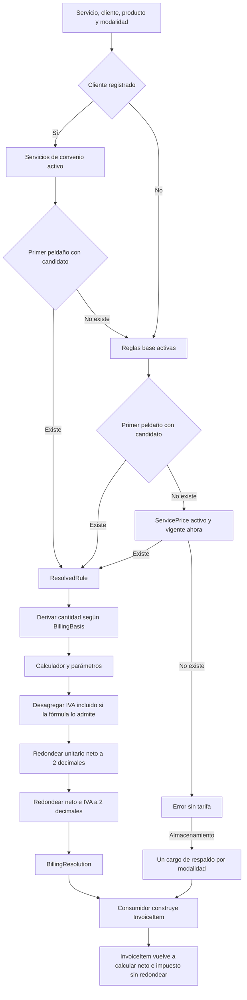
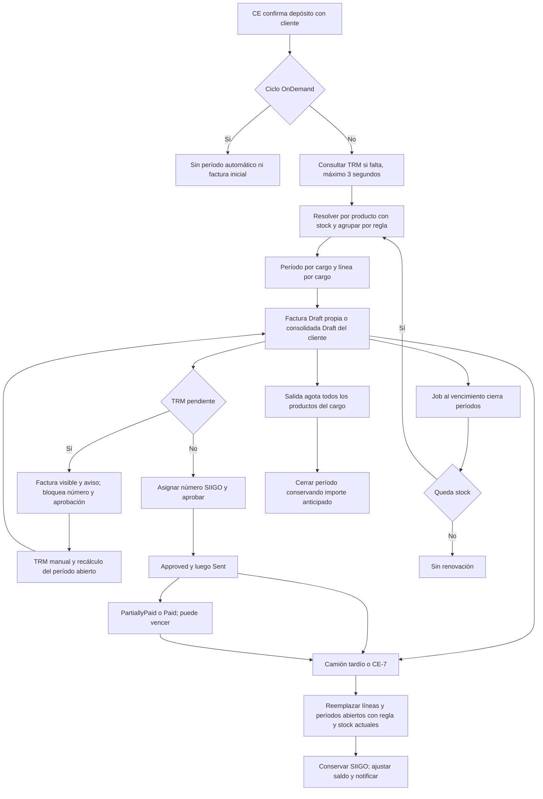

# Análisis del motor de acuerdos y facturación de Bodegas Asociadas

Fecha: 17 de septiembre de 2026. Alcance: diagnóstico, sin implementación.

## 1. Veredicto

**Adecuado con ajustes.** El modelo convenio → servicio → producto/modalidad y los calculadores especializados cubren las formas de cobro demostradas, con la ampliación de unidad de carga ya decidida.
No hay evidencia para sustituirlo por un motor genérico ni para reescribirlo.
El problema principal es que resolución, cobro operativo, agrupación y corrección no obedecen siempre al mismo contrato.
Hay defectos reproducibles por lectura: sobrescritura que multiplica un total como unitario, selección de otra modalidad y guías con rutas de precio diferentes.
La consolidación diaria descrita por el negocio no existe como tal en el job actual.
Faltan una evidencia inmutable del cálculo y protección transaccional contra ejecuciones concurrentes.
Recomiendo reabrir el recálculo de documentos vinculados a SIIGO y la compatibilidad de la sustitución de fórmulas en Ola 2.
Conservaría los convenios y documentos existentes; corregiría incrementalmente sus puntos de consumo y añadiría trazabilidad desde una fecha de corte.
La aprobación operativa del motor debe depender de trazas completas, no solo de pruebas de calculadores aislados.

### Base de evidencia y límites

- `API` = `/Volumes/Dock/Projects/bodegas_asociadas/code_workspace/Backend/wms-api`.
- `WEB` = `/Volumes/Dock/Projects/bodegas_asociadas/code_workspace/Frontend/wms`.
- `WS` = `/Volumes/Dock/Projects/bodegas_asociadas/code_workspace`; `RAÍZ` = `/Volumes/Dock/Projects/bodegas_asociadas`.
- **Código backend de referencia: `develop@f411ca8`**. La revisión empezó en `546bae9`; durante ella se incorporó WMS-33. Se revisó su diferencia y se incluyó. Las líneas API citadas corresponden a `f411ca8`, recuperable con `git show f411ca8:ruta`.
- **Frontend de referencia: `develop@17748da`**, con WMS-14 y WMS-5. Los cambios de WMS-33 que estaban apareciendo en el directorio de trabajo no se consideran entrega terminada. Las referencias WEB corresponden a los componentes examinados en esa base, no a una certificación del trabajo simultáneo.
- **Hoy** significa comportamiento de esas referencias; no se inspeccionó la BD de producción, convenios efectivamente cargados ni documentos fiscales reales. **Decidido** identifica reglas aprobadas; **Ola 2 en curso** separa WMS-18/WMS-30 pendientes y el frontend de WMS-33.
- Se leyeron los tres Word completos mediante su contenido OOXML, incluidos párrafos de tablas. La SRS suministrada contiene introducción, alcance y usuarios; no contiene el catálogo tarifario detallado que podría sugerir su título. No se atribuyen a ella cifras inexistentes.
- Los resultados numéricos son **trazas estáticas del código**, con aritmética decimal contrastada en memoria. No equivalen a una ejecución E2E con PostgreSQL/SIIGO. Se ejecutaron las pruebas existentes indicadas en §5, sin crear pruebas ni modificar los repositorios.
- Las referencias abreviadas a continuación son parte del sistema de citas del informe: cada una indica el documento y su sección. Los párrafos Word se identifican además por contenido para evitar depender de paginación.

| Clave | Fuente de negocio o decisión |
| --- | --- |
| SRS | `RAÍZ/documentos/Especificación de requerimientos.docx`, «Introducción», «Alcance» y «Usuarios del sistema». |
| LEV | `RAÍZ/documentos/Resumen levantamiento.docx`, §1 Importaciones, párrafos «Vigilancia y Bascula» y «Facturación»; §2 Exportaciones; §3 Otros servicios. |
| NEG | `RAÍZ/documentos/Contexto proyecto bodegas.docx`, «Flujo de importación (Salida mercancía)»; «Flujo de exportación»; «Arquitectura del Sistema de Facturación», §1 Acuerdos del Cliente, §2 Flujo de Facturación, §3 Componentes y §4 Lógica de Salida. |
| DIA | `RAÍZ/diagramas/facturacion_v1.mmd`, alternativas convenio/estándar, crédito/contado y consolidar/individual. |
| CTX | `WS/docs/contexto-negocio-wms-para-ia.md`, completo; especialmente §5.8, §7.1–§7.11, §12–§14. Corte histórico 14-sep. |
| O1 | `WS/ajustes/plan-cerrado-ola-1-2026-09-14.md`, §2 D01–D24. |
| O2 | `WS/ajustes/plan_implementacion_ola2.md`, §2 D01–D35, §4 WMS-18/WMS-30/WMS-33, §5 y §6. |

Cuando NEG describe facturar al cierre o el montacargas periódico, y CTX/O1 establecen cobro anticipado y operativo, se conserva la decisión posterior y se explicita la diferencia. Una decisión vigente cuestionable se lleva a §6; no se etiqueta como defecto de implementación.

## 2. Cómo funciona hoy

### Resolución y cálculo

Evidencia: `API/Wms.Application/Billing/Services/BillingResolver.cs:22`, `:74`, `:152`, `:233`, `:305`; `API/Wms.Application/Billing/Common/Services/StorageBillingService.cs:106`, `:201`; `API/Wms.Domain/Entities/Billing/InvoiceItem.cs:86`.

La escalera real es: producto+modalidad → producto+modalidad nula → producto con **cualquier** modalidad → producto nulo+modalidad → ambos nulos → producto nulo con **cualquier** modalidad. Dentro del peldaño gana `CreatedAt` descendente. No hay segundo criterio para fechas idénticas. Un convenio genérico precede a una tarifa base específica porque el nivel prima sobre la especificidad. Eso es coherente con CTX §7.3; el cruce hacia otra modalidad es el problema MAF-02.

El diagrama describe el resolver, **no todos los cobros**. Almacenamiento sí lo usa. Báscula lo usa para obtener/validar precio, pero factura el total enviado por el operario. Montacargas resuelve convenio o `ForkliftRate`, y el IVA se decide al cerrar. La guía de importación multicliente consulta `rate` directamente; la automática de exportación no crea factura. El TODO de `ProcessStoragePaymentHandler` no demuestra ausencia del resolver: ya lo usa indirectamente mediante `WeighbridgeService` (`API/Wms.Application/Weighbridge/Commands/Storage/ProcessPayment/ProcessStoragePaymentHandler.cs:143`; `API/Wms.Application/Weighbridge/Common/Services/WeighbridgeService.cs:77`).

### Vida de una factura de almacenamiento

**Hoy con WMS-33 backend:** primer período desde `EntryDate`; renovación desde `min(fin anterior, ahora)`; camión tardío sin período abre desde ahora. No hay prorrateo por días por corregir la fecha. `Weekly=7 días`, `Biweekly=14 días`, `Monthly=AddMonths(1)`. Fuentes: `API/Wms.Application/ForeignTrade/Commands/ConfirmStorageDeposit/ConfirmStorageDepositHandler.cs:57`; `API/Wms.Application/Billing/Common/Services/StoragePeriodStart.cs:8`; `API/Wms.Application/Billing/Common/Services/StorageBillingService.cs:309`, `:332`, `:377`, `:443`, `:796`; `API/Wms.Application/Billing/Jobs/BillingJobService.cs:230`.

El diagrama no representa una obligación de transitar por todos los estados: el dominio permite `Draft → Approved`; `PendingApproval` también se acepta al aprobar. Los cobros inmediatos pueden pasar directamente a `Paid` al registrar dinero. `Cancelled` no se recalcula. `InvoiceNumber` único no prueba validación fiscal en DIAN: es un dato digitado, sin estado fiscal externo ni CUFE en `Invoice`. Fuentes: `API/Wms.Domain/Entities/Billing/Invoice.cs:24`, `:251`, `:288`, `:350`, `:428`; `API/Wms.Application/Billing/Commands/AssignInvoiceNumber/AssignInvoiceNumberHandler.cs:22`.

### Cinco fuentes de precio y una configuración de impuestos

| Entidad | Justificación y límites hoy | Veredicto |
| --- | --- | --- |
| `AgreementService` + parámetros | Precio contractual por cliente, servicio y ámbito. Prioridad máxima. No tiene versión efectiva ni moneda de tarifa. | Conservar; es el núcleo contractual. |
| `ServicePricingRule` + parámetros | Misma expresividad sin cliente: estándar de almacenamiento por producto/modalidad. Comparte normalización con convenio. | Conservar; reutilizar validación y contrato de cálculo. |
| `ServicePrice` | Precio simple con `ValidFrom/ValidTo`; nivel 3 por cantidad, no cargo fijo por depósito. La UI lo administra para servicios distintos de almacenamiento/montacargas. | Conservar por compatibilidad. Solapa con una regla genérica `PER_UOM` en algunos casos, pero `FIXED` no es equivalente cuando cantidad > 1. |
| `ServiceMinimumValue` | Un respaldo por modalidad para grupos que fallan o carecen de tarifa. No es un piso aplicado a toda fórmula válida. | Conservar y nombrar explícitamente su función; acordar tratamiento de IVA. |
| `ForkliftRate` | Matriz sencilla por vehículo; la UI de montacargas dirige al catálogo específico. El horómetro no multiplica el importe. | Justificada para el operario. No migrarla solo para reducir tablas; encapsular su selección. |
| `ServiceTax` | Impuesto agregado del servicio; no es fuente de precio. Montacargas rechaza su asignación por O1-D22. | Conservar separación. |

Evidencia: `API/Wms.Application/Billing/Services/BillingResolver.cs:34`, `:216`; `API/Wms.Domain/Entities/Service/ServicePrice.cs:5`; `API/Wms.Application/Billing/Common/Services/StorageBillingService.cs:206`; `API/Wms.Application/Warehouse/Common/Services/ForkliftService.cs:79`; `WEB/app/pages/admin/services/[id].vue:29`; `API/Wms.Application/Services/Commands/AssignServiceTax/AssignServiceTaxHandler.cs:23`. Negocio: LEV §1 Facturación, CTX §5.8 y §7.3–§7.4.

## 3. Matriz de cobertura

Los **únicos valores monetarios explícitos de los tres Word** son los $23.000 de báscula de ingreso/importación, exportación y solo pesaje. Los ejemplos $257.600, $40.000 y $291.200 provienen de CTX §7.3, que los identifica como reales; requieren contraste con el convenio firmado antes de cargarlos. $184.000 / 0,255 % / $72.156.863 aparecen como **pregunta pendiente**, no tarifa aprobada, en CTX §12. $272.600 / 0,28 % aparecen en pruebas, no constituyen evidencia comercial.

| Forma de cobro y fuente | Configuración sin desarrollador hoy | Cobertura y qué queda forzado |
| --- | --- | --- |
| Báscula $23.000 por servicio/ciclo; LEV §1, §2 y §3 | Servicio BASCULA → precio base; o tercero → convenio → BASCULA, `FIXED`, `rate=23000`. Definir si ese importe incluye IVA; el formulario operativo recibe total editable. | **Soportado** para precio simple y destinatario no registrado. Dos pesajes de un ciclo no deben generar dos cobros. Variaciones por producto/modalidad no están conectadas de forma completa al consumidor. |
| Convenio especial frente a estándar; LEV §1 «Facturación», NEG §1, DIA | Tercero → acuerdos → agregar servicio, fórmula y parámetros; activar convenio. Sin convenio, administrar precio o regla estándar según servicio. | **Soportado con defectos de selección/integración** MAF-02/04. No basta con configurar una fórmula para que todo consumidor suministre sus magnitudes. |
| Almacenamiento periódico por depósito; NEG §1–§2 y DIA | Configuración de facturación del cliente: ciclo y plazo; servicio ALMACENAMIENTO en convenio o tarifa base. | **Soportado** anticipadamente por decisión CTX §7.4. WMS-33 backend ya usa ingreso. `Biweekly` cobra cada 14 días aunque LEV §2 y UI dicen 15. |
| Renovaciones sobre saldo y mínimo; NEG §1 «Cálculo Proporcional» y «Tarifa Mínima» | `PER_UOM` para cantidad; `PERCENTAGE_OF_VALUE_PRORATED` para CIF proporcional, `percentage`, `minimum`, umbral opcional. | **Parcial**: fórmula disponible; la confirmación contractual del prorrateo sigue pendiente en CTX §7.3. Una tarifa por cantidad no recibe automáticamente el mínimo de modalidad. |
| % del CIF completo, con mínimo; CTX §7.3–§7.4 | `PERCENTAGE_OF_VALUE`; moneda y valor pertenecen al depósito, TRM del ingreso. | **Soportado**. Conserva CIF completo del grupo en cada renovación; no multiplicar por stock. Mínimo de fórmula incluye IVA. |
| $257.600 por vehículo; CTX §7.3 | `PER_VEHICLE`, `rate=257600`, ámbito contractual. | **Soportado con límite**: cuenta vehículos distintos que ingresaron al documento, no visitas, ni vehículos presentes, ni vehículos que aportaron solo ese producto. `vehicleType` opcional se muestra pero el calculador no lo utiliza. |
| $291.200 por tanquero; CTX §7.3 | `PER_PACKAGING_UNIT`, `rate=291200`, `packagingTypeCode=TANQUERO`. | **Parcial hoy**: cuenta registros de contenedores/embalaje sin estado de salida. **Ola 2:** `PER_CARGO_UNIT`, tipo TANQUERO, unidades no despachadas. Compatibilidad pendiente MAF-13. |
| $40.000 por contenedor; CTX §7.3 | La semilla actual ya no ofrece `PER_CONTAINER` ni `FIXED_PER_CONTAINER`. Existe producto de contenedor vacío con `PER_UOM`, `Unidad`, `rate=40000`; no equivale a contar cualquier contenedor cargado. | **Parcial hoy**. CTX quedó desactualizado en esos dos códigos. **Ola 2:** unidad CONTENEDOR con tarifa por unidad. No recomendar prohibir ese cobro. |
| Guía de salida; NEG «Salida mercancía», CTX §7.1 | GUIA_SALIDA → precio base o convenio `FIXED/rate`; en destinatario único, total editable. No hay cifra contractual en las fuentes. | **Parcial**: importación multicliente cobra por número de depósitos, no necesariamente una vez por guía; exportación automática no factura. Cobro por reimpresión no se demuestra en código y debe aclararse. |
| Montacargas, horómetros y servicio cobrado; LEV §1, NEG ingreso, CTX §5.8; O1-D22 | Administración → Tarifas de Montacargas por vehículo; convenio `PER_VEHICLE_TYPE` con cinco importes, o fijo. Al cerrar: base editable y «Agregar IVA». | **Soportado** por uso/tipo, con IVA opcional. Horas son control operativo; ninguna fuente exige tarifa por hora. NEG menciona cargarlo al período; la decisión posterior lo cobra en su propio flujo. |
| Papelería/servicio adicional periódico; NEG §1 y DIA | Crear servicio, precio/convenio; enlazarlo en `LinkedServiceId` del almacenamiento. | **Parcial**: una referencia por regla; se añade una vez por servicio distinto por apertura, incluso renovaciones. No representa consumo operativo ni evita duplicar un montacargas/guía ya cobrado por su evento. |
| Consolidar pesajes y guías del día; NEG §1–§2, DIA, CTX §7.1 | Cliente → configuración → Consolidada; cobro PendingBilling. | **No soportado de punta a punta** como se describe. Se crean facturas individuales; el job solo concilia pagos. La consolidación disponible para almacenamiento/ciertas guías es por ciclo calendario, no día. |
| Almacenamiento por unidad de carga, con salida parcial; O2-D23–D30 | Aún no configurable con el modelo nuevo. | **Ola 2 en curso**: una unidad parcialmente despachada sigue cobrando una unidad completa; desaparece en próximas renovaciones al quedar `Dispatched`. Es una decisión vigente, no un defecto. |

Evidencia de cálculo de la matriz: `API/Wms.Infrastructure/Persistence/SeedDataExtensions.cs:581`, `:740`; `API/Wms.Application/Billing/Calculators/PerVehicleFormulaCalculator.cs:13`; `API/Wms.Application/Billing/Common/Services/StorageBillingService.cs:68`, `:683`; `API/Wms.Application/ForeignTrade/Common/Services/ForeignTradeService.cs:22`; `API/Wms.Application/ForeignTrade/Commands/CreateDispatchGuide/CreateDispatchGuideCommandHandler.cs:203`; `API/Wms.Application/ForeignTrade/Commands/CreateExportDispatchGuide/CreateExportDispatchGuideCommandHandler.cs:115`; `API/Wms.Application/Warehouse/Commands/Forklift/EndForkliftUseCommandHandler.cs:83`.

### Capacidades habituales que no deben inventarse como requisitos

| Capacidad | Evidencia del negocio | Expresividad actual y postura |
| --- | --- | --- |
| Tramos de días o valor | No demostrada en SRS/LEV/NEG ni decisiones. Un mínimo/umbral no es una escala progresiva. | No existe motor de tramos. **No proponerlo** hasta tener convenio que lo exija. |
| Tarifa distinta primera estancia/renovación | NEG distingue cantidad total/saldo, no tasas diferentes. | No hay ordinal de período en `FormulaContext`. No confundir menor base con menor tarifa. No ampliarlo sin contrato. |
| Dos cargos `% CIF + fijo` dentro del mismo servicio | No demostrado. Papelería adicional sí está en NEG. | Una fórmula por regla; `LinkedServiceId` cubre un servicio diferente, no una composición arbitraria. No forzar duplicados del mismo ámbito. |
| Descuentos | Se pactan precios especiales, pero no una política de descuento separada. | Configurar tarifa contractual neta es suficiente. No existe descuento porcentual general ni vigencia de promoción; no se justifica añadirlos todavía. |
| Tarifa cotizada en USD | Hay CIF en USD; no evidencia de tarifa del servicio en USD. | El motor opera importes COP sin moneda por regla/línea. No tratar TRM del CIF como conversión de una tarifa USD. Preguntar antes de extender. |
| Vigencia/versiones de convenio | Convenios firmados y cambios de estado sí; caducidad automática contractual no documentada. | Versionar lo utilizado se justifica por reconstrucción de cobros. Fechas efectivas y vencimiento automático requieren política comercial. La activación programada que ofrece la UI está incompleta. |
| Cambio de tarifa a mitad de período | No hay regla contractual expresa. | Hoy cambia la tarifa de un recálculo posterior y de la siguiente renovación; editar no dispara recálculo por sí mismo. Recomiendo congelar la tarifa por período, sujeto a respuesta Q4. |

Evidencia: `API/Wms.Domain/Billing/FormulaContext.cs:1`; `API/Wms.Domain/Entities/Agreement/Agreement.cs:11`; `API/Wms.Application/Billing/Common/Services/StorageBillingService.cs:495`; `WEB/app/features/agreements/components/AgreementForm.vue:45`. Las recomendaciones de esta tabla responden a riesgos trazados; las capacidades no demostradas quedan como preguntas, no backlog obligatorio.

## 4. Escenarios trazados

**Convenciones:** importes COP salvo indicación; IVA del 19 % configurado cuando se indica; sin retención sumada. Son datos de prueba explicativos, no una afirmación sobre tarifas contratadas. Las cifras 0,255 %/$184.000 se usan como ejemplo pendiente de confirmación (CTX §12). «Obtenido» significa resultado derivado del código citado; se distingue importe del resolver de decimales adicionales que conserva `InvoiceItem` antes de persistir.

| Escenario | Datos y recorrido | Esperado según negocio/decisión | Obtenido hoy y comparación |
| --- | --- | --- | --- |
| **E1. Importación USD, mínimo y dos renovaciones** | Ingreso 01-sep 08:00 Colombia; confirmación 03-sep; mensual; USD 100.000 × TRM 4.000 = CIF $400.000.000; 100 unidades. Convenio 0,255 %, mínimo $184.000 IVA incluido, umbral $72.156.863. Primera renovación 01-oct con 100; salida de 90 el 10-oct; segunda renovación 01-nov con 10. | O2-D14: períodos 01-sep/01-oct/01-nov/01-dic. Con fórmula completa firmada: cada cargo $1.020.000 neto + $193.800 IVA = **$1.213.800**. Con fórmula prorrateada pactada: dos cargos $1.213.800 y el tercero **$184.000**. | Resuelve una regla, un grupo; cantidad facturable 1. Completa: **$3.641.400** en tres períodos. Prorrateada: CIF vigente tercero $40.000.000; porcentaje $102.000 neto, inferior al piso neto $154.621,85; total resolver **$184.000**, acumulado **$2.611.600**. `InvoiceItem` conserva $184.000,0015 en memoria para el tercer cargo. No cambia el cargo de octubre por la salida. Coincide con cada fórmula; no se puede elegir entre ambas sin convenio. |
| **E1b. TRM indisponible** | Mismo depósito; falla consulta inicial. Mínimo de modalidad $184.000. | O1-D14–D17: depósito confirmado, factura visible con respaldo, aviso y bloqueo de número/aprobación; al completar TRM, recálculo. | Fórmula % falla por CIF COP ausente; fallback $184.000 **netos**, total **$218.960** con IVA. TRM manual recalcula solo períodos abiertos. Si ya se cerraron períodos anteriores con mínimo, no se reconstruyen automáticamente. Diferencia entre los dos mínimos y riesgo histórico, MAF-10/06. |
| **E2. Tres productos y reglas distintas** | CIF COP $400.000.000. A: 60 unidades, regla 0,255 % sin mínimo efectivo. B: 30 unidades, `PER_UOM=1000`. C: 10 unidades, `PER_VEHICLE=257600`. Dos vehículos distintos ingresados. | CTX §7.4: tres grupos; vehículos se cobran una vez. Bajo el reparto por cantidades decidido: A recibe 60 % del CIF. | A $612.000; B $30.000; C 2 × $257.600 = $515.200. Neto **$1.157.200**, IVA **$219.868**, total **$1.377.068**. Tres períodos/cargos, una factura. Si B también tuviera otra regla PER_VEHICLE, ambos grupos por vehículo caen a un solo respaldo, no se cobran cuatro vehículos. No se demuestra que los vehículos pertenezcan solo a C. |
| **E3. Sin convenio: base y respaldo** | 10 unidades; tarifa base ALMACENAMIENTO `PER_UOM`, rate $10.000, unidad coincidente; mínimo modalidad $184.000. | LEV: precio estándar sin convenio. CTX §7.4: respaldo únicamente si falta/falla tarifa. | Regla válida → **$100.000 + $19.000 = $119.000**, aunque sea menor que mínimo de modalidad. Si no hay regla ni ServicePrice → **$218.960** por respaldo. Sin mínimo activo → **$0**, con advertencia. Si hay `ServicePrice=10000`, nivel 3 también cobra 10 × $10.000; no equivale a FIXED $10.000. |
| **E4a. Báscula inmediata, no registrado** | Persona con identificación, BASCULA configurada; total digitado $23.000, sin IVA en esta variante; sin número SIIGO. | LEV §3, O1-D23: cobrar sin crear tercero; factura y pago. | Omite convenio, valida tarifa, `SplitTotal` produce $23.000/$0; crea destinatario no registrado, una línea y pago Received; pasa a **Paid**. El número queda null y después no puede asignarse por guarda de estado O1-D21. Con IVA incluido: subtotal $19.327,73, impuesto de SplitTotal $3.672,27; la línea lo recalcula a $3.672,2687. |
| **E4b. Dos básculas pendientes, Consolidated** | Cliente registrado, dos ciclos en el día, $23.000 cada uno, PendingBilling, configuración Consolidated. | NEG §1–§2: una factura diaria **$46.000** sin duplicar cargos. | Dos facturas Draft de **$23.000**, vencimiento inmediato y sin pago. El job reconcilia esas facturas; no las agrupa. Se conserva el dinero registrado, pero no el modo de facturación solicitado. |
| **E5. Montacargas con/sin IVA** | Tarifa de vehículo $200.000 —ejemplo de prueba—, horómetros 100→102, importe sin edición. | O1-D22: valor digitado es base; check apagado por defecto. | Sin IVA: **$200.000**. Con IVA activo 19 %: **$238.000**. Dos horas no multiplican la tarifa. Convenio válido prima; sin convenio usa ForkliftRate. Immediate registra pago; PendingBilling crea factura individual sin pago. Coincide en importe con la decisión. |
| **E6. Camión tardío, factura pagada** | PER_UOM $10.000; primer cargo 10 unidades = $119.000 IVA incluido, pagado y con número SIIGO F-100. Llegan 5 unidades antes de vencer; no hubo salidas. | O1-D09–D12: sumar stock, recalcular, mantener número, avisar saldo. | Stock 15 → neto $150.000, IVA $28.500, total **$178.500**, pagado $119.000, saldo **$59.500**, estado PartiallyPaid, mismo F-100. Es implementación de la decisión. Si F-100 ya fue validada fiscalmente, el WMS queda distinto de SIIGO sin documento de ajuste. |
| **E6b. Salida previa al camión tardío** | Mismo primer cargo de 10; salen 8; llegan 5: recibido acumulado 15, stock actual 7. | CTX §7.4 conserva cobro adelantado; O1-D10 manda recálculo con datos actuales. Las fuentes no concilian ambas reglas para este caso. | El recálculo sustituye 10 × $10.000 por **7 × $10.000 = $83.300 con IVA**, pese al ingreso adicional. Conserva $119.000 pagados y notifica crédito **$35.700**. No lo etiqueto como incumplimiento de D10: recomiendo reabrir su semántica (R2). |
| **E7. Convenio editado/desactivado durante período abierto** | 10 unidades a $10.000; factura $119.000. Se edita tarifa a $12.000. | No hay política comercial expresa para cambios intraperíodo. Default recomendado: mismo precio del período, nueva tarifa desde siguiente renovación. | Editar no modifica la factura. Si luego ocurre CE-7/camión/TRM, vuelve a resolver tarifa actual: 10 unidades serían **$142.800** aun conservando fechas antiguas. Si se desactiva y tarifa base es $15.000, el mismo recálculo pasa a **$178.500**. Sin base cae al mínimo. No guarda parámetros para reproducir el cálculo original. |
| **E8. Unidad de carga parcialmente despachada** | O2: dos tanqueros T1/T2 con 100 unidades de producto cada uno; rate $291.200; sin IVA para simplificar. Salen 60 de T1, luego las 40 restantes. | O2-D27/D28: inicial 2 × $291.200 = **$582.400**; renovación con T1 parcial: **$582.400**; renovación con T1 totalmente despachado: **$291.200**. No prorratear una unidad física al 40 %. | **No implementado todavía** en el corte. Hoy `Containers.Count` por embalaje no filtra despachados: mientras quede stock de algún producto, dos registros pueden continuar cobrando **$582.400**. El cambio decidido resuelve ese problema, pero reemplazar código/parámetro con el mismo GUID rompe convenios existentes si no se compatibilizan. |

Evidencias E1–E3: `API/Wms.Application/Billing/Common/Services/StorageBillingService.cs:68`, `:106`, `:158`, `:194`, `:206`, `:309`, `:377`, `:776`; `API/Wms.Application/Billing/Calculators/PercentageOfValueFormulaCalculator.cs:16`; `API/Wms.Application/Billing/Calculators/PercentageOfValueProratedFormulaCalculator.cs:21`; `API/Wms.Application/Billing/Services/BillingResolver.cs:89`. E4: `API/Wms.Application/Weighbridge/Commands/WeighingOnly/ProcessPayment/ProcessWeighingOnlyPaymentHandler.cs:85`; `API/Wms.Application/Weighbridge/Commands/WeighingOnly/StartPendingBilling/StartWeighingOnlyPendingBillingHandler.cs:66`; `API/Wms.Application/Billing/Jobs/BillingJobService.cs:110`. E5: `API/Wms.Application/Warehouse/Commands/Forklift/EndForkliftUseCommandHandler.cs:83`, `:169`. E6–E7: `API/Wms.Application/Billing/Common/Services/StorageBillingService.cs:443`, `:495`, `:523`, `:550`; `API/Wms.Domain/Entities/Billing/Invoice.cs:428`; `API/Wms.Application/Agreements/Commands/UpdateAgreementService/UpdateAgreementServiceHandler.cs:88`. E8: O2 §2 D27–D28; `API/Wms.Application/Billing/Calculators/PerPackagingUnitFormulaCalculator.cs:16`.

### Contrapruebas numéricas adicionales

1. **Override:** línea 10 × $10.000 + IVA = $119.000. La UI muestra $119.000 como original; introducir nuevo monto $95.000 produce **10 × $95.000 × 1,19 = $1.130.500**, no $95.000. MAF-01.
2. **Otra modalidad:** convenio producto P/Exportación FIXED $50.000; base P/Importación FIXED $100.000. Un depósito de importación selecciona el convenio de exportación por el tercer peldaño: **$50.000**, no $100.000; con IVA serían $59.500 vs $119.000. MAF-02.
3. **Guía con IVA incluido:** convenio FIXED $23.800, `TaxIncluded=true`, IVA 19 %. Resolver/preview: base $20.000, total **$23.800**. Guía multicliente con un depósito: toma `rate=23800` como neto y agrega IVA → **$28.322**. MAF-04.
4. **Precio futuro:** precio vigente $23.000; el 17-sep se registra nuevo precio $25.000 válido desde 01-oct. `Service.SetPrice` expira hoy el anterior. Resolver no encuentra precio hasta octubre; báscula falla, almacenamiento puede ir a respaldo. MAF-08.
5. **Renovación atrasada:** período vence 15-sep con 100 unidades; salen 60 el 16; job corre 17-sep, tarifa $1.000 sin IVA. Con cobro anticipado del período iniciado el 15, base esperada 100 → **$100.000**. WMS-33 conserva fecha 15, pero usa stock de ejecución 40 → **$40.000**. Si todo salió y el período quedó cerrado, el job ya ni lo selecciona. MAF-14; ausencia de incidentes reales comprobados.

## 5. Hallazgos

La severidad expresa la consecuencia posible, no frecuencia observada en producción. No se asigna «crítica» sin demostrar afectación material real. Los riesgos de concurrencia y fiscalidad se distinguen de los defectos reproducibles por lectura. Los hallazgos sobre decisiones remiten a §6 y no implican autorización para cambiarlas.

### MAF-01 — Sobrescribir el monto de una línea lo convierte en precio unitario

**Tipo: defecto. Severidad: alta. Estado: Hoy.**

- **Evidencia:** `WEB/app/pages/billing/invoices/[id].vue:496` pasa `data.total`; `WEB/app/features/billing/components/OverrideAmountDialog.vue:116` presenta «monto de línea». `API/Wms.Application/Billing/Commands/OverrideBillingAmount/OverrideBillingAmountHandler.cs:31` registra como original el subtotal; `API/Wms.Domain/Entities/Billing/InvoiceItem.cs:127` asigna el nuevo importe a `UnitPrice` y vuelve a multiplicar por cantidad y agregar IVA. CTX §7.7 admite sobrescritura con motivo; no define este cambio de unidad.
- **Impacto:** contraprueba 1: pretender $95.000 produce $1.130.500. Incluso con cantidad 1, introducir un total con IVA vuelve a agregar impuesto. El registro del override compara magnitudes diferentes.
- **Recomendación:** acordar una única semántica explícita —preferiblemente total final de la línea, que es lo mostrado— y traducirla a neto/unitario con política de redondeo. Mostrar antes/después de base, IVA y total. Mantener historial de sobrescrituras existentes; no reinterpretarlas automáticamente. El descarte de overrides al recalcular es O1-D12, no un defecto adicional.

### MAF-02 — La especificidad puede elegir una tarifa de otra modalidad y los empates no están totalmente resueltos

**Tipo: defecto. Severidad: alta. Estado: Hoy.**

- **Evidencia:** `API/Wms.Application/Billing/Services/BillingResolver.cs:319`–`:332` incluye producto/cualquier modalidad y genérico/cualquier modalidad; `:338` ordena únicamente por `CreatedAt`. `API/Wms.Domain/Entities/Agreement/Agreement.cs:69`, `:84` validan alta/edición, pero `:111` reactiva sin comprobar duplicados. Los índices de `API/Wms.Infrastructure/Persistence/Configurations/Agreement/AgreementServiceConfiguration.cs:26` y `.../Service/ServicePricingRuleConfiguration.cs:24` contienen columnas opcionales. En PostgreSQL los valores nulos normalmente no colisionan en un índice único ([documentación oficial](https://www.postgresql.org/docs/16/ddl-constraints.html)). NEG §1 distingue contratos y modalidades; CTX §7.3 define el ámbito producto/modalidad, sin justificar aplicar una modalidad diferente.
- **Impacto:** contraprueba 2: importación a $50.000 cuando su tarifa estándar sería $100.000. Desactivar A, crear B con el mismo ámbito genérico y reactivar A permite dos candidatos; gana el más nuevo, aunque el operario haya reactivado deliberadamente el antiguo. Si comparten fecha, falta desempate estable.
- **Recomendación:** usar solo ámbitos compatibles, con nulo como comodín explícito; antes de cambiar la escalera, listar qué convenios dependen de esos peldaños y validar su intención. Comprobar unicidad también al activar y proteger los nulos en BD tras resolver duplicados. Un desempate por ID vuelve estable el resultado, pero no sustituye rechazar el solapamiento exacto. Conservar el solapamiento deliberado entre regla general y específica.

### MAF-03 — PendingBilling y el job diario no cumplen la consolidación prometida

**Tipo: defecto. Severidad: alta. Estado: Hoy, frente a NEG y configuración vigente.**

- **Evidencia:** NEG «Arquitectura…» §1–§2 exige agrupación diaria de básculas y guías; DIA contempla consolidar/individual. `API/Wms.Application/Weighbridge/Commands/WeighingOnly/StartPendingBilling/StartWeighingOnlyPendingBillingHandler.cs:89` crea factura propia sin consultar preferencia; `API/Wms.Application/Warehouse/Commands/Forklift/EndForkliftUseCommandHandler.cs:130` hace lo mismo. `API/Wms.Application/Billing/Jobs/BillingJobService.cs:110` solo reconcilia pagos de facturas existentes. `API/Wms.Application/Billing/Common/Services/BillingService.cs:43` sí reutiliza un Draft consolidado, pero por ciclo calendario del cliente. La guía multicliente lo utiliza (`API/Wms.Application/ForeignTrade/Commands/CreateDispatchGuide/CreateDispatchGuideCommandHandler.cs:228`); la rama de destinatario único no (`:295`).
- **Impacto:** E4b conserva los dos cargos, pero produce dos documentos y vencimiento inmediato. Consolidated no significa lo mismo entre servicios. PerService funciona como factura por operación en esas rutas; PerWeighbridgeCycle queda materializado por el enlace de la factura al ciclo de báscula, pero no constituye una política común que reúna otros servicios de ese ciclo. En almacenamiento, toda preferencia distinta de Consolidated toma la misma rama. No se encontró un doble cargo causado por el job diario: sencillamente no consolida.
- **Recomendación:** fijar en Q1 una tabla de agrupación por servicio y modo; aplicarla cuando nace cada cargo. Guardar identidad del cargo para que moverlo a una factura agrupada no lo vuelva a facturar. Separar periodicidad de almacenamiento, ventana de consolidación y plazo de pago; hoy comparten configuración con sentidos distintos. No reactivar el editor manual de facturas.

### MAF-04 — La guía de salida tiene un cálculo paralelo y la guía automática de exportación no genera cargo

**Tipo: defecto; la obligación exacta de cobrar cada guía de exportación requiere confirmación comercial. Severidad: alta. Estado: Hoy.**

- **Evidencia:** `API/Wms.Application/ForeignTrade/Common/Services/ForeignTradeService.cs:22` lee el parámetro `rate` de un convenio y luego un `ServicePrice` activo; omite fórmula, regla base, vigencia del precio, `TaxIncluded` y escalera. La rama multicliente lo usa en `API/Wms.Application/ForeignTrade/Commands/CreateDispatchGuide/CreateDispatchGuideCommandHandler.cs:213`. `API/Wms.Application/ForeignTrade/Commands/CreateExportDispatchGuide/CreateExportDispatchGuideCommandHandler.cs:115`, `:159` crea guía sin línea de factura y devuelve total cero; `API/Wms.Application/ForeignTrade/Commands/ExecuteLoadingOrder/ExecuteLoadingOrderCommandHandler.cs:309` llama esa ruta. NEG «Salida mercancía» dice cobrar la guía impresa; LEV §1–§2 y CTX §7.1 incluyen GUIA_SALIDA como servicio.
- **Impacto:** contraprueba 3 cobra $28.322 frente a $23.800 resuelto. Una fórmula sin `rate` puede no surtir efecto aunque sea seleccionable en convenio. Para exportación no hay importe esperado documentado que permita cuantificar una pérdida, pero sí una ruta completa sin facturación que debe conciliarse con el catálogo y Q6.
- **Recomendación:** llevar la guía al mismo contrato de resolución/cálculo, preservando el total pactado y la agrupación por cliente. Hacer explícito si una guía automática es gratuita o facturable, y distinguir creación de reimpresión mediante una identidad de cargo. No cobrar exportaciones históricas automáticamente a partir de este informe.

### MAF-05 — Recálculo operativo y documento fiscal pueden divergir conservando el número SIIGO

**Tipo: riesgo de una decisión vigente. Severidad: alta. Estado: Decidido O1-D10/D11, implementado Hoy.**

- **Evidencia:** O1-D10 permite reemplazar líneas en Approved, Sent y Paid y conservar número/aprobación; `API/Wms.Domain/Entities/Billing/Invoice.cs:428` lo implementa. `API/Wms.Application/Billing/Common/Services/StorageBillingService.cs:523`, `:550` elimina líneas/overrides y las sustituye. La entidad factura no registra CUFE ni estado de validación externo (`API/Wms.Domain/Entities/Billing/Invoice.cs:24`). E6 demuestra la divergencia de $59.500. WMS-33 puede además cambiar fechas/TRM con efectos de recálculo: O2-D15; `API/Wms.Application/Billing/Common/Services/StorageRecalculationTrigger.cs:84`.
- **Impacto:** si F-100 corresponde a una factura electrónica ya validada, su representación WMS y su saldo pueden cambiar sin reflejo fiscal en SIIGO. Tener número no demuestra validación; tampoco Paid equivale a validada. No se afirma que toda edición WMS sea por sí misma una infracción.
- **Evidencia externa:** la [Resolución DIAN 227 de 2025, artículo 1.5.1.5.6.1](https://normograma.dian.gov.co/dian/compilacion/docs/resolucion_dian_0227_2025.htm) regula las notas crédito/débito y su relación con la factura. [SIIGO documenta que una factura electrónica validada no se edita](https://siigonube.portaldeclientes.siigo.com/editar-factura-electronica/), y remite a notas de ajuste. Son fuentes oficiales consultadas para este análisis; no se auditó el cumplimiento tributario del contribuyente.
- **Recomendación:** reabrir R1: conservar el documento externo emitido y representar el ajuste económico por separado, con vínculo a la nota SIIGO correspondiente. Mantener recálculo directo de borradores. No se necesita construir otro emisor fiscal ni una integración API completa para empezar.

### MAF-06 — La factura no conserva evidencia suficiente para reproducir el cálculo

**Tipo: riesgo. Severidad: alta. Estado: Hoy; la auditoría genérica es Decidido O1-D13.**

- **Evidencia:** `API/Wms.Application/Billing/Services/BillingResolver.cs:118` devuelve identificadores y parámetros, pero `API/Wms.Application/Billing/Common/Services/StorageBillingService.cs:181` los descarta al crear `StorageCharge`. `API/Wms.Domain/Entities/Billing/StorageBillingPeriod.cs:13` conserva fórmula/base/origen, cantidad/precio y productos; no conserva regla, parámetros ni TRM usada. `API/Wms.Domain/Entities/Billing/InvoiceItem.cs:15` tiene un `ServicePriceId` opcional, insuficiente para convenios y no poblado en esa ruta. `API/Wms.Infrastructure/Persistence/AppDbContext.cs:131` audita entidades `IAuditable`; `API/Wms.Domain/Entities/Agreement/AgreementService.cs:11` y sus parámetros no tienen esa interfaz. La auditoría de línea conserva cambios de importes, no toda la entrada matemática. CTX §14.3 ya registra divergencia esquema/calculador.
- **Impacto:** E7 no puede reconstruirse solo con factura y convenio actual. Quitar un servicio o reemplazar parámetros rompe la explicación histórica, aunque sobrevivan los importes de la línea. El texto libre truncado a 1.000 caracteres no es evidencia suficiente. Una TRM registrada después recalcula abiertos, no períodos ya cerrados (`API/Wms.Application/Billing/Commands/RegisterManualTrm/RegisterManualTrmCommandHandler.cs:50`, `:70`); la guarda fiscal consulta el estado actual del depósito (`API/Wms.Application/Billing/Common/Services/InvoiceTrmGuard.cs:13`). Un antiguo respaldo puede quedar sin señal inequívoca de qué TRM faltaba al cobrar.
- **Recomendación:** guardar desde una fecha de corte una instantánea inmutable de resolución: identificador y revisión de regla, fórmula/versión, parámetros, magnitudes de grupo/depósito, moneda, TRM/fecha/origen, impuestos, redondeo, resultado y motivo de fallback. Añadirla a la línea o a una entidad dependiente; no reconstruir ficticiamente datos históricos ausentes. Conservar las auditorías existentes y etiquetar documentos antiguos con trazabilidad parcial. Reabrir R3 si O1-D13 se interpreta como impedir cualquier nueva evidencia persistida.

### MAF-07 — Guardar un convenio válido para el formulario no garantiza poder calcularlo

**Tipo: defecto y deuda técnica. Severidad: alta. Estado: Hoy; WMS-18/WMS-30 resuelven solo parte del vocabulario.**

- **Evidencia:** `API/Wms.Application/Agreements/Commands/AddAgreementService/AddAgreementServiceHandler.cs:73`, `:96` y `.../UpdateAgreementService/UpdateAgreementServiceHandler.cs:88` validan tipos, campos y enum contra el esquema; no llaman a la validación del calculador. `API/Wms.Application/Agreements/Commands/ActivateAgreement/ActivateAgreementHandler.cs:15` tampoco revalida servicios. En contraste, reglas base sí validan por registro (`API/Wms.Application/Services/Commands/CreateServicePricingRule/CreateServicePricingRuleHandler.cs:118`). `API/Wms.Application/Billing/Calculators/PercentageOfValueFormulaCalculator.cs:43` exige porcentaje 0–100; el formulario no impone ese máximo (`WEB/app/features/agreements/components/AgreementServiceForm.vue:109`, `:375`).
- **Impacto:** porcentaje 150 se guarda y luego cae al mínimo al facturar, con mensaje genérico que puede parecer «sin convenio». Tasas negativas aceptadas por ciertos validadores numéricos de calculador pueden terminar en rechazo de la entidad de período, fuera del catch de fallback. Un servicio complementario solo se verifica activo, no calculable con el contexto disponible; al facturarlo se suministra cantidad 1 sin magnitudes de vehículo/contenedor (`API/Wms.Application/Billing/Common/Services/StorageBillingService.cs:683`). Su fallo puede impedir la factura completa. No se demuestra que haya convenios productivos así configurados.
- **Recomendación:** un contrato por fórmula para esquema, validación semántica y calculador; validarlo al guardar y activar, también para enlaces. Mantener clave-valor persistida y proyectar parámetros tipados internamente: no hace falta una tabla distinta por fórmula. Validar coherencia de contexto al escoger producto/unidad/tipo de carga, sin prohibir ALMACENAMIENTO salvo PER_VEHICLE_TYPE. Añadir pruebas de contrato que recorran todas las fórmulas sembradas y sus parámetros, más pruebas de integración guardar → resolver → facturar. Para datos heredados, diagnóstico previo y aviso accionable, sin desactivar masivamente convenios.

### MAF-08 — Las fechas de vigencia ofrecidas no se cumplen de manera uniforme

**Tipo: defecto. Severidad: media. Estado: Hoy.**

- **Evidencia:** `API/Wms.Domain/Entities/Service/Service.cs:56` expira el precio actual al crear cualquiera, aunque el nuevo empiece después; `API/Wms.Application/Billing/Services/BillingResolver.cs:49` exige vigencia actual. `API/Wms.Domain/Entities/Agreement/Agreement.cs:29` almacena estado Scheduled/fecha; la UI permite programarlo (`WEB/app/features/agreements/components/AgreementForm.vue:174`). La búsqueda de consumidores de `ScheduledActivationDate`, excluyendo migraciones, no encontró ejecutor de activación. La activación explícita sí archiva el convenio activo anterior (`API/Wms.Domain/Entities/Stakeholders/Stakeholder.cs:227`). No existe vigencia contractual final ni versiones efectivas por servicio.
- **Impacto:** contraprueba 4 crea una ventana sin tarifa; un convenio programado puede quedarse inactivo. No confundir ausencia de caducidad —requisito no demostrado— con estas funciones ya ofrecidas e incompletas.
- **Recomendación:** precio futuro no debe invalidar el vigente antes de su fecha; definir intervalos sin solapamientos. Si no hay necesidad probada de activación programada, retirar temporalmente esa opción con aviso sobre registros existentes; si la hay, completar activación idempotente y observable. No añadir un sistema amplio de vigencias sin Q4.

### MAF-09 — La idempotencia por consulta previa no protege contra concurrencia

**Tipo: riesgo. Severidad: alta. Estado: Hoy; no se reprodujo con dos conexiones.**

- **Evidencia:** `API/Wms.Application/Billing/Common/Services/StorageBillingService.cs:337` consulta si hay período abierto; `API/Wms.Application/Billing/Jobs/BillingJobService.cs:216` abre transacción, lee/cierra y vuelve a abrir. El índice de períodos (`API/Wms.Infrastructure/Persistence/Configurations/Billing/StorageBillingPeriodConfiguration.cs:32`) no impone identidad única de generación; `API/Wms.Application/Billing/Common/Services/BillingService.cs:52` busca Draft consolidado y después crea sin clave única de esa agrupación. El job protege su secuencia local, no varias instancias ni un evento operativo simultáneo. Los triggers de recálculo son posteriores al commit y capturan el error para notificar (`API/Wms.Application/Billing/Common/Services/StorageRecalculationTrigger.cs:188`). O1-D09 decide no bloquear el ingreso.
- **Impacto:** dos transacciones pueden superar la misma comprobación y crear renovaciones/facturas duplicadas o reemplazar líneas con datos desfasados. Si falla el trigger tras guardar el ingreso, stock y factura quedan temporalmente distintos y no se ve un reintento durable automático. La notificación reduce el silencio, pero no garantiza completar el trabajo.
- **Recomendación:** serializar generación/recálculo por depósito, dar identidad única al evento de cobro y proteger la clave de agrupación de factura; registrar trabajo pendiente y reintentar de forma idempotente. No crear índice «un período abierto por depósito»: legítimamente existen varios grupos por regla. Conservar la transacción y el DbContext aislado por depósito, que sí son correctos. Revisar además el filtro `status = 'ACTIVE'` frente a conversión string del enum `Active` en `.../Configurations/Agreement/AgreementConfiguration.cs:28`, `:55`: es una señal de protección posiblemente inefectiva, pendiente de verificar en la BD real.

### MAF-10 — Los dos mínimos tienen significado tributario distinto y la UI no lo hace evidente

**Tipo: riesgo operativo. Severidad: media. Estado: Hoy, conforme a reglas de respaldo decididas.**

- **Evidencia:** `API/Wms.Application/Billing/Calculators/PercentageOfValueFormulaCalculator.cs:35` desagrega del mínimo el IVA configurado; `API/Wms.Application/Billing/Common/Services/StorageBillingService.cs:206`, `:224` toma el mínimo de modalidad como neto y luego crea línea con impuesto. `API/Wms.Infrastructure/Persistence/SeedDataExtensions.cs:615` describe el mínimo porcentual como IVA incluido. CTX §7.4 distingue piso de fórmula y respaldo; CTX §12 deja sin confirmar el ejemplo $184.000/0,255 %/umbral. `WEB/app/features/services/components/ServiceMinimumValuesCard.vue:11` explica que es respaldo, pero no elimina toda ambigüedad neto/total.
- **Impacto:** E1/E1b: $184.000 vs $218.960 con IVA. El respaldo no es un piso global para todas las fórmulas: E3 correctamente cobra $119.000 si la regla válida da ese resultado. Convertirlo inadvertidamente en piso general alteraría convenios firmados.
- **Recomendación:** conservar ambos conceptos, etiquetar base/impuesto/total, mostrar ejemplo antes de guardar y confirmar Q3. No convertir importes históricos masivamente. Validar también la relación entre `minimumThreshold`, porcentaje y mínimo: el umbral puede omitir el piso por configuración, así que no es equivalente a `max(porcentaje, mínimo)` en todo caso.

### MAF-11 — El cálculo monetario se repite con políticas de redondeo diferentes

**Tipo: defecto de consistencia. Severidad: media. Estado: Hoy.**

- **Evidencia:** `API/Wms.Application/Billing/Services/BillingResolver.cs:112`–`:116` redondea unitario, neto e IVA a dos decimales AwayFromZero. `API/Wms.Domain/Entities/Billing/InvoiceItem.cs:86` vuelve a calcular sin redondear; `API/Wms.Domain/Entities/Billing/StorageBillingPeriod.cs:64` usa redondeo predeterminado. `API/Wms.Application/Billing/Common/Services/StorageBillingService.cs:676` no utiliza directamente los importes redondeados de la resolución. Báscula desagrega total en `API/Wms.Application/Billing/Common/Services/BillingRecipientFactory.cs:41`; montacargas tiene otro bloque en `API/Wms.Application/Billing/Common/Services/ForkliftVatCalculator.cs:12`.
- **Impacto:** E1/E4a presentan decimales extra antes de persistir; almacenar cantidades/importe con precisión distinta puede generar diferencias entre período, línea y suma de factura. Los ejemplos demuestran divergencia matemática; no prueban un rechazo SIIGO real. El redondeo es de importes COP por convención del flujo, no un tipo monetario explícito por regla.
- **Recomendación:** hacer que todos los consumidores conserven la misma resolución monetaria y aplicar redondeo una sola vez según una política documentada y validada con SIIGO. Mantener separado el IVA añadido de retenciones: `API/Wms.Application/Billing/Common/Services/BillingService.cs:14`, `:33` suma solo `TaxKind.Added`, lo cual evita tratar retención como IVA adicional. No inventar retenciones por servicio sin necesidad fiscal documentada.

### MAF-12 — Cobrar de inmediato puede impedir registrar después el número SIIGO

**Tipo: defecto de integración del ciclo de vida. Severidad: alta. Estado: Hoy, interacción con O1-D21.**

- **Evidencia:** `API/Wms.Application/Weighbridge/Commands/WeighingOnly/ProcessPayment/ProcessWeighingOnlyPaymentHandler.cs:111` acepta número opcional y registra el pago (`:151`). Montacargas crea factura sin número (`API/Wms.Application/Warehouse/Commands/Forklift/EndForkliftUseCommandHandler.cs:130`) y en Immediate la paga (`:171`). `API/Wms.Domain/Entities/Billing/Invoice.cs:288` pasa a Paid; `:350` permite asignar número solo en Draft/PendingApproval. CTX §7.8 contempla pendientes de número y O1-D21 fija el número al aprobar.
- **Impacto:** E4a y E5 pueden producir documentos pagados, fiscales por su monto, sin número y sin ruta de asignación posterior. No es un problema de resolver tarifas, pero impide cerrar la operación en SIIGO. Obligar informalmente a todos a usar PendingBilling cambiaría el flujo de contado.
- **Recomendación:** distinguir estado de cobro y estado de emisión o, como ajuste mínimo, permitir completar una única vez un número ausente en un documento pagado aún no emitido externamente. Mantener bloqueado cambiar un número ya fijado. La excepción a D21 requiere decisión explícita R4; no reabrir indiscriminadamente la edición de documentos aprobados.

### MAF-13 — Ola 2 cambia el contrato de una fórmula existente sin una transición compatible

**Tipo: riesgo de migración de una decisión vigente. Severidad: alta. Estado: Ola 2 en curso.**

- **Evidencia:** O2-D28 sustituye PER_PACKAGING_UNIT por PER_CARGO_UNIT con el mismo GUID y cambia `packagingTypeCode` por `cargoUnitTypeCode`; D29 elimina las representaciones antiguas y el plan asume BD recreada sin backfill. Hoy `API/Wms.Infrastructure/Persistence/SeedDataExtensions.cs:581` y `API/Wms.Application/Billing/Calculators/PerPackagingUnitFormulaCalculator.cs:16` consumen el contrato previo. El usuario exige coexistir con convenios configurados y facturas emitidas; LEV §1 y NEG §1 reconocen convenios firmados.
- **Impacto:** actualizar catálogo/esquema sin transformar parámetros y evidencia histórica puede hacer ilegibles o incalculables acuerdos existentes. E8 justifica la nueva magnitud física; no justifica perder la anterior. WMS-18 corrige unidades, pero también exige mapear valores anteriores de `uom` a códigos, no asumir que el texto ya coincide.
- **Recomendación:** R5: introducir el nuevo contrato con identidad/revisión explícita y compatibilidad de lectura para el antiguo; convertir convenios activos después de validarlos uno por uno o por mapeo inequívoco. Mantener facturas históricas sin recálculo. No convertir embalajes de producto en unidades físicas sin datos que prueben la correspondencia.

### MAF-14 — Una renovación atrasada cobra el stock de ejecución con fecha anterior

**Tipo: riesgo de cálculo. Severidad: alta. Estado: Hoy con WMS-33; no se acredita incidente productivo.**

- **Evidencia:** `API/Wms.Application/Billing/Jobs/BillingJobService.cs:230` conserva el fin anterior como inicio; vuelve a resolver con datos actuales (`:241`). `API/Wms.Application/Billing/Common/Services/StorageBillingService.cs:88`, `:158` usa `CurrentStock`, sin fecha de corte; `:796` cierra por agotamiento. O2-D14 dispone contigüidad y CTX §7.4 dispone cobro anticipado sobre saldo. El job solo busca períodos Open vencidos, no intervalos sin cargo de depósitos ya agotados (`BillingJobService.cs:174`).
- **Impacto:** contraprueba 5: $40.000 frente a $100.000 para el mismo inicio 15-sep. Tras varios períodos de indisponibilidad puede ir abriendo períodos atrasados con la misma foto actual. Un cierre por salida total puede sacar el depósito del conjunto a renovar. El importe real afectado requiere historial operativo.
- **Recomendación:** antes de aplicar una salida, asegurar el cargo del período que ya comenzó; para recuperación de jobs, reconstruir saldo a la fecha efectiva desde movimientos, o llevar a revisión si no existe evidencia suficiente. Contabilizar explícitamente intervalos pendientes. No solucionar atrasos desplazando fechas contra WMS-33 ni recalculando documentos emitidos sin R1.

### MAF-15 — OnDemand de almacenamiento carece de un disparador operativo completo

**Tipo: brecha de negocio en la configuración ofrecida. Severidad: alta si se utiliza. Estado: Hoy.**

- **Evidencia:** `API/Wms.Application/Billing/Common/Services/StorageBillingService.cs:352` retorna sin período/factura si el ciclo es OnDemand. La configuración ofrece ese ciclo y su ayuda remite a generación manual; CTX §7.1 congela precisamente la creación manual de facturas. No se identificó una acción operativa equivalente que asegure el primer cargo OnDemand en los flujos revisados. NEG §1 requiere almacenamiento por depósito, aunque no documenta un cliente que pida OnDemand.
- **Impacto:** seleccionar esa opción puede dejar el depósito sin primer cargo ni período que el job pueda renovar. Es una trampa funcional demostrable; no se afirma que existan clientes configurados así.
- **Recomendación:** comprobar uso y necesidad en Q1. Si no se necesita, impedir nuevas selecciones de OnDemand para almacenamiento y advertir sobre las existentes. Si se necesita, definir un disparador ligado al depósito —por ejemplo, liquidar servicio al cierre— con identidad de cargo, sin revivir la creación manual de facturas.

### MAF-16 — El costo de resolución crece con productos y se repite en renovación

**Tipo: deuda técnica. Severidad: media. Estado: Hoy.**

- **Evidencia:** `API/Wms.Application/Billing/Common/Services/StorageBillingService.cs:106` resuelve secuencialmente por producto; `API/Wms.Application/Billing/Services/BillingResolver.cs:233`, `:261`, `:49` consulta convenios, reglas base y precio según las caídas de nivel; `:74` vuelve a cargar servicio/impuestos al calcular por grupo. El job resuelve antes de cerrar y de nuevo al abrir (`API/Wms.Application/Billing/Jobs/BillingJobService.cs:220`, `:241`).
- **Impacto:** para P productos, hasta aproximadamente 3P viajes de selección, más cargas del depósito, cálculo de grupos y persistencia; renovación repite buena parte. Con muchos depósitos abiertos aumentan duración de transacción y ventana de atraso. Es complejidad demostrable, no una medición de lentitud: no se inventa tiempo de respuesta ni volumen productivo.
- **Recomendación:** cargar candidatas y tributos una vez por operación y resolver en memoria con las mismas reglas; reutilizar la resolución validada dentro de la transacción. Cache solo por operación/revisión, para evitar tarifas obsoletas. Medir consultas y duración por depósito antes de añadir infraestructura de caché o paralelismo.

### Qué detecta el usuario y qué cubren las pruebas

| Momento | Detección y experiencia actual | Límite |
| --- | --- | --- |
| Guardar convenio | Campos requeridos, decimal/enum y duplicado activo exacto en alta/edición; formulario dinámico por esquema. | No valida toda la semántica del calculador, el futuro contexto ni activación sin conflicto. MAF-07/02. |
| Configurar tarifa base | Esquema y validación adicional del registro de calculadores. | Contexto del depósito aún puede ser incompatible; una validación de sintaxis no prueba todos los insumos. |
| Facturar almacenamiento | Errores capturados de regla/contexto → respaldo, origen MINIMUM, detalle y notificación a Billing; TRM faltante bloquea número/aprobación. | Mensaje de mínimo puede ocultar «convenio inválido»; errores fuera de esos catch abortan. El texto de factura consolidada no conserva todas las advertencias del recálculo. |
| Facturar báscula/montacargas/guía | Error del comando o importe editable en formulario operativo; no comparten el fallback de almacenamiento. | La edición del importe puede esconder discrepancia entre sugerencia y tarifa. No hay una única explicación de precio común a todas las rutas. |

Evidencia adicional: `API/Wms.Application/Billing/Common/Services/StorageBillingService.cs:194`, `:237`, `:534`; `API/Wms.Application/Billing/Common/Services/StorageBillingNotifier.cs:1`; `WEB/app/pages/billing/invoices/[id].vue:172`, `:452`. La pantalla administrativa separa almacenamiento (reglas/mínimos), montacargas (tarifas por vehículo) y otros servicios (precios): `WEB/app/pages/admin/services/[id].vue:29`. Esa separación ayuda a un operario; permitir más fórmulas en un convenio no asegura que todos sus consumidores las respeten.

Se ejecutó `dotnet test Wms.Tests --no-restore --no-build --filter 'FullyQualifiedName~Billing' --logger 'console;verbosity=minimal'`. La primera ejecución, antes de la compilación concurrente de WMS-33, tuvo **66 pruebas: 63 correctas y 3 fallidas conocidas**. La ejecución posterior tuvo **71: 68 correctas y las mismas 3 fallidas conocidas**. Son `PerUomFormulaCalculatorTests` (1) y `PerPackagingUnitFormulaCalculatorTests` (2), anunciadas por el usuario y reescritas por Ola 2: **no son hallazgos nuevos**. Se ejecutaron binarios existentes; no se afirma haber hecho un build limpio propio ni integración con BD/SIIGO.

Hay cobertura útil de calculadores, registro, IVA de montacargas, validadores, reglas de factura, recálculo de entidad y las cinco pruebas de inicio de período WMS-33. Evidencias: `API/Wms.Tests/Billing/Calculators/PercentageOfValueFormulaCalculatorTests.cs:1`, `.../Services/FormulaCalculatorRegistryTests.cs:1`, `.../Services/ForkliftVatCalculatorTests.cs:1`, `.../StoragePeriodStartTests.cs:1`, `API/Wms.Tests/Domain/Billing/InvoiceStorageRecalculationTests.cs:1`. No se localizaron pruebas de integración de `BillingResolver`, agrupación completa de almacenamiento, consolidación por preferencia, concurrencia de jobs ni contrato completo seed→guardado→cálculo; tampoco un archivo de pruebas específico del porcentaje prorrateado. Esa es la prioridad de verificación tras corregir los defectos, no multiplicar pruebas que repitan la implementación.
