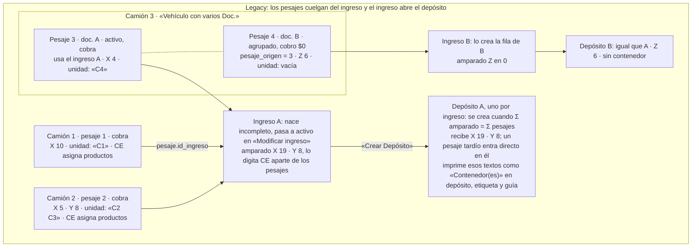
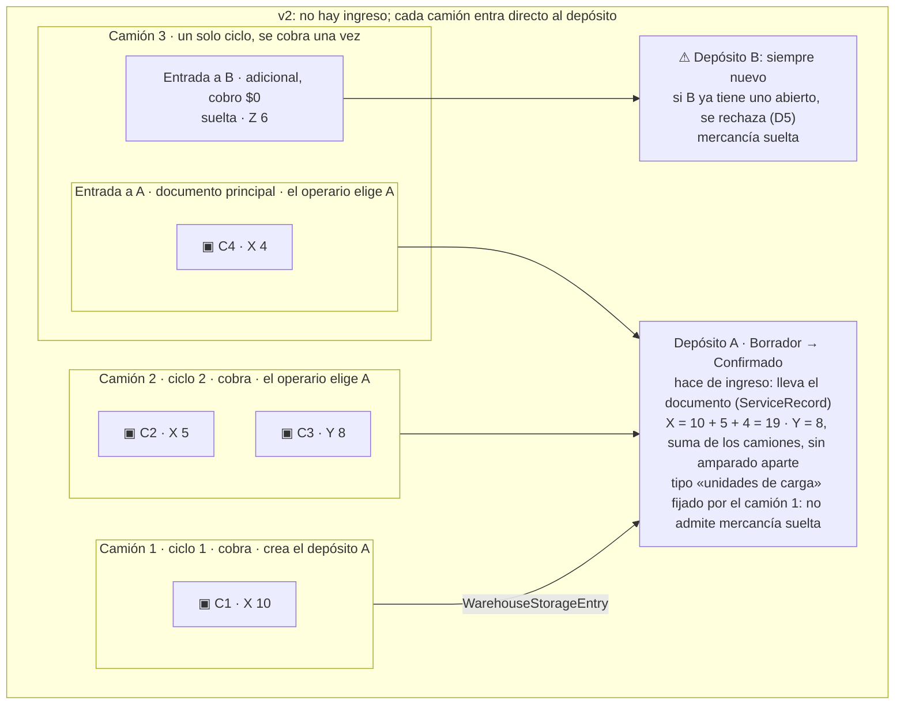

# Paridad del flujo de depósitos y levantes: legacy vs v2

Corte: 2026-11-11 · Backend `develop` `aa69633` · Frontend `develop` `8c7f20e`. Versión en markdown del documento publicado en Claude Docs (<https://claude.ai/artifact/Lpd3pUNpFNxazFB555Lmet>); si difieren, manda el que el usuario haya editado después. Los dos incluyen la etapa 5 (tiquetes e ingresos), con los diagramas de camiones, documentos, unidades de carga y depósitos, la etapa 6 (unidades de carga) y la lista de brechas integrada. Lo observado en los videos está en `hallazgos-videos-levantamiento-2026-11-11.md`.

La v2 cubre el ciclo completo del depósito, pero el levante y la salida aún no permiten trabajar como en el legacy: de 50 diferencias revisadas, 18 son brechas: 8 en el levante y el depósito, 6 en la relación entre tiquetes e ingresos y 1 en las unidades de carga. Las de mayor impacto:

- **El levante no calcula la cantidad** en los depósitos que crea báscula, porque falta el peso documental por producto.
- **No hay salida global**: un depósito que llegó en dos camiones necesita dos órdenes y dos guías, y la orden debe existir antes del cargue.
- **La tasa de cambio es la de la DIAN del día**, no la semanal que usa Comercio Exterior.
- **Corregir los pesos del tiquete** exige dos pantallas y no existe el peso de la mercancía digitado.
- **Nada compara lo que ampara el documento con lo que trajeron los camiones.** El legacy no deja crear el depósito hasta que coinciden; la v2 confirma con el primer camión.

La v2 sí mejora lo que el legacy hacía mal: corrige sin borrar la mercancía, en transacción, y recalcula la factura.

## Alcance y fuentes

El análisis cubre el ciclo de un depósito en Comercio Exterior: ingreso por báscula, edición del tiquete y sus pesos, creación del depósito, levantes y salida. La etapa 5 añade la relación entre «Tickets Ingresos» (pesajes) e «Ingresos» (documentos), a partir de los hallazgos del usuario sobre el código legacy. La etapa 6 compara las unidades de carga.

| Fuente | Qué aporta |
| --- | --- |
| `documentos/Levantamiento staging/levante_y_salida_global.MOV` (≈2 min) | Registro de levantes y salida global |
| `documentos/Levantamiento staging/proceso_levante_edicion_pesos.mov` (≈3,5 min) | Edición de pesos de un tiquete con depósito y registro de levante |
| `documentos/Levantamiento staging/Comercio exterior.txt` y `revision_hallazgos.md` | Transcripción de las sesiones y revisión del usuario (PA-01 a PA-25) |
| Código legacy (`bodegas-legacy/modulos/`) | Reglas detrás de cada pantalla |
| Código v2 (`Backend/wms-api`, `Frontend/wms`) | Comportamiento actual |
| `contexto/decisiones.md` y `planes/paridad-legacy/` | Decisiones que explican las diferencias intencionales (DEC-0xx, P1–P17, DF1–DF4) |

Fuera de alcance: Colmotores (importador 70: prefijo `EC`, VIN) y acceso y roles. La carpeta `ajustes/` citada en algunos planes ya no existe (`contexto/mapa-de-fuentes.md` §7).

## Cómo trabaja hoy la operaria en el legacy

En el legacy, Comercio Exterior corrige los datos del tiquete y del depósito en cualquier momento, y el levante y la salida leen esos datos en vivo. Los dos videos muestran un depósito de importación de 930 cajas y 24 940 kg que llegó en dos camiones y salió completo el mismo día.

1. **Cuadrar los pesos del tiquete con la planilla DIAN.** Desde *Tickets Ingresos* abre *Editar* («Modificar entrada a báscula»). Cambia el peso del indicador, el del manifiesto y el de la mercancía, y la tara del vehículo se recalcula sola (indicador − mercancía). En el video pasa de 11 300 a 11 240 kg de mercancía para igualar lo recibido en la planilla de recepción de la DIAN.
    - El peso de la mercancía no siempre es bruto − tara: muchos camiones no se repesan y el peso sale de pesar bultos de muestra.
    - El formulario no se bloquea aunque el ingreso ya tenga depósito.
2. **Revisar el depósito.** En *Depósitos Import.* cada depósito muestra, por vehículo, la cantidad y el peso, y abajo «Peso Entra», «P. Bruto Ampara» y «Saldo Peso». Los pesos editados se ven de inmediato.
3. **Editar datos del depósito.** «Modificar datos del depósito» permite cambiar la fecha y hora, el número del depósito y las observaciones.
4. **Gestionar amparados.** «Relacione los productos amparados» registra producto, embalaje y cantidad amparada.
5. **Registrar el levante.** En *Levantes Import.* ve una matriz Ingreso / Nacionalizados / Saldo con una columna por producto. Digita el peso bruto del levante y la cantidad se calcula en proporción a lo ingresado, solo si el depósito tiene un producto. La tasa de cambio llega precargada con la tasa semanal y es editable. El FOB en pesos sale de CIF USD × tasa. Pide solo la fecha del levante.
6. **Salida global.** En *Salidas Import.* elige el depósito, marca los dos tiquetes de ingreso y guarda. La guía lleva los dos tiquetes, las dos placas, levante, aceptación, saldo anterior, cantidad que sale y nuevo saldo. No hay orden de cargue ni paso por báscula: el camión nunca descargó.

## Cómo cambia el flujo en la v2

En la v2 el depósito ya no lo crea Comercio Exterior: nace en Borrador cuando báscula registra el primer camión, y Comercio Exterior lo completa y lo confirma. La salida pasa por una orden de cargue y una guía por camión. Cinco de los siete pasos de la v2 (marcados con ⚠) tienen una brecha frente al legacy.

```mermaid
flowchart TB
  subgraph L[Legacy]
    L1[Báscula registra el tiquete] --> L2[CE cuadra los pesos en un formulario]
    L2 --> L3[CE crea el depósito y los amparados]
    L3 --> L4[Levante con cantidad calculada y tasa semanal]
    L4 --> L5[Guía de salida global: varios tiquetes]
    L5 --> L6[Sale con el tiquete de ingreso]
  end
  subgraph V[v2]
    V1[Báscula registra el camión: depósito en Borrador] --> V2[⚠ Corrección de pesos en dos pantallas]
    V2 --> V3[⚠ CE confirma: exige cliente; productos fijos]
    V3 --> V4[⚠ Levante con cantidad manual y TRM del día]
    V4 --> V5[⚠ Orden de cargue por camión, antes de báscula]
    V5 --> V6[⚠ Guía de salida por camión, antes del cargue]
    V6 --> V7[Sale con el tiquete de ingreso: F4-08]
  end
```

## Comparación por etapa

Rutas: `B/` = `Backend/wms-api/`, `F/` = `Frontend/wms/app/`, `L/` = `bodegas-legacy/modulos/`. Tipo: **Igual**, **Mejora**, **Intencional** (respaldado por una decisión) o **Brecha**.

### 1. Ingreso y edición de pesos

| Qué | Legacy | v2 | Tipo |
| --- | --- | --- | --- |
| Quién crea el depósito | Comercio Exterior, a mano, cuando lo amparado = lo ingresado (`L/mod_depositos/registrardeposito.php:99-145`) | Báscula, en Borrador, con el primer camión (`B/Wms.Application/Weighbridge/Commands/Storage/Initiate/InitiateStorageWeighingHandler.cs:357-430`) | Intencional (DEC-010, DEC-013) |
| Pesos que corrige Comercio Exterior | Indicador, manifiesto y mercancía en un solo formulario; la tara se recalcula (`L/mod_bascula/modificarentrada.php:157`) | El manifiesto del camión desde el detalle del depósito (`UpdateTruckManifestCommandHandler.cs:34-90`). Los pesajes bruto y tara, desde el historial de báscula (`F/pages/operations/weighbridge/history.vue:644`) | **Brecha** |
| Peso de la mercancía sin repesaje | Lo digita la operaria (bultos de muestra) | Con un solo pesaje, el neto es el peso del manifiesto (DEC-057 D12, `ManifestDeducedWeights.cs`) | Intencional |
| Bloqueo con depósito | Ninguno; solo congela las líneas con levante (`modificarentrada.php:95-111`) | Pesajes: sin guarda de estado. Manifiesto: Borrador o Confirmado | Igual |
| Efecto en la mercancía | Borra y reinserta `producto_en_bodega` y seriales, sin transacción (`:193-247`) | No toca la mercancía; corrige en sitio y en transacción | Mejora |
| Efecto en la facturación | `cron.php:213` suma el peso del manifiesto en la siguiente corrida | Recalcula el período abierto tras corregir el manifiesto (`StorageRecalculationTrigger.cs:302-333`) | Mejora |

### 2. Depósito

| Qué | Legacy | v2 | Tipo |
| --- | --- | --- | --- |
| Vista de trabajo | Tabla con vehículos, cantidades, «Peso Entra» y «Saldo Peso» | Tarjetas por estado; el detalle muestra el neto físico (`DepositPhysicalWeight.cs:20-41`) | **Brecha** de usabilidad |
| Saldo de peso | Peso amparado − peso que entra | No existe; «Validar depósito» compara con 5 % de tolerancia (`DepositValidationMath.cs:22-60`) | Intencional (R-07) |
| Número del depósito | Editable | Consecutivo automático, no editable (`DocumentNumberGenerator.cs`) | Intencional (DEC-012) |
| Fecha del depósito | Editable sin límite | Corregible dentro de la estadía del primer camión (`WarehouseStorage.cs:205-240`) | Intencional (DEC-051) |
| Productos amparados | Se corrigen en cualquier momento antes de la salida | Solo en Borrador (`WarehouseStorage.cs:530-535`) | **Brecha** |
| Confirmar sin cliente | No aplica | Exige cliente (`DepositConfirmationRequirements.cs:71-72`) | **Brecha** |
| Cantidad con levante | La fila con levante queda congelada | Tras devolver a Borrador, la cantidad puede bajar por debajo de lo levantado | **Brecha** (riesgo de datos) |

### 3. Levante

| Qué | Legacy | v2 | Tipo |
| --- | --- | --- | --- |
| Productos | Matriz con una columna por producto | Selector de un producto por levante (`F/features/foreign-trade/components/ReleaseForm.vue`) | Intencional (aceptado por la operaria, PA-09) |
| Cálculo de la cantidad | Solo con un producto: peso digitado × (Σ cantidad ingresada ÷ Σ manifiesto de los camiones), sobre el ingreso total, y la cantidad sigue editable (`L/mod_levantes/registrarlevante.php:246-254`, `:611`). Con varios productos no calcula: precarga el saldo de cada producto y la operaria pone 0 en los que no van | Existe, pero usa el peso documental del producto (`ReleaseForm.vue:125-129`, `:251-290`). Los depósitos de báscula lo dejan vacío (`InitiateStorageWeighingHandler.cs:418-427`) y nada lo completa después (ningún comando llama a `UpdateNetDeclaredWeight`): aparece «No hay peso documental suficiente» (`:565`) | **Brecha crítica** |
| Tasa de cambio | Tasa semanal manual, precargada y editable | TRM de la DIAN del día; la manual solo si la DIAN falla (`ReleaseFobService.cs:56-82`) | **Brecha** |
| Datos del levante | Número de levante, número de aceptación y fecha del levante. La fecha de aceptación se guarda igual a la del levante (`registrarlevante.php:326-328`) | Exige también la fecha de aceptación (`RegisterImportReleaseCommandValidator.cs:29-30`) | **Brecha** menor |
| Nombre del valor | «CIF USD» | «CIF» / FOB; la operaria pide «Valor en aduanas» | **Brecha** de texto |
| Nacionalizado en la etiqueta | Manual | Automático con el primer levante | Mejora |

**Detalle del cálculo de la cantidad.** Desglosa la fila «Cálculo de la cantidad»; no suma diferencias al conteo.

- **Legacy:** `cantidad = peso digitado × (Σ cantidad ingresada ÷ Σ peso_manifiesto de los pesajes)` (`L/mod_levantes/registrarlevante.php:246-254`). La proporción es la del ingreso total, no la del saldo: en el video, 930 unidades y 24.940 kg dan 249 kg → 9,29. Solo se activa con un producto (`:611`); con varios, cada casilla trae el saldo del producto y la operaria pone 0 a los que no van (PA-09); lo que ve «automático» es ese saldo precargado, no un cálculo desde el peso. En el volcado, 9.685 de 10.839 levantes de depósitos de un producto (89 %) siguen la fórmula exacta. En los de varios productos, 1.197 de 1.202 (99,6 %) levantan un solo producto, 1.158 de ellos (97 %) por todo lo ingresado de ese producto, y solo 15 siguen la fórmula. La cantidad sigue editable y solo se valida contra el saldo, en el navegador (`:255-262`). El peso total no descarta los pesajes eliminados (`:451`).
- **v2:** `cantidad = peso × (cantidad pendiente del producto ÷ peso documental neto pendiente del producto)` (`F/features/foreign-trade/components/ReleaseForm.vue:124-129`, `:251-290`). Cuando calcula, la cantidad queda bloqueada (`:262-263`). Pero ningún depósito de báscula tiene ese peso: báscula y Comercio Exterior crean los productos con los pesos en `null` (`InitiateStorageWeighingHandler.cs:416-427`, `DepositProductEditing.cs:246-252`), y `WarehouseStorageProduct.UpdateNetDeclaredWeight` no se llama desde ningún lado. Solo lo traen los ingresos manuales de Bodega y los depósitos migrados.

| Aspecto | Legacy | v2 |
| --- | --- | --- |
| Cuándo calcula | Solo con un producto | Solo si el producto tiene peso documental: nunca en los depósitos de báscula |
| Base del cálculo | Σ cantidad ÷ Σ manifiesto de los camiones (ingreso total) | Pendiente ÷ peso documental pendiente, por producto |
| Peso contra el que compara | Bruto del manifiesto, el mismo tipo de peso que trae la declaración | Neto documental |
| Cantidad calculada | Editable | Bloqueada |
| Validaciones | Cantidad ≤ saldo, en el navegador | Cantidad ≤ pendiente en el servidor (`RegisterImportReleaseCommandHandler.cs:47-55`); peso ≤ saldo documental en el formulario |
| Número de levante repetido | No guarda y no avisa: el mensaje está comentado (`registrarlevante.php:313`, `:333-345`) | Rechaza con un mensaje (GAP-009) |
| Fecha de aceptación | Copia la del levante (`:326-328`) | Obligatoria y aparte |

**Cómo cerrar la brecha 1.** Con un producto, calcular la cantidad desde el peso sobre la cantidad recibida y la Σ del manifiesto de los camiones no anulados, que la v2 ya tiene, en lugar del peso documental: da el mismo resultado que el legacy y compara peso bruto con peso bruto. Con varios productos, precargar lo pendiente del producto elegido y habilitar «Levante total del saldo disponible» aunque no haya peso documental (hoy depende de él, `ReleaseForm.vue:258-260`): la cantidad es todo lo pendiente y la operaria digita el peso. Es el caso del 97 % de esos levantes. En los dos casos, la cantidad calculada o precargada debe quedar editable.

### 4. Salida

| Qué | Legacy | v2 | Tipo |
| --- | --- | --- | --- |
| Documento de salida | Guía directa desde el depósito | Orden de cargue → guía; en importación la guía es obligatoria antes del cargue (DEC-056) | Intencional |
| Camión que nunca descargó | Sale con su tiquete de ingreso, sin báscula | La orden sale con el tiquete de ingreso (`EntryTicketExitRules.cs:23-40`, F4-08) | Igual |
| Salida global de varios camiones | Una guía con varios tiquetes y placas | Una orden y una guía por camión (P16) | **Brecha** |
| Orden creada después del cargue | No aplica | La orden debe existir antes de báscula | **Brecha** |

### 5. Tiquetes e ingresos

En el legacy, el ingreso es el documento comercial y agrupa los pesajes (`pesaje.id_ingreso`): pasa de `incompleto` a `activo` y luego tiene depósito. En la v2 no hay entidad «ingreso»: el depósito en Borrador hace su papel. `ServiceRecord` lleva el documento (`CargoManifestNumber`, `PrimaryDocumentTypeId`) y `WarehouseStorage` el depósito. Cada camión es una `WarehouseStorageEntry`, que une el depósito con el `EntryLog` y el ciclo de báscula (`B/Wms.Domain/Entities/Warehouse/WarehouseStorageEntry.cs:12-14`). Así lo mapea `bodegas-legacy/docs/legacy_analysis/LEGACY_VS_NEW.md:257`.

Los dos diagramas muestran el mismo caso: el documento A llega en tres camiones, el camión 2 trae dos productos y el camión 3 trae además el documento B. Los camiones del documento A traen su mercancía en contenedores (C1 a C4) y el documento B llega suelto. Las cantidades y los contenedores son de ejemplo. En Claude Docs están dibujados a escala; aquí van en Mermaid.

En el legacy, «Vehículo con varios Doc.» (`L/mod_bascula/listarentradasbascula.php:323`) graba un pesaje por documento. El primero cobra; los demás quedan «agrupados», con `pesaje_origen` apuntando al primero y cobro en $0 (`L/mod_bascula/registrarentradavariascp.php:108-111`, `:259-262`; `facturar.php:82-89`). Cada fila puede usar un ingreso existente y, si ese ingreso ya tiene depósito, la mercancía entra directo en él (`registrarentradavariascp.php:201-213`). Con un solo documento, Comercio Exterior asigna los productos del camión en «Editar» (`L/mod_bascula/modificarentrada.php:218`, `:232-235`).

La unidad de carga del legacy es solo un texto del pesaje: un camión con dos contenedores los escribe en el mismo campo, la mercancía no se asocia a ninguno y el depósito los imprime juntos como «Contenedor(es)».

En la v2 el camión 3 es un solo ciclo con dos entradas. La del documento principal va al depósito que elige el operario. La del segundo documento crea siempre un depósito nuevo, con su propio `ServiceRecord`, y se cobra en $0 (`B/Wms.Application/Weighbridge/Commands/Storage/Initiate/InitiateStorageWeighingHandler.cs:1061-1137`, `:1270`). **Es la brecha 10:** si el documento B ya tiene un depósito abierto por un camión anterior, la v2 rechaza el depósito adicional con un 409 (DEC-057 D5, `InitiateStorageWeighingHandler.cs:962-968`). El legacy sí sumaba esa mercancía al depósito existente, pero en el volcado no hay ningún pesaje «agrupado»: la función no se usó, y por eso la brecha es de impacto bajo.

En la v2 cada unidad de carga (▣) es una entidad que lleva su propia mercancía. El camión 1 fija el depósito A en «unidades de carga», así que A ya no admite un camión de mercancía suelta; el documento B, en su propio depósito, sí puede llegar suelto. La comparación completa está en la etapa 6.

| Qué | Legacy | v2 | Tipo |
| --- | --- | --- | --- |
| Cardinalidad documento–camión | 1 ingreso : N pesajes, por `pesaje.id_ingreso` | 1 depósito : N entradas, por `WarehouseStorageEntry.WarehouseStorageId`; el ciclo lleva `ServiceRecordId` | Igual |
| Entidad «ingreso» aparte del depósito | `ingreso`, con su propio estado y formulario (`L/mod_ingresos/modificaringreso.php:89-111`) | No existe; los datos del documento se completan en el depósito en Borrador (P2, `planes/paridad-legacy/plan-backend-paridad-legacy.md:259-285`) | Intencional |
| Tiquete sin ingreso, ingreso sin tiquetes | Hay repesajes sin `id_ingreso` e ingresos que quedan huérfanos (ver «Correcciones» abajo) | No hay entrada sin depósito. Anular el último camión anula el depósito (`B/Wms.Application/Weighbridge/Commands/VoidWeighing/VoidWeighingCommandHandler.cs:306-315`) | Mejora |
| Reutilizar el documento al pesar | El operario elige en un autocompletado por tipo y número de documento, que muestra la transportadora; se excluyen solo los eliminados (`L/mod_bascula/seleccionardocumercial.php:13-18`). Si no elige, se crea un ingreso `incompleto` (`registrarentradabascula.php:66-80`) | El operario elige un depósito abierto del mismo tipo y número (normalizado) o «Es otro documento» (DEC-057 D1, `InitiateStorageWeighingHandler.cs:270-274`). Abierto = Borrador o Confirmado, sin cierre de camiones, no migrado y no descartado (`StorageDocumentLookup.cs:28-37`, `:245-257`; `StorageDocumentMatcher.cs:109-115`). En ninguno de los dos la transportadora es parte de la clave | Igual |
| Camión con varios documentos | «Vehículo con varios Doc.» (sin uso en el volcado: ningún pesaje «agrupado»): un pesaje por documento; el primero cobra y los demás quedan «agrupados» en $0. Cada documento puede usar un ingreso existente, aunque ya tenga depósito, y su mercancía entra en él (`L/mod_bascula/registrarentradavariascp.php:83-111`, `:201-213`) | Un ciclo con una entrada por documento. El principal va al depósito que elige el operario; el segundo crea siempre un depósito nuevo, cobrado en $0, y se rechaza si su documento ya tiene uno abierto (DEC-057 D5, `InitiateStorageWeighingHandler.cs:962-968`, `:1061-1137`) | **Brecha** (riesgo de paridad) |
| Repesaje de entrada | Otra fila de `pesaje` con `pesaje_origen`: pesa el camión vacío y calcula la mercancía. No lleva ingreso ni cobro, y el pesaje original no cambia (`L/mod_bascula/repesarentrada.php:63`, `:71-111`). Comercio Exterior no lo ve: «Tickets Ingresos» lo excluye y «Editar» no lo lee (`listarentradas.php:82`, `:461-477`); el depósito y el cobro usan el manifiesto. Lo tienen 7.559 de las 18.616 entradas con ingreso | Es el segundo pesaje del mismo ciclo, y su neto llega al detalle del depósito como neto físico (`DepositPhysicalWeight.cs:8-19`). El cobro sigue saliendo del manifiesto (`StorageBillingService.cs:102`) | Mejora |
| Repesaje de salida | El último repesaje de la salida da el «peso despachado» y el saldo de peso en la salida y en las prórrogas (`L/mod_salidas/registrarsalida.php:949-960`, `:1010-1017`; `listardepositosprorroga.php:665-669`). El cron no lo usa para cobrar. Lo tienen 4.759 de las 14.084 salidas | El pesaje de salida queda en el ciclo de la orden de cargue; ni la orden, ni la guía, ni el depósito muestran un peso despachado | **Brecha** menor |
| Atomicidad del alta | Si falla el pesaje, borra el ingreso nuevo (`:141-142`), pero ese borrado nunca corre (ver «Correcciones») | Una transacción para documento, depósito, entrada y consecutivo (`InitiateStorageWeighingHandler.cs:63`, `:709`) | Mejora |
| Estado intermedio | `incompleto` → `activo` al guardar el tiquete (`modificarentrada.php:129`) o el ingreso (`modificaringreso.php:111`). El `incompleto` no aparece en «Ingresos» (`listaringresos.php:121`) | Borrador → Confirmado con «Confirmar depósito», que exige requisitos (`DepositConfirmationRequirements.cs:67-128`). El Borrador se ve desde el primer camión | Intencional (P2) |
| Lista de tiquetes en Comercio Exterior | «Tickets Ingresos»: una fila por pesaje con sus pesos y recibo. Excluye repesajes (`pesaje_origen IS NULL`), agrupados, modalidad ≥ 4 y salidas sin ingreso (`L/mod_bascula/listarentradas.php:75-89`). Desde aquí la operaria abre «Editar» para cuadrar pesos (video 2, 0:16) | No existe en el menú de Comercio Exterior. Los tiquetes están en *Báscula › Historial* (`F/components/layout/AppMenu.vue:215-237`) y, por depósito, en la tabla de camiones del detalle (`F/features/foreign-trade/components/DepositExpandedEntriesTable.vue:166-204`). En la v2 el repesaje es otro pesaje del mismo ciclo y no hay «agrupado» | **Brecha** |
| Aviso en rojo | Tiquete sin mercancía asignada (`listarentradas.php:342-412`). Ingreso sin SIA o sin peso neto (`listaringresos.php:333-337`) | No hay camión sin mercancía: báscula exige un producto con cantidad (`InitiateStorageWeighingValidator.cs:133-141`). Lo que falta para confirmar sale en el detalle, no en la tarjeta del tablero | **Brecha** menor |
| Cantidad amparada vs ingresada | Comercio Exterior digita lo amparado por el documento. La línea que crea el tiquete nace con 0 (`modificarentrada.php:249-277`; esquema `cantidadamparada DEFAULT 0`). «Ingresos» lo compara en vivo con lo que trajeron todos los tiquetes (`listaringresos.php:322-327`, `:440-475`) | No hay cantidad amparada propia. El total del producto es la suma de lo declarado por camión, guardada y recalculada en cada cambio (`InitiateStorageWeighingHandler.cs:579-583`, `B/Wms.Application/ForeignTrade/Common/Services/DepositProductEditing.cs:29-33`). Nada avisa si faltan camiones o cantidades del documento | **Brecha** (riesgo de paridad) |
| Peso total del documento | `SUM(peso_manifiesto)` de todos los pesajes del ingreso, sin filtrar los eliminados ni los agrupados (`listaringresos.php:486`) | Σ peso de manifiesto de las entradas no anuladas (`StorageBillingService.cs:102`). Al anular un camión, sus líneas pasan a 0 y se recalcula (`VoidWeighingCommandHandler.cs:264-273`) | Mejora |
| Valor de la mercancía | Dos niveles. Báscula digita «Precio Mercancía» en cada tiquete (`L/mod_bascula/registrarentrada.php:1016`, `modificarentrada.php:1108`). En importación, Comercio Exterior confirma «Precio Mercancía CPI» del ingreso, precargado con la suma de los tiquetes y editable en cualquier momento (`L/mod_ingresos/modificaringreso.php:443-459`). El depósito solo lo muestra (`L/mod_depositos/registrardeposito.php:369`) | Un solo valor y moneda (COP o USD) por depósito: báscula lo digita con el primer camión y los siguientes no lo suman (`InitiateStorageWeighingHandler.cs:410`). Comercio Exterior lo corrige solo en Borrador (`B/Wms.Domain/Entities/Warehouse/WarehouseStorage.cs:444-459`) | **Brecha** |
| Uso del valor de la mercancía | Solo se muestra en «Depósitos por facturar», en dólares y en pesos con la tasa de la fecha de ingreso (`L/mod_facturacion/listardepositosfacturar.php:525-530`); ningún cálculo lo usa | Base de las fórmulas de porcentaje sobre el valor, en pesos con la TRM (`PercentageOfValueFormulaCalculator.cs:22-32`) | Mejora |
| Habilitar el depósito | «Crear Depósito» aparece si Σ amparado = Σ ingresado > 0 y aún no hay depósito; creado, sale de «Ingresos» (`listaringresos.php:309-311`, `:516-517`) | El depósito ya existe; se confirma con los requisitos de P2/P5 sin comparar cantidades. Confirmado, pasa a su columna del tablero (`F/features/foreign-trade/utils/kanban-columns.ts:7`). Un camión tardío entra aun confirmado (P5) | Intencional (DEC-010) |
| Líneas creadas por el pesaje | Inserta en `productoamparado` el par producto–embalaje que falte, con `origen='pesaje'` (`modificarentrada.php:249-277`). «Gestionar amparados» inserta sin `origen` y sin revisar duplicados (`L/mod_ingresos/gestionarproductos.php:55-67`) | Un producto nuevo del camión crea su línea del depósito (`InitiateStorageWeighingHandler.cs:536-557`), sin campo de origen. Como no hay amparado digitado, no hay duplicados | Igual |
| Menú | Dos entradas en Comercio Exterior: «Tickets Ingresos» e «Ingresos», antes de «Depósitos Import.» (`bodegas-legacy/menus/menuizquierda.php:205-211`) | Una sola: «Depósitos», un tablero por estado (`AppMenu.vue:313-345`, DEC-058). El Borrador hace de «Ingresos» | Intencional, documentado a medias |

**Los dos precios del legacy son un mismo dato en dos niveles.** El del tiquete es la parte que trae cada camión y solo sirve para precargar el de la CPI; nada más lo lee. En el volcado, 18.159 de los 18.175 tiquetes con ingreso traen precio, y en 9.636 de los 9.679 ingresos de importación con precio (99,6 %) el de la CPI es exactamente la suma de sus tiquetes: casi siempre se acepta lo precargado. La moneda se guarda como país (ECU, dólar). En la v2 no hay valor por camión; con varios camiones, báscula debe digitar el total de la CPI en el primero.

**Navegación sin decisión explícita.** DEC-058 documenta el tablero (`contexto/decisiones.md:237-240`), y P2 deja la completitud del documento en el depósito en Borrador. Ninguna decisión dice que «Tickets Ingresos» e «Ingresos» desaparecen de Comercio Exterior. `bodegas-legacy/docs/legacy_analysis/FRONTEND_PARITY.md:39` mapea «Tickets Ingresos» a *Báscula › Historial* con «MEJOR EN V2», pero confunde dos pantallas. *Báscula › Entradas* es `listarentradasbascula.php` (`menuizquierda.php:195`); «Tickets Ingresos» de Comercio Exterior es `listarentradas.php` (`:208`). Si existió una decisión en `ajustes/`, se perdió (`contexto/mapa-de-fuentes.md` §7).

**Correcciones a lo leído del legacy.** Verificado en el código:

- **El borrado del ingreso huérfano nunca corre.** El insert del pesaje termina en `or die(...)` (`registrarentradabascula.php:139`): si falla, el script muere antes de la línea 141, y el ingreso queda `incompleto` y huérfano. Como «Ingresos» no muestra los `incompleto`, nadie lo ve.
- **La fila roja de «Ingresos» marca otra cosa.** Indica falta de SIA o de peso neto, no de mercancía (`listaringresos.php:333-337`). La fila roja por mercancía sin asignar está en «Tickets Ingresos».
- **`modificaringreso.php` también activa el ingreso.** Su `UPDATE` fija `estado='activo'` (`:111`). Si el peso neto está vacío, lo precarga con Σ `peso_manifiesto` y lo copia al bruto mientras se digita (`:421-432`). Ese bruto es el «PB. Ampara» del listado (`listaringresos.php:485`).
- **Lo amparado nace en 0.** La línea creada por el tiquete no trae cantidad (`DEFAULT 0`). El botón «Crear Depósito» solo aparece cuando Comercio Exterior digita lo que dice el documento en «Gestionar amparados» (video 2, 3:08) y eso coincide con lo ingresado. Es un control documento contra camiones.
- **El autocompletado deja sumar camiones a un ingreso que ya tiene depósito.** Solo excluye los eliminados (`seleccionardocumercial.php:17`). `consultaentroplaca.php:7-16` avisa «Ya entro» si el mismo vehículo ya pesó para ese ingreso. La v2 equivale con su 409 «Este camión ya tiene un ciclo de báscula activo para este documento» (`InitiateStorageWeighingHandler.cs:343-353`), que mira el registro de entrada, no la placa.
- **Filtros de amparados distintos.** «Gestionar amparados» lista `estado='activo'` (`gestionarproductos.php:90`); «Ingresos» suma `estado<>'eliminado'` (`listaringresos.php:326`).

### 6. Unidades de carga

En el legacy, la unidad de carga es un texto libre de cada pesaje («Unidad de Carga», sí o no) que Comercio Exterior escribe en «Editar» (`L/mod_bascula/modificarentrada.php:933-943`, `:165`). Báscula solo guarda el id del catálogo `unidadcarga` (remolque, semirremolque, tráiler volqueta), que en el volcado tiene una sola fila, «-». En el volcado, 1.192 de los 18.616 pesajes con ingreso tienen ese texto, y 708 de los 9.987 ingresos tienen al menos uno. En la v2 la unidad es una entidad propia, `WarehouseStorageCargoUnit`: tipo de un catálogo, placa normalizada, estado y su propia mercancía, ligada al depósito y al camión (`B/Wms.Domain/Entities/Warehouse/WarehouseStorageCargoUnit.cs:14-35`; DEC-010 (3), DEC-014).

| Qué | Legacy | v2 | Tipo |
| --- | --- | --- | --- |
| Quién la registra | Comercio Exterior, en «Editar». Báscula no la pide: guarda solo `id_unidadcarga` (`L/mod_bascula/registrarentradabascula.php:113`, `:123`) | Báscula, al pesar: elige el tipo de carga del depósito y registra cada unidad con tipo y placa (`InitiateStorageWeighingCommand.cs:69-73`, `CargoUnitDeclaration.cs:41-65`) | Intencional (DEC-014) |
| Unidades por camión | Un solo campo de texto por pesaje | Varias; la placa es única dentro del depósito (`InitiateStorageWeighingHandler.cs:1378-1384`) | Mejora |
| Mercancía de la unidad | No existe: la mercancía es del pesaje (`producto_en_bodega.id_pesaje`) | Cada unidad trae su mercancía y el camión es la suma. Una sola unidad sin mercancía toma la del camión; con varias, Comercio Exterior reparte en Borrador (`CargoUnitDeclaration.cs:67-75`, `SetCargoUnitBreakdownCommandHandler.cs:11-15`). Confirmar exige el reparto (`DepositConfirmationRequirements.cs:118-160`) | Intencional (DEC-014) |
| Mezclar suelta y unidades | Sin regla. En el volcado, solo 2 de los 708 ingresos con unidad mezclan pesajes con texto y sin él | El primer camión fija el tipo de carga del depósito y se rechazan los camiones del otro tipo (`WarehouseStorage.cs:184-192`) | Intencional (DEC-014) |
| Recepción en Bodega | No hay recepción por unidad | Bodega confirma «Recibida completa» por unidad, sin contar productos (`ReceptionCargoUnits.cs:8-11`) | Intencional (DEC-010 (3)) |
| Salida | La guía imprime todas las unidades del ingreso y no dice cuál sale (`L/mod_salidas/verguia.php:678-682`) | Cada línea de la orden de cargue nombra su unidad, y la unidad puede salir parcialmente (`LoadingOrderReservationService.cs:51`, DEC-014) | Mejora |
| Cobro del almacenamiento | No usa la unidad: `cron.php` no la consulta | Por unidad, con `PER_CARGO_UNIT` y mínimo por unidad (`PerCargoUnitFormulaCalculator.cs:18-21`, `StorageBillableCargoUnits.cs:8-13`) | Intencional (DEC-014) |
| Impresos | «Contenedor(es)» en el depósito, la etiqueta y la guía (`L/mod_depositos/verdeposito.php:442-446`, `adhesivos.php:361-367`) | «TIPO PLACA», o «N/A», en tiquete, etiqueta, guía y PDF del depósito (`CargoUnitText.cs:5-8`) | Igual |
| Corregir después de báscula | Comercio Exterior agrega, cambia o borra el texto en «Editar» cuando quiera | Comercio Exterior corrige tipo y placa en Borrador o Confirmado (`CorrectCargoUnitCommandHandler.cs:25-41`). No hay cómo agregar ni quitar una unidad, ni cambiar el tipo de carga, que se fija al crear el depósito (`WarehouseStorage.cs:35`, `:184-192`) | **Brecha** (riesgo de cobro) |

## Dónde se concentran las diferencias

Conteo de las filas de las seis tablas anteriores (50 diferencias). En el documento publicado se muestra como barras apiladas.

| Etapa | Brecha | Intencional | Igual | Mejora | Total |
| --- | --- | --- | --- | --- | --- |
| Ingreso y pesos | 1 | 2 | 1 | 2 | 6 |
| Depósito | 4 | 3 | 0 | 0 | 7 |
| Levante | 4 | 1 | 0 | 1 | 6 |
| Salida | 2 | 1 | 1 | 0 | 4 |
| Tiquetes e ingresos | 6 | 4 | 3 | 5 | 18 |
| Unidades de carga | 1 | 5 | 1 | 2 | 9 |
| **Total** | **18** | **16** | **6** | **10** | **50** |

El ingreso es la etapa más cercana al legacy. El depósito y el levante concentran lo que la operaria no puede hacer hoy en la v2. En tiquetes e ingresos casi todo es diferencia de diseño: el depósito en Borrador reemplaza al ingreso. Lo que se perdió es el control de lo amparado, la lista de tiquetes, el peso despachado de cada salida, la corrección del valor de la mercancía después de confirmar y la posibilidad de sumar el segundo documento de un camión a un depósito abierto. En unidades de carga casi todo es decisión tomada (DEC-014); la brecha es corregir las unidades después de báscula.

## Brechas ordenadas por impacto

Integra los frentes: creación del depósito, edición del tiquete con depósito, tiquetes e ingresos y unidades de carga. **Riesgo** = la diferencia puede dejar datos o cobros errados, no solo más trabajo.

| # | Brecha | Etapa | Impacto | Riesgo | Por qué | Referencia |
| --- | --- | --- | --- | --- | --- | --- |
| 1 | El levante no calcula la cantidad desde el peso en los depósitos creados por báscula | Levante | Alto | — | El cálculo existe, pero depende de un peso documental por producto que báscula deja vacío y nada completa; además compara contra peso neto y bloquea la cantidad | PA-12; `ReleaseForm.vue:125-129`, `:565` |
| 2 | Salida global: una guía con varios tiquetes, y orden de cargue creada al cargar | Salida | Alto | — | Hoy se exige una orden y una guía por camión, y la orden antes de báscula | PA-14; choca con P16 y DEC-056 |
| 3 | Tasa de cambio semanal manual en el levante | Levante | Alto | **Sí** | Las declaraciones anticipadas usan otra tasa y el FOB queda mal | PA-08, PA-24; `ReleaseFobService.cs:56-82` |
| 4 | Lista de tiquetes en Comercio Exterior, con un solo formulario para corregir todos sus pesos | Ingreso / Tiquetes | Alto | — | La operaria parte de «Tickets Ingresos» para cuadrar cada tiquete con la planilla DIAN; en la v2 no tiene esa lista y los pesos se corrigen en dos pantallas | PA-02, PA-13, PA-22; `listarentradas.php:75-89`; `AppMenu.vue:313-345` |
| 5 | Control de lo amparado por el documento contra lo que trajeron los camiones | Tiquetes / Depósito | Medio-alto | **Sí** | Se puede confirmar con el primer camión aunque falten camiones o cantidades del documento, y nada lo avisa. El legacy no creaba el depósito hasta que cuadraba | `listaringresos.php:516-517`; `DepositConfirmationRequirements.cs:67-128` |
| 6 | Corregir productos y valor de la mercancía de un depósito confirmado, sin poder bajar de lo levantado | Depósito | Medio | **Sí** | Solo se edita en Borrador; al devolverlo, nada impide bajar de lo levantado. El valor es la base del cobro por porcentaje del valor; en el legacy el de la CPI se corregía en cualquier momento | `WarehouseStorage.cs:530-535`, `:444-459`; `UpdateDepositProductCommandHandler.cs:39-43` |
| 7 | Agregar o quitar unidades de carga, y cambiar el tipo de carga, después de báscula | Unidades de carga | Medio | **Sí** | El cobro por unidad cuenta las que registró báscula. Si báscula se equivoca en el número de unidades o en el tipo de carga, Comercio Exterior no lo puede corregir; en el legacy editaba el texto | `CorrectCargoUnitCommandHandler.cs:25-41`; `WarehouseStorage.cs:184-192` |
| 8 | Confirmar el depósito sin cliente | Depósito | Medio | — | A veces no se sabe a quién facturar al llegar la mercancía | Revisión §2; `DepositConfirmationRequirements.cs:71-72` |
| 9 | Ver los depósitos en tabla con vehículos, cantidades, pesos y lo que falta para confirmar | Depósito / Tiquetes | Medio | — | Las tarjetas obligan a abrir cada depósito. El Borrador no dice qué falta, como lo hacía la fila roja de «Ingresos» | Sesión «Tarjetas de depósito»; `listaringresos.php:333-337` |
| 10 | Sumar el segundo documento de un camión al depósito abierto de ese documento | Tiquetes / Báscula | Bajo | **Sí** | Si el segundo documento ya llegó en otro camión, el depósito adicional se rechaza. Hay que pasarlo a documento principal y, si los dos documentos tienen depósito abierto, uno queda partido en dos depósitos. En el volcado no hay ningún pesaje «agrupado»: el legacy no lo usó | `registrarentradavariascp.php:201-213`; DEC-057 D5, `InitiateStorageWeighingHandler.cs:962-968` |
| 11 | Peso despachado de cada salida | Salida | Bajo | — | En el legacy sale del repesaje de salida y da el saldo de peso en la salida y en las prórrogas. En la v2 Comercio Exterior no lo ve; el cobro no depende de él en ninguno de los dos | `registrarsalida.php:949-960`; `listardepositosprorroga.php:665-669` |
| 12 | Fecha de aceptación obligatoria y rótulo «CIF» | Levante | Bajo | — | La operaria solo usa la fecha del levante y dice «Valor en aduanas» | PA-10, PA-11 |
| 13 | Seriales por unidad | Depósito | Bajo | — | Sin decisión registrada; uso principal en Colmotores | BR-04-009 |

La lista de tiquetes (fila «Lista de tiquetes» de la etapa 5) se integró en la brecha 4, el aviso en rojo en la brecha 9 y el valor de la mercancía en la brecha 6. Por eso hay 13 brechas para 18 filas marcadas **Brecha**.

Lo que la v2 ya mejora y conviene conservar:

- correcciones en transacción y sin borrar mercancía;
- recálculo de la factura al corregir el manifiesto;
- consecutivos sin carrera;
- salida con el tiquete de ingreso para camiones que no descargan;
- alta del camión en una sola transacción, sin ingresos huérfanos;
- peso total sin camiones anulados.

## Decisiones pendientes

Cinco brechas chocan con decisiones ya tomadas y necesitan que se reabran antes de un plan cerrado (DEC-001):

- [ ] **Salida global y orden posterior al cargue** frente a P16 y DEC-056. Definir si la guía global agrupa tiquetes de un mismo depósito y cuántas guías se cobran.
- [ ] **Tasa de cambio** frente a la TRM de la DIAN: tasa semanal registrada por Comercio Exterior, precargada y editable en cada levante.
- [ ] **Edición de productos y del valor de la mercancía tras confirmar** frente a D19: qué se puede corregir en Confirmado y con qué límites (levante, reserva, orden de cargue).
- [ ] **Cantidad amparada del documento** frente a DEC-010 (2): «las cantidades del depósito son las declaradas en báscula». Definir si Comercio Exterior registra lo que ampara el documento y qué pasa si no cuadra con los camiones: aviso, bloqueo al confirmar, o solo el cierre de ingreso de camiones (CHG-54).
- [ ] **Segundo documento de un camión con depósito abierto** frente a DEC-057 D5: «un depósito adicional necesita un documento propio». Definir si el depósito adicional puede asociarse al depósito abierto de su documento, como en el legacy, con la misma elección explícita de D1.
- [ ] **Lista de tiquetes en Comercio Exterior** (sin decisión que choque): definir si es una vista nueva o el historial de báscula visible para Comercio Exterior. Corregir el mapeo de `FRONTEND_PARITY.md:39`.

Las demás se pueden planear sin reabrir decisiones. La primera candidata es la brecha 1: calcular la cantidad como el legacy: con un producto, sobre la cantidad recibida y la suma del manifiesto de los camiones; con varios, precargar lo pendiente del producto y habilitar el levante total sin peso documental.

Abierta: si el reparto del peso entre productos de un depósito con varios productos lo hace la operaria o sale de las cantidades.

## Anexo: detalle técnico previo (creación del depósito y edición con depósito)

Comparaciones hechas en la misma sesión, antes del análisis de los videos, leyendo el código.

**Creación del depósito.**

- Legacy: manual, cuando Σ amparado = Σ ingresado sobre el total del ingreso y no hay otro depósito; inserción sin transacción con `MAX+1`; seriales de 18 dígitos por unidad (`registrardeposito.php:99-145`).
- v2: automática en báscula, en Borrador (`InitiateStorageWeighingHandler.cs:357-430`); el acto manual equivalente es «Confirmar depósito» (`ConfirmStorageDepositHandler.cs`), que exige datos (P2, P5) y abre el período y la factura en una transacción.
- Consecutivo `{año}BA/EXP/INSP{5 dígitos}` con `SELECT … FOR UPDATE` (`DocumentNumberGenerator.cs`, DEC-012); no hay serie `OT`. No se renumera al corregir la fecha de ingreso.
- Cuadrilla en la recepción de Bodega, no al crear. Usuario e IP solo en `audit_logs`.

**Edición de un tiquete con depósito.**

- Legacy `modificarentrada.php`: borra y reinserta `producto_en_bodega` con ids nuevos y regenera seriales; las filas con levante se muestran en solo lectura y se excluyen del borrado (`:1073-1076`, `:206`), así que no se duplican. Reescribe el recibo (cliente, fecha del día, montos). Sin transacción.
- Legacy `repesarentrada.php`: inserta un pesaje nuevo con `pesaje_origen` y **sin `id_ingreso`**; no afecta el depósito.
- v2: corregir un pesaje recalcula el neto físico copiado en la entrada (`CycleNetWeightUpdater.cs:23-46`); corregir el manifiesto sincroniza entrada y `Manifest` en una transacción y recalcula el período abierto. La facturación por peso usa Σ manifiesto, como `cron.php:213`.
- Riesgo detectado: tras «devolver a corrección», `UpdateDepositProduct` permite bajar la cantidad de una línea con levante; solo valida reservado y negativo (`WarehouseStorageProduct.cs:138-155`). Leído en el código, no probado.
