# Análisis funcional – Fase 2 del levantamiento de noviembre de 2026

> **Estado: CERRADO el 2026-11-19.** Cada módulo y la sección de transversales tienen el visto bueno del usuario (AF-55, AF-71, AF-103, AF-126, AF-137). Las secciones 0, 1, 6 y 7 se redactaron al cierre a partir de lo aprobado. Las decisiones vigentes que se reabren (sección 5) no cambian en el hub hasta que se registren en `contexto/decisiones.md`.

Inicio: 2026-11-18. Cierre: 2026-11-19. Código leído: Backend `develop` `aa69633` · Frontend `develop` `8c7f20e` (los mismos de la fase 1).

## 0. Portada

### 0.1. Alcance

Convierte los hallazgos (`H-xxx`), diferencias (`D-xx`), observaciones de video (`OV-xx`) y propuestas (`PR-xx`) de la fase 1 en un análisis funcional por módulo: flujo de negocio, flujo del operario, comparación legacy / v2 / comportamiento acordado, reglas, pantallas con mockup de baja fidelidad y decisiones. Cada decisión la toma el usuario y queda registrada como `AF-xx` (sección 4).

Fuera de alcance: plan técnico, diseño de base de datos o de API, estimación, priorización, historias de usuario y tareas de desarrollo. Cuando un tema los requiere, se anota como consideración para la fase siguiente.

### 0.2. Fuentes

| Fuente | Ruta | Qué aporta |
|---|---|---|
| Fase 1 | `docs/levantamiento-2026-11/fase_1-consolidacion-final-hallazgos-2026-11-17.md` | Hallazgos, diferencias, observaciones de video, propuestas, mockups y referencias (MK, RV), aclaraciones (PA, C) y los 21 temas de §12 |
| Lectura de los videos | `docs/levantamiento-2026-11/hallazgos-videos-levantamiento-2026-11-11.md` | OV-01 a OV-11 (§12.19) |
| Análisis de paridad | `docs/levantamiento-2026-11/analisis-paridad-flujo-depositos-2026-11-11.md` | 13 brechas, fórmula del levante y precios en dos niveles (§12.20). El usuario lo actualizó durante el análisis (ver 7.5) |
| Revisión del usuario (F2) | `docs/levantamiento_staging/revision_hallazgos.md` | Respuestas PA-01 a PA-25, ajustes generales de interfaz y ajustes por módulo. Las credenciales de su §3 se usaron y no se copian |
| Arquitectura de salidas | `docs/levantamiento_staging/salidas_arquitectura.md` (2026-11-18) | Las cuatro formas de salida, la salida de mercancía con tipo y estado (AF-30) |
| Ajustes de Bodega | `docs/levantamiento_staging/bodega_ajustes.md` (2026-11-19) | Entradas, recepción directa, órdenes de salida y montacargas (AF-64) |
| Mockups del usuario | `docs/levantamiento_staging/mockups/` | MK-01 a MK-06 de la fase 1; MK-01 v2 (`modelo_bascula/formulario_registro_v2`), MK-07 (`detalle_pesaje`), MK-08 (`modal_recepcion_bodega`), MK-09 (`recepcion_directa_bodega`) y MK-10 (`orden_de_salida_bodega`), aportados durante el análisis |
| Excel de convenios | `docs/levantamiento_staging/CONVENIO 23-24-25-26.xlsx` | Hoja 2026: patrones de tarifa, responsables, importadores y razón social. Se cita solo en cifras (§12.21) |
| Decisiones y contexto del hub | `docs/contexto/decisiones.md`, `estado.md`, `contexto-negocio-wms-para-ia.md`, `convenciones-tecnicas.md` | Decisiones vigentes (DEC-xxx) que se contrastan en la sección 5 |
| Planes cerrados citados | `docs/planes/paridad-legacy/plan-backend-paridad-legacy.md` y los planes de corrección | P16, CHG-36 y lo construido para DEC-014 |
| Código de la v2 | `Backend/wms-api` `develop` `aa69633`; `Frontend/wms` `develop` `8c7f20e` | Comportamiento de hoy, citado con ruta y línea |
| Legacy | `bodegas-legacy/` (código PHP) y el legacy en local | Comportamiento del sistema anterior, citado con ruta y línea |
| Volcados del legacy | `db_legacy/` | Solo cifras agregadas: repesajes y tipos de salida. Sin datos de personas |

Nada de `docs/archivo/` se tomó como instrucción.

### 0.3. Cómo leer los diagramas y los mockups

- **Rutas citadas:** `B/` = `Backend/wms-api/`, `F/` = `Frontend/wms/app/`, `L/` = `bodegas-legacy/modulos/`. Otras rutas del legacy van completas.
- **Identificadores:**
  - `H`, `PR`, `D`, `OV`, `MK`, `RV`, `PA` y `C` son de la fase 1;
  - `AF` son las decisiones de este análisis (sección 4);
  - `DEC` son las decisiones vigentes del hub;
  - `P-XXX-nn` son las pantallas de los wireframes.
- **Diagramas Mermaid:**
  - `flowchart` para flujos: rombos para decisiones; líneas punteadas para caminos alternos o avisos;
  - `stateDiagram-v2` para estados;
  - en el flujo del operario, cada recuadro agrupa una pantalla con su código.
- **Wireframes** (`fase_2-mockups/`): un HTML por módulo y uno de transversales, con un estilo común (`wireframe.css`).
  - Son de baja fidelidad, en escala de grises y con datos ficticios.
  - Muestran qué va dónde y qué campos lleva, no el estilo final, que sigue el tema de la aplicación.
  - Los elementos condicionales se dibujan abiertos, con una nota.
  - Cada pantalla tiene un ancla (`#P-BAS-01`) que el documento enlaza.
  - Cuando el usuario aportó un mockup, el wireframe sigue su estructura y la ubicación de los botones (AF-45).
- **Cada módulo** sigue el mismo orden:
  - a alcance;
  - b actores;
  - c flujo de negocio;
  - d flujo del operario;
  - e comparación legacy / v2 / acordado;
  - f reglas;
  - g pantallas;
  - h decisiones;
  - i impacto;
  - j pendientes.

### 0.4. Índice de decisiones AF-xx

| Bloque | Decisiones | Visto bueno |
|---|---|---|
| Inventario y reparto | AF-01 a AF-04 | — |
| 2.1 Báscula (con las de 2.2, 3.6, 3.7 y 3.8 que se tomaron aquí) | AF-05 a AF-55 | AF-55 |
| 2.2 Bodega | AF-56 a AF-71 | AF-71 |
| 2.3 Comercio Exterior (con las de 3.5) | AF-72 a AF-103 | AF-103 |
| 2.4 Facturación | AF-104 a AF-126 | AF-126 |
| 3 Transversales | AF-127 a AF-137 | AF-137 |

Decisiones reemplazadas o precisadas dentro del análisis:

- AF-19 queda reemplazada por AF-44 (entrada duplicada por documento).
- AF-30 y AF-31, en lo del stock, quedan reemplazadas por AF-36 (el stock se descuenta al emitir la guía).
- AF-35 se ajusta con AF-66 (la salida de patio completa las salidas por tiquete y global).
- AF-58 queda reducida a «recepción por entrada» por AF-65.
- AF-112 se precisa con AF-123 («Facturar a» por cliente e importador).
- AF-124 queda reemplazada por AF-125 (sin importador en la tarifa).

Decisiones vigentes que se reabren o precisan: sección 5.

## 1. Visión general del flujo de negocio

Bodegas Asociadas recibe, guarda y despacha mercancía de importación, exportación e inspección en su depósito de Ipiales. Cobra la báscula, el montacargas, la guía de salida y el almacenamiento.

| Actor | Rol en la v2 | Qué hace en el flujo acordado | Sección |
|---|---|---|---|
| Vigilancia | `Receiving` | Registra placa, motivo (con su categoría) y fecha de cada camión que entra o sale. Báscula puede corregirlo (AF-08) | 2.1 |
| Báscula | `Scale` | Pesa y registra una entrada por documento, que crea o suma a un depósito en Borrador (AF-44). Pesa las salidas por número de depósito y consolidadas, y los solo pesaje. Cobra | 2.1 |
| Bodega | `Warehouse` | Recibe cada entrada (o sin báscula), ejecuta el cargue o la salida de patio y cobra el montacargas, con alertas de atraso | 2.2 |
| Comercio Exterior | `ForeignTrade` | Completa y confirma el depósito, corrige el ingreso, registra levantes y crea y confirma las salidas, que emiten la guía | 2.3 |
| Facturación | `Billing` | Factura el almacenamiento por períodos y los cobros pendientes, registra pagos y mantiene tarifas y acuerdos | 2.4 |
| Administrador | `Admin` | Todo, más usuarios, auditoría, notificaciones y umbrales | 3.1 |

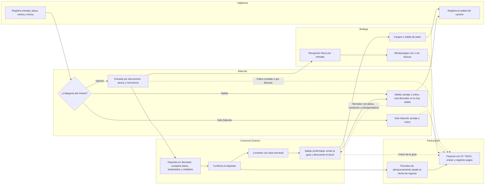

Lo que cambia respecto de la v2 de hoy, en una línea por bloque:

- **Báscula.** Formulario en página propia, de tres pasos y con la sección Vigilancia. Una entrada por documento. Pesos como el legacy, repesaje en modal e historial en tres páginas (2.1).
- **Bodega.**
  - Sin «llegada» ni bloqueos sobre Báscula; alertas amarillas y rojas configurables.
  - «Entradas» y «Salidas» en el menú; recepción directa en página propia.
  - El cargue ya no mueve stock ni pide sello (2.2).
- **Comercio Exterior.**
  - Depósitos por tipo en tabla maestro-detalle, y detalle por etapas con amparados.
  - Edición en Confirmado; levantes en tabla, con cálculo desde el peso y tasa semanal.
  - Salidas con tipo y estado (2.3, 3.7).
- **Facturación.**
  - Facturar en un paso; N.º SIGO corregible.
  - «Facturar a» por cliente e importador; ciclo libre en días.
  - Pendientes solo con trabajo; reportes con contado y por cobrar.
  - Acuerdos en «Tarifas y acuerdos», con plantilla y fórmulas nuevas (2.4).
- **Transversales.**
  - Menú con «Configuración», «Tarifas y acuerdos» y «Reportes».
  - Listados sin tarjeta de título y con filtros por columna.
  - Notificaciones configurables y unidad de medida retirada (3).

## 2. Módulos

### 2.1. Báscula

#### a. Alcance

| Tipo | Elementos |
|---|---|
| Hallazgos tratados aquí | H-001, H-002, H-003, H-005, H-006, H-007, H-009, H-010, H-011, H-012, H-013, H-014, H-015, H-016, H-018, H-019, H-020, H-021, H-022, H-023, H-075, H-085 |
| Hallazgos citados (se tratan en otra sección) | H-004 (3.3), H-008, H-074 y H-084 (3.6), H-017 y H-072 (3.7), H-024, H-073 y H-076 (2.2), H-068 (2.4) |
| Propuestas | PR-01 a PR-09 y PR-32. Decididas en este bloque por AF-03, pero redactadas en su sección: PR-10 (2.2), PR-11 (3.6), PR-12 (3.8) y PR-21 (3.7) |
| Diferencias | D-01 a D-09 (D-10 va en 3.6) |
| Temas de §12 de la fase 1 | §12.1, §12.2, §12.13, §12.14 y §12.18 |
| Brechas de la paridad | Brecha 10 (segundo documento de un camión con depósito abierto) |
| Mockups | MK-01 (fase 1), **MK-01 v2** (`docs/levantamiento_staging/mockups/modelo_bascula/formulario_registro_v2/`, del usuario, 2026-11-18) y **MK-07** (`docs/levantamiento_staging/mockups/modelo_bascula/detalle_pesaje/`, del usuario, 2026-11-18) |

H-009 y H-023 se cerraron sin cambio en la fase 1 (PA-03, PA-07). H-009 queda cubierto además por AF-07 (guardar sin pesos).

#### b. Actores y roles

| Rol | Qué hace en Báscula |
|---|---|
| Operario de vigilancia (`Receiving`) | Registra el ingreso del camión (placa, motivo y fecha y hora) y su salida. Sus datos se pueden corregir desde Báscula (AF-08) |
| Operario de báscula (`Scale`) | Toma el camión de la cola, corrige lo de Vigilancia, registra documentos, mercancía y pesos, cobra, imprime y repesa. Consulta el historial, corrige el ingreso hasta que Comercio Exterior confirma el depósito (AF-26) y anula pesajes |
| Comercio Exterior (`ForeignTrade`) | Recibe el depósito en Borrador y lo confirma. Corrige los datos y los pesos del ingreso en cualquier estado (3.6). Completa la salida que Báscula crea en Borrador y emite la guía (3.7) |
| Operario de bodega (`Warehouse`) | Registra la llegada y la recepción del camión, y el cargue de la salida. Ya no bloquea a Báscula (AF-14) |
| Facturación (`Billing`) | Recibe los cobros de báscula (contado o pendiente por facturar). No interviene en la pantalla |
| Administrador (`Admin`) | Mantiene el catálogo de motivos de ingreso con su categoría (AF-08, sección 3.2) |

#### c. Flujo de negocio

El camión entra por Vigilancia y queda en la cola de báscula. La **categoría del motivo de ingreso** (Ingreso, Salida o Solo báscula, AF-08) decide qué registra Báscula:

- **Ingreso con depósito** (importación, exportación o inspección): un documento por entrada, con su mercancía y sus pesos. Si el camión trae varios documentos, el operario duplica la entrada: queda una entrada por documento, cada una con sus pesos y su repesaje (AF-44, AF-46). Cada entrada abre un depósito en Borrador o se suma a uno abierto de su documento (DEC-057 D1, AF-20). Comercio Exterior lo completa y lo confirma; Bodega recibe la mercancía sin frenar a Báscula.
- **Salida** (por número de depósito o consolidada): la placa trae la salida que Comercio Exterior creó antes, o Báscula crea una nueva en Borrador con placa, conductor y transportadora (AF-30, AF-37). Las salidas por tiquete de entrada y global no pasan por báscula (AF-29).
- **Solo báscula**: peso, tercero opcional y cobro.

El dinero: un cobro de báscula por camión (contado o pendiente por facturar); el documento que se entrega dice que no es factura (H-068). El repesaje no cobra (AF-13). Con entradas duplicadas cobra la primera y las duplicadas van en $0 (AF-47).

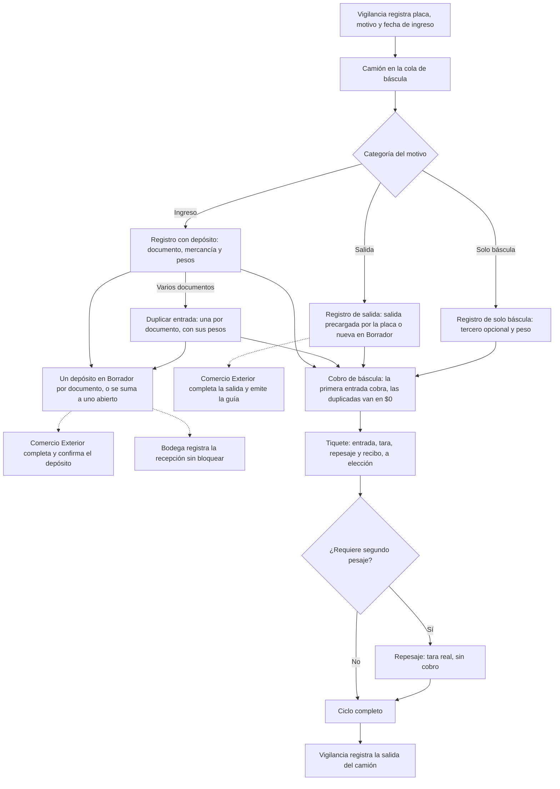

Estados del camión en la cola (el ciclo de báscula):

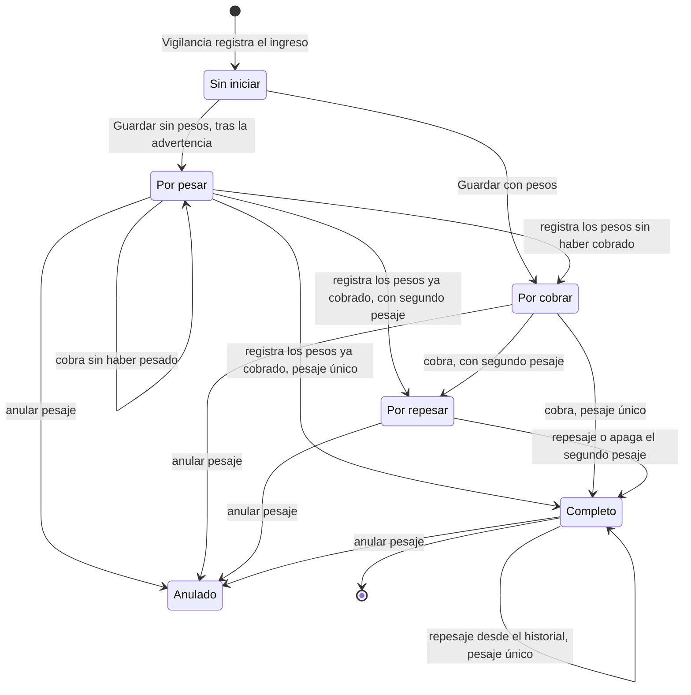

«En atención» (MK-01 v2) no es un estado del ciclo: marca en el panel de la cola el camión que el operario tiene abierto.

#### d. Flujo del operario

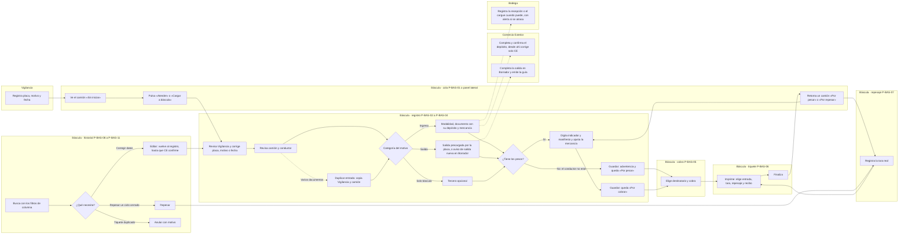

Caminos alternos que cubre el flujo:

- **Guardar sin pesaje.** El conductor no está o el camión llegó fuera de horario (H-009): «Guardar» advierte y deja el camión «Por pesar»; se puede cobrar y pesar después, retomándolo desde la cola (AF-07).
- **Camión que llega a cargar sin salida previa.** Báscula ve el aviso de salida nueva y guarda; queda una salida en Borrador para Comercio Exterior (AF-30, AF-37).
- **Varios documentos en un camión.** Con las secciones 1 y 2 completas, «Duplicar entrada» crea otra entrada del mismo camión con esos datos copiados, y el operario llena documento, mercancía y pesos. Cada entrada se pesa, se cobra y se repesa por su cuenta: cobra la primera y las duplicadas van en $0. En la cola cada entrada aparece con su mercancía. Una duplicada por error se quita si no se ha guardado; guardada, se anula (AF-44 a AF-49).
- **Corrección después de registrar.** Desde el historial, «Editar» reabre el registro mientras el depósito no esté confirmado; después corrige Comercio Exterior (AF-26).
- **Bodega retrasada.** Báscula repesa igual; Bodega registra la recepción después y salta la alerta de 2.2 (AF-14, AF-65).
- **Ciclo único que necesita repesaje.** «Repesar» desde el historial o el detalle (AF-11, AF-40).
- **Camión que no descarga.** Se apaga «Req. 2.º pesaje» y el ciclo se cierra con el primer peso (AF-11).
- **Tiquete duplicado o arrastre mal registrado.** «Anular pesaje» con motivo (AF-23) o corrección del ingreso (AF-26).

#### e. Comparación legacy / v2 / acordado

Rutas: `B/` = `Backend/wms-api/`, `F/` = `Frontend/wms/app/`, `L/` = `bodegas-legacy/modulos/`.

| Tema | Legacy | v2 hoy (`develop`) | Acordado | Evidencia y decisión |
|---|---|---|---|---|
| Dónde se registra | Páginas por tipo (`L/mod_bascula/registrarentradabascula.php`) | Panel sobre la cola, que no se desmonta; cierra con «Volver a la cola» | Página propia con la cola en un panel lateral; la tabla principal se conserva | `F/pages/operations/weighbridge/index.vue:1702-1771`; DEC-058; **AF-05** |
| Pasos | Pesos en el mismo formulario del registro; recibo después | Registro → Cobro → Peso → Tiquete; cobra antes de pesar | Registro (con pesos) → Cobro → Tiquete | `index.vue:1885-2001`; **AF-06** |
| Guardar | — | Un «Guardar» en el encabezado | Un «Guardar»: sin pesos advierte y deja «Por pesar»; con pesos, «Por cobrar» | `index.vue:1760-1771`; PR-03; **AF-07** |
| Qué formulario se muestra | Menú por tipo de entrada | Selector «Tipo de operación», preseleccionado por una tabla fija de 5 motivos | Lo decide la categoría del motivo; cambiar el motivo cambia el formulario | `F/features/weighbridge/utils/entry-reason-operation.ts:17-28`; PR-02; **AF-08** |
| Datos de Vigilancia | Báscula digita la placa | Los corrige Vigilancia o Admin (`EntryCorrectionAccess`) | Báscula corrige motivo, fecha y placa en la sección Vigilancia | H-012, H-075; **AF-08** |
| Pesos del ingreso | Indicador y manifiesto digitados; mercancía = manifiesto, editable; tara = indicador − mercancía | Cuatro pesos en el paso de peso, mercancía = manifiesto sin poder cambiarla | Como el legacy; con repesaje, la mercancía pasa a indicador − tara real | `L/mod_bascula/registrarentradabascula.php:846-858`; `F/features/weighbridge/components/WeightCapture.vue:462-520`; **AF-09, AF-41** |
| Manifiesto | Opcional (`pesaje.nro_manifiestoemp` admite nulo) | Número y peso obligatorios en todo ingreso | Número y peso solo con carta porte | `B/Wms.Application/Weighbridge/Commands/Storage/Initiate/InitiateStorageWeighingValidator.cs:102-108`; DEC-057 (H2); H-015; **AF-12** |
| «Pesaje y observaciones» | — | Fecha de ingreso, primer pesaje, perecederos, observaciones, documentos adicionales | Se quita; queda «Req. 2.º pesaje» en el encabezado | `F/features/weighbridge/components/StorageServiceForm.vue:1263-1340`; **AF-10** |
| Ciclo de uno o dos pesajes | Repesa cuando quiera | Se fija al registrar | Switch editable hasta cerrar; un ciclo único cerrado se reabre para un repesaje desde el historial | H-002; **AF-11, AF-40** |
| Repesaje | Ilimitado, otro pesaje sin cobro que no cambia el original | Segundo pesaje del ciclo; correcciones con motivo | Modal, uno por ciclo, sin cobro | `L/mod_bascula/repesarentrada.php:63`, `:71-95`; `listarentradasbascula.php:518-520`; D-09; **AF-13** |
| Bloqueos de Bodega | No hay | 409 sin llegada a Bodega antes del segundo pesaje; 409 en el repesaje de salida sin cargue | Ninguno; la salida se completa cuando haya pesaje y cargue | `B/…/Weighbridge/Common/Services/ReceptionArrivalRules.cs:12-19`; `ExitLoadingRules.cs:25-40`; DEC-019; **AF-14, AF-31** |
| Historial | Entradas, salidas y solo pesaje, cada una con sus columnas | Una página con pestañas Entradas/Salidas, panel de filtros y 4 tarjetas | Tres páginas con las columnas del legacy, filtros por columna y detalle en drawer | `L/mod_bascula/listarentradasbascula.php:357-376`; `F/pages/operations/weighbridge/history.vue:370-420`; `F/features/weighbridge/components/WeighbridgeHistoryTable.vue:100-221`; D-03, D-08; **AF-15** |
| Cola | — | Placa, estado, motivo, cliente, conductor, modalidad, documento, primer peso, espera | Además P. bruto, P. mercancía, tara y la mercancía (producto, embalaje y peso); una fila por entrada | `F/features/weighbridge/components/TruckQueue.vue:227-287`; H-003; **AF-15, AF-44** |
| Solo báscula | Tercero a facturar | Cliente opcional y peso esperado | Tercero con selector paginado; sin peso esperado | `F/features/weighbridge/components/WeighingOnlyForm.vue:168-188`; **AF-16** |
| «Soltar camión» | — | Cierra y descarta lo no guardado | Se quita | `index.vue:1423-1435`, `:1749-1758`; **AF-16** |
| Tiquete impreso | Tiquete o recibo, cada uno de entrada, de tara o de entrada y tara, elegidos con imágenes; el repesaje aparte | Hoja fija de 80×200 mm, solo «PRODUCTO»; se ofrece con el ciclo completo; «Imprimir sin observaciones» y «Guardar e Imprimir» en el historial | Un «Imprimir» que abre un modal: casillas Entrada, Tara y Repesaje, «Incluir recibo» y observación; desde el primer peso; altura del contenido; producto, embalaje y cantidad | `L/mod_bascula/facturar.php:236-292`; `B/…/Weighbridge/Common/Services/WeighbridgeTicketPdfService.cs:28`, `:345-351`; `index.vue:2000-2001`; `history.vue:889-903`; D-02; **AF-16, AF-24, AF-52, AF-53** |
| Recuperar operaciones | — | Página `/operations/weighbridge/recover` para retomar o descartar operaciones a medias, con botón en la cola | Desaparece: se retoma desde la cola y se descarta anulando | `F/pages/operations/weighbridge/recover.vue`; `index.vue:1672-1680`; **AF-51** |
| Inspección | Sin depósito: placa, conductor, peso y mercancía | Depósito con carta porte y producto obligatorios | Depósito con documento y producto opcionales y descripción obligatoria | `InitiateStorageWeighingValidator.cs:24-26`, `:133-141`; D-01; **AF-17** |
| Conductores con el mismo documento | Se agrega un punto al número | Índice único por tipo y número | Se permiten si el nombre difiere | `B/Wms.Infrastructure/Persistence/Configurations/Logistics/DriverConfiguration.cs:24`; DEC-017; D-06; **AF-18** |
| Camión con varios documentos | Un registro (pesaje) por documento; cada uno puede unirse a su ingreso abierto. «Vehículo con varios Doc.» no tiene uso en el volcado | Un solo ciclo: el adicional se registra tras el primer peso, siempre crea depósito nuevo y comparte bruto y tara (DEC-050 BR-02-013) | Una entrada por documento con «Duplicar entrada»; cada una con sus pesos, su repesaje y su depósito, que puede ser el abierto de su documento; cobra la primera | `L/mod_bascula/seleccionardocumercial.php:13-18`; `WeightCapture.vue:433`; `InitiateStorageWeighingHandler.cs:962-968`; D-07; **AF-20, AF-43, AF-44, AF-46 a AF-49** |
| Unidad de medida | No existe | Columna «Unidad» en la mercancía | Se quita de toda la app | `F/features/weighbridge/components/TruckGoodsLines.vue:263-264`; H-018; **AF-22** (3.8) |
| Tipo de vehículo | — | Obligatorio en «Camión y conductor» | Sale de báscula; lo registra Bodega | DEC-057 (nota H1); **AF-21** (2.2) |
| Unidades de carga | Texto libre que escribe Comercio Exterior | Báscula elige el tipo de carga y registra cada unidad | Las registra Comercio Exterior al editar el ingreso | `StorageServiceForm.vue:1095-1144`; **AF-27** (3.6) |
| Eliminar tiquetes | Pide razón y marca en rojo | «Anular pesaje» con motivo | Basta la anulación; el anulado se ve resaltado | `L/mod_bascula/eliminarentrada.php:68-119`; `index.vue:1965-1975`; D-04; **AF-23** |
| Corrección tras registrar | Báscula edita hasta que Comercio Exterior asigna productos | Báscula: pesos con motivo, fecha, conductor y vehículo | Báscula corrige todo el ingreso hasta que Comercio Exterior confirma | `L/mod_bascula/listarentradasbascula.php:389-420`, `:533-550`; DEC-050 (BR-02-010); **AF-26** (3.6) |
| Carta porte | Lista de coincidencias al digitar | Busca al salir del campo y muestra los depósitos abiertos | Sugerencias al digitar; al elegir, el depósito como hoy | `StorageServiceForm.vue:1027-1061`; D-05; **AF-24** |
| Transportadora | Busca por nombre | Trae todas y filtra por nombre | Busca por nombre o NIT, paginada | `F/features/weighbridge/components/CompleteEntryInfo.vue:126-127`; **AF-24** |
| Tipo de documento | — | La memoria de la sesión recuerda el último | «Carta porte» por defecto | `F/features/weighbridge/composables/useEntryFormMemory.ts`; **AF-25** |
| Conductor en el cobro | — | No se actualiza si se cambia en el registro | Selector preseleccionado con el del registro | H-020; **AF-25** |
| Salida | Pesaje de salida sin orden; Comercio Exterior registra la salida después | Exige una orden de cargue previa; busca por número o placa | Salida precargada por la placa o creada en Borrador | `L/mod_bascula/registrarsalida.php`; `F/features/weighbridge/components/OutputServiceForm.vue:237-300`; DEC-050 (BR-02-001); **AF-30, AF-34, AF-37** (3.7) |

#### f. Reglas de negocio y validaciones

**Obligatoriedad en el registro.**

| Dato | Importación / exportación | Inspección | Salida | Solo báscula |
|---|---|---|---|---|
| Motivo, fecha y hora de ingreso, placa | Sí | Sí | Sí | Sí |
| Transportadora, país del vehículo, conductor | Sí | Sí | Sí | Sí |
| Modalidad | Sí | Sí | No (AF-37) | No |
| Tipo y número de documento | Sí | No (AF-17) | No | No |
| Número y peso del manifiesto | Solo con carta porte (AF-12) | Solo con carta porte | No | No |
| Producto y cantidad (embalaje opcional, como hoy) | Sí | No (AF-17) | No: la pone Comercio Exterior | No |
| Descripción de la inspección | — | Sí (AF-17) | — | — |
| P. indicador | No: sin él queda «Por pesar» (AF-07) | Igual | Igual | Igual |
| P. mercancía | No (AF-39) | No | — | — |
| Tercero | — | — | — | No (AF-16) |

**Cálculo de los pesos (AF-09, AF-41).**

- P. mercancía se precarga con el P. manifiesto de la entrada y el operario la puede cambiar.
- P. vehículo (tara) = P. indicador − P. mercancía, mientras no haya repesaje.
- Con repesaje: P. vehículo = tara real y P. mercancía = P. indicador − tara real. La mercancía que usan el depósito y el levante es esta; Comercio Exterior ve al lado el P. manifiesto y la diferencia, y la puede corregir (3.6).
- Sin carta porte no hay manifiesto: la mercancía puede quedar vacía hasta el repesaje o la corrección de Comercio Exterior (AF-39).
- El cobro de almacenamiento por peso sigue con la suma de los manifiestos, como hoy. Lo que pasa sin manifiesto se trata en 2.4.

**Ciclo y repesaje (AF-11, AF-13, AF-40).**

- «Req. 2.º pesaje» se puede cambiar hasta cerrar el ciclo. Apagarlo con el primer peso tomado cierra el ciclo con ese peso.
- Un ciclo de pesaje único cerrado admite un repesaje desde el historial o el detalle, aunque el camión haya salido por Vigilancia.
- Un solo repesaje por ciclo, sin cobro. Un repesaje equivocado se corrige con motivo («Editar pesajes»), no con otro repesaje.
- Cada entrada duplicada tiene su propio ciclo, con sus pesos y su repesaje. Ya no hay pesaje compartido entre depósitos ni pesajes intermedios (AF-46; se reabre DEC-050 BR-02-013).

**Quién corrige y hasta cuándo (AF-08, AF-26).** Báscula corrige los datos de Vigilancia (motivo, fecha y placa) y todo el ingreso hasta que Comercio Exterior confirma el depósito; después corrige Comercio Exterior (3.6). La modalidad no cambia después de guardar: se anula y se repite. Un cambio de motivo que cambie su categoría después de guardar se trata igual, porque cambia el tipo de operación. La fecha de ingreso conserva los límites de DEC-012 y DEC-051. El cobro de un tiquete guardado no se edita en Báscula (DEC-057 H5c).

**Varios documentos: entradas duplicadas (AF-44 a AF-49, AF-20).**

- «Duplicar entrada» está en el encabezado, junto a la placa y los datos de ingreso, y se habilita cuando las secciones 1 (Vigilancia) y 2 (Camión y conductor) están completas.
- Se puede duplicar cuantas veces haga falta. La entrada nueva copia las secciones 1 y 2; el operario llena la 3 (modalidad, documento, depósito y mercancía) y la 4 (pesos).
- Cada entrada es independiente: su documento, su depósito (con la elección de DEC-057 D1, que admite un depósito abierto de su número), sus pesos, su repesaje y su tiquete.
- Cobra la primera entrada; las duplicadas pasan por el cobro con valor $0.
- Una duplicada por error se quita sin dejar rastro si no se ha guardado: basta salir sin guardar («Volver a la cola» o cambiar de camión), porque lo no guardado se pierde (AF-05). Guardada, se anula con motivo (AF-23).
- En la cola y en su panel, cada entrada aparece aparte, con la placa y su mercancía (producto, embalaje y peso), para distinguirlas.

**Sin bloqueos de Bodega (AF-14).** Báscula no espera la llegada de Bodega para el segundo pesaje ni el cargue para el repesaje de salida. El atraso lo vigila la alerta de 2.2 (PR-14). La salida se completa cuando hay pesaje y cargue (AF-31, AF-35) y muestra cuál falta.

**Tiquete impreso (AF-16, AF-24).**

- Se imprime con un solo botón «Imprimir», que abre el modal P-BAS-13 en el paso Tiquete, en el detalle y en la fila del historial (AF-53).
- En el modal se combinan las casillas «Entrada» (bruto), «Tara» (calculada o real) y «Repesaje», más «Incluir recibo» (valor) y la observación opcional. Entrada + Tara equivale al «Entrada y tara» del legacy (AF-52).
- Las casillas llegan marcadas según lo que ya tiene la entrada; lo que aún no existe (por ejemplo, el repesaje pendiente) sale deshabilitado.
- Se puede imprimir y reimprimir desde el primer peso, también con el repesaje pendiente (AF-24, AF-50).
- La hoja toma la altura de su contenido y lleva una línea por mercancía con producto, embalaje y cantidad.
- Conserva la leyenda de documento interno, que no es factura de venta (H-068).

**Salida en báscula (AF-30, AF-34, AF-37).**

- La placa de Vigilancia precarga la salida que Comercio Exterior creó antes.
- Si la placa no tiene salida, Báscula crea una en Borrador con placa, conductor y transportadora; la modalidad sale después del depósito.
- Si Báscula cambia el conductor, el cambio pasa a la salida y a la guía si aún no se emitió; si ya se emitió, se avisa a Comercio Exterior.
- Báscula se cobra en las salidas por número de depósito y consolidada (AF-33).

**Cobro (AF-25, AF-47, AF-54).** El cobro conserva sus destinatarios de hoy: tercero registrado, conductor del vehículo, persona no registrada y consumidor final. El selector de tercero registrado tiene alta rápida («+»). El formulario de cobro es el mismo en báscula, montacargas y guía de salida, así que el alta rápida llega también a esos cobros (2.2, 3.7).

**Anulación (AF-23).** «Anular pesaje» con motivo de 10 a 500 caracteres, como hoy. En el historial, el anulado se ve resaltado con su motivo.

**Conductores (AF-18).** Puede haber varios conductores con el mismo tipo y número de documento si el nombre difiere. El selector muestra nombre y documento para elegir.

#### g. Pantallas

Wireframes en [`fase_2-mockups/bascula.html`](./fase_2-mockups/bascula.html). Los listados y formularios siguen los patrones que se definan en 3.3: encabezado y filtros (PR-29 frente a DEC-058) y labels flotantes (AF-38).

**P-BAS-01 · Cola de báscula** — [`bascula.html#P-BAS-01`](./fase_2-mockups/bascula.html#P-BAS-01). Página `/operations/weighbridge`, que se conserva (AF-05).

| Columna o filtro | Origen | Regla |
|---|---|---|
| Filtros de estado | Estado del ciclo | Todos, Sin iniciar, Por pesar, Por cobrar, Por repesar |
| Placa, estado, motivo, cliente, conductor, modalidad, documento, espera | Como hoy | Una fila por entrada: las duplicadas repiten la placa |
| Mercancía | Línea de mercancía de la entrada | Producto, embalaje y peso, para distinguir las entradas de un mismo camión (AF-44) |
| P. bruto, P. mercancía, tara | Pesos del registro | Nuevas (AF-15); vacías mientras el camión esté «Sin iniciar» o «Por pesar» |
| Acciones: «Atender» | — | Abre P-BAS-02 a P-BAS-04 según la categoría del motivo. La fila no abre nada al hacer clic (H-004, 3.3) |
| Encabezado | — | Sin «Recuperar operaciones»: la página `/recover` se retira (AF-51) |

**P-BAS-02 · Formulario de registro, ingreso con depósito** — [`bascula.html#P-BAS-02`](./fase_2-mockups/bascula.html#P-BAS-02). Página propia con el panel de la cola a la derecha.

| Campo | Tipo | Obligatorio | Origen del dato | Quién lo edita | Cuándo es editable | Regla |
|---|---|---|---|---|---|---|
| Duplicar entrada | Botón (encabezado, junto a la placa) | — | — | Báscula | Con las secciones 1 y 2 completas | AF-44, AF-49 |
| Req. 2.º pesaje | Switch (encabezado) | — | Configuración del ciclo | Báscula | Hasta cerrar el ciclo | AF-11 |
| Motivo de ingreso | Selector del catálogo | Sí | Vigilancia | Vigilancia, Báscula | Hasta que CE confirme; no puede cambiar de categoría después de guardar | Su categoría decide el formulario (AF-08) |
| Fecha y hora de ingreso | Fecha y hora | Sí | Vigilancia | Vigilancia, Báscula, CE | Hasta que CE confirme (Báscula) | No futura, dentro de la estadía del primer camión (DEC-012, DEC-051) |
| Placa | Texto | Sí | Vigilancia | Vigilancia, Báscula | Hasta que CE confirme | H-075 |
| Transportadora | Selector paginado (nombre o NIT) con alta rápida («+»), como hoy | Sí | Vehículo o memoria del turno | Báscula | Hasta que CE confirme | H-013; sin regresión del alta rápida de hoy (`F/features/entries/components/VehicleForm.vue:376-380`, AF-54) |
| País del vehículo | Selector | Sí | Vehículo o memoria | Báscula | Hasta que CE confirme | — |
| Conductor | Selector paginado (nombre o documento), con alta y corrección | Sí | Vigilancia o vehículo | Báscula | Hasta que CE confirme | AF-18 |
| Modalidad | Radio (importación, exportación, inspección) | Sí | Motivo o memoria | Báscula | Antes de guardar | Una sola (C-13); no cambia después (AF-26) |
| Tipo de documento | Selector | Sí, salvo inspección | «Carta porte» por defecto | Báscula, CE | Báscula hasta que CE confirme; CE siempre | H-016 |
| Número de documento | Texto con sugerencias | Sí, salvo inspección | Báscula | Báscula, CE | Igual | Sugiere documentos de depósitos abiertos (H-011); cambiarlo repite la elección del depósito |
| Depósito | Selector | Sí, si el documento tiene depósitos abiertos | Búsqueda del documento | Báscula | Antes de guardar | DEC-057 D1; cada entrada duplicada elige el suyo (AF-20, AF-44) |
| N.º de manifiesto | Texto | Solo con carta porte | Báscula | Báscula, CE | Igual que el documento | AF-12 |
| Descripción de la inspección | Texto | Sí, en inspección | Báscula | Báscula, CE | Igual | AF-17 |
| Producto | Selector del catálogo o texto libre | Sí, salvo inspección | Catálogo | Báscula, CE | Igual | El texto libre crea el producto y avisa a CE, como hoy |
| Embalaje | Selector | No, como hoy | Producto | Báscula, CE | Igual | Sin unidad de medida (AF-22) |
| Cantidad | Número | Sí, salvo inspección | Báscula | Báscula, CE | Igual | — |
| P. indicador | Número (kg) | No (sin él, «Por pesar») | Báscula | Báscula; CE en 3.6 | Hasta que CE confirme (Báscula) | Primer pesaje, siempre bruto en un ingreso |
| P. vehículo / tara | Calculado | — | Indicador − mercancía, o el repesaje | — | — | AF-09, AF-41 |
| P. manifiesto | Número (kg) | Solo con carta porte | Báscula | Báscula, CE | Báscula hasta que CE confirme; CE siempre | AF-12; precarga la mercancía |
| P. mercancía | Número (kg) | No (AF-39) | Precargado con el manifiesto | Báscula, CE | Igual | AF-09 |

Acciones:

- «Guardar»: con P. indicador, «Por cobrar»; sin él, advertencia y «Por pesar». En los dos casos lleva a P-BAS-05.
- «Volver a la cola»: lo no guardado se pierde (AF-05).
- «Duplicar entrada» (encabezado, junto a la placa): abre una entrada nueva con las secciones 1 y 2 copiadas.
- «+ Agregar producto», en el encabezado de «Mercancía declarada»; la papelera de cada línea la quita.
- En el panel de la cola, «Cargar a báscula» abre otro camión.

Sigue la estructura y la ubicación de botones de MK-01 v2 (AF-45). Se aparta en:

- sale «Tipo de vehículo» de «Camión y conductor» (AF-21);
- la tara se calcula como el legacy (AF-09) y no se digita, aunque el mockup la muestre como campo con «Calculado o histórico»;
- el bloque oculto de «Datos para Comercio Exterior» del HTML de MK-01 v2 no va (C-11);
- en inspección se agrega «Descripción de la inspección» en la sección 3 (AF-17).

**P-BAS-03 · Formulario de registro, salida** — [`bascula.html#P-BAS-03`](./fase_2-mockups/bascula.html#P-BAS-03).

| Campo | Tipo | Obligatorio | Origen del dato | Quién lo edita | Cuándo es editable | Regla |
|---|---|---|---|---|---|---|
| Vigilancia, camión y conductor | Como en P-BAS-02 | Sí | Vigilancia | Báscula | Hasta cerrar la salida | El conductor pasa a la salida (AF-34) |
| Salida de mercancía | Solo lectura (número, tipo, estado, depósitos, mercancía, guía) | — | Salida que la placa tiene en Borrador o Confirmada | CE | — | Si no hay, aviso de salida nueva en Borrador (AF-30, AF-37) |
| P. indicador | Número (kg) | No (sin él, «Por pesar») | Báscula | Báscula | Hasta cerrar el ciclo | Primer peso, vehículo vacío |

Acciones: las de P-BAS-02. Respecto de MK-01: la fase 1 decía que «Salida de mercancía» conservaba sus secciones actuales (PR-01); cambian por la nueva salida (3.7).

**P-BAS-04 · Formulario de registro, solo báscula** — [`bascula.html#P-BAS-04`](./fase_2-mockups/bascula.html#P-BAS-04).

| Campo | Tipo | Obligatorio | Origen del dato | Quién lo edita | Cuándo es editable | Regla |
|---|---|---|---|---|---|---|
| Tercero | Selector paginado (nombre o NIT) con alta rápida («+») | No | Catálogo de terceros | Báscula | Hasta cerrar el ciclo | Reemplaza a «Cliente»; sin «Peso esperado» (AF-16); alta rápida (AF-54) |
| Peso | Número (kg) | No (sin él, «Por pesar») | Báscula | Báscula | Hasta cerrar el ciclo | — |

**P-BAS-05 · Paso 2, cobro** — [`bascula.html#P-BAS-05`](./fase_2-mockups/bascula.html#P-BAS-05). Conserva la distribución y la lógica del cobro de hoy.

| Campo | Tipo | Obligatorio | Origen del dato | Quién lo edita | Cuándo es editable | Regla |
|---|---|---|---|---|---|---|
| Resumen del registro | Solo lectura con «Editar registro» | — | Paso 1 | Báscula | Mientras se cobra | H-019: vuelve al paso 1 |
| Destinatario | Radio: Tercero registrado, Conductor del vehículo, Persona no registrada, Consumidor final | Sí | Cliente del depósito o conductor | Báscula | Antes de cobrar | Los de hoy, sin cambios (`F/features/billing/components/BillingCollectForm.vue:500-548`, AF-54) |
| Tercero registrado | Selector paginado con alta rápida («+») | Sí, si es el destinatario | Cliente del depósito, preseleccionado | Báscula | Antes de cobrar | Alta rápida nueva (AF-54) |
| Conductor del vehículo | Datos del conductor | Sí, si es el destinatario | Conductor del registro | Báscula | Antes de cobrar | H-020: si cambia el conductor del registro, el cobro se actualiza |
| Persona no registrada | Nombre, tipo y número de identificación | Sí, si es el destinatario | Báscula | Báscula | Antes de cobrar | Como hoy |
| Método de pago y referencia | Selector y texto | Método sí; referencia no | — | Báscula | Antes de cobrar | Método precargado en «Efectivo»; «Referencia» solo con otro método; sin «Nota» (AF-132) |
| Valor | Calculado | — | Tarifa o convenio | — | — | Báscula en $0 solo por convenio (DEC-057 H5b) o por ser entrada duplicada (AF-47) |
| Modo de pago | Selector | Sí | — | Báscula | Antes de cobrar | Inmediato o pendiente por facturar |

**P-BAS-06 · Paso 3, tiquete** — [`bascula.html#P-BAS-06`](./fase_2-mockups/bascula.html#P-BAS-06).

- Acciones: «Imprimir», que abre el modal P-BAS-13 (AF-53), y «Finalizar».
- La observación del tiquete se pide en el modal.

**P-BAS-07 · Modal de repesaje** — [`bascula.html#P-BAS-07`](./fase_2-mockups/bascula.html#P-BAS-07).

| Campo | Tipo | Obligatorio | Origen del dato | Quién lo edita | Cuándo es editable | Regla |
|---|---|---|---|---|---|---|
| Datos del registro y P. indicador, P. manifiesto | Solo lectura | — | Registro | — | — | PR-04 |
| P. vehículo / tara | Número (kg), del indicador | Sí | Báscula | Báscula | Al repesar | Un repesaje por ciclo (AF-13) |
| P. mercancía | Calculado | — | Indicador − tara real | — | — | Muestra la diferencia con el manifiesto (AF-41) |
| Fecha y hora del repesaje | Fecha y hora, precargada | Sí | Reloj | Báscula | Al repesar | — |

Acciones: «Registrar repesaje» y «Cancelar». Se abre desde la cola («Por repesar»), desde el historial y desde el detalle (AF-40).

**P-BAS-08 · Historial › Entradas** — [`bascula.html#P-BAS-08`](./fase_2-mockups/bascula.html#P-BAS-08).

- Pestañas: Importación, Exportación e Inspección.
- Columnas del legacy: fecha y hora, vehículo, conductor, ID del conductor, P. bruto, P. mercancía, tara, cantidad, peso del manifiesto, documento de entrada, repesa, valor, tiquete, estado y acciones. Cada columna tiene su filtro.
- Orden: más reciente primero (H-007).
- Acciones:
  - «Ver»: abre el drawer P-BAS-11.
  - «Editar»: abre P-BAS-02 hasta que CE confirme el depósito.
  - «Repesar»: solo en ciclos de pesaje único cerrados.
  - «Imprimir»: abre el modal P-BAS-13 (AF-53).
  - «Anular».
- Una fila por entrada: las entradas duplicadas aparecen como filas propias (AF-50).
- Los anulados se ven resaltados.
- MK de referencia: ninguno; la tabla sigue PR-05 y H-003.

**P-BAS-09 · Historial › Salidas** — [`bascula.html#P-BAS-09`](./fase_2-mockups/bascula.html#P-BAS-09). Columnas del legacy (`L/mod_bascula/listarsalidas.php`): fecha y hora, vehículo, conductor, ID del conductor, mercancía, peso del vehículo, peso al salir, peso de la mercancía, repesa y valor. Se agregan salida, tiquete y estado. Mismas acciones que Entradas; «Editar» corrige pesos y datos con motivo, también con el ciclo cerrado (AF-135, 3.6).

**P-BAS-10 · Historial › Solo báscula** — [`bascula.html#P-BAS-10`](./fase_2-mockups/bascula.html#P-BAS-10). Columnas del legacy (`L/mod_bascula/listarsolopesajes.php`): fecha y hora, vehículo, conductor, ID del conductor, pesaje, repesaje, tara y valor. «Mercancía» pasa a «Tercero» (PR-06) y se agregan tiquete y estado.

**P-BAS-11 · Detalle del ciclo (drawer)** — [`bascula.html#P-BAS-11`](./fase_2-mockups/bascula.html#P-BAS-11). Reemplaza el modal de detalle del historial (`F/pages/operations/weighbridge/history.vue:515-847`).

- Sigue la estructura y la ubicación de botones de MK-07 (AF-45):
  - encabezado con título, estado, placa y fecha de ingreso, y los botones de ampliar y cerrar;
  - «1. Datos del vehículo y entrada»: conductor, empresa y tipo, motivo y fecha;
  - «2. Pesaje en báscula (kg)»: los cuatro pesos en la distribución 2×2 del registro, con sus fechas, «Editar pesajes» y el aviso si el manifiesto supera la diferencia de pesajes;
  - «Tickets asociados»: el tiquete de esta entrada, con su peso declarado y su valor ($0 si es duplicada). Las otras entradas del camión tienen su propia fila en el historial y su propio detalle (AF-50);
  - «Factura y cobro», reducido como en MK-07: factura, cliente, total cobrado y estado.
- Pie: «Anular pesaje» a la izquierda; «Imprimir tiquete» y «Cerrar» a la derecha. «Imprimir tiquete» abre el modal P-BAS-13 (AF-53). Se agrega «Repesar» junto a «Imprimir tiquete», solo en ciclos de pesaje único cerrados (AF-40).

**P-BAS-12 · Tiquete impreso** — [`bascula.html#P-BAS-12`](./fase_2-mockups/bascula.html#P-BAS-12). Contenido de hoy, con una línea por mercancía (producto, embalaje, cantidad) y la altura ajustada al contenido. Lo que imprime depende de lo marcado en P-BAS-13.

**P-BAS-13 · Modal de impresión** — [`bascula.html#P-BAS-13`](./fase_2-mockups/bascula.html#P-BAS-13). Se abre desde «Imprimir» en P-BAS-06, P-BAS-08 a P-BAS-10 y P-BAS-11 (AF-53). Reemplaza «Imprimir sin observaciones» y «Guardar e Imprimir» del historial actual (`F/pages/operations/weighbridge/history.vue:869-909`).

| Campo | Tipo | Obligatorio | Origen del dato | Quién lo edita | Cuándo es editable | Regla |
|---|---|---|---|---|---|---|
| Entrada | Casilla | Al menos una casilla | Primer peso (bruto) | Báscula | Siempre que exista el primer peso | Marcada por defecto si existe (AF-52) |
| Tara | Casilla | Al menos una casilla | Tara calculada o real | Báscula | Siempre que exista el primer peso | Marcada por defecto si existe; con Entrada equivale a «Entrada y tara» |
| Repesaje | Casilla | Al menos una casilla | Repesaje del ciclo | Báscula | Solo si el repesaje existe; si no, deshabilitada | — |
| Incluir recibo | Switch | No | Cobro de la entrada | Báscula | Siempre | Agrega el valor cobrado (recibo del legacy) |
| Observación | Texto | No | Báscula | Báscula | Al imprimir | Sale en el tiquete; queda guardada como hoy |

Acciones: «Imprimir» (una sola) y «Cancelar».

El catálogo de motivos de ingreso con su categoría (AF-08) se dibuja en `transversales.html`, con la sección Configuración (3.2).

#### h. Decisiones tomadas en el módulo

AF-05 a AF-18, AF-20, AF-23 a AF-25, AF-38 a AF-41 y AF-43 a AF-55 (AF-19 quedó reemplazada por AF-44). Decididas en este bloque para otras secciones: AF-21 (2.2); AF-26 y AF-27 (3.6); AF-22 (3.8); AF-28 a AF-37 y AF-42 (3.7).

#### i. Impacto en otros módulos y en decisiones vigentes

- **Bodega (2.2).** Registra el tipo de vehículo (AF-21). Ya no frena a Báscula: su atraso se avisa (AF-14). En la salida, carga con la guía emitida (AF-30). El cobro del montacargas recibe el alta rápida de tercero (AF-54).
- **Comercio Exterior (2.3, 3.6, 3.7).**
  - Corrige el ingreso en cualquier estado (AF-26).
  - Registra las unidades de carga, que ya no registra Báscula (AF-27).
  - Ve el manifiesto junto a la mercancía del repesaje (AF-41).
  - Completa las salidas que Báscula crea en Borrador (AF-30).
  - El cobro de la guía de salida recibe el alta rápida de tercero (AF-54).
  - Recibe depósitos de inspección sin documento ni producto (AF-17) y entradas que se suman a un depósito abierto de su documento (AF-20, AF-44).
- **Facturación (2.4).**
  - Ingresos sin manifiesto (AF-12): las fórmulas por peso cobran sobre la suma del peso de mercancía de las entradas, haya o no manifiesto (AF-113).
  - Cobros de báscula en las salidas (AF-33).
  - `PER_UOM` por embalaje (AF-22).
  - Revisión del cobro por unidad de carga con el Excel de convenios (AF-27).
- **Configuración (3.2).** Categoría de los motivos de ingreso (AF-08).
- **Decisiones vigentes que se reabren** (detalle en la sección 5):
  - DEC-058 (panel de báscula), DEC-057 (H2, D5 y la nota sobre el tipo de vehículo), DEC-050 (BR-02-001, BR-02-010 y BR-02-013), DEC-019 (repesaje de salida), DEC-017, DEC-016, DEC-015, y P16 y CHG-36 de planes cerrados.
  - DEC-057 (H3) queda precisada por AF-09 y AF-41, sin reabrirla.
  - Siguen DEC-010 (1) (báscula rápida, unos 30 s por camión), DEC-012 y DEC-051 (límites de la fecha de ingreso), DEC-056 (guía antes del cargue) y DEC-057 H5b y H5c (cobro).

#### j. Pendientes del módulo

- Resueltos en la sección 3: etiquetas encima del campo (AF-131); listados sin tarjeta de título, con filtros por columna (AF-129, reabre DEC-058); campos del cobro (AF-132); catálogo de motivos con su categoría (3.2, P-TR-04).
- Resuelto en 2.3: salidas de exportación e inspección (AF-88).
- **Consideraciones para la fase siguiente** (no se desarrollan aquí):
  - asignar categoría a los motivos existentes;
  - qué pasa con las órdenes de cargue abiertas al cambiar a la nueva salida;
  - recalcular las facturas al corregir pesos y unidades (DEC-022);
  - medir de nuevo los 30 s de báscula (PRF-002) con el formulario nuevo.

### 2.2. Bodega

#### a. Alcance

| Tipo | Elementos |
|---|---|
| Hallazgos tratados aquí | H-024, H-025, H-073, H-076 |
| Hallazgos citados | H-021 (2.1), H-051, H-052 y H-053 (2.4, montacargas), H-072 (3.7) |
| Propuestas | PR-10 (decidida en el bloque de Báscula, AF-21), PR-13 y PR-14. Citadas: PR-09 (2.1), PR-24 (2.4), PR-26 (3.4) |
| Temas de §12 de la fase 1 | §12.11 |
| Ajustes del usuario | `docs/levantamiento_staging/bodega_ajustes.md` (2026-11-19, AF-64) |
| Mockups del usuario (2026-11-19) | **MK-08** recepción física (`docs/levantamiento_staging/mockups/modal_recepcion_bodega/`), **MK-09** recepción directa (`…/recepcion_directa_bodega/`) y **MK-10** ejecutar salida (`…/orden_de_salida_bodega/`) |

H-025 (cuadrilla al ejecutar el cargue) ya está en la v2: el cargue pide «Cuadrilla que cargó», opcional (`F/features/warehouse/components/LoadingOrderExecutionDialog.vue:463`). Se conserva en MK-10. El catálogo de cuadrillas pasa a Configuración (3.2).

#### b. Actores y roles

| Rol | Qué hace en Bodega |
|---|---|
| Operario de bodega (`Warehouse`) | Completa la recepción de cada entrada pesada, hace las recepciones directas sin báscula, registra el montacargas, ejecuta las salidas con cargue y registra la salida de patio de las que no cargan |
| Operario de báscula (`Scale`) | Pesa el camión; ya no espera a Bodega (AF-14) |
| Comercio Exterior (`ForeignTrade`) | Recibe las alertas de retraso y los avisos de diferencias; confirma las salidas, que emiten su guía (AF-68) |
| Facturación (`Billing`) | Recibe el cobro del montacargas (2.4) |
| Administrador (`Admin`) | Configura los umbrales de las alertas (AF-57) y sus destinatarios (3.4) |

#### c. Flujo de negocio

Bodega informa y no bloquea (DEC-010 (2), AF-14).

- **Entradas.** Lo que pesa Báscula pasa directo a «Recepción», una fila por entrada; ya no hay registro de llegada (AF-64, AF-65). Bodega completa la recepción de la entrada que descarga: cantidad, ubicación (obligatoria, AF-61), cuadrilla, firma, fotos y tipo de vehículo (AF-62). Si lo contado difiere de lo declarado, se avisa a Comercio Exterior, que corrige con CE-7 si corresponde, como hoy.
- **Recepción directa.** El camión que no pasa por báscula se recibe en una página propia; siempre crea un depósito de inspección, con las reglas de inspección de báscula (AF-69).
- **Salidas.** «Órdenes de salida» lista las salidas Confirmadas, que ya tienen guía (AF-68), de los cuatro tipos (AF-64). El stock bajó al emitir la guía (AF-36).
  - Por número de depósito y consolidada: Bodega ejecuta la salida (el cargue). Registra lo cargado y el sistema libera las ubicaciones solo (AF-70); con el pesaje de Báscula, la salida queda completada.
  - Por tiquete de entrada y global: el camión no descargó; Bodega registra la salida de patio con un clic, y eso completa la salida (AF-66, AF-67).
- **Tiempos (AF-56, AF-57, AF-65, AF-66).**
  - Un reloj por entrada, desde el pesaje hasta la recepción completada.
  - Uno por salida, desde la guía hasta el cargue o la salida de patio.
  - Al cruzar el umbral amarillo y el rojo, la fila cambia de color y se avisa a Comercio Exterior y a Bodega.
- **Montacargas.** Se registra desde la fila de recepción (AF-59) y se cobra con el formulario de cobro compartido.

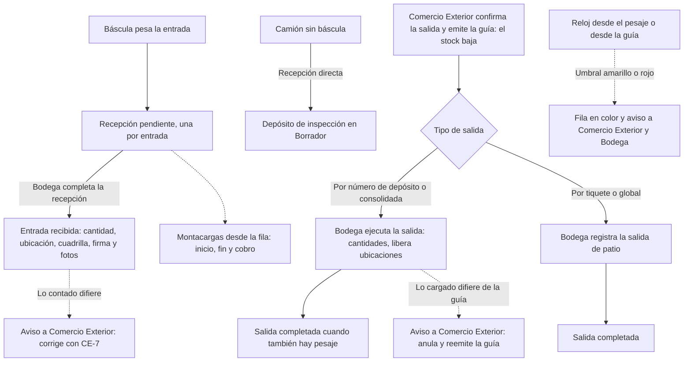

Estados de una entrada en Bodega:

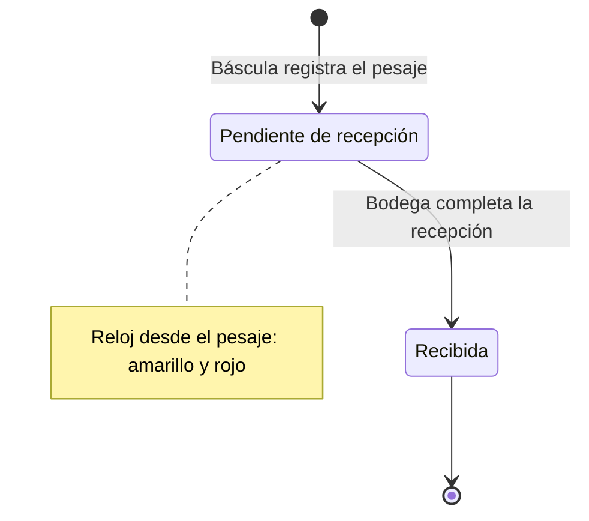

Estados de una salida, vistos desde Bodega (la salida llega Confirmada y con guía):

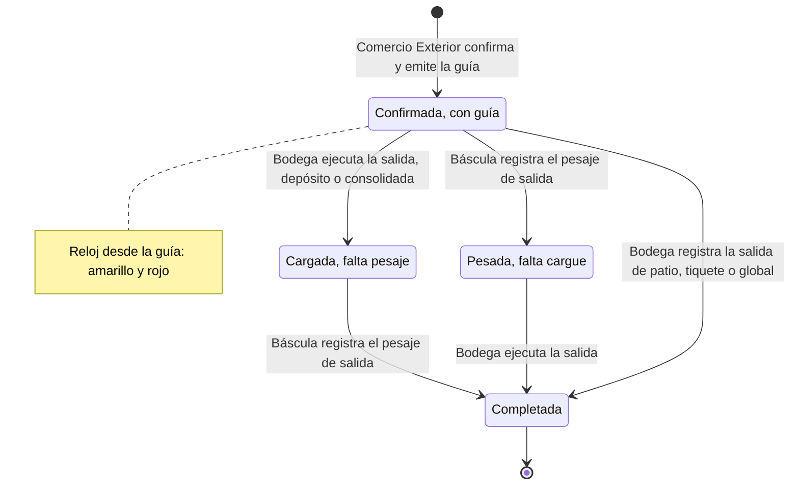

#### d. Flujo del operario

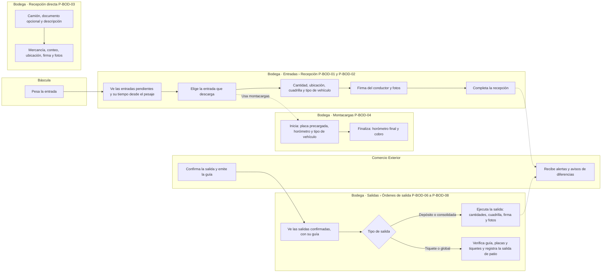

Caminos alternos que cubre el flujo:

- **Bodega retrasada.** El camión sigue su ciclo en Báscula. La fila de Bodega pasa a amarillo y a rojo, y Comercio Exterior y Bodega reciben el aviso (AF-56, AF-57).
- **Camión con varias entradas.** Una fila y una recepción por entrada (AF-58, AF-65).
- **Diferencia en la recepción.** Aviso a Comercio Exterior, que corrige con CE-7, como hoy.
- **Camión que no pasa por báscula.** Recepción directa: depósito de inspección (AF-69).
- **Cargue distinto de la guía.** Aviso a Comercio Exterior para anular y reemitir la guía (DEC-052).
- **Pesaje antes del cargue.** La salida queda «Pesada, falta cargue» y su reloj sigue (AF-31, AF-35).
- **Camión que no descargó (tiquete o global).** Salida de patio con un clic (AF-66, AF-67).
- **Montacargas para un vehículo sin tipo.** El diálogo lo pide y lo guarda en el vehículo (AF-63).
- **Depósito en unidades de carga.** La recepción marca cada unidad «Recibida completa», sin contar productos (DEC-010 (3)).

#### e. Comparación legacy / v2 / acordado

| Tema | Legacy | v2 hoy (`develop`) | Acordado | Evidencia y decisión |
|---|---|---|---|---|
| Menú de Bodega | «Asignar bodega», «Liberar bodega», «Observaciones», «Órdenes de cargue», «Reportes» | «Recepciones» (Ingresos, Recepción, Historial), «Montacargas», «Órdenes de cargue», «Inventario», «Novedades» | «Entradas» (Recepción, Historial) y, a continuación, «Salidas» (Órdenes de salida, Historial); el resto sigue | `bodegas-legacy/menus/menuizquierda.php:247-253`; `F/components/layout/AppMenu.vue:242-302`; **AF-64** |
| Llegada y recepción | No existen: Bodega no registraba ingresos en el sistema | «Ingresos a Bodega» registra la llegada; «Recepción» completa el descargue | Sin llegada: la entrada pesada aparece en Recepción y se completa ahí | `F/pages/warehouse/receptions/entry.vue:47-75`; H-024; **AF-64, AF-65** |
| Bloqueo de Báscula | No hay | 409 sin llegada antes del segundo pesaje | Sin bloqueo | `B/Wms.Application/Weighbridge/Common/Services/ReceptionArrivalRules.cs:12-19`; H-073; **AF-14** |
| Alertas de retraso | No hay | No hay | Recepción (desde el pesaje) y salida (desde la guía), con umbrales amarillo y rojo configurables; aviso a Comercio Exterior y Bodega | PR-14; **AF-56, AF-57, AF-65, AF-66** |
| Modal de recepción física | — | Pasos con mucho scroll | Una vista: información del depósito, productos descargados, firma y fotos | `F/features/warehouse/components/ReceptionStepCompletion.vue`; MK-08; **AF-59** |
| Ubicación en la recepción | «Asignar bodega» aparte | Opcional por producto | Obligatoria por producto descargado | `ReceptionStepCompletion.vue:60`, `:183`; **AF-61** |
| Cuadrilla de descargue | — | Una por recepción, opcional | Igual | `ReceptionStepCompletion.vue:61-62`; **AF-60** |
| Tipo de vehículo | — | Obligatorio en báscula y en el montacargas | En la recepción, opcional y precargado; en el montacargas se pide si falta y se guarda | H-076; **AF-21, AF-62, AF-63** |
| Recepción directa sin báscula | — | Modal que pide carta porte, modalidad, cliente, terceros, documentos, unidad, valor, moneda y motivo | Página propia con los campos de MK-09; siempre de inspección, con documento y productos opcionales y descripción obligatoria | `F/features/warehouse/components/ReceptionStepManualInfo.vue:314-596`; **AF-64, AF-69** |
| Montacargas | Reportes físicos | Página propia; el historial muestra el detalle de la facturación | Además, botón en la fila de Recepción; el historial muestra solo lo pagado y si se facturó | `F/features/warehouse/components/ForkliftUseDialog.vue:296-390`; `F/features/warehouse/components/ForkliftUseList.vue`; PR-13; **AF-59, AF-64** |
| Salidas en Bodega | CE registra la salida y autoriza el cargue; Bodega lo completa en «Órdenes de cargue» | Órdenes de cargue con su guía (importación); no hay salidas por tiquete o global en Bodega | «Órdenes de salida»: las Confirmadas de los cuatro tipos; cargue en depósito y consolidada, salida de patio en tiquete y global | `L/mod_salidas/autorizarcargue.php:97`; `L/mod_bodegas/listarcargues.php`; `F/features/warehouse/components/LoadingOrderList.vue`; **AF-64, AF-66, AF-68** |
| Ejecutar la salida | «Completar carga» | Cantidad cargada, ubicación de retiro, placa, conductor, cuadrilla, sello, observaciones, firma y fotos; descuenta stock | MK-10: cantidad cargada («Cargar todo»), cuadrilla, observaciones, firma y fotos; ubicaciones liberadas solas; sin sello; el stock ya bajó con la guía | `LoadingOrderExecutionDialog.vue:276-297`, `:440-538`; MK-10; **AF-36, AF-70** |
| Salida de patio | — | No existe | Un clic con verificación de guía, placas y tiquetes; fecha y hora automáticas; observación opcional | **AF-66, AF-67** |
| Cuadrilla en el cargue | — | «Cuadrilla que cargó», opcional | Sin cambio | `LoadingOrderExecutionDialog.vue:463`; H-025 |

#### f. Reglas de negocio y validaciones

**No bloqueo (AF-14).** Ningún registro de Bodega condiciona a Báscula ni a Comercio Exterior (DEC-010 (2)). Una salida de depósito o consolidada se completa cuando hay pesaje y cargue, en cualquier orden (AF-31).

**Relojes y alertas (AF-56, AF-57, AF-65, AF-66).**

| Registro vigilado | Desde | Hasta | Dónde se ve |
|---|---|---|---|
| Recepción | Pesaje de la entrada en báscula | Recepción completada | Fila en Recepción (P-BOD-01) |
| Salida | Guía emitida | Cargue ejecutado (depósito y consolidada) o salida de patio (tiquete y global) | Fila en Órdenes de salida (P-BOD-06) |

- Cada registro tiene dos umbrales, amarillo y rojo, que configura el administrador. Los valores iniciales los define el cliente (pendiente, sección j).
- Al cruzar cada umbral, la fila cambia de color y se avisa a Comercio Exterior y a Bodega. Los destinatarios y el canal se configuran según 3.4 (PR-26).
- El paso «Bodega» del detalle del depósito en Comercio Exterior usa el mismo color (PR-17, 2.3).

**Recepción (AF-58, AF-60 a AF-62, AF-65).**

- Una fila y una recepción por entrada; el operario elige la que descarga. La recepción es informativa: no mueve stock ni fija fechas, como hoy.
- Cantidad descargada por producto: obligatoria si se descargó y no mayor que lo declarado (como MK-08). Se registran solo las mayores que cero.
- Ubicación: obligatoria por producto descargado.
- Cuadrilla: una por recepción, opcional, sin pago.
- Tipo de vehículo: opcional, precargado si el vehículo ya lo tiene; lo que se elige queda en el vehículo.
- Firma del conductor y fotos, como hoy.
- Si el depósito es de unidades de carga, cada unidad se marca «Recibida completa», sin contar productos (DEC-010 (3)).

**Recepción directa (AF-64, AF-69).**

- Página propia; siempre crea un depósito de inspección en Borrador.
- Aplica las reglas de inspección de báscula (AF-17): documento comercial y productos opcionales, descripción de la inspección obligatoria.
- Pide solo lo que Bodega puede completar (MK-09): camión y conductor, documento, mercancía declarada, conteo, ubicación, cuadrilla, firma y fotos. Ya no pide cliente, terceros, documentos adicionales, valor, moneda ni motivo.

**Montacargas (AF-59, AF-63, AF-64, AF-54).**

- El botón «Montacargas» en la fila de Recepción abre el inicio con la placa precargada.
- El tipo de vehículo se precarga; si falta, se pide (la tarifa depende de él) y queda en el vehículo.
- El cobro usa el formulario compartido, con alta rápida de tercero (AF-54). El cambio del check de IVA por «Requiere factura» se decide en 2.4 (PR-24).
- En el historial, la facturación solo informa lo pagado y si se facturó.

**Salidas (AF-30, AF-36, AF-64, AF-66 a AF-68, AF-70; DEC-052, DEC-056).**

- «Órdenes de salida» muestra solo las salidas Confirmadas pendientes de Bodega; toda Confirmada tiene guía (AF-68).
- Por número de depósito y consolidada:
  - Bodega registra la cantidad cargada por producto, con «Cargar todo»;
  - el sistema libera las ubicaciones del producto sin pedirlas;
  - no se pide sello;
  - si lo cargado difiere de la guía, se avisa a Comercio Exterior para que la anule y la reemita.
- Por tiquete de entrada y global:
  - la salida de patio muestra la guía, las placas y los tiquetes;
  - registra fecha y hora automáticas y una observación opcional, y deja la salida «Completada».
- El stock ya se descontó al emitir la guía en los cuatro tipos (AF-36).

#### g. Pantallas

Wireframes en [`fase_2-mockups/bodega.html`](./fase_2-mockups/bodega.html). Los listados siguen el patrón que se defina en 3.3, donde también se revisan los modales grandes (AF-59).

**P-BOD-01 · Entradas › Recepción** — [`bodega.html#P-BOD-01`](./fase_2-mockups/bodega.html#P-BOD-01). Ruta `/warehouse/receptions`. Reemplaza «Ingresos» y «Recepción».

| Columna o filtro | Origen | Regla |
|---|---|---|
| Hora del pesaje, vehículo, depósito, cliente, mercancía y cantidad declarada | Entrada de báscula | Una fila por entrada (AF-58) |
| Tiempo desde el pesaje | Reloj | Color amarillo o rojo (AF-57, AF-65) |
| Acciones | — | «Completar recepción» (P-BOD-02) y «Montacargas» (P-BOD-04, placa precargada, AF-59) |
| Encabezado | — | «Nueva recepción directa» abre P-BOD-03 |

El «Historial» de Entradas se conserva como hoy (`/warehouse/receptions/history`).

**P-BOD-02 · Modal de recepción física** — [`bodega.html#P-BOD-02`](./fase_2-mockups/bodega.html#P-BOD-02). Sigue la estructura de MK-08.

| Campo | Tipo | Obligatorio | Origen del dato | Quién lo edita | Cuándo es editable | Regla |
|---|---|---|---|---|---|---|
| Conductor, empresa de transporte, declarado en manifiesto, peso físico neto | Solo lectura | — | Báscula y depósito | — | — | — |
| Tipo de vehículo | Selector | No | Vehículo | Bodega | Al completar la recepción | Precargado; se guarda en el vehículo (AF-62) |
| Queda sobre el vehículo | Switch | No | Bodega | Bodega | Al completar | Activo, la ubicación de los productos es «Sobre vehículo»; lo usa la tarifa «descargada o sobre vehículo» (AF-119, AF-120) |
| Cantidad descargada (por producto) | Número | Sí, si se descargó | Bodega | Bodega | Al completar | No mayor que lo declarado; indica si coincide (como MK-08) |
| Ubicación en bodega (por producto) | Selector con «+ Nueva posición» y disponibilidad | Sí, por producto descargado | Ubicaciones disponibles | Bodega | Al completar | AF-61 |
| Observaciones de la carga | Texto | No | Bodega | Bodega | Al completar | — |
| Cuadrilla de descargue | Selector | No | Catálogo de cuadrillas | Bodega | Al completar | Una por recepción, sin pago (AF-60) |
| Unidades de carga | Casilla «Recibida completa» por unidad | Sí, si el depósito es de unidades | Unidades del depósito | Bodega | Al completar | DEC-010 (3) |
| Firma del conductor | Firma | Como hoy | Bodega | Bodega | Al completar | — |
| Fotos de la mercancía | Imágenes | No | Bodega | Bodega | Al completar | — |

Acciones: «Completar recepción» y «Cancelar».

Respecto de MK-08:

- La cuadrilla va una vez por recepción, no por producto (AF-60), y sin el texto «Registra pago a cuadrilla».
- Se agrega «Tipo de vehículo» (AF-62).
- Se agrega el switch «Queda sobre el vehículo» (AF-119, decidido en 2.4).
- No va «Almacén Central · Bahía 04», que no es un dato de la v2.

**P-BOD-03 · Recepción directa sin báscula** — [`bodega.html#P-BOD-03`](./fase_2-mockups/bodega.html#P-BOD-03). Página propia (AF-64); sigue MK-09.

| Campo | Tipo | Obligatorio | Origen del dato | Quién lo edita | Cuándo es editable | Regla |
|---|---|---|---|---|---|---|
| Camión y conductor (placa, empresa, país, conductor) | Compacto con «Editar» | Sí | Vehículo o digitado | Bodega | Antes de guardar | Como en báscula, con alta rápida de empresa y conductor |
| Tipo de vehículo | Selector | No | Vehículo | Bodega | Antes de guardar | AF-62 |
| Carta porte o guía de transporte | Texto | No | Bodega | Bodega | Antes de guardar | Reglas de inspección (AF-17, AF-69) |
| Modalidad | Solo lectura: «Inspección» | — | Fija | — | — | AF-69 |
| Descripción de la inspección | Texto | Sí | Bodega | Bodega | Antes de guardar | AF-17, AF-69 |
| Queda sobre el vehículo | Switch | No | Bodega | Bodega | Antes de guardar | Como en P-BOD-02 (AF-119) |
| Producto, embalaje y cantidad declarada | Línea por producto con «+ Agregar producto» | No | Catálogo o texto | Bodega | Antes de guardar | Reglas de inspección |
| Cantidad descargada, ubicación | Número («Copiar» lo declarado) y selector | Sí, por producto declarado | Bodega | Bodega | Antes de guardar | AF-61 |
| Cuadrilla de descarga | Selector | No | Catálogo | Bodega | Antes de guardar | AF-60 |
| Firma del conductor y fotos | Firma e imágenes | Firma como hoy; fotos no | Bodega | Bodega | Antes de guardar | — |

Acciones: «Guardar» y «Volver a Recepciones».

Respecto de MK-09:

- Se agregan «Descripción de la inspección» (AF-69) y «Tipo de vehículo» (AF-62).
- La nota de la modalidad queda como regla.
- El texto «Asigna pago de mano de obra» de la cuadrilla no va (AF-60).

**P-BOD-04 · Montacargas: inicio y cobro** — [`bodega.html#P-BOD-04`](./fase_2-mockups/bodega.html#P-BOD-04).

| Campo | Tipo | Obligatorio | Origen del dato | Quién lo edita | Cuándo es editable | Regla |
|---|---|---|---|---|---|---|
| Placa | Búsqueda | Sí | Precargada desde Recepción, o digitada | Bodega | Al iniciar | AF-59 |
| Horómetro inicial | Número con decimales | Sí | Bodega | Bodega | Al iniciar | Como hoy (H-053) |
| Tipo de vehículo | Selector | Sí | Vehículo, precargado | Bodega | Al iniciar | Si falta, se pide y se guarda (AF-63) |
| Horómetro final y observaciones | Número y texto | Horómetro sí | Bodega | Bodega | Al finalizar | Como hoy |
| Cobro | Formulario de cobro compartido | Sí | Tarifa por tipo de vehículo | Bodega | Al finalizar | Alta rápida de tercero (AF-54); IVA o «Requiere factura» según 2.4 |

**P-BOD-05 · Historial de montacargas** — [`bodega.html#P-BOD-05`](./fase_2-mockups/bodega.html#P-BOD-05). Como hoy, pero la facturación se reduce a dos columnas informativas: «Pagado» (valor) y «Facturado» (sí o no) (AF-64).

**P-BOD-06 · Salidas › Órdenes de salida** — [`bodega.html#P-BOD-06`](./fase_2-mockups/bodega.html#P-BOD-06). Solo las salidas Confirmadas pendientes de Bodega, de los cuatro tipos.

| Columna | Origen | Regla |
|---|---|---|
| Salida, tipo, placas, tiquetes (tiquete y global), depósitos y mercancía, guía | Salida | AF-64, AF-68 |
| Falta | Estado | Cargue, pesaje o salida de patio (AF-35, AF-66) |
| Tiempo desde la guía | Reloj | Color amarillo o rojo (AF-57) |
| Acciones | — | «Ejecutar salida» (depósito y consolidada, P-BOD-07) o «Registrar salida de patio» (tiquete y global, P-BOD-08) |

**P-BOD-07 · Ejecutar salida (depósito y consolidada)** — [`bodega.html#P-BOD-07`](./fase_2-mockups/bodega.html#P-BOD-07). Sigue MK-10.

| Campo | Tipo | Obligatorio | Origen del dato | Quién lo edita | Cuándo es editable | Regla |
|---|---|---|---|---|---|---|
| Guía vigente | Aviso con su número y «Verificada» | — | Salida | — | — | DEC-056 |
| Disponibilidad | Aviso «Todo el stock está disponible… % ubicado» | — | Ubicaciones | — | — | Las ubicaciones se liberan solas (AF-70) |
| Cliente, vehículo, conductor | Solo lectura | — | Salida | — | — | — |
| Cantidad cargada (por producto) | Número con «Cargar todo» | Sí | Bodega | Bodega | Al ejecutar | Si difiere de la guía, aviso a CE (DEC-052) |
| Cuadrilla que cargó | Selector | No | Catálogo | Bodega | Al ejecutar | H-025 |
| Observaciones | Texto, máximo 250 caracteres | No | Bodega | Bodega | Al ejecutar | — |
| Firma del conductor | Firma | Como hoy | Bodega | Bodega | Al ejecutar | — |
| Fotos | Imágenes | No | Bodega | Bodega | Al ejecutar | — |

Acciones: «Ejecutar salida» y «Cancelar». Respecto de hoy salen «Stock anterior», «Stock nuevo», «Reserva liberada», «Retirar de» y «Número de sello» (AF-36, AF-70).

**P-BOD-08 · Salida de patio (tiquete y global)** — [`bodega.html#P-BOD-08`](./fase_2-mockups/bodega.html#P-BOD-08). Acción rápida (AF-67):

- muestra la guía vigente, las placas y los tiquetes de la salida;
- registra fecha y hora automáticas y una observación opcional;
- botón «Registrar salida de patio», que deja la salida «Completada» (AF-66).

**P-BOD-09 · Salidas › Historial** — [`bodega.html#P-BOD-09`](./fase_2-mockups/bodega.html#P-BOD-09). Tabla de las salidas ya atendidas por Bodega (AF-64), con:

- fecha y hora de ejecución, salida, tipo, placas, depósitos y mercancía, guía;
- lo cargado o «Salida de patio», la cuadrilla y el estado;
- acción «Ver».

La configuración de los umbrales de alerta (AF-57) se dibuja en `transversales.html`, con las notificaciones (3.4).

#### h. Decisiones tomadas en el módulo

AF-56 a AF-71 (AF-58 queda reducida a «recepción por entrada» por AF-65). Tomadas en otros bloques que aplican aquí: AF-14, AF-17, AF-21, AF-30, AF-31, AF-35, AF-36 y AF-54; y, de Facturación, AF-105 (montacargas con o sin factura) y AF-119 (switch «Queda sobre el vehículo»).

#### i. Impacto en otros módulos y en decisiones vigentes

- **Báscula (2.1).** Ya no espera a Bodega (AF-14); el tipo de vehículo sale de su formulario (AF-21).
- **Comercio Exterior (2.3).** Recibe las alertas de retraso; el paso «Bodega» del detalle del depósito se pinta con el mismo color (PR-17). Las recepciones directas le llegan como depósitos de inspección sin cliente ni valor (AF-69).
- **Salidas (3.7).**
  - Confirmar la salida emite la guía (AF-68).
  - La salida por tiquete o global se completa con la salida de patio (AF-66, que ajusta AF-35).
  - El cargue ya no mueve stock ni pide sello (AF-36, AF-70).
  - La lista de Bodega se llama «Órdenes de salida» (AF-64).
- **Facturación (2.4).** Cobro del montacargas: PR-24 («Requiere factura», AF-105) y alta rápida de tercero (AF-54). La recepción registra si la mercancía queda sobre el vehículo, para la tarifa de AF-116 (AF-119).
- **Notificaciones (3.4).** Destinatarios y canal de las alertas de retraso; pantalla de umbrales.
- **Menú (3.2).** «Entradas» y «Salidas» en Bodega (AF-64).
- **Patrones de interfaz (3.3).** Revisión de los modales grandes (AF-59).
- **Decisiones vigentes.**
  - CHG-36 se reabre (sección 5, AF-14).
  - Siguen DEC-010 (2) y (3), DEC-052 (aviso si lo cargado difiere) y DEC-056 (guía antes del cargue).

#### j. Pendientes del módulo

- **Valores iniciales de los umbrales** amarillo y rojo de recepción y salida: los define el cliente (Bodega y Comercio Exterior). Ver sección 6.
- **Consideraciones para la fase siguiente:**
  - cómo se calculan los relojes de los registros abiertos al desplegar;
  - qué pasa con las llegadas ya registradas y las órdenes de cargue abiertas.

### 2.3. Comercio Exterior

#### a. Alcance

| Tipo | Elementos |
|---|---|
| Hallazgos tratados aquí | H-026, H-027, H-028, H-029, H-030, H-031, H-032, H-033, H-035, H-036, H-037, H-038, H-039, H-040, H-043, H-044, H-045, H-071 |
| Hallazgos citados | H-034 y H-077 (3.5), H-041 y H-074 (3.6), H-042 y H-072 (3.7), H-069 y H-070 (2.4) |
| Propuestas | PR-15 a PR-20 y PR-22. Decidida en este bloque por AF-03 y redactada en 3.5: PR-23 |
| Diferencias | D-13 a D-21 |
| Observaciones de los videos | OV-01, OV-03, OV-04, OV-09, OV-10, OV-11 (OV-02 en 3.5; OV-05 en 3.7; OV-06 a OV-08 en 3.6) |
| Temas de §12 de la fase 1 | §12.4, §12.7, §12.8, §12.9, §12.15, §12.16, §12.17 |
| Brechas de la paridad | 1, 4, 5, 6, 8, 9 y 12 (la 3 en 3.5; la 2 y la 11 en 3.7; la 7 en 3.6; la 13 fuera de alcance) |
| Mockups | MK-02 (tabla de importación), MK-03 (detalle por etapas), MK-04 y MK-05 (levantes) y MK-06 (especificación de levantes) |

H-044 (pruebas detenidas en levantes con varias declaraciones) se resuelve con el cálculo de AF-83: se cierra sin decisión propia.

#### b. Actores y roles

| Rol | Qué hace en Comercio Exterior |
|---|---|
| Comercio Exterior (`ForeignTrade`) | Dueño del depósito. Completa y corrige los datos, los amparados y los productos; confirma; corrige el ingreso y sus pesos (3.6); registra levantes; configura tasa y prefijos (con Admin y Facturación); crea y confirma salidas, que emiten su guía; saca el inventario nacionalizado |
| Operario de báscula (`Scale`) | Crea el depósito en Borrador con el primer camión, o lo suma a uno abierto (2.1) |
| Operario de bodega (`Warehouse`) | Recibe la mercancía y ejecuta las salidas; su atraso se ve en la etapa Bodega (2.2) |
| Facturación (`Billing`) | Cobra el almacenamiento desde la fecha de ingreso cuando el depósito tiene cliente (AF-75); usa la tasa semanal (AF-85) |
| Administrador (`Admin`) | Todo lo anterior, más la configuración |

#### c. Flujo de negocio

1. **El depósito nace en Borrador** cuando Báscula registra el primer camión con el documento, o un camión se suma a un depósito abierto (2.1).
2. **Comercio Exterior lo completa en el detalle por etapas** (AF-73):
   - Entradas: corrige cada camión, sus pesos, su precio y sus unidades de carga (AF-26, AF-27, AF-94).
   - Datos principales: documento, terceros, manifiesto DIAN y valor CPI (AF-76).
   - Amparados: lo que ampara el documento por producto (AF-77).
3. **Confirma** cuando se cumplen los requisitos y lo amparado cuadra con lo ingresado (AF-77).
   - Puede confirmar sin cliente; el cobro arranca desde la fecha de ingreso cuando se asigne (AF-75).
   - Ya no se cierra el ingreso de camiones ni se devuelve a Borrador para corregir (AF-93, AF-95).
4. **Levantes.** Registra los levantes en la tabla agrupada por mercancía. La cantidad se calcula desde el peso (AF-83), con la tasa semanal precargada (AF-85, AF-86); el valor en aduanas va en USD, con su equivalente en pesos (AF-81, AF-82). Con el primer levante, la importación queda «Nacionalizada» (PA-15).
5. **Salidas.** Crea la salida (cuatro tipos, AF-28) y la confirma, lo que emite la guía y descuenta el stock (AF-36, AF-68). Bodega ejecuta el cargue o la salida de patio, y Báscula el pesaje, según el tipo (2.1, 2.2). Cuando ningún producto tiene stock, el depósito pasa a «Cerrado», como hoy.
6. **Exportación e inspección** siguen el mismo flujo sin levantes; la inspección, sin amparados y sin guía (AF-87, AF-88).

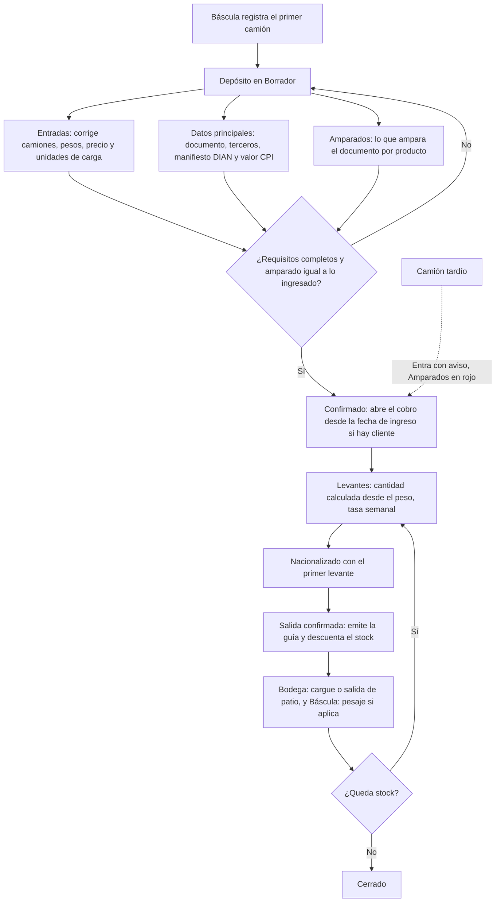

Estados del depósito:

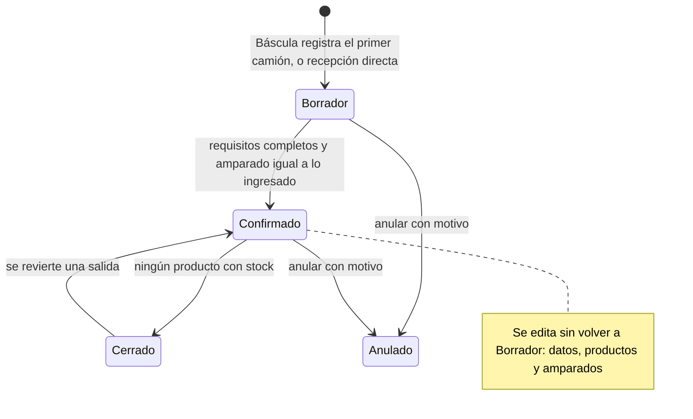

Estado de nacionalización de cada mercancía en importación (MK-04): «Sin levante» → «Parcial» → «Nacionalizado», según lo levantado frente a lo ingresado.

#### d. Flujo del operario

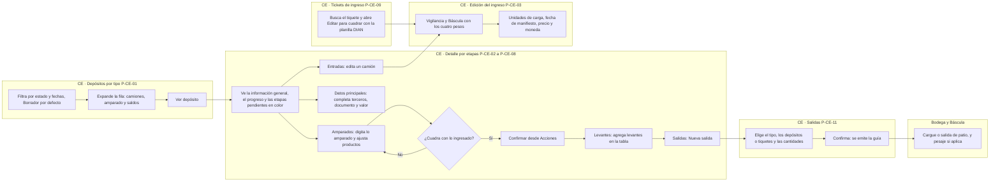

Caminos alternos que cubre el flujo:

- **Cliente desconocido al ingreso.** Se confirma sin cliente; al asignarlo, el cobro arranca desde la fecha de ingreso (AF-75).
- **Amparado que no cuadra.** No se confirma; la etapa Amparados queda marcada (AF-73, AF-77).
- **Camión tardío después de confirmar.** Entra, el depósito sigue confirmado y Amparados se marca en rojo con aviso (AF-84).
- **Pesos que no cuadran con la planilla DIAN.** Desde Tickets de ingreso o Entradas, «Editar» corrige los cuatro pesos (AF-26, 3.6).
- **Corrección después de confirmar.** Datos principales, productos y amparados se editan en Confirmado. Una cantidad no baja de lo levantado ni de lo despachado, y la factura se recalcula (AF-76, AF-78).
- **Levante de un depósito de semanas anteriores.** La tasa se precarga por la semana de la fecha del levante y se puede cambiar (AF-86).
- **Depósito con varios productos.** El levante precarga lo pendiente del producto elegido; «Levante total del saldo» funciona sin peso documental (AF-83).
- **Salida mal registrada.** En Borrador se edita. Confirmada, se anula la guía, lo que devuelve el stock y la salida a Borrador, mientras no esté completada (AF-90).

#### e. Comparación legacy / v2 / acordado

| Tema | Legacy | v2 hoy (`develop`) | Acordado | Evidencia y decisión |
|---|---|---|---|---|
| Lista de depósitos | Tablas «Tickets Ingresos», «Ingresos» y «Depósitos Import.» con vehículos, cantidades y saldos | Tablero por estado con tarjetas (DEC-058) | Menú «Depósitos» por tipo con tabla maestro-detalle y filtro por estado y fechas | `bodegas-legacy/menus/menuizquierda.php:205-211`; `F/pages/foreign-trade/deposits/index.vue:57-121`; MK-02; H-027, D-14; **AF-72** |
| Detalle del depósito | Varias pantallas | Una página larga con secciones y diálogos | Stepper de seis etapas con información general, progreso e indicador de etapa pendiente | `F/pages/foreign-trade/imports/[id]/index.vue:534-905`; MK-03; **AF-73, AF-96** |
| Lista de tiquetes | «Tickets Ingresos» con «Editar» | No existe en CE | «Tickets de ingreso» con enlace al depósito y «Editar»; salidas y solo pesaje en el historial de báscula | `L/mod_bascula/listarentradas.php:75-89`; D-13; brecha 4; **AF-74** |
| Datos del depósito | Datos del ingreso editables en cualquier momento | Casi todo solo en Borrador; el valor solo en Borrador (DEC-029 §7.4) | Datos principales editables en Borrador y Confirmado, con recálculo | `L/mod_ingresos/modificaringreso.php:89-111`; `B/Wms.Domain/Entities/Warehouse/WarehouseStorage.cs:444-459`; OV-09, D-15; **AF-76** |
| Valor de la mercancía | Precio por tiquete y precio CPI del ingreso (precargado con la suma, editable) | Un valor por depósito, digitado por báscula con el primer camión | Precio por camión (edición del ingreso) y valor CPI del depósito precargado con la suma | `modificaringreso.php:443-459`; `InitiateStorageWeighingHandler.cs:410`; brecha 6; **AF-94** |
| Cliente | — | Obligatorio para confirmar | Opcional; el cobro arranca desde la fecha de ingreso al asignarlo | `B/Wms.Application/ForeignTrade/Common/Services/DepositConfirmationRequirements.cs:70-71`; H-071; brecha 8; **AF-75** |
| Amparados | Se digitan aparte; el depósito solo se crea cuando cuadran con lo ingresado | No existen | Etapa Amparados; confirmar exige que cuadren; camión tardío con aviso | `L/mod_ingresos/gestionarproductos.php:55-67`; `L/mod_ingresos/listaringresos.php:516-517`; OV-10; brecha 5; **AF-77, AF-84** |
| Productos tras confirmar | Se corrigen mientras no hayan salido; congela lo levantado | Solo en Borrador; al devolver a Borrador nada impide bajar de lo levantado | En Borrador y Confirmado; no por debajo de lo levantado ni de lo despachado | `WarehouseStorage.cs:530-535`; H-031, D-16; brecha 6; **AF-78** |
| Cierre del ingreso de camiones | No existe | Acción explícita sin reapertura (DEC-013) | Se retira | **AF-95** |
| Devolver a Borrador | — | Acción para corregir | Se retira | `imports/[id]/index.vue:813-905`; **AF-93** |
| Prefijos | Tabla de prefijos por campo | No existen | Prefijos en Configuración, precargados en N.º de levante, N.º de aceptación y manifiesto DIAN | `L/mod_prefijos/listarprefijos.php:52-72`; H-035, D-17; **AF-79** |
| Registro del levante | Matriz con una columna por producto; levantes seguidos | Modal con selector de producto; guardar y reabrir | Tabla agrupada por mercancía con fila editable; Vista 2 reemplaza «Levantes» | `F/features/foreign-trade/components/ReleaseForm.vue`; `F/pages/foreign-trade/releases/index.vue`; MK-04, MK-05; D-18, D-21; **AF-80** |
| Cantidad del levante | Con un producto: peso × Σ cantidad ÷ Σ manifiesto; editable | Usa un peso documental vacío en depósitos de báscula y bloquea la cantidad | Como el legacy con un producto; con varios, pendiente precargado y levante total habilitado; siempre editable | `L/mod_levantes/registrarlevante.php:246-254`, `:611`; `ReleaseForm.vue:124-129`, `:251-290`; D-19, OV-01; brecha 1; **AF-83** |
| Datos del levante | N.º de levante, N.º de aceptación y fecha del levante | Además, fecha de aceptación obligatoria | Sin fecha de aceptación | `B/Wms.Application/ForeignTrade/Commands/RegisterImportRelease/RegisterImportReleaseCommandValidator.cs:29-30`; D-20, OV-03; **AF-82** |
| Rótulo del valor | «CIF USD»; «FOB CO» = CIF × tasa | «CIF» (DEC-029 §7.2) | «Valor en aduanas (USD)» y su equivalente en pesos, calculado al digitar | OV-11; H-037; brecha 12; **AF-81, AF-82** |
| Tasa de cambio | Semanal manual, precargada y editable | TRM de la DIAN del día | Semanal manual, compartida; detalle en 3.5 | `B/Wms.Application/ForeignTrade/Common/Services/ReleaseFobService.cs:56-82`; D-22; **AF-85, AF-86** |
| Inventario nacionalizado | Reporte agrupado por depósito, con filtro de fechas y firma | No existe | Como el legacy, con el detalle de cada levante; pantalla, PDF y Excel | `L/mod_inventario/reportenacionalizados.php:64-352`; H-043; **AF-91** |
| Terceros y productos rápidos | — | Asignar terceros solo en Borrador; crear importador, agencia o exportador desde báscula | Alta rápida de terceros (también confirmado) y de productos; embalaje junto al nombre | `F/features/weighbridge/components/StorageServiceForm.vue:1171-1191`; H-029, H-032, H-033; **AF-92** |
| Salidas en CE | «Nueva salida» por forma; guía directa | Orden de cargue y guía por separado | Una salida con tipo y estado; confirmar emite la guía; menú «Salidas» | `L/mod_salidas/nuevasalida.php:92-129`; `F/pages/foreign-trade/loading-orders/create.vue`; **AF-28 a AF-30, AF-68, AF-89, AF-97** |
| Exportación e inspección | Mismas formas de salida en exportación | Detalle propio; inspección sin guía | Mismas etapas sin Levantes; inspección sin Amparados y sin guía | `L/mod_salidas/nuevasalidaexp.php`; `CreateDispatchGuideCommandHandler.cs:133`; **AF-87, AF-88** |

#### f. Reglas de negocio y validaciones

**Confirmación (AF-75, AF-77).**

- Exige los requisitos de hoy menos el cliente: fecha del documento, importador y agencia (importación) o exportador (exportación), manifiesto DIAN (importación, DEC-057), valor de la mercancía, número y peso del manifiesto de los camiones con carta porte (AF-12) y el reparto por unidad de carga (`DepositConfirmationRequirements.cs:66-128`).
- Exige además que lo amparado por cada producto sea igual a lo ingresado. La inspección no tiene amparados (AF-87).
- Al confirmar con cliente se abre el primer período desde la fecha de ingreso, como hoy. Sin cliente, se abre al asignarlo, con el mismo inicio (AF-75).

**Edición (AF-76, AF-78, AF-93, AF-95; AF-26 y AF-27 en 3.6).**

- Datos principales, productos y amparados se editan en Borrador y Confirmado, hasta que el depósito se cierre. No hay «Devolver a Borrador» ni «Cerrar ingreso de camiones».
- Lo que afecta el cobro (valor, moneda, cliente, cantidades, unidades de carga, fecha de ingreso) recalcula la factura del período abierto (DEC-022). Cambiar el cliente con una factura emitida sigue DEC-056.
- Una cantidad no queda por debajo de lo levantado ni de lo despachado en guías; un producto con levante o con salida no se quita.
- La fecha de ingreso conserva los límites de DEC-012 y DEC-051; el número del depósito no se edita (DEC-012).

**Valor de la mercancía (AF-94).** El precio por camión se digita en la edición del ingreso. El valor CPI del depósito, en Datos principales, se precarga con la suma de los camiones y CE lo deja o lo corrige; el cobro usa el CPI (DEC-029 §7.1). La moneda es una por depósito.

**Amparados (AF-77, AF-84).**

- Por producto: cantidad amparada frente a cantidad ingresada (la suma de los camiones), con el saldo en rojo si no cuadra.
- Lo amparado no cambia el stock: el stock sigue siendo lo declarado en báscula y lo corregido (DEC-010 (2), precisada).
- Un camión tardío después de confirmar entra (DEC-013 sin cierre); Amparados se marca en rojo y se avisa a Comercio Exterior.

**Indicador de etapa pendiente (AF-73).** Criterios deducidos, a validar:

| Etapa | Se marca pendiente cuando |
|---|---|
| Entradas | Falta un dato obligatorio de un camión (manifiesto con carta porte, precio por camión) |
| Datos principales | Falta un requisito de confirmación de esta etapa |
| Bodega | Hay una recepción pendiente; el color sigue los umbrales de 2.2 (AF-57) |
| Amparados | Lo amparado no cuadra con lo ingresado |
| Levantes | Hay diferencia de peso entre lo nacionalizado y lo ingresado (aviso de MK-04) |
| Salidas | Una salida confirmada espera el cargue, el pesaje o la salida de patio |

**Levantes (AF-80 a AF-83, AF-85, AF-86; DEC-029 §7.8).**

- Datos: N.º de levante y N.º de aceptación (con prefijo, AF-79), fecha del levante, tasa, valor en aduanas (USD) y su equivalente en pesos, peso y cantidad. Sin fecha de aceptación.
- Cálculo de la cantidad:
  - con un producto, cantidad = peso digitado × Σ cantidad ingresada ÷ Σ peso del manifiesto de los camiones no anulados;
  - con varios, se precarga lo pendiente del producto elegido y «Levante total del saldo» funciona sin peso documental;
  - la cantidad queda editable siempre y no supera lo pendiente.
- La tasa se precarga con la semanal de la semana de la fecha del levante y se puede cambiar (3.5).
- El valor en aduanas va una sola vez por levante, en su primer producto, como hoy (DEC-029 §7.8).
- Tras guardar, la fila editable vuelve a ofrecerse con el nuevo saldo (H-040).
- El estado de cada mercancía es Sin levante, Parcial o Nacionalizado. La etiqueta pasa a «NACIONALIZADO» con el primer levante, como hoy (PA-15).

**Prefijos (AF-79).** Un prefijo por campo (N.º de levante, N.º de aceptación, manifiesto DIAN) en Configuración; el campo llega con él y el operario lo completa o lo cambia.

**Salidas desde CE (AF-28 a AF-37, AF-66, AF-68, AF-88, AF-90, AF-97).**

- **Tipos.** Por tiquete de entrada, global, por número de depósito y consolidada; la consolidada es la de varios depósitos (AF-32).
- **Confirmar y guía.** Confirmar emite la guía y descuenta el stock; la inspección no tiene guía y descuenta al confirmar.
- **Editar.** En Borrador se edita libre. Confirmada, se corrige anulando la guía mientras no esté completada.
- **Completar.** Tiquete y global: con la salida de patio. Depósito y consolidada: con el cargue y el pesaje.
- **Firmante de la guía.** Global, el importador; las demás, el conductor (`L/mod_salidas/verguia.php:785-795`).
- **ZIP por depósito.** «Descargar PDF por depósito (ZIP)» se conserva solo en las consolidadas (AF-97).

**Inventario nacionalizado (AF-91).**

- Agrupado por depósito: número, documento, agencia y cliente.
- Por mercancía: embalaje, fecha de ingreso, manifiesto, ingreso, existencia, nacionalizado y el detalle de cada levante (número, aceptación, fecha, cantidad, peso y valor en aduanas).
- Filtro por fechas de levante; firmas «Jefe de Bodega» y «Recibí conforme», como el legacy (`reportenacionalizados.php:393-398`); en pantalla, PDF y Excel.

#### g. Pantallas

Wireframes en [`fase_2-mockups/comercio-exterior.html`](./fase_2-mockups/comercio-exterior.html). Los listados siguen el patrón que se defina en 3.3.

Menú de Comercio Exterior:

- Dashboard.
- Depósitos: Importación, Exportación e Inspección.
- Tickets de ingreso.
- Levantes.
- Salidas.
- Abandono y prórrogas.
- Listas de empaque.

Salen «Órdenes de cargue» y «Guías de salida» (AF-97). El inventario nacionalizado va en Reportes.

**P-CE-01 · Depósitos › Importación** — [`comercio-exterior.html#P-CE-01`](./fase_2-mockups/comercio-exterior.html#P-CE-01). Sigue MK-02 en columnas y patrón maestro-detalle.

| Columna o filtro | Origen | Regla |
|---|---|---|
| Panel de filtros: estado (Borrador, Confirmado, Cerrado, Anulado; uno a la vez) y fechas desde y hasta | — | Borrador por defecto (PR-15, AF-72); no van los filtros «Todos / Pendientes / Facturados» de MK-02 |
| Fecha, N.º de depósito con placa, documento comercial, tiquetes, terceros (cliente e importador), mercancía con embalaje, pesos (bruto, mercancía, tara, manifiesto), estado | Depósito y sus entradas | Una fila por depósito; marca de etapa pendiente (AF-73) |
| Fila expandida | Entradas | Manifiesto DIAN y valor; tabla por camión con placa, mercancía, cantidad, cantidad amparada, peso, tiquete, MPreimp y acciones (etiqueta, tiquete); totales de cantidad y peso que entran, amparado y saldo; «Gestionar amparados» |
| Filtros por columna y orden | — | Filtros por columna en N.º de depósito, documento comercial, tiquete y mercancía; orden en las columnas (AF-99) |
| Acciones | — | «Ver depósito», solo en la fila principal, no en la expandida (AF-99); la fila no abre nada al hacer clic (3.3) |

Exportación e Inspección usan la misma tabla, sin columnas de levantes. Inspección muestra la descripción en lugar del documento cuando no lo tiene.

**P-CE-02 · Detalle del depósito (encabezado y etapa Entradas)** — [`comercio-exterior.html#P-CE-02`](./fase_2-mockups/comercio-exterior.html#P-CE-02). Sigue MK-03 en el stepper, el encabezado, la información general y el progreso.

- **Encabezado:** número, tipo, estado de nacionalización y del depósito, «Volver» y menú «Acciones» (confirmar, imprimir etiqueta del depósito y por vehículo, registrar prórroga, anular).
- **Stepper:** Entradas, Datos principales, Bodega, Amparados, Levantes y Salidas, con el indicador de etapa pendiente en color (AF-73).
- **Información general:** placas, producto (sin subpartida, AF-98), importador y NIT, manifiesto DIAN, fecha y hora, balance de cantidades (total de entrada, amparado y saldo) y balance de pesos.
- **Progreso.**
- **Etapa Entradas:** tabla con fecha y hora, placa, conductor, tiquete, mercancía con embalaje, peso bruto, mercancía, tara, cantidad, peso del manifiesto y diferencia manifiesto/mercancía (AF-41); acción «Editar», que abre P-CE-03.

Respecto de MK-03: sin subpartida (AF-98) y sin las tarjetas de pólizas y de régimen de su etapa Amparados, que son contenido de referencia (PR-17).

**P-CE-03 · Edición del ingreso** — [`comercio-exterior.html#P-CE-03`](./fase_2-mockups/comercio-exterior.html#P-CE-03). Se abre desde Entradas y desde Tickets de ingreso.

| Campo | Tipo | Obligatorio | Origen del dato | Quién lo edita | Cuándo es editable | Regla |
|---|---|---|---|---|---|---|
| Sección Vigilancia (motivo, fecha, placa) | Como P-BAS-02 | Sí | Vigilancia | CE (y Báscula hasta la confirmación) | Siempre (CE) | AF-08, AF-26 |
| Sección Báscula (camión y conductor, documento, mercancía y los cuatro pesos) | Como P-BAS-02 | Como P-BAS-02 | Báscula | CE (y Báscula) | Salvo lo levantado o despachado | AF-26; la modalidad no cambia |
| Unidad de carga | Switch: encendido = unidades de carga; apagado = mercancía suelta | — | Depósito | CE | Mientras ningún producto tenga levante o salida | AF-27, AF-102 |
| Unidades de carga (tipo y placa por unidad) | Tabla con agregar y quitar, visible con el switch encendido | Sí, con el switch encendido | CE | CE | Mientras ningún producto tenga levante o salida | AF-27 |
| Fecha del manifiesto | Fecha | No | CE | CE | Siempre | C-11 |
| Precio de la mercancía del camión | Número | No | CE | CE | Siempre | Suma al valor CPI precargado (AF-94) |
| Moneda | Selector (COP, USD) | Con precio | Depósito | CE | Siempre | Una por depósito (AF-94) |

Acciones: «Guardar» y «Volver». Los detalles de la edición del ingreso están en 3.6.

**P-CE-04 · Etapa Datos principales** — [`comercio-exterior.html#P-CE-04`](./fase_2-mockups/comercio-exterior.html#P-CE-04). El formulario se agrupa en bloques: Ingreso, Documento comercial, Manifiesto DIAN, Terceros, y Pesos y valor CPI; cada campo va por separado (AF-100).

| Campo | Tipo | Obligatorio | Origen del dato | Quién lo edita | Cuándo es editable | Regla |
|---|---|---|---|---|---|---|
| Fecha y hora de ingreso | Fecha y hora | Sí | Vigilancia | CE | Borrador y Confirmado | DEC-012, DEC-051 |
| N.º y fecha del manifiesto DIAN | Texto (con prefijo) y fecha | Sí para confirmar importación | CE | CE | Borrador y Confirmado | DEC-057; AF-79 |
| Tipo de documento comercial | Selector | Sí (salvo inspección) | Báscula | CE | Borrador y Confirmado | Cambiar el documento sigue 3.6 |
| Número de documento comercial | Texto | Sí (salvo inspección) | Báscula | CE | Borrador y Confirmado | Cambiar el documento sigue 3.6 |
| Fecha del documento comercial | Fecha | Sí para confirmar (salvo inspección) | CE | CE | Borrador y Confirmado | No futura |
| Cliente | Selector paginado con «+» | No para confirmar | CE | CE | Borrador y Confirmado | AF-75; DEC-056 si hay factura |
| Importador, agencia de aduanas (importación) o exportador (exportación) | Selectores paginados con «+» | Sí para confirmar | CE o báscula | CE | Borrador y Confirmado | AF-92 |
| Empresas de transporte | Solo lectura: las de los camiones | — | Vehículo de cada entrada | CE, en la edición del ingreso | Siempre | Se retira la transportadora propia del depósito (AF-101); H-030 |
| Peso neto y bruto CPI | Número | No | Suma de manifiestos, precargada | CE | Borrador y Confirmado | — |
| Valor CPI y moneda | Número y selector | Sí para confirmar | Suma de precios por camión, precargada | CE | Borrador y Confirmado | AF-94; recalcula la factura (AF-76) |
| Descripción de la inspección (inspección) | Texto | Sí | Báscula | CE | Borrador y Confirmado | AF-17 |

**P-CE-05 · Etapa Bodega** — [`comercio-exterior.html#P-CE-05`](./fase_2-mockups/comercio-exterior.html#P-CE-05). Solo lectura:

- recepciones de cada entrada (pendiente o recibida, conteo, ubicación y cuadrilla), con el color del reloj (AF-57);
- inventario por producto (stock, reservado, disponible y ubicaciones);
- movimientos (kardex);
- acciones: «Ajustar cantidad (CE-7)» y «Ver novedades», como hoy.

**P-CE-06 · Etapa Amparados** — [`comercio-exterior.html#P-CE-06`](./fase_2-mockups/comercio-exterior.html#P-CE-06).

| Campo | Tipo | Obligatorio | Origen del dato | Quién lo edita | Cuándo es editable | Regla |
|---|---|---|---|---|---|---|
| Producto y embalaje | Selector con «+ producto» (embalaje junto al nombre) | Sí | Báscula o CE | CE | Borrador y Confirmado | AF-78, AF-92 |
| Cantidad ingresada | Solo lectura (suma de los camiones) | — | Entradas | — | — | — |
| Cantidad del depósito | Número | Sí | Declarado en báscula | CE | Borrador y Confirmado | No menor que lo levantado ni lo despachado (AF-78) |
| Cantidad amparada | Número | Sí para confirmar | CE | CE | Borrador y Confirmado | Debe cuadrar con lo ingresado para confirmar (AF-77) |
| Saldo | Calculado (amparado − ingresado) | — | — | — | — | En rojo si no es cero |

Acciones: «+ Agregar producto» y quitar (solo sin levante ni salida).

**P-CE-07 · Etapa Levantes (Vista 1)** — [`comercio-exterior.html#P-CE-07`](./fase_2-mockups/comercio-exterior.html#P-CE-07). Sigue MK-04.

- Encabezado con «Exportar» y «Nuevo levante».
- Cuatro tarjetas: ingreso, nacionalizado con avance, saldo en bodega y levantes.
- Alerta de diferencia de peso.
- Tabla agrupada por mercancía: encabezado de ingreso; una fila por levante con N.º de levante, N.º de aceptación, fecha, tasa, valor en aduanas (USD), valor en pesos, cantidad, peso y acciones (ver, editar, retirar); fila editable «Agregar levante» con el saldo; nacionalizado y saldo.

| Campo de la fila editable | Tipo | Obligatorio | Origen del dato | Quién lo edita | Cuándo es editable | Regla |
|---|---|---|---|---|---|---|
| N.º de levante | Texto con prefijo | Sí | Prefijo de Configuración | CE | Al registrar o editar | AF-79 |
| N.º de aceptación | Texto con prefijo | Sí | Prefijo | CE | Al registrar o editar | AF-79 |
| Fecha del levante | Fecha | Sí | — | CE | Al registrar o editar | Sin fecha de aceptación (AF-82) |
| Tasa | Número | Sí | Tasa semanal de la semana de la fecha del levante | CE | Al registrar o editar | AF-85, AF-86 |
| Valor en aduanas (USD) | Número | Sí en el primer producto del levante | — | CE | Al registrar o editar | AF-81; DEC-029 §7.8 |
| Valor en pesos | Calculado al digitar | — | USD × tasa | — | — | AF-82 |
| Peso (kg) | Número | Sí | — | CE | Al registrar o editar | — |
| Cantidad | Número, calculada o precargada y editable | Sí | AF-83 | CE | Al registrar o editar | No supera lo pendiente |

Respecto de MK-04: la columna «CIF (USD)» pasa a «Valor en aduanas (USD)» (AF-81) y se agrega el valor en pesos (AF-82).

**P-CE-08 · Etapa Salidas** — [`comercio-exterior.html#P-CE-08`](./fase_2-mockups/comercio-exterior.html#P-CE-08).

- Tabla expandible. Fila: fecha, número de salida, guía, tipo, estado y lo que falta, ciudad destino, peso despachado y observaciones.
- Detalle: producto, cantidad de entrada, saldo anterior, cantidad que sale y nuevo saldo, con total y descarga de la guía.
- Acciones: «Editar» (AF-90), «Anular guía» y «Nueva salida» (abre P-CE-11 con el depósito precargado).

**P-CE-09 · Tickets de ingreso** — [`comercio-exterior.html#P-CE-09`](./fase_2-mockups/comercio-exterior.html#P-CE-09).

- Columnas: las de la etapa Entradas, más el N.º de depósito como enlace, con filtros por columna.
- Acción: «Editar» (P-CE-03).
- Salidas y solo pesaje se consultan en el historial de báscula (AF-74).

**P-CE-10 · Levantes (Vista 2)** — [`comercio-exterior.html#P-CE-10`](./fase_2-mockups/comercio-exterior.html#P-CE-10). Sigue MK-05 y reemplaza la página «Levantes» actual (AF-80).

- Búsqueda por depósito, documento, importador, mercancía o N.º de levante.
- Filtro por estado de nacionalización, con conteo, y botón «Con diferencia de peso».
- Columnas: depósito y fecha, documento comercial, terceros, mercancía, ingreso, nacionalizado con avance, saldo y estado.
- Fila expandida con la tabla agrupada compacta y «Agregar levante».

**P-CE-11 · Salidas: listado y nueva salida** — [`comercio-exterior.html#P-CE-11`](./fase_2-mockups/comercio-exterior.html#P-CE-11). Propuesta (AF-89), a validar.

- **Listado:** número, fecha, tipo, estado, depósitos, placas, guía, lo que falta y acciones (ver, editar en Borrador, anular guía, descargar guía; ZIP por depósito solo en consolidadas, AF-97).
- **Nueva salida:**

| Campo | Tipo | Obligatorio | Origen del dato | Quién lo edita | Cuándo es editable | Regla |
|---|---|---|---|---|---|---|
| Tipo de salida | Radio: tiquete de entrada, global, por número de depósito | Sí | — | CE | En Borrador | Con varios depósitos el sistema la marca «consolidada» (AF-32) |
| Depósitos | Selector paginado (confirmados, nacionalizados en importación) | Sí | — | CE | En Borrador | Uno en tiquete y global |
| Tiquetes de ingreso | Casillas con los tiquetes del depósito | Sí en tiquete (uno) y global (varios) | Entradas del depósito | CE | En Borrador | OV-05 |
| Líneas | Producto, saldo anterior, cantidad que sale y nuevo saldo | Sí | Saldos del depósito | CE | En Borrador | No supera lo nacionalizado ni el disponible |
| Vehículo y conductor | Selectores paginados con «+» | Sí | Báscula (salida en Borrador) o CE | CE | En Borrador | AF-34, AF-37 |
| Ciudad destino | Selector paginado | Sí | — | CE | En Borrador | Como hoy; el vencimiento de la guía sale de la ciudad |
| Orden del cliente (número, emisor, fecha, soporte) | Textos y archivo | No | — | CE | En Borrador | Como la orden externa de hoy |
| Observaciones | Texto | No | — | CE | En Borrador | — |

Acciones: «Guardar borrador» y «Confirmar» (emite la guía y descuenta el stock; en inspección solo descuenta, AF-88). El cobro de la guía usa el formulario compartido (2.4).

**P-CE-12 · Inventario de mercancía nacionalizada** — [`comercio-exterior.html#P-CE-12`](./fase_2-mockups/comercio-exterior.html#P-CE-12). Reporte en Reportes, con el formato de AF-91.

#### h. Decisiones tomadas en el módulo

AF-72 a AF-84 y AF-87 a AF-103. Decididas en este bloque para otras secciones: AF-85 y AF-86 (3.5). Tomadas en otros bloques que aplican aquí: AF-12, AF-17, AF-26 a AF-37, AF-41, AF-42, AF-57, AF-66 y AF-68.

#### i. Impacto en otros módulos y en decisiones vigentes

- **Báscula (2.1).**
  - El depósito que Báscula crea ya no lleva valor (lo pone CE por camión, AF-94).
  - Los depósitos completos siguen apareciendo en la elección del documento, porque se retira el cierre (AF-95).
- **Bodega (2.2).** El reloj de recepción se ve en la etapa Bodega.
- **Facturación (2.4).**
  - El cobro puede arrancar al asignar el cliente, desde la fecha de ingreso (AF-75).
  - Se recalcula al editar en Confirmado (AF-76, AF-78).
  - Usa la tasa semanal (AF-85).
  - El informe de póliza usa el «Valor en aduanas» (H-062, AF-81).
- **Configuración (3.2).** Prefijos (AF-79) y tasas semanales (AF-86).
- **Salidas (3.7).** Menú «Salidas», crear salida y ZIP de consolidadas (AF-97).
- **Decisiones vigentes que se reabren** (sección 5):
  - DEC-058 (tablero de depósitos, AF-72);
  - DEC-029 §7.4 (valor solo en Borrador, AF-76) y §7.2 (rótulo «CIF», AF-81);
  - DEC-023 (TRM de la DIAN, AF-85);
  - DEC-013 (cierre explícito del ingreso de camiones, AF-95);
  - la regla de WMS-29 «Editar productos del depósito: solo en Borrador» (`contexto/contexto-negocio-wms-para-ia.md` §5.11; AF-78).
- **Decisión que se precisa:** DEC-010 (2) (AF-77).
- **Siguen:** DEC-012, DEC-051, DEC-056 (inspección sin guía; guía antes del cargue en importación) y DEC-029 §7.8.

#### j. Pendientes del módulo

- Filtros por columna, orden y botones sin estilo de texto en todas las tablas principales: regla general de 3.3 (AF-99).
- **Consideraciones para la fase siguiente:**
  - datos existentes sin cantidad amparada (los depósitos confirmados hoy) y sin precio por camión;
  - prefijos y tasas iniciales.

### 2.4. Facturación

#### a. Alcance

| Tipo | Elementos |
|---|---|
| Hallazgos tratados aquí | H-046 a H-068, H-069, H-070, H-082, H-086 |
| Hallazgos citados | H-071 (2.3, AF-75); H-051 y H-053 también en 2.2 (montacargas) |
| Propuestas | PR-24 y PR-25. PR-28 (sección «Tarifas y acuerdos» en el menú) se redacta en 3.2 |
| Diferencias | D-24 a D-27 |
| Temas de §12 de la fase 1 | §12.6, §12.10 y §12.21 (Excel de convenios) |
| Decisiones de otros bloques que llegan aquí | AF-12 y AF-113 (peso sin manifiesto), AF-22 (`PER_UOM` por embalaje), AF-27 (unidades de carga), AF-33 (cobros de báscula en salidas), AF-47 (duplicadas en $0), AF-54 (alta rápida de tercero en el cobro), AF-75 (cobro desde la fecha de ingreso al asignar el cliente), AF-76 y AF-78 (recálculo en Confirmado), AF-85 (tasa semanal), AF-94 (valor CPI) |
| Insumo | Hoja 2026 del Excel de convenios (`docs/levantamiento_staging/CONVENIO 23-24-25-26.xlsx`): 218 filas, 76 responsables, 58 textos de tarifa distintos. Se cita solo en cifras, sin nombres |

H-053 (horómetro), H-066 (valor incorrecto en la prueba, por convenios sin cargar) y H-068 (el tiquete ya dice «Documento interno de control de pesaje. No es una factura de venta.», `B/Wms.Application/Common/Services/DocumentLegends.cs:11`) se cierran sin cambio propio (AF-121).

#### b. Actores y roles

| Rol | Qué hace en Facturación |
|---|---|
| Facturación (`Billing`) | Revisa las facturas en Borrador, las factura con el N.º SIGO, las envía, registra pagos y corrige el N.º SIGO con motivo. Configura el ciclo y el «Facturar a» de cada cliente, los acuerdos y la plantilla. Saca los reportes, incluido el de póliza |
| Comercio Exterior (`ForeignTrade`) | Asigna el cliente del depósito, que activa el cobro (AF-75); corrige valor, cantidades y unidades de carga, que recalculan la factura (AF-76, AF-78) |
| Operario de báscula (`Scale`) | Cobra el tiquete (contado o pendiente por facturar), que llega a Facturación (2.1) |
| Operario de bodega (`Warehouse`) | Cobra el montacargas con o sin factura (AF-105) y marca si la mercancía queda sobre el vehículo (AF-119) |
| Administrador (`Admin`) | Todo lo anterior |

#### c. Flujo de negocio

1. **Origen de las facturas.**
   - Báscula, guía de salida y montacargas nacen en su cobro: de contado (pagadas) o pendientes por facturar.
   - El montacargas sin factura no genera factura: queda como registro con «No aplica» (AF-105).
   - El almacenamiento nace en Borrador con cada período del depósito, desde la fecha de ingreso, cuando el depósito tiene cliente (AF-75).
2. **Cálculo.** El valor sale del acuerdo del cliente (2.4 f), con el «Facturar a» del cliente o del importador del depósito como destinatario (AF-123). Si algo del depósito cambia, la factura del período se recalcula (DEC-022, AF-76).
3. **Pendientes.** El depósito aparece en «Depósitos pendientes» cuando cumple un período sin facturar, o tiene una factura en Borrador sin N.º SIGO o una anulada sin refacturar; desaparece al facturar (AF-109).
4. **Facturar.** En un solo paso: N.º SIGO, fecha, destinatario, valor precargado y editable, y observaciones; fija el vencimiento (AF-122).
5. **Enviar y cobrar.** Facturación envía la factura y registra los pagos, parciales o el completo en un clic. Todo pago queda verificado (AF-110).
6. **Mora.** Una factura de almacenamiento vencida cuenta para el cliente del depósito, aunque el destinatario sea otro, y puede bloquear sus salidas (AF-112).
7. **Corrección.** El N.º SIGO se corrige con motivo en cualquier estado salvo Anulada (AF-104). El resto sigue como hoy: el destinatario se cambia en Borrador, y una factura emitida se anula y se refactura.

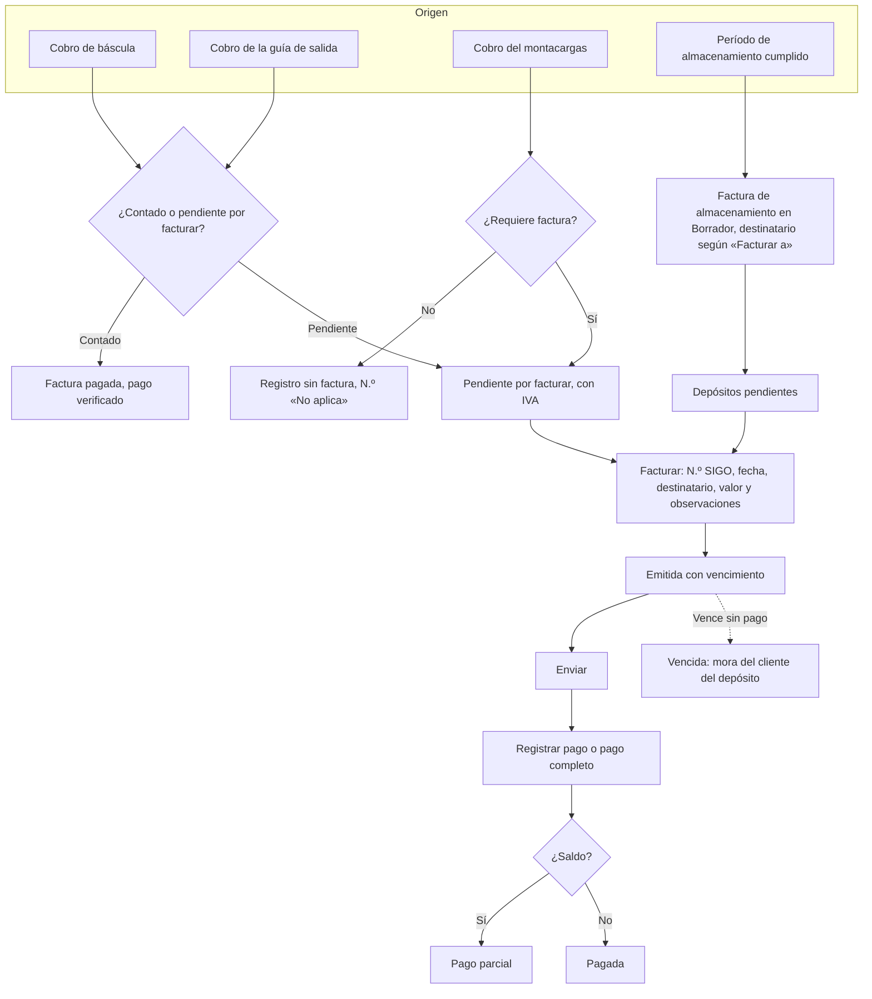

Estados de la factura (la rama Borrador → Aprobada se hace con «Facturar»; los demás estados no cambian):

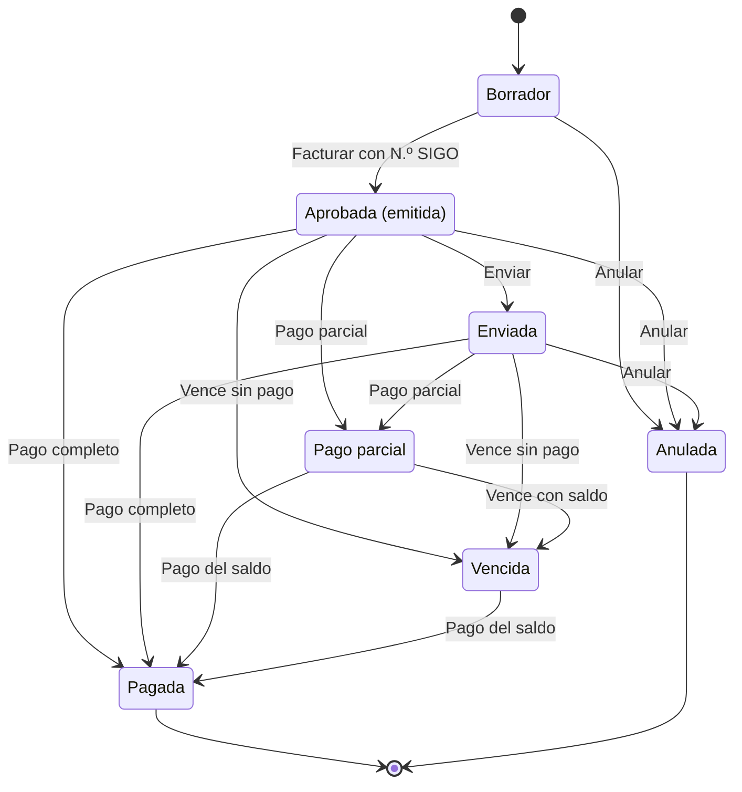

#### d. Flujo del operario

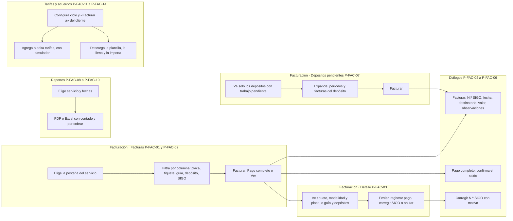

Caminos alternos que cubre el flujo:

- **N.º SIGO mal digitado.** Se corrige con motivo desde el detalle, en cualquier estado salvo Anulada (AF-104).
- **Destinatario distinto del configurado.** Facturación lo cambia en Borrador, como hoy (AF-112, AF-123).
- **Cliente asignado tarde.** El primer período arranca desde la fecha de ingreso al asignarlo (AF-75), y el depósito aparece en pendientes si el período ya se cumplió.
- **Depósito corregido por CE después de emitir.** Sigue DEC-022 y DEC-056: se recalcula en Borrador; emitida, se actualiza la misma factura y se avisa a Facturación.
- **Tarifa que el acuerdo no expresa.** La factura sale con el mínimo de la modalidad, o en $0, y Facturación ajusta la línea, como hoy (DEC-020).
- **Cliente nuevo o tarifas del año nuevo.** Facturación descarga la plantilla, la llena e importa (AF-114).

#### e. Comparación legacy / v2 / acordado

| Tema | Legacy | v2 hoy (`develop`) | Acordado | Evidencia y decisión |
|---|---|---|---|---|
| Facturar un período | Un formulario: N.º SIIGO, fecha, fecha límite, cliente, valor a mano, detalle y observaciones | Valor calculado y editable en Borrador; N.º SIGO, «Aprobar» (fija vencimiento), «Enviar», «Registrar pago» | Un paso «Facturar» con el valor precargado y editable; «Enviar» y pagos aparte | `L/mod_facturacion/facturarciigo.php:89-91`; `B/Wms.Domain/Entities/Billing/Invoice.cs:345-380`; H-067, D-27; **AF-122** |
| N.º SIGO | Editable (`modificarfactura.php:57`) | Fijo al aprobar (DEC-024) | Editable con motivo, salvo Anulada | H-046; **AF-104** |
| Destinatario del almacenamiento | Texto libre al facturar | Cliente del depósito; se cambia en Borrador | «Facturar a» por cliente y por importador; se cambia en Borrador | `B/Wms.Application/Billing/Commands/UpdateInvoiceRecipient/UpdateInvoiceRecipientHandler.cs:24`; H-064, H-069; **AF-112, AF-123** |
| Mora | Solo la marca «sin salidas» del cliente | Cuenta por destinatario de la factura | La del almacenamiento cuenta para el cliente del depósito | `L/mod_clientes/modificarcliente.php:80`; `B/Wms.Application/Billing/Jobs/OverdueSweep.cs:20-25`; **AF-112** |
| Ciclo | 15, 30, 90, 180 y 360 días | Ocho ciclos, con «mes calendario» | Los de N días, sin mes calendario, y uno libre en días | `L/mod_clientes/registrarcliente.php:469-473`; `B/Wms.Application/Billing/Common/Services/BillingCycleCatalog.cs:24-33`; H-056, H-057; **AF-108, AF-115** |
| Conteo de períodos | Inicio = ingreso; fin = inicio + N; siguiente = fin + 1 | Igual, más el mes calendario que se corre | Igual que el legacy | `bodegas-legacy/cron.php:74-75`; `B/Wms.Application/Billing/Common/Services/StoragePeriodCalculator.cs:27-55`; **AF-115** |
| Depósitos pendientes | Solo los que cumplieron el período | Todos los activos | Solo con trabajo pendiente (incluye DEC-053) | `L/mod_facturacion/listardepositosfacturar.php:328-380`; `F/pages/billing/pending-deposits/index.vue:165-263`; H-058, D-26; **AF-109** |
| Facturas de báscula | Columnas de entradas: tiquete, fecha y hora, modalidad, vehículo, conductor, pesos, valor | Cuatro pestañas con las mismas columnas genéricas | Pestaña de báscula con las columnas del legacy | `L/mod_bascula/listarentradas.php:75-89`; `F/pages/billing/invoices/index.vue:94-98`, `:261-326`; H-047; **AF-110** |
| Búsqueda de facturas | Carta porte, factura, depósito, SIGO, cliente | Estado, N.º factura, destinatario y día | Filtros por columna, como lo pedido | `F/pages/billing/invoices/index.vue:198-218`; H-048, D-24; **AF-110** |
| Facturas de guías | Fecha y hora, guía, depósito, placa, mercancía, embalaje, cantidad y CPI | Sin esos datos | N.º de guía, N.º de salida, tiquete, depósitos, placas, CPI, mercancía y embalaje | H-055, D-25, §12.6; **AF-107** |
| Destinatarios del cobro de la guía | — | Cinco, con «Clientes» | Cuatro, sin «Clientes» | `F/features/billing/components/BillingCollectForm.vue:8`, `:76`; H-054; **AF-106** |
| Montacargas | Reportes físicos | Check «Agregar IVA» (DEC-018) | Switch «Requiere factura» | H-051; **AF-105** |
| Pagos | — | Los de Facturación nacen verificados; los de contado, pendientes | Todos verificados | `B/Wms.Application/Billing/Commands/RecordPayment/RecordPaymentHandler.cs:54-58`; `B/Wms.Domain/Entities/Billing/InvoicePayment.cs:70`; H-060; **AF-110** |
| Reportes de cobros | — | Solo Excel | PDF y Excel con suma, contado y por cobrar aparte | H-049, H-050, H-052; **AF-110** |
| Facturación por CPI | Depósito con mercancía, despachos, existencias y facturas | Sin el valor de la mercancía | Como el legacy, con el valor | `L/mod_facturacion/informecpi.php:119-336`; H-059; **AF-111** |
| Facturación anual | — | Cantidad de facturas por mes y día | Listado de facturas con suma | H-061; **AF-111** |
| Póliza | — | Admin y CE | También Facturación, con el valor en aduanas | `F/pages/reports/policies.vue:16`; H-062; **AF-111** |
| Acuerdos | Convenio por cliente en texto libre | Servicio por servicio en el detalle del tercero; simulador con todos los datos | «Tarifas y acuerdos»: una fila por tarifa, plantilla descargable e importable, simulador por fórmula | `L/mod_convenios/registrarconvenio.php`; `F/features/agreements/components/FormulaPreviewPanel.vue:99-135`; H-063, H-070, H-086, PR-25; **AF-114, AF-118** |
| Fórmulas | — | Ocho fórmulas | Además: descargada o sobre vehículo, según el valor, por tonelada o kilo con mínimo, y por tramos de peso | `B/Wms.Infrastructure/Persistence/SeedDataExtensions.cs:411-510`; **AF-116, AF-125** |
| Peso de las fórmulas por peso | — | Suma del peso de manifiesto | Suma del peso de mercancía de las entradas | `B/Wms.Application/Billing/Calculators/WeightThresholdFormulaCalculator.cs:8-10`; AF-12; **AF-113** |

#### f. Reglas de negocio y validaciones

**Facturar (AF-122, AF-104).**

- Se hace donde hoy se aprueba: en Borrador o Pendiente de aprobación (`B/Wms.Domain/Entities/Billing/Invoice.cs:347`).
- Campos:
  - N.º SIGO: obligatorio, salvo en las facturas no fiscales (DEC-024).
  - Fecha de la factura.
  - Destinatario: precargado con el «Facturar a».
  - Valor: precargado con el cálculo de los convenios y editable; la diferencia queda como ajuste de línea, como hoy.
  - Observaciones.
- Al guardar, la factura queda Aprobada (emitida) y se fija el vencimiento con los días de pago del cliente. Ya no hay un «Aprobar» aparte.
- El N.º SIGO se corrige con motivo en cualquier estado salvo Anulada; queda en la auditoría.

**Destinatario y mora (AF-106, AF-112, AF-123).**

- Configuración del cliente: un «Facturar a» general y excepciones por importador. La factura de almacenamiento toma el «Facturar a» del importador del depósito y, si no hay, el general; sin configuración, el cliente, como hoy.
- Facturación lo cambia en Borrador con «Cambiar destinatario», como hoy (DEC-057 D22 y D23).
- La mora de las facturas de almacenamiento cuenta para el cliente del depósito. El bloqueo manual «sin salidas» ya se aplica al cliente (BR-05-004).
- El cobro de la guía ofrece cuatro destinatarios: tercero registrado (con alta rápida, AF-54), conductor del vehículo, persona no registrada y consumidor final.

**Ciclos y períodos (AF-108, AF-115).**

- Ciclos: semanal (7), quincenal (14 y 15), mensual (30), trimestral (90), semestral (180) y anual (360), más «Otro» con N días.
- Se retira el «mes calendario».
- Inicio del primer período: la fecha de ingreso. Fin: inicio + N días. Fecha límite: fin + 3. Siguiente inicio: fin + 1. Todo como hoy y como el legacy.

**Depósitos pendientes (AF-109).** Aparece un depósito si cumple alguna de estas condiciones, y desaparece al facturar:

- tiene un período cumplido sin facturar;
- tiene una factura de almacenamiento en Borrador sin N.º SIGO;
- tiene una factura anulada sin refacturar (DEC-053).

**Pagos (AF-110).**

- Todo pago registrado queda verificado, incluidos los de contado de báscula y guías.
- «Pago completo» registra el saldo de la factura sin digitar el valor; los parciales siguen como hoy.

**Montacargas (AF-105).**

- **Con factura:** lleva IVA y queda pendiente por facturar; el N.º se muestra «Pendiente de número» hasta facturar.
- **Sin factura:** sin IVA, pago inmediato y N.º «No aplica»; no genera factura.

**Acuerdos y fórmulas (AF-113, AF-114, AF-116, AF-117, AF-119, AF-120, AF-125).**

- Una tarifa aplica a un servicio y puede limitarse a un producto, una modalidad o a perecederos, como hoy; gana la más específica. Las tarifas que en el Excel cambian por importador se configuran por mercancía (AF-125).
- La papelería («+ $15.000») va como servicio complementario de la tarifa (BR-06-004).
- Otras equivalencias del Excel:
  - «+ báscula» es la báscula en $0 por convenio (DEC-057 H5b);
  - «por caja» es `PER_UOM` por embalaje (AF-22);
  - «por tanquero» y «por contenedor» son `PER_CARGO_UNIT` con las unidades que registra CE (AF-27).
- Las fórmulas por peso cobran sobre la suma del peso de mercancía de las entradas del depósito, haya o no manifiesto.
- Fórmulas nuevas:

| Fórmula | Parámetros | Cómo cobra |
|---|---|---|
| Descargada o sobre vehículo | % del valor (con mínimo opcional) y tarifa por vehículo | Por camión (AF-120): las entradas descargadas, el % sobre su precio por camión (AF-94); las que quedan sobre el vehículo, la tarifa por vehículo. Bodega marca «Queda sobre el vehículo» en la recepción (AF-119) |
| Según el valor | Límite de valor en pesos, regla hasta el límite (fija o por unidad de carga) y regla por encima (% del valor) | Compara el valor CPI del depósito en pesos (con la tasa de la semana de ingreso si la moneda es otra, AF-85) con el límite |
| Por tonelada o kilo con mínimo | Tarifa, unidad (tonelada o kilo) y mínimo | Tarifa × peso de mercancía; si da menos que el mínimo, el mínimo |
| Por tramos de peso | Límite en kg, tarifa hasta el límite y tarifa desde el límite | Ver pendiente en j |

- El simulador pide solo los datos que usa la fórmula elegida (H-063).

**Plantilla de acuerdos (AF-114, AF-118).** Propuesta a validar en el visto bueno:

- Se descarga desde «Tarifas y acuerdos», en Excel, con tres hojas:

| Hoja | Una fila por | Columnas |
|---|---|---|
| Clientes | Cliente | NIT, ciclo (días), días de pago, límite de crédito, NIT del «Facturar a» general |
| Facturar a | Excepción por importador | NIT del cliente, NIT del importador, NIT del «Facturar a» |
| Tarifas | Tarifa | NIT del cliente, producto (opcional), perecedero (Sí, No o vacío), modalidad, servicio, fórmula, una columna por parámetro, papelería (Sí o No), IVA incluido (Sí o No), vigente desde |

- La plantilla trae una hoja de instrucciones con las fórmulas y sus parámetros.
- Al importar, el sistema muestra una vista previa con el resultado de cada fila. Nada se guarda hasta confirmar, y las filas con error no se cargan.
- Un NIT que no existe es un error: el tercero se crea antes en Configuración.
- Una tarifa con «vigente desde» futura entra programada, como la activación de acuerdos de hoy. La anterior rige hasta esa fecha.
- La carga inicial usa la misma plantilla: la hoja 2026 se traduce una vez y Facturación la revisa antes de importar.

**Reportes (AF-110, AF-111).**

- **Cobros por servicio** (báscula, guía y montacargas):
  - el operario elige el servicio y las fechas;
  - columnas del legacy;
  - dos bloques con suma propia: contado (pagado) y por cobrar; en montacargas, facturado y no facturado;
  - PDF y Excel.
- **Facturación por CPI:** como el legacy, por depósito:
  - encabezado: documento, importador, fecha de ingreso, manifiesto y tasa;
  - mercancía con ingreso, despachos y existencias, y el valor de la mercancía;
  - facturas del depósito: N.º, fecha, fecha límite, facturado a, valor y observaciones.
- **Facturación anual:** el listado de facturas (consecutivo, destinatario y valor) por mes, con la suma igual al total.
- **Póliza:** habilitada para Facturación; liquida sobre el valor en aduanas del levante (AF-81).

#### g. Pantallas

Wireframes en [`fase_2-mockups/facturacion.html`](./fase_2-mockups/facturacion.html). El lugar de cada ítem en el menú y la sección «Tarifas y acuerdos» se definen en 3.2 (PR-28); los listados siguen el patrón de 3.3.

**P-FAC-01 · Facturas › Báscula** — [`facturacion.html#P-FAC-01`](./fase_2-mockups/facturacion.html#P-FAC-01).

| Columna o filtro | Origen | Regla |
|---|---|---|
| Pestañas Báscula, Guía de salida, Montacargas y Almacenamiento | Tipo de factura | Como hoy |
| N.º de factura (SIGO), tiquete, fecha y hora, modalidad, placa, conductor, pesos (bruto, tara y neto), valor, destinatario, estado y saldo | Factura y entrada de báscula | Columnas de entradas del legacy (H-047) |
| Filtros por columna | — | Carta porte, placa, tiquete, conductor, fecha, N.º de factura, SIGO, depósito y cliente (H-048) |
| Acciones | — | «Facturar» (pendiente por facturar), «Pago completo» (con saldo) y «Ver» |

**P-FAC-02 · Facturas › Guía de salida, Montacargas y Almacenamiento** — [`facturacion.html#P-FAC-02`](./fase_2-mockups/facturacion.html#P-FAC-02).

| Pestaña | Columnas propias |
|---|---|
| Guía de salida | N.º de guía, N.º de salida, tiquete de báscula (si pesó), depósitos, placas, CPI, mercancía y embalaje (AF-107) |
| Montacargas | Requiere factura, N.º («Pendiente de número», SIGO o «No aplica»), placa, tipo de vehículo, horas e IVA (AF-105) |
| Almacenamiento | N.º de depósito, período (desde y hasta), fecha límite, cliente y «Facturar a» |

**P-FAC-03 · Detalle de la factura** — [`facturacion.html#P-FAC-03`](./fase_2-mockups/facturacion.html#P-FAC-03).

- Muestra el tiquete, la modalidad y la placa en báscula (H-047), y la guía, la salida y los depósitos en guías.
- Acciones: «Enviar», «Registrar pago», «Corregir N.º SIGO» y «Anular».

**P-FAC-04 · Facturar** — [`facturacion.html#P-FAC-04`](./fase_2-mockups/facturacion.html#P-FAC-04). Diálogo de AF-122: N.º SIGO, fecha, destinatario, valor calculado (de referencia) y valor a facturar, observaciones y el vencimiento que resulta.

**P-FAC-05 · Corregir N.º SIGO** — [`facturacion.html#P-FAC-05`](./fase_2-mockups/facturacion.html#P-FAC-05). Número actual, número nuevo y motivo obligatorio (AF-104).

**P-FAC-06 · Pago completo** — [`facturacion.html#P-FAC-06`](./fase_2-mockups/facturacion.html#P-FAC-06). Confirmación con el saldo, la fecha, el método de pago, la referencia y la nota; queda verificado (H-060, H-065). Facturación conserva los tres campos de pago (AF-132).

**P-FAC-07 · Depósitos pendientes** — [`facturacion.html#P-FAC-07`](./fase_2-mockups/facturacion.html#P-FAC-07).

| Columna o filtro | Origen | Regla |
|---|---|---|
| N.º de depósito, días, documento comercial, cliente, «Facturar a», valor de la mercancía | Depósito | Solo con trabajo pendiente (AF-109) |
| Motivo | Período o factura | «Período cumplido», «Borrador sin SIGO» o «Anulada sin refacturar» |
| Fila expandida | Períodos y facturas | Tabla interna con tema oscuro (H-082) |
| Acciones | — | «Facturar» |

**P-FAC-08 · Reporte de cobros por servicio** — [`facturacion.html#P-FAC-08`](./fase_2-mockups/facturacion.html#P-FAC-08). Servicio y fechas; dos bloques con su suma (contado y por cobrar); PDF y Excel.

**P-FAC-09 · Facturación por CPI** — [`facturacion.html#P-FAC-09`](./fase_2-mockups/facturacion.html#P-FAC-09). Formato del legacy con el valor de la mercancía.

**P-FAC-10 · Facturación anual** — [`facturacion.html#P-FAC-10`](./fase_2-mockups/facturacion.html#P-FAC-10). Resumen por mes y el listado de facturas con su suma.

**P-FAC-11 · Configuración de facturación del cliente** — [`facturacion.html#P-FAC-11`](./fase_2-mockups/facturacion.html#P-FAC-11). Ciclo (con «Otro: N días»), días de pago, límite de crédito, preferencia, «Facturar a» general y excepciones por importador (AF-108, AF-115, AF-123).

**P-FAC-12 · Tarifas y acuerdos › Acuerdo del cliente** — [`facturacion.html#P-FAC-12`](./fase_2-mockups/facturacion.html#P-FAC-12). Una fila por tarifa: importador, producto, perecedero, modalidad, servicio, fórmula, resumen de parámetros, papelería, IVA incluido y vigencia. Acciones «+ Agregar tarifa», «Descargar plantilla» e «Importar plantilla».

**P-FAC-13 · Agregar tarifa** — [`facturacion.html#P-FAC-13`](./fase_2-mockups/facturacion.html#P-FAC-13). Elige la fórmula y muestra solo sus parámetros. El simulador pide solo los datos que esa fórmula usa (AF-118).

**P-FAC-14 · Importar plantilla** — [`facturacion.html#P-FAC-14`](./fase_2-mockups/facturacion.html#P-FAC-14). Carga del archivo, vista previa por fila con su resultado y «Confirmar importación».

#### h. Decisiones tomadas en el módulo

AF-104 a AF-125 (AF-124 queda reemplazada por AF-125). Tomadas en otros bloques que aplican aquí: AF-12, AF-22, AF-27, AF-33, AF-47, AF-54, AF-55 (se resuelve en 3.3), AF-75, AF-76, AF-78, AF-81, AF-85 y AF-94.

#### i. Impacto en otros módulos y en decisiones vigentes

- **Báscula (2.1).**
  - El cobro de la guía pierde «Clientes» (AF-106); el formulario de cobro es el mismo de báscula y montacargas.
  - Los pagos de contado quedan verificados (AF-110).
- **Bodega (2.2).**
  - La recepción física suma el switch «Queda sobre el vehículo» (AF-119), que se dibuja en P-BOD-02 y P-BOD-03.
  - El cobro del montacargas lleva «Requiere factura» (AF-105).
- **Comercio Exterior (2.3).** El peso de mercancía y el precio por camión que corrige CE alimentan el cobro (AF-113, AF-120).
- **Configuración y menú (3.2).** «Tarifas y acuerdos» con la configuración de facturación del cliente, los acuerdos y la plantilla; el ítem «Clientes» del menú de Facturación y el lugar de cada reporte.
- **Patrones de interfaz (3.3).** Filtros por columna de las facturas (AF-99) y campos del formulario de cobro (AF-55).
- **Decisiones vigentes que se reabren** (sección 5):
  - DEC-024 (N.º SIGO fijo, AF-104);
  - DEC-018 (montacargas con check de IVA, AF-105).
- **Decisión que se precisa:** DEC-053 (depósitos pendientes, AF-109).
- **Siguen:** DEC-020 (factura siempre se genera), DEC-021 (sin creación manual), DEC-022 (recálculo), DEC-053 (renovación al inicio del período), DEC-055 (precios programados), DEC-056 (cambio de cliente con factura) y DEC-057 H5b y H5c.

#### j. Pendientes del módulo

- **Para el cliente:**
  - en las dos tarifas «por tramos de peso», el límite y si la tarifa del segundo tramo se aplica a todo el peso o solo al exceso;
  - en la tarifa «descargada o sobre vehículo» de un depósito mixto, cómo se aplica el mínimo de la parte porcentual.
- **Consideraciones para la fase siguiente:**
  - los clientes configurados hoy con «mes calendario» pasan a otro ciclo;
  - la carga inicial necesita traducir los 58 textos de tarifa de la hoja 2026.
- Los filtros por columna, el orden y los botones sin estilo de texto siguen la regla general de 3.3 (AF-99).

## 3. Transversales

Wireframes de esta sección en [`fase_2-mockups/transversales.html`](./fase_2-mockups/transversales.html). Las secciones 3.5 a 3.8 recogen decisiones tomadas en los módulos; sus pantallas están en los wireframes de cada módulo.

### 3.1. Administración y roles

**Alcance.** PR-28 (permisos por sección), H-079 (sidebar con varios roles). Decisiones: AF-127, AF-128, AF-134.

**Reglas (AF-127, AF-128).**

- El control de acceso sigue por roles: Admin, Vigilancia (`Receiving`), Báscula (`Scale`), Bodega (`Warehouse`), Comercio Exterior (`ForeignTrade`) y Facturación (`Billing`).
- El Admin entra a todos los módulos. «Usuarios», «Auditoría», «Notificaciones» y «Umbrales de alertas» son solo suyos.
- «Configuración» es para Admin, Comercio Exterior y Facturación, con tres excepciones:
  - prefijos: Admin y CE (AF-79);
  - tasas de cambio: Admin, CE y Facturación (AF-86);
  - parámetros del sistema: solo Admin.
- «Tarifas y acuerdos» es para Facturación y Admin.
- **Sin retrocesos (DEC-005).** Vigilancia, Báscula y Bodega no entran a Configuración, pero siguen creando conductores, vehículos, empresas de transporte y terceros desde sus formularios con el botón «+» (AF-54, AF-92), y Bodega crea posiciones desde la recepción.
- Los reportes se ven con los permisos de hoy, más el de póliza para Facturación (AF-111).
- Con varios roles, el detalle del usuario en el sidebar no se aprieta y el avatar no se corta (H-079, AF-134).

| Sección | Admin | Vigilancia | Báscula | Bodega | CE | Facturación |
|---|---|---|---|---|---|---|
| Vigilancia | Sí | Sí | — | — | — | — |
| Báscula | Sí | — | Sí | — | — | — |
| Bodega | Sí | — | — | Sí | — | — |
| Comercio Exterior | Sí | — | — | — | Sí | — |
| Facturación | Sí | — | — | — | — | Sí |
| Reportes | Sí | — | Los suyos | Los suyos | Los suyos | Los suyos |
| Configuración | Sí | — | — | — | Sí, sin parámetros | Sí, sin prefijos ni parámetros |
| Tarifas y acuerdos | Sí | — | — | — | — | Sí |
| Administración | Sí | — | — | — | — | — |

### 3.2. Menú y nuevas secciones (Configuración, Tarifas y acuerdos)

**Alcance.** PR-28, H-083, §12.12; citados H-025, H-029, H-032, H-063, H-070, H-086, PR-02, PR-15 y PR-25. Decisiones: AF-127, AF-128, y los menús de cada módulo (AF-64, AF-72, AF-97).

**Reglas.**

- Ítems de un solo nivel: el ítem lleva al listado y se crea desde el botón de la tabla. Desaparecen los «Listado» y «Crear» (AF-127).
- Se agrupan solo los ítems que el análisis definió como grupo: «Entradas» y «Salidas» en Bodega (AF-64) y «Depósitos» por tipo en CE (AF-72).
- Los reportes salen de los módulos y se reúnen en una sección «Reportes», con cada reporte visible para los roles que lo usan. Es la propuesta para el menú denso (H-083).
- **Configuración** reúne los catálogos sin precios:
  - terceros, productos, tipos de embalaje, tipos de unidad de carga, servicios, conductores, vehículos, ubicaciones, ciudades y cuadrillas;
  - motivos de ingreso, con su categoría (AF-08);
  - prefijos (AF-79), tasas de cambio (AF-86) y parámetros del sistema (AF-128).
  
  Sale «Unidades de medida» (AF-22).
- **Tarifas y acuerdos** reúne:
  - los acuerdos de los clientes, con la plantilla (P-FAC-12 a P-FAC-14);
  - la configuración de facturación de los clientes (P-FAC-11);
  - las tarifas base de los servicios;
  - las tarifas de montacargas.
  
  Ya no hay acuerdos en el detalle del tercero ni tarifas en el detalle del servicio.
- **Administración** queda con Usuarios, Auditoría, Notificaciones y Umbrales de alertas (AF-128, AF-133).

Menú propuesto (AF-127, a validar en el visto bueno). Entre paréntesis, los roles; sin paréntesis, los de la sección.

| Sección | Ítems |
|---|---|
| Notificaciones | Notificaciones (todos) |
| Dashboards | Trazabilidad (Admin, CE) |
| Vigilancia | Ingreso · Salida · Historial |
| Báscula | Dashboard · Proceso de pesaje · Historial: Entradas, Salidas, Solo báscula (AF-15) |
| Bodega | Dashboard · Entradas: Recepción, Historial · Salidas: Órdenes de salida, Historial · Montacargas · Inventario · Novedades (AF-64) |
| Comercio Exterior | Dashboard · Depósitos: Importación, Exportación, Inspección · Tickets de ingreso · Levantes · Salidas · Abandono y prórrogas · Listas de empaque (AF-72, AF-74, AF-80, AF-97) |
| Facturación | Dashboard · Facturas · Depósitos pendientes · Pagos |
| Reportes | Reporte de báscula (Báscula) · Diario de ingresos, Diario de salidas, Mercancía en abandono, Salidas a destino de abandono, Ingresos por producto, Ingresos por agencia, Inventario nacionalizado (CE) · Movimientos por depósito (CE, Facturación) · Inventario general (Bodega, CE, Facturación) · Póliza (CE, Facturación) · Cobros por servicio, Facturación por CPI, Facturación anual (Facturación) |
| Tarifas y acuerdos | Acuerdos · Configuración de facturación · Tarifas de servicios · Tarifas de montacargas |
| Configuración | Terceros · Productos · Tipos de embalaje · Tipos de unidad de carga · Servicios · Conductores · Vehículos · Motivos de ingreso · Ubicaciones · Ciudades · Cuadrillas · Prefijos · Tasas de cambio · Parámetros |
| Administración | Usuarios · Auditoría · Notificaciones · Umbrales de alertas |
| Ayuda | Centro de ayuda (todos) |

Respecto de hoy (`F/components/layout/AppMenu.vue:9-520`):

- Salen «Terceros» de CE y «Clientes» de Facturación, que se cubren con Configuración › Terceros.
- Sale «Configuraciones» de Facturación, que pasa a Tarifas y acuerdos.
- Salen «Órdenes de cargue» y «Guías de salida» de CE (AF-97).
- El grupo «Recepciones» de Bodega se reemplaza por Entradas y Salidas (AF-64).

**Pantallas.**

- [P-TR-01](./fase_2-mockups/transversales.html#P-TR-01), el menú por rol.
- [P-TR-04](./fase_2-mockups/transversales.html#P-TR-04), motivos de ingreso con categoría.
- [P-TR-05](./fase_2-mockups/transversales.html#P-TR-05), prefijos.
- [P-TR-06](./fase_2-mockups/transversales.html#P-TR-06), tasas de cambio.

### 3.3. Patrones de interfaz y ajustes generales

**Alcance.** PR-27, PR-29, PR-30, PR-31, H-004, H-080, H-081, §12.12; citados H-007, H-011, H-013, H-045, H-048, H-082 y PR-05. Pendientes que dejaron los módulos: AF-38 (etiquetas), AF-55 (campos del cobro), AF-59 (modales grandes) y AF-99 (filtros, orden y botones). Decisiones: AF-129 a AF-132 y AF-134.

**Listados (AF-129, AF-99, H-004).** Se reabre DEC-058 en «Páginas uniformes».

- Sin tarjeta de título y subtítulo. La tabla es el elemento principal, con su barra superior: «Nuevo …» y «Exportar» (RV-04).
- **Filtros por columna** en la fila bajo los encabezados (RV-05), en los campos más usados. Los filtros acordados en cada módulo (P-BAS, P-BOD, P-CE, P-FAC) son el mínimo.
- **Orden** en las columnas principales. Si el listado es paginado, el orden se hace en el servidor.
- **Filtros globales** (estado, rango de fechas) en una tarjeta tipo barra encima de la tabla, solo si la página los necesita (RV-06).
- **Acciones** solo con botones, nunca con clic en la fila, para que se pueda copiar el texto (H-004). Ningún botón con estilo de solo texto: todos con borde o relleno (AF-99).

**Modales, drawers y páginas (AF-130).**

- CRUD de catálogos (Configuración): en un modal sobre el listado.
- Detalle de un registro: en un drawer sobre el listado, como el detalle del pesaje (MK-07, P-BAS-11).
- Formulario de operación largo: en página propia, como el registro de báscula (AF-05) y la recepción directa (AF-64).
- Un modal que hoy obliga a mucho scroll se redistribuye a dos columnas, como la recepción física (MK-08), o pasa a página.
- El encabezado del modal no tapa las alertas del contenido (H-081, AF-134).

Clasificación de los modales grandes de hoy (por número de campos), a validar en el visto bueno:

| Modal hoy | Archivo (`F/`) | Qué pasa |
|---|---|---|
| Recepción física | `features/warehouse/components/ReceptionStepCompletion.vue`, `ReceptionStepManualInfo.vue` | Modal redistribuido según MK-08 (P-BOD-02); la recepción directa pasa a página (P-BOD-03) |
| Agregar servicio al acuerdo (15 campos) | `features/agreements/components/AgreementServiceFormDialog.vue` | Se reemplaza por «Agregar tarifa» (P-FAC-13) |
| Regla de precio del servicio (13) | `features/services/components/ServicePricingRuleFormDialog.vue` | Mismo patrón que P-FAC-13, en Tarifas y acuerdos |
| Novedad de bodega (15) | `features/warehouse/components/NoveltyFormDialog.vue` | Modal a dos columnas |
| Ubicación (14) | `pages/admin/locations/index.vue` | Modal a dos columnas |
| Producto del depósito (10) | `features/foreign-trade/components/DepositProductDialog.vue` | Modal a dos columnas, desde Amparados |
| Vehículo (alta rápida) | `features/entries/components/VehicleForm.vue` | Modal a dos columnas |
| Registro de levante | `features/foreign-trade/components/ReleaseForm.vue` | Sale: el levante se registra en la fila editable (AF-80) |
| Ejecutar cargue | `features/warehouse/components/LoadingOrderExecutionDialog.vue` | Se reemplaza por «Ejecutar salida» (MK-10, P-BOD-07) |
| Guía de salida | `features/foreign-trade/components/DispatchGuideForm.vue` | Sale: la guía se emite al confirmar la salida (AF-68) |
| Acciones de la factura | `features/billing/components/InvoiceActionsDialog.vue` | Se reemplaza por «Facturar» (AF-122) |

**Formularios.**

- **Etiquetas:** encima del campo en toda la app, como MK-01 v2 y como hoy (AF-131). No se usan etiquetas flotantes.
- **Alta rápida:** un botón «+» al lado de los selectores de terceros, empresas de transporte, conductores y productos, como se acordó en Báscula, CE, Bodega y Facturación (AF-54, AF-92).
- **Selectores de listas grandes** (terceros, productos, conductores, vehículos, depósitos): paginados y con búsqueda en el servidor (PR-27, AF-134). Responden a H-045 (selectores lentos) y H-013.

**Formulario de cobro de báscula, montacargas y guía (AF-132).**

- Método de pago, precargado en «Efectivo».
- «Referencia», visible solo con otro método.
- Sale «Nota».
- El reporte de cobros puede separar el efectivo que se entrega (H-050).
- Facturación conserva método, referencia y nota en su registro de pagos (P-FAC-06, que se ajusta).

**Correcciones (AF-134, AF-111).**

- El switch de tema responde al clic sobre él (H-080).
- La tabla interna de pendientes respeta el tema oscuro (H-082).
- El login tiene el botón de ver contraseña (PR-31).

**Pantallas.**

- [P-TR-02](./fase_2-mockups/transversales.html#P-TR-02), el patrón de listado.
- [P-TR-03](./fase_2-mockups/transversales.html#P-TR-03), el CRUD en modal y el detalle en drawer.
- [P-TR-09](./fase_2-mockups/transversales.html#P-TR-09), el formulario de cobro.
- [P-TR-10](./fase_2-mockups/transversales.html#P-TR-10), el login y el sidebar.
- [P-TR-11](./fase_2-mockups/transversales.html#P-TR-11), el selector con búsqueda.

### 3.4. Notificaciones y alertas

**Alcance.** PR-26, H-078; citados PR-14, H-073 y §12.11. Decisiones: AF-57, AF-128, AF-133.

**Hoy.** Cada aviso va a roles fijos en el código (44 puntos que avisan), en la app y algunos también por correo. Las modificaciones de peso y el repesaje van solo al Admin (`B/Wms.Application/Weighbridge/Commands/ModifySecondWeight/ModifySecondWeightHandler.cs:104-108`), lo que motivó H-078.

**Reglas.**

- **Destinatarios (AF-133).** En Administración › Notificaciones, el Admin ve una fila por tipo de notificación. En cada fila elige los roles que la reciben y el switch «También por correo». Arranca con los roles y el canal de hoy.
- **Alertas de atraso de Bodega (AF-57, AF-128).** En Administración › Umbrales de alertas, el Admin fija dos umbrales (amarillo y rojo) para cada registro vigilado:
  - recepción, por entrada, desde el pesaje (AF-65);
  - cargue de las salidas por número de depósito y consolidadas;
  - salida de patio de las salidas por tiquete y global, desde la guía (AF-66).
  
  Al cruzar cada umbral, la fila se pinta y se envía la notificación «Atraso de Bodega», cuyos destinatarios se configuran como cualquier otra. Los valores iniciales los da el cliente (pendiente en la sección 6).
- **Avisos nuevos que salen del análisis.** Se configuran igual:
  - camión tardío en un depósito confirmado (AF-84);
  - cambio de conductor o placa en una salida con guía emitida (AF-34, AF-135);
  - semana sin tasa registrada (AF-136).

- **Relación con el plan cerrado `planes/plan-cerrado-correos-notificacion-por-rol-2026-11-05.md`** (aprobado, pendiente de ejecución). Es compatible con AF-133:
  - ese plan hace que el correo de un aviso llegue a los usuarios activos de cada rol destino, con `Notifications:AdminEmails` de respaldo (N1 a N3);
  - AF-133 hace configurables, por aviso, los roles destino y el envío por correo.
  
  Ninguno de los dos agrega preferencias por usuario.

**Pantallas.** [P-TR-07](./fase_2-mockups/transversales.html#P-TR-07) (notificaciones) y [P-TR-08](./fase_2-mockups/transversales.html#P-TR-08) (umbrales).

### 3.5. Tasa de cambio

**Alcance.** PR-23, H-034, H-077, D-22, OV-02, brecha 3 de la paridad. Decisiones: AF-85, AF-86, AF-128, AF-136. Se reabre DEC-023.

| Tema | Legacy | v2 hoy | Acordado | Evidencia |
|---|---|---|---|---|
| Origen | Tasa semanal manual | TRM de la DIAN del día; manual solo si la DIAN falla | Tasa semanal manual y compartida, sin DIAN | `L/mod_tasascambio/`; `B/Wms.Application/ForeignTrade/Common/Services/ReleaseFobService.cs:56-82`; **AF-85** |
| Quién la registra | — | — | CE, Facturación o Admin, en Configuración | **AF-86, AF-128** |
| Levante | Precargada y editable | TRM del día | La de la semana de la fecha del levante, editable | **AF-86** |
| Factura del período | — | TRM de la fecha de ingreso (DEC-023) | La de la semana de la fecha de ingreso | **AF-85** |
| Semana sin tasa | — | — | Última registrada, con aviso; recálculo al registrarla | **AF-136** |

**Reglas.**

- Una tasa por semana: desde, hasta y valor, sin semanas superpuestas. Se puede corregir.
- Corregir la tasa de una semana recalcula las facturas en Borrador de esa semana (DEC-022). Los levantes ya registrados no cambian: guardan su tasa.

**Pantalla.** [P-TR-06](./fase_2-mockups/transversales.html#P-TR-06).

### 3.6. Edición de datos del ingreso

**Alcance.** PR-11, H-008, H-012, H-041, H-074, H-075, H-084, D-10, D-11, D-12; brechas 4 y 7 de la paridad; citados PR-01, PR-17 y PR-18. Decisiones: AF-08, AF-11, AF-13, AF-26, AF-27, AF-39 a AF-41, AF-74, AF-76, AF-78, AF-94, AF-102, AF-135. Se reabren DEC-050 (BR-02-010) y lo construido para DEC-014 (BAS-07).

| Quién | Qué corrige | Hasta cuándo | Dónde |
|---|---|---|---|
| Báscula | Vigilancia (motivo, fecha, placa), camión y conductor, documento, mercancía y los cuatro pesos de una entrada | Hasta que CE confirma el depósito | Formulario de registro (P-BAS-02) y su historial (AF-08, AF-26) |
| Báscula | Pesos, fecha, placa, conductor, transportadora y tercero de una salida o un solo pesaje | Siempre, con motivo y aviso | Historial (P-BAS-09, P-BAS-10) (AF-135) |
| Comercio Exterior | Los datos del ingreso y los cuatro pesos en un solo formulario, la unidad de carga (switch) y sus unidades, el precio por camión y la fecha del manifiesto | En cualquier estado del depósito, salvo lo levantado o despachado; las unidades de carga, mientras ningún producto tenga levante o salida | Edición del ingreso (P-CE-03), desde Entradas o Tickets de ingreso (AF-26, AF-27, AF-74, AF-94, AF-102) |
| Comercio Exterior | Datos principales, productos y amparados del depósito | En Borrador y Confirmado, sin bajar de lo levantado ni de lo despachado | Detalle por etapas (AF-76, AF-78) |
| Báscula | Agregar el repesaje a un ciclo de un solo pesaje ya cerrado | Siempre, un repesaje, sin cobro | Historial y drawer, «Repesar» (AF-11, AF-13, AF-40) |

**Reglas.**

- La modalidad no cambia: se anula la entrada y se repite.
- Cambiar el documento repite la elección del depósito (DEC-057 D1).
- **Pesos** (como el legacy):
  - se editan el indicador, el vehículo, el manifiesto y la mercancía;
  - la tara se recalcula;
  - con repesaje, la mercancía es el neto real (AF-09, AF-41);
  - sin carta porte, la mercancía es opcional y la completa el repesaje o CE (AF-39).
- Lo que afecta el cobro recalcula la factura del período (DEC-022, AF-76).
- Toda corrección queda en la auditoría. Las correcciones de Báscula después de cerrar el ciclo piden motivo y avisan (AF-135).
- La fecha de ingreso conserva los límites de DEC-012 y DEC-051.

**Pantallas.** Las del módulo: P-BAS-02, P-BAS-07, P-BAS-09 a P-BAS-11 y P-CE-03. La corrección de una salida o un solo pesaje se dibuja en [P-TR-12](./fase_2-mockups/transversales.html#P-TR-12).

### 3.7. Modalidades de salida

**Alcance.** PR-21, H-017, H-042, H-072, D-23, §12.3, §12.5; brechas 2 y 11 de la paridad; citados PR-22 y H-055. Fuente del usuario: `docs/levantamiento_staging/salidas_arquitectura.md`. Decisiones: AF-28 a AF-37, AF-42, AF-64, AF-66 a AF-68, AF-70, AF-88 a AF-90 y AF-97. Se reabren DEC-016 (WMS-17), DEC-019 (R-EXP), DEC-050 (BR-02-001) y P16 del plan de paridad.

**La salida de mercancía reemplaza a la orden de cargue** (AF-30). Tiene tipo y estado (Borrador, Confirmada, Completada, Cancelada), y la guía se asocia a ella.

| Tipo | Qué lleva | Quién la crea | Báscula | Bodega | Se completa con | Firmante de la guía |
|---|---|---|---|---|---|---|
| Por tiquete de entrada | Uno o más tiquetes de ingreso de un depósito; el camión no descargó | CE | No pesa ni cobra (AF-33) | Salida de patio (AF-66, AF-67) | La salida de patio | Conductor |
| Global | Varios tiquetes en una guía, cobrada una vez (AF-33) | CE | No pesa ni cobra | Salida de patio | La salida de patio | Importador |
| Por número de depósito | Productos de un depósito | CE, o Báscula en Borrador si el camión llega sin salida (AF-30, AF-37) | Pesa y cobra | Cargue (MK-10, P-BOD-07) | El cargue y el pesaje, sin orden entre ellos (AF-31) | Conductor |
| Consolidada | Productos de más de un depósito; el sistema fija el tipo por el número de depósitos (AF-32) | Igual | Pesa y cobra | Cargue | El cargue y el pesaje | Conductor |

**Reglas.**

- **Confirmar emite la guía y descuenta el stock**, en los cuatro tipos (AF-36, AF-68). No hay salida confirmada sin guía. La inspección no lleva guía: confirmar descuenta el stock (AF-88).
- **Datos mínimos de Báscula** al crear la salida en Borrador: placa (de Vigilancia), conductor y transportadora. La modalidad sale del depósito (AF-37). La placa de Vigilancia trae la salida existente (AF-34).
- **Bodega no bloquea a Báscula** (AF-14). La salida dice qué le falta: pesaje o cargue (AF-35). El atraso lo vigilan las alertas de 3.4.
- **El cargue** libera las ubicaciones sin pedirlas y ya no pide sello (AF-70).
- **Editar** (AF-90):
  - en Borrador, todo;
  - confirmada, se anula la guía (devuelve el stock y la salida a Borrador) mientras no esté completada;
  - completada, no se edita.
- **Peso despachado.** Las salidas por número de depósito y consolidadas muestran el de su pesaje, y el depósito su saldo de peso (AF-42).
- **Dónde se ven.**
  - CE: un ítem «Salidas» con el listado y «Nueva salida». La guía se ve, descarga o anula desde su salida, y el ZIP por depósito queda solo para las consolidadas (AF-89, AF-97).
  - Bodega: las ve en «Órdenes de salida» (AF-64).
- **Exportación** usa los cuatro tipos con guía, como importación (AF-88).

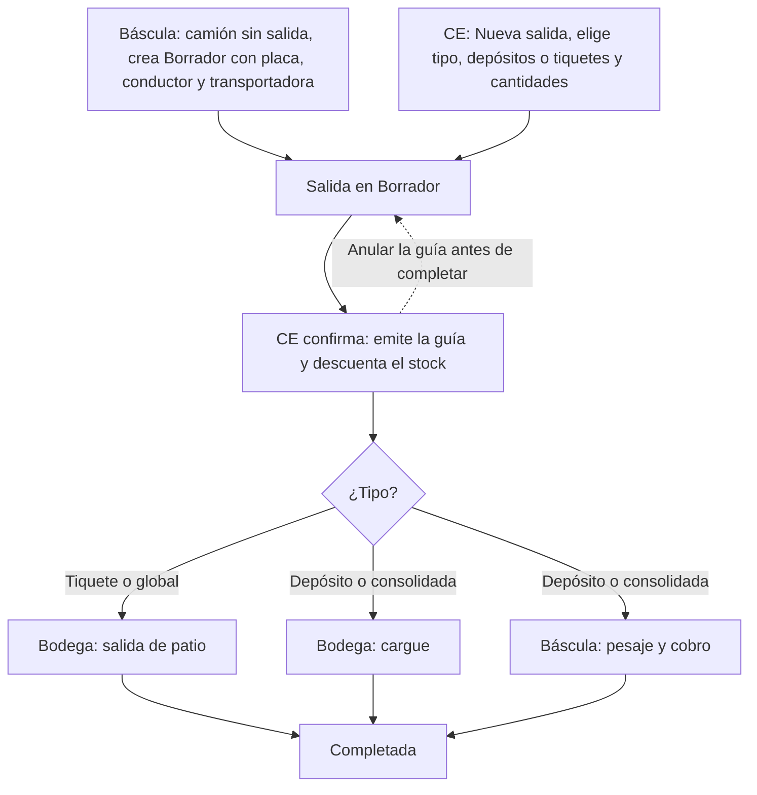

**Pantallas.** P-CE-08 y P-CE-11 (CE); P-BOD-06 a P-BOD-09 (Bodega); P-BAS-03 (Báscula); P-FAC-02 (facturas de guías).

### 3.8. Unidad de medida y embalaje

**Alcance.** PR-12, H-018, H-033. Decisiones: AF-22, AF-92 (H-033), AF-117. Se reabren DEC-015 y su precisión en DEC-057 (H15).

**Reglas.**

- La unidad de medida sale de toda la app: productos, formularios de báscula, CE y Bodega, impresos (PDF del depósito, guía, tarjeta) y el catálogo «Unidades de medida» (AF-22).
- Lo que el operario cambia al agregar un producto es el **embalaje**, que es editable (H-018, aclarado en PA-05 y C-04).
- El embalaje se muestra junto al nombre del producto en los selectores y en las tablas (H-033, AF-92).
- La fórmula `PER_UOM` cuenta por embalaje (AF-22). Las tarifas «por caja» del Excel se configuran con ella (AF-117).

**Consideración para la fase siguiente.** Los productos y las tarifas `PER_UOM` que hoy guardan una unidad de medida.

## 4. Decisiones del análisis (AF-xx)

| ID | Fecha | Pregunta | Respuesta del usuario | Elementos afectados |
|---|---|---|---|---|
| AF-01 | 2026-11-18 | ¿Se aprueba el reparto por módulo del inventario (clasificación de la fase 1; a transversales lo que cruza módulos; PR-24 y H-051 en Facturación con impacto en Bodega; H-076, PR-10, H-073 y PR-14 en Bodega; H-071 en Comercio Exterior)? | «Apruebo el reparto» | Sección 7 completa |
| AF-02 | 2026-11-18 | ¿Se crea un módulo Vigilancia? | «Sin módulo Vigilancia»: Vigilancia aparece como actor en la visión general y en Báscula; sus cambios se tratan en la sección Vigilancia del formulario de báscula | H-012, H-075, PR-02 |
| AF-03 | 2026-11-18 | ¿Cuándo se deciden las transversales que definen los módulos (edición del ingreso, modalidades de salida, tasa de cambio)? | «Con el primer módulo»: PR-11 y PR-21 se preguntan en el bloque de Báscula y PR-23 en el de Comercio Exterior; se redactan en Transversales | PR-11, PR-21, PR-23; secciones 3.5, 3.6 y 3.7 |
| AF-04 | 2026-11-18 | ¿Se incluyen las brechas del análisis de paridad sin hallazgo propio (5, 7, 8 y 12)? | «5, 7 y 8; la 12 fuera»: la 5 va con la etapa Amparados, la 7 con Báscula y la 8 con la edición del ingreso; los seriales por unidad quedan fuera de alcance | Brechas 5, 7, 8 y 12 de la paridad |
| AF-05 | 2026-11-18 | PR-01 propone una página propia para el proceso del camión; choca con DEC-058 (panel sobre la cola). ¿Qué contenedor se usa? | «Página propia. No importa que los datos digitados al salir de la página se pierdan, al revisar la operación este caso es poco probable porque los camiones van en fila. El caso que sí es posible es que el operario recibe los documentos antes y realiza el ingreso sin el pesaje porque el conductor no llega, pero este escenario se resuelve con las dos opciones de guardar (dos botones de guardar).» (AF-07 deja después un solo botón con las dos funciones.) Además actualizó el mockup (`docs/levantamiento_staging/mockups/modelo_bascula/formulario_registro_v2/`): un panel a la derecha del formulario con la fila de camiones, para hacer ingresos seguidos sin volver a la página anterior. «La tabla principal en `/operations/weighbridge` se debe conservar.» | PR-01, MK-01, DEC-058 (se reabre su parte de báscula, sección 5) |
| AF-06 | 2026-11-18 | ¿Tres pasos (Registro, Cobro, Tiquete) con el peso en Registro, como el legacy, en lugar de los cuatro actuales? | «Tres pasos, peso en Registro» | PR-01, H-019 |
| AF-07 | 2026-11-18 | PR-03: ¿«Guardar» y «Guardar sin pesaje», y dónde van los botones? | «Deja solo un botón de "Guardar" que cumple las dos funciones: si el operario no ingresa los pesos, automáticamente queda en "Por pesar" y se muestra una advertencia antes de guardar. Y la ubicación de los botones es en el header como en el mockup.» | PR-03 (modificada), H-009, §12.13 |
| AF-08 | 2026-11-18 | ¿Sección Vigilancia editable desde báscula (PR-01) y motivo de ingreso con categoría en lugar del selector de tipo de operación (PR-02)? ¿Dónde va la fecha de ingreso? | «El formulario de báscula debe tener la sección de vigilancia y el operario de báscula debe poder editar desde allí los campos de motivo, fecha y placa. Ya no es necesario hacerlo desde el encabezado porque la sección de vigilancia satisface esa necesidad.» Los motivos los alimenta administración en `/admin/entry-reasons`; a esa entidad se le agrega una propiedad nueva («categoría» o «Tipo operación») con tres opciones: «Ingreso», «Salida» o «Solo báscula». Determina el formulario que se muestra en báscula: si el operario cambia el motivo en la sección Vigilancia (sigue siendo un selector), el formulario se actualiza al instante | PR-01, PR-02, H-012, H-075, §12.14 |
| AF-09 | 2026-11-18 | ¿Cómo se calculan los cuatro pesos de la sección Pesaje (P. indicador, P. vehículo/tara, P. manifiesto, P. mercancía)? | «Como el legacy»: se digitan el indicador y el manifiesto; la mercancía se precarga con el manifiesto y Báscula la puede cambiar; la tara = indicador − mercancía | PR-01, MK-01 v2, DEC-057 (H3, precisada) |
| AF-10 | 2026-11-18 | ¿Se quita la sección «Pesaje y observaciones» (fecha de ingreso, «Primer pesaje», «Flujo perecederos», observaciones y documentos adicionales)? | «Quitarla completa» | PR-01 |
| AF-11 | 2026-11-18 | H-002: ¿cómo se cierra un ciclo sin segundo pesaje o se le agrega uno? | «Switch editable hasta cerrar, pero aclarar el escenario de un ciclo de pesaje: si el operario inicialmente registró el ingreso con un solo pesaje requerido, al terminar se cierra; el operario quiere que posteriormente a esto se pueda abrir nuevamente para agregar un repesaje. El escenario de apagar el segundo pesaje con el primero tomado sí cumple lo requerido.» | H-002, PR-01, PR-04 |
| AF-12 | 2026-11-18 | H-015: ¿el manifiesto es obligatorio solo con carta porte? Choca con DEC-057 (H2) | «Ambos solo con carta porte»: número y peso del manifiesto se piden solo con carta porte; con factura comercial o remisión no se piden. Se reabre DEC-057 (H2) | H-015, PR-01, DEC-057 (H2) |
| AF-13 | 2026-11-18 | PR-04 y §12.2: ¿repesaje en modal y cuántos repesajes? | «Modal, un repesaje, sin cobro»: un solo repesaje por ciclo (también en el ciclo reabierto de AF-11), sin cobro nuevo; un repesaje equivocado se corrige con motivo | PR-04, D-09, §12.2 |
| AF-14 | 2026-11-18 | PR-09: ¿qué bloqueos de Bodega sobre Báscula se quitan: (1) llegada a Bodega antes del segundo pesaje del ingreso (CHG-36); (2) cargue registrado antes del repesaje de salida (R-EXP, DEC-019)? | «Los dos». Se reabre DEC-019 en el repesaje de salida; cuándo se descuenta el stock se define con las salidas (PR-21) | PR-09, H-073, DEC-019 |
| AF-15 | 2026-11-18 | PR-05: historial en tres páginas con las columnas del legacy; ¿y la cola? (§12.18) | «PR-05 y ampliar la cola.» Además: «el detalle que se muestra en el historial se debe rediseñar, actualmente se muestra en un modal que es confuso para el usuario». Referencia: `docs/levantamiento_staging/mockups/modelo_bascula/detalle_pesaje/` (MK-07). «Ahora el detalle se muestra en un drawer para ganar espacio y el detalle de "Factura y Cobro" no es relevante para el operario de báscula, por eso se reduce, y los pesajes se manejan en la misma distribución del formulario de registro para facilitar la lectura.» | PR-05, H-003, H-022, D-03, D-08, §12.18 |
| AF-16 | 2026-11-18 | ¿Se aprueban PR-06 (Solo báscula sin peso esperado y con «Tercero»), PR-08 (quitar «Soltar camión») y PR-32 (ticket con la altura de su contenido)? | Aprobó las tres | PR-06, PR-08, PR-32, H-085 |
| AF-17 | 2026-11-18 | PR-07 / H-001: ¿inspección con documento y producto opcionales y descripción obligatoria? | «Aprobar PR-07»: en inspección, tipo y número de documento y producto opcionales; descripción obligatoria. Sin documento, cada camión crea su propio depósito; con documento se asocia como hoy | PR-07, H-001, D-01 |
| AF-18 | 2026-11-18 | H-014: ¿conductores distintos con el mismo documento? Choca con DEC-017 | «Permitir el mismo documento»: varios conductores con el mismo tipo y número si el nombre difiere; el selector muestra nombre y documento para elegir. Se reabre DEC-017 en ese punto | H-014, D-06, DEC-017 |
| AF-19 | 2026-11-18 | H-021: ¿cómo se registra un camión con mercancía de varios documentos? | **Reemplazada por AF-44.** «Todos los documentos en Registro»: en el paso 1 se agregan los documentos del camión, cada uno con su mercancía (un depósito por documento); el bruto es del camión y se cobra una vez; después, repesaje final o intermedios; se puede seguir agregando uno tarde | H-021, D-07, H-024 |
| AF-20 | 2026-11-18 | Brecha 7: ¿el documento adicional de un camión se suma al depósito abierto de ese documento? Choca con DEC-057 (D5) | «Sumar al depósito abierto»: el operario elige uno de los depósitos abiertos del número o «Es otro documento», como en DEC-057 (D1). Se reabre DEC-057 (D5) | Brecha 7 de la paridad, DEC-057 (D5) |
| AF-21 | 2026-11-18 | PR-10: ¿se quita el tipo de vehículo de báscula y lo registra Bodega como opcional? Choca con la nota de DEC-057 (obligatorio en Báscula) | «Aprobar PR-10»: sale de báscula; Bodega lo registra opcional en la recepción; el montacargas lo precarga por la placa. MK-01 v2 se aparta en ese campo | PR-10, H-076, DEC-057 (nota «Sin cambios», H1) |
| AF-22 | 2026-11-18 | PR-12: ¿se quita la unidad de medida de toda la app? Choca con DEC-015, con la precisión de DEC-057 sobre el PDF y la guía, y con la fórmula `PER_UOM` | «Quitarla; PER_UOM por embalaje»: sale de productos, formularios, impresos y catálogo; la fórmula por cantidad cuenta por embalaje | PR-12, H-018, H-033, DEC-015, DEC-057 |
| AF-23 | 2026-11-18 | H-010: ¿basta «Anular pesaje» para eliminar tickets? | «Basta la anulación»: en el historial los anulados se ven resaltados (fila en rojo) con su motivo; los arrastres mal asignados se corrigen con la edición del ingreso | H-010, D-04 |
| AF-24 | 2026-11-18 | Pedidos claros de Báscula (1): ¿cuáles pasan como comportamiento acordado? | Marcó los cuatro: H-005 (imprimir sin repesaje: tiquete de entrada, tiquete con la tara calculada y recibo), H-006 (ticket con producto, embalaje y cantidad), H-011 (autocompletar la carta porte con documentos de depósitos abiertos) y H-013 (transportadora por nombre o NIT) | H-005, H-006, H-011, H-013, D-02, D-05 |
| AF-25 | 2026-11-18 | Pedidos claros de Báscula (2): ¿cuáles pasan como comportamiento acordado? | Marcó los cuatro: H-016 («Carta porte» por defecto), H-020 (conductor en el cobro, preseleccionado con el del registro), H-007 (más reciente primero) y H-019 (en el cobro se sigue viendo el registro y se puede volver a editar) | H-007, H-016, H-019, H-020 |
| AF-26 | 2026-11-18 | PR-11: ¿quién edita qué datos y pesos del ingreso, y hasta cuándo? Choca con DEC-050 (BR-02-010) | «CE como legacy; Báscula hasta confirmar»: Comercio Exterior edita los datos del ingreso y los cuatro pesos en un solo formulario en cualquier estado del depósito, salvo lo levantado o despachado; Báscula corrige lo mismo hasta que Comercio Exterior confirma el depósito. La modalidad no cambia (se anula y se repite); cambiar el documento repite la elección del depósito (DEC-057 D1). Se reabre DEC-050 (BR-02-010) | PR-11, H-008, H-041, H-074, H-084, D-10, D-11, D-12, DEC-050 |
| AF-27 | 2026-11-18 | Brecha 8: ¿Comercio Exterior agrega o quita unidades de carga y cambia el tipo de carga después de báscula? | «Agregar, quitar y cambiar tipo. En la edición del ingreso, CE agrega y quita unidades de carga, mientras ningún producto tenga levante o salida. En báscula ya no se deben agregar las unidades de cargue, esto lo debe hacer CE. Para la facturación se debe revisar el Excel de convenios para entender cómo se hace el cobro.» | Brecha 8 de la paridad, DEC-014 (lo construido en BAS-07), PR-01, sección 2.4 |
| AF-28 | 2026-11-18 | PR-21 / H-042: ¿qué modalidades de salida soporta la v2? | Marcó las cuatro: por tiquete de entrada, global, por número de depósito y consolidada. Lo confirma la decisión 1 de `docs/levantamiento_staging/salidas_arquitectura.md` | PR-21, H-042, D-23, OV-05, P16 del plan de paridad |
| AF-29 | 2026-11-18 | §12.3: en las salidas por tiquete y global, ¿orden primero y guía después, o guía directa? | «Guía directa, sin orden» | PR-21, §12.3, DEC-016 |
| AF-30 | 2026-11-18 | H-072 / C-08: ¿báscula crea la orden en borrador para el camión que llega sin orden? Choca con DEC-050 (BR-02-001) y DEC-056 | Remite a sus decisiones de `docs/levantamiento_staging/salidas_arquitectura.md` (2026-11-18): (1) se soportan las cuatro formas de salida del legacy; (2) «la entidad orden de cargue ya no es necesaria teniendo en cuenta los flujos de la operación»: se reemplaza por una entidad de salida de mercancía con su tipo de salida, y la guía se asocia a ella; (3) estados de la salida: Borrador, Confirmada, Completada, Cancelada; (4) por número de depósito hay dos casos: el camión llega sin orden y báscula la crea en Borrador con los datos mínimos, Comercio Exterior la confirma, completa los datos y la mercancía y genera la guía, y con la guía Bodega ejecuta el cargue y en ese momento se modifica el stock; o Comercio Exterior crea la orden antes de que llegue el camión, báscula la precarga como hoy y Bodega carga cuando la guía se haya generado. En ambos casos la orden puede llevar mercancía de depósitos diferentes | PR-21, PR-22, H-017, H-072, DEC-016, DEC-050 (BR-02-001), DEC-056 (se mantiene la guía antes del cargue), P16 |
| AF-31 | 2026-11-18 | Con AF-14, ¿qué pasa si el camión se repesa antes de que Bodega registre el cargue? | «El stock se modifica con la ejecución del cargue de bodega y se debería marcar como completada solo cuando bodega y báscula hayan completado la operación, pero sin bloqueos. Si bodega se atrasa, salta la alerta de PR-14.» | PR-09, PR-14, PR-21, DEC-019 |
| AF-32 | 2026-11-18 | ¿Qué distingue la salida consolidada de la salida por número de depósito, si esta también puede llevar varios depósitos? | «Número de depósitos»: mismo flujo (pesaje, guía, cargue); el sistema fija el tipo: «consolidada» con más de un depósito, «por número de depósito» con uno | PR-21, AF-28, AF-30 |
| AF-33 | 2026-11-18 | §12.5: ¿en qué salidas se cobra báscula y cuántas veces se cobra la guía global? | «Báscula si pesa; una guía, un cobro»: báscula se cobra en por número de depósito y consolidada; tiquete y global no cobran báscula; cada guía se cobra una vez, aunque la global reúna varios tiquetes. Se reabre P16 en el cobro | §12.5, H-042, PR-21, P16, DEC-041 (T4) |
| AF-34 | 2026-11-18 | H-017: ¿la placa de Vigilancia precarga la salida en báscula y qué pasa si báscula cambia el conductor? | «Precarga y el conductor pasa a la salida»: la placa trae la salida sola; el conductor que registra báscula queda en la salida y en la guía si aún no se emitió; si ya se emitió, se avisa a Comercio Exterior para reemitirla | H-017, PR-21 |
| AF-35 | 2026-11-18 | En las salidas por tiquete y global (sin báscula ni cargue), ¿cuándo se descuenta el stock y cuándo queda «Completada»? | «En los 4 tipos de salida, que el stock se descuente cuando se emita la guía, y para estos dos casos en este momento deja la salida "completada". Para los otros dos casos el estado se completa con el cargue y el pesaje, pero se debe indicar qué falta para completarlo, si pesaje o cargue.» | PR-21, AF-30, AF-31 |
| AF-36 | 2026-11-18 | Contradicción entre AF-30/AF-31 (el stock se mueve con el cargue de Bodega) y AF-35 (el stock se descuenta al emitir la guía en los cuatro tipos): ¿cuál rige? | «Al emitir la guía, en los 4 tipos»: AF-35 reemplaza lo del cargue en AF-30 y AF-31; el cargue de Bodega y el pesaje solo completan la salida (por número de depósito y consolidada) y dicen qué falta | PR-21, AF-30, AF-31, AF-35 |
| AF-37 | 2026-11-18 | ¿Qué datos mínimos pone Báscula en la salida que crea en Borrador? | «Vehículo y conductor. Solo placa (de Vigilancia), conductor y transportadora. Modalidad no es necesario, se toma del depósito posteriormente.» | PR-21, AF-30, H-072 |
| AF-38 | 2026-11-18 | PR-01: ¿labels flotantes (FloatLabel, variante «on») o etiquetas encima como MK-01 v2? | «Decidirlo en Transversales»: se trata como patrón general de formularios en la sección 3.3 | PR-01, sección 3.3 |
| AF-39 | 2026-11-18 | AF-12: sin carta porte no hay manifiesto; ¿cómo queda P. mercancía? | «Siempre opcional»: se puede guardar sin mercancía; la completa el repesaje o Comercio Exterior al editar el ingreso | AF-09, AF-12, PR-01 |
| AF-40 | 2026-11-18 | AF-11: ¿desde dónde se reabre un ciclo de pesaje único cerrado para agregar el repesaje? | «Desde el historial»: acción «Repesar» en la fila del historial de Entradas y en el detalle (drawer); abre el modal de repesaje sin volver a la cola; se permite aunque el camión ya haya salido por Vigilancia | AF-11, AF-13, PR-04, PR-05 |
| AF-41 | 2026-11-18 | Con repesaje, ¿el neto real reemplaza a la mercancía del registro? (repetida tras releer la etapa 5 de la paridad) | «El neto real reemplaza. CE ve al lado el peso del manifiesto y la diferencia, y puede corregir. Al corregir se debe ver reflejado en el depósito y al hacer el levante.» | AF-09, AF-13, AF-26, DEC-057 (H3, queda definido lo que dejó «por definir») |
| AF-42 | 2026-11-18 | ¿Se incluye la brecha 11 de la paridad (peso despachado de cada salida), agregada después de AF-04? | «Incluirla en salidas»: la salida por número de depósito y la consolidada muestran el peso despachado de su pesaje y el depósito el saldo de peso | Brecha 11 de la paridad, sección 3.7 |
| AF-43 | 2026-11-18 | Dato nuevo: «Vehículo con varios Doc.» no tiene uso en el volcado. ¿Se mantiene AF-20? | «Mantener AF-20» | AF-20, brecha 10 de la paridad, DEC-057 (D5) |
| AF-44 | 2026-11-18 | Visto bueno de la sección 2.1 y de cinco criterios deducidos (motivo que cambia de categoría, manifiesto por documento con suma en el pesaje, cobrar antes de pesar, embalaje opcional, cobro reducido en el detalle) | Pidió cambiar solo el criterio 2: «Que no se registren todos los documentos en un mismo ingreso, sino manejarlos como el legacy: se hace un ingreso separado por cada documento. Para esto propongo duplicar la entrada en báscula: en el formulario exista una opción de duplicar la entrada cuantas veces sea necesario y una entrada duplicada eliminarla en caso de que se genere una por error. Al duplicarla, que se cargue la información de las secciones 1 y 2, que es la misma, y el usuario llene la sección 3 y 4. De esta forma se evita confusión y cada entrada se maneja de forma independiente, al igual que sus repesajes. Para esto es importante que en la vista de la cola de báscula se muestre la mercancía para poder identificarlos.» Actualizó MK-01 v2 con la mercancía en la cola. Reemplaza AF-19 | H-021, D-07, AF-19, PR-01, MK-01 v2 |
| AF-45 | 2026-11-18 | (Indicación del usuario sobre los wireframes) | «Debes apegarte al mockup que diseñé, formulario_registro_v2, en cuanto a la ubicación de botones y estructura. Por ejemplo, el botón de "Agregar producto" se encuentra en otra ubicación.» Se aplica también a MK-07 en el detalle del ciclo | P-BAS-02 a P-BAS-04, P-BAS-11, MK-01 v2, MK-07 |
| AF-46 | 2026-11-18 | Con entradas duplicadas, cada una con sus pesos y repesajes: ¿se reabre DEC-050 (BR-02-013, un solo pesaje bruto y tara para todos los depósitos del camión)? | «Reabrir: pesos propios por entrada»: cada entrada duplicada tiene su P. indicador, su mercancía y su repesaje; ya no hay pesaje compartido ni intermedios entre depósitos de un mismo ciclo | H-021, DEC-050 (BR-02-013), AF-44 |
| AF-47 | 2026-11-18 | ¿Cómo se cobra la báscula de las entradas duplicadas? | «Solo la primera; duplicadas en $0»: la entrada original cobra; las duplicadas pasan por el cobro con valor $0 y su tiquete | AF-44, DEF-F11-009 |
| AF-48 | 2026-11-18 | ¿Hasta cuándo y cómo se elimina una entrada duplicada por error? | «Sin guardar se quita; guardada se anula»: mientras no se ha guardado se quita sin dejar rastro; guardada, se anula con motivo como cualquier pesaje (AF-23) | AF-44, AF-23 |
| AF-49 | 2026-11-18 | ¿Dónde va «Duplicar entrada»? | Actualizó MK-01 v2: el botón va en el encabezado, junto a la placa y los datos de ingreso. «Este botón debe habilitarse cuando la sección 1 y 2 estén completas para copiarlas.» | AF-44, MK-01 v2 |
| AF-50 | 2026-11-19 | Visto bueno de la sección 2.1 y de seis criterios deducidos (D5 sin objeto, quitar la duplicada sin guardar saliendo, «Duplicar entrada» solo en ingresos, selector de depósito bajo el documento, «Tickets asociados» con las duplicadas, tara calculada no digitable) | Pidió cambiar el criterio 5: «Cada entrada muestra sus tickets; en el historial deben aparecer las duplicadas y en el detalle su ticket correspondiente.» Los criterios 1, 2, 3, 4 y 6 no los objetó. Cambios a los wireframes: quitar «Recuperar operaciones» de P-BAS-01; quitar «Observaciones registradas en garita» de la sección 2 de P-BAS-02 («no hace parte del formulario»); en P-BAS-11, «al imprimir el tiquete debe abrir un modal y el operario selecciona qué tipo quiere imprimir, igual al legacy: "De entrada", "Tara", "Entrada y tara", "Repesaje" y si incluye o no el recibo, o buscar una forma más ágil de escoger qué desea ver en el ticket; debe ser flexible, y conservar que actualmente se piden o no observaciones, pero dejar solo un botón de Imprimir». Preguntó si con el repesaje pendiente el operario puede volver a imprimir el tiquete: sí (AF-24, AF-52) | AF-44 a AF-49, P-BAS-01, P-BAS-02, P-BAS-11 |
| AF-51 | 2026-11-19 | Sin el botón «Recuperar operaciones», ¿qué pasa con `/operations/weighbridge/recover`? | «Desaparece la página»: retomar se hace desde la cola y descartar es «Anular pesaje» con motivo | P-BAS-01, AF-07, AF-48 |
| AF-52 | 2026-11-19 | ¿Cómo se elige qué imprimir en el modal de impresión? | «Casillas combinables»: «Entrada», «Tara» y «Repesaje» se combinan (Entrada + Tara es el «Entrada y tara» del legacy), switch «Incluir recibo» y Observación opcional; llegan marcadas según lo que ya tiene el ciclo y lo que aún no existe sale deshabilitado; un solo botón «Imprimir» | H-005, H-006, PR-32, P-BAS-13 |
| AF-53 | 2026-11-19 | ¿El mismo modal se usa en el paso Tiquete y en el historial? | «Sí, en todos»: un solo «Imprimir» con el mismo modal en el paso Tiquete (P-BAS-06), en el detalle (P-BAS-11) y en la fila del historial | P-BAS-06, P-BAS-08 a P-BAS-11, P-BAS-13 |
| AF-54 | 2026-11-19 | Visto bueno de la sección 2.1 tras AF-50 a AF-53 | Pidió tres cambios: (1) «En el formulario de registro, en el mockup no aparece el botón de agregar una "Empresa Transportista" al lado del select; no debe haber regresiones en eso.» (2) «También en solo báscula, en el tercero haya un botón al lado del select de agregar un tercero nuevo de forma rápida.» (3) «En P-BAS-05 de cobro, las opciones de destinatarios se conservan las que están actualmente. Y en Terceros debe haber la opción de agregar uno rápidamente con un botón al lado del select. Esta opción de agregar un tercero aplica también para Montacargas y Guía de salida, donde se realiza el cobro.» | P-BAS-02, P-BAS-04, P-BAS-05, secciones 2.2 y 3.7 |
| AF-55 | 2026-11-19 | Visto bueno de la sección 2.1 Báscula tras AF-54 | «Visto bueno, sigue con Bodega.» Deja un pendiente para Transversales: «en el formulario de cobro que se utiliza en Báscula, Montacargas y Guías de salida, revisar si es necesario o no los campos de "Método de pago", "Referencia" y "Nota". Validar si para Facturación son necesarios» | Sección 2.1; pendiente del formulario de cobro en la sección 3 |
| AF-56 | 2026-11-19 | PR-14 / H-073: ¿se aprueba Bodega no bloqueante con control de tiempo y qué registros se vigilan? | Marcó los tres: llegada (desde el primer pesaje), recepción (desde la llegada) y cargue de la salida (desde la guía emitida). PR-14 queda aprobada | PR-14, H-073, §12.11 |
| AF-57 | 2026-11-19 | PR-14: ¿cómo es el límite de tiempo? | «Amarillo y rojo, configurables»: dos umbrales por cada registro vigilado, que configura el administrador; la fila se pinta amarilla o roja y se avisa al cruzar cada uno. Los valores iniciales los define el cliente | PR-14, PR-26, §12.11 |
| AF-58 | 2026-11-19 | H-024: con una entrada por documento (AF-44), ¿cómo ve Bodega un camión con varias entradas? | «Llegada por camión, recepción por entrada»: «Ingresos» muestra una fila por camión con sus entradas y la llegada se registra una vez para todas; la recepción se completa por entrada, porque cada una es otro depósito, y el operario elige cuál descarga | H-024, AF-44 |
| AF-59 | 2026-11-19 | PR-13: ¿botón para registrar el montacargas desde recepciones? | «En la fila, placa precargada. Botón "Montacargas", pero solo en la fila de recepción.» Además: «se debe rediseñar el modal de Recepción Física, actualmente genera mucho scroll». Referencia: `docs/levantamiento_staging/mockups/modal_recepcion_bodega/` (MK-08), «tener en cuenta la distribución de los elementos y cómo podrían mostrarse; los estilos se deben ajustar a la aplicación». Y: «Agrega en transversales la revisión de estos modales grandes» | PR-13, MK-08, sección 3.3 |
| AF-60 | 2026-11-19 | MK-08 pone la cuadrilla en cada producto y el texto «Registra pago a cuadrilla»; ¿cómo queda? | «Una por recepción, sin pago»: una cuadrilla por recepción, como hoy; el texto del mockup no agrega pago | MK-08, P-BOD-03 |
| AF-61 | 2026-11-19 | ¿La ubicación en bodega es obligatoria en la recepción (MK-08) u opcional (hoy)? | «Obligatoria, como MK-08»: cada producto descargado lleva su ubicación | MK-08, P-BOD-03 |
| AF-62 | 2026-11-19 | AF-21: ¿dónde registra Bodega el tipo de vehículo? | «En la recepción, precargado»: en el bloque «Información del depósito y manifiesto», precargado si el vehículo ya lo tiene | PR-10, H-076, AF-21, P-BOD-03 |
| AF-63 | 2026-11-19 | Montacargas: ¿qué pasa si el vehículo no tiene tipo? | «Se pide y se guarda»: el montacargas lo exige para cobrar y queda guardado en el vehículo | PR-10, H-076, P-BOD-04 |
| AF-64 | 2026-11-19 | Visto bueno de la sección 2.2 Bodega y de cinco criterios deducidos | Pidió los ajustes de `docs/levantamiento_staging/bodega_ajustes.md` (2026-11-19). **Recepción:** «eliminar la página de ingreso, solo dejar la recepción; todos los registros de ingresos pasan a recepción directamente»; el menú «Recepciones» pasa a «Entradas», con «Recepción» e «Historial». **Montacargas:** en el historial, la facturación «solo debe mostrar la cantidad pagada y si fue o no facturado»; es informativo. **Recepción directa:** el modal «está solicitando información que no se puede completar en bodega»; los campos son los de `docs/levantamiento_staging/mockups/recepcion_directa_bodega/` (MK-09) y pasa a una página independiente. **Órdenes de cargue (salidas):** cambia el nombre a «Órdenes de salida» («ya no se maneja el concepto de órdenes de cargue»); aparecen todas las salidas sin importar el tipo; en «Por tiquete de entrada» y «Global», que no tienen cargue, el operario registra la salida de patio; en «Por número de depósito» y «Consolidada» registra el cargue con las cantidades; solo se listan las salidas «Confirmada»; el modal de ejecutar la salida de depósito y consolidada es el de `docs/levantamiento_staging/mockups/orden_de_salida_bodega/` (MK-10) y para tiquete y global se ajusta con los campos necesarios y una acción rápida para la salida de patio; en el menú, después de «Entradas», va «Salidas» con «Órdenes de salida» (solo las pendientes) e «Historial» (en tabla) | Sección 2.2, P-BOD-01 a P-BOD-06, MK-09, MK-10, AF-58, AF-35 |
| AF-65 | 2026-11-19 | Sin la página «Ingresos», ¿desaparece el registro de la llegada? | «Sí; un solo reloj»: la entrada pesada aparece en Recepción «Pendiente» y se completa ahí; un solo reloj, desde el pesaje hasta la recepción completada. AF-58 queda en «recepción por entrada» | AF-56, AF-58, AF-64 |
| AF-66 | 2026-11-19 | ¿Qué hace la salida de patio en las salidas por tiquete y global? | «Completa la salida»: la guía descuenta el stock (AF-36) y la salida queda pendiente de la salida de patio, que la deja «Completada». Se ajusta AF-35. El reloj de PR-14 vigila también la salida de patio, desde la guía | AF-35, AF-36, AF-56, AF-64 |
| AF-67 | 2026-11-19 | ¿Qué pide la acción rápida de salida de patio? | «Un clic con verificación»: muestra la guía vigente, las placas y los tiquetes de la salida; registra fecha y hora automáticas y una observación opcional; sin firma ni fotos | AF-64, AF-66 |
| AF-68 | 2026-11-19 | ¿Puede existir una salida Confirmada sin guía? | «No: confirmar emite la guía»: toda salida Confirmada tiene guía y en «Órdenes de salida» todo se puede ejecutar; desaparece el estado «Esperando guía» en Bodega | AF-30, AF-64, DEC-056 |
| AF-69 | 2026-11-19 | Recepción directa sin báscula (MK-09): ¿es siempre de inspección? | «Sí: siempre inspección, pero se aplican las mismas reglas de báscula: en la inspección el documento comercial y los productos son opcionales y se agrega un campo obligatorio de descripción.» | MK-09, AF-17, AF-64 |
| AF-70 | 2026-11-19 | Ejecutar salida (MK-10): ¿qué pasa con «Retirar de» (ubicación) y «Número de sello»? | «Ubicación automática; el sello se elimina. El sistema libera las ubicaciones del producto sin pedirlas. El sello se retira, no hace falta.» Preguntó para qué es el sello: es el número del precinto que se pone al camión o contenedor tras el cargue; se guarda en la orden y en la guía (`B/Wms.Domain/Entities/Warehouse/DispatchGuide.cs:19`), no se imprime en la guía y sale como «Precinto» en el reporte de novedades (`B/Wms.Application/Warehouse/Novelties/Services/WarehouseNoveltyPdfService.cs:87`) | MK-10, P-BOD-07 |
| AF-71 | 2026-11-19 | Visto bueno de la sección 2.2 Bodega, rehecha con AF-64 a AF-70, y de cuatro criterios deducidos (historial de Entradas como hoy; columnas del historial de salidas; tipo de vehículo y altas rápidas en la recepción directa; cantidad descargada no mayor que lo declarado) | «Visto bueno, sigue con CE» | Sección 2.2 |
| AF-72 | 2026-11-19 | PR-15 y PR-16: ¿tabla maestro-detalle por tipo de depósito en lugar del tablero de DEC-058? §12.15 (filtros) y §12.17 (drawer) | «PR-15 y PR-16 con filtro de estado.» «§12.15: los filtros (Todos/Pendientes/Facturados) que muestra MK-02 los puso la IA.» «§12.17: la tabla maestro-detalle reemplaza el drawer.» Se reabre DEC-058 en la parte del tablero de depósitos | PR-15, PR-16, H-027, D-14, MK-02, §12.15, §12.17, DEC-058 |
| AF-73 | 2026-11-19 | PR-17: ¿se aprueba la estructura del detalle por etapas de MK-03? | «Aprobar la estructura.» Además: «se debe mostrar un indicador, puede ser por color, en cada etapa que falte por completar la información» | PR-17, MK-03 |
| AF-74 | 2026-11-19 | PR-18 / H-026: ¿«Tickets de ingreso» en CE y qué pasa con salidas y solo pesaje? | «PR-18; salidas y solo pesaje en báscula»: CE tiene «Tickets de ingreso» con edición; salidas y solo pesaje los ve en solo lectura en el historial de báscula (P-BAS-09, P-BAS-10) | PR-18, H-026, D-13, brecha 4 de la paridad |
| AF-75 | 2026-11-19 | H-071: confirmar sin cliente; cuando se asigna tarde, ¿desde cuándo se cobra? | «Desde la fecha de ingreso»: se confirma sin cliente y, al asignarlo, se abre el primer período desde la fecha de ingreso | H-071, brecha 8 de la paridad, DEC-012, DEC-020 |
| AF-76 | 2026-11-19 | Etapa «Datos principales»: ¿cuándo se editan? | «Borrador y Confirmado, con recálculo»: se editan sin devolver a Borrador hasta que el depósito se cierre; si cambia algo que afecta el cobro, la factura del período se recalcula (DEC-022). Se reabre DEC-029 §7.4 | PR-17, H-028, H-029, H-030, D-15, OV-09, DEC-029 §7.4 |
| AF-77 | 2026-11-19 | Etapa «Amparados»: ¿qué hace la cantidad amparada? Choca con DEC-010 (2) | «Bloquea la confirmación»: como el legacy, no se confirma hasta que lo amparado cuadre con lo ingresado. Se precisa DEC-010 (2) | Brecha 5 de la paridad, OV-10, PR-17, DEC-010 (2) |
| AF-78 | 2026-11-19 | ¿Se editan productos después de confirmar? | «En Confirmado, sin bajar de lo levantado»: se editan en Borrador y Confirmado; una cantidad no queda por debajo de lo levantado ni de lo despachado en guías; un producto con levante o salida no se quita; la factura se recalcula | H-031, D-16, brecha 6 de la paridad |
| AF-79 | 2026-11-19 | H-035: ¿cómo funcionan los prefijos? | «En Configuración, precargados»: un prefijo por campo (N.º de levante, N.º de aceptación, manifiesto DIAN) que configuran Admin y CE; el campo llega con el prefijo y el operario completa o lo cambia en ese registro | H-035, D-17, sección 3.2 |
| AF-80 | 2026-11-19 | PR-19: ¿qué vistas de levantes se aprueban? | «Ambas vistas; Vista 2 reemplaza "Levantes"»: el levante se registra en la fila editable de la tabla agrupada, sin modal (H-036, H-040); la Vista 2 ocupa el ítem «Levantes» del menú | PR-19, H-036, H-040, D-18, D-21, OV-04, MK-04, MK-05, MK-06 |
| AF-81 | 2026-11-19 | ¿Rótulo «Valor en aduanas (USD)» o «CIF (USD)»? Choca con DEC-029 §7.2 | «"Valor en aduanas (USD)"»: cambia solo el rótulo en pantallas e impresos; el dato y su cálculo no cambian. Se reabre DEC-029 §7.2 en el rótulo | H-037, §12.16, OV-11, brecha 12 de la paridad, DEC-029 §7.2 |
| AF-82 | 2026-11-19 | Pedidos de levantes sin alternativa real | Marcó los tres: H-038 (sin fecha de aceptación), H-040 (levantes seguidos) y el valor en pesos calculado al digitar (OV-11) | H-038, H-040, D-20, D-21, OV-03, OV-11 |
| AF-83 | 2026-11-19 | Cálculo de la cantidad del levante (repetida con el análisis actualizado de la paridad): ¿qué base de peso? | «Propuesta de la paridad, Σ manifiesto»: con un producto, cantidad = peso digitado × Σ cantidad ingresada ÷ Σ peso del manifiesto de los camiones no anulados; con varios productos, se precarga lo pendiente del producto elegido y se habilita «Levante total del saldo» sin peso documental; la cantidad queda editable siempre | H-039, D-19, OV-01, brecha 1 de la paridad, AF-41 |
| AF-84 | 2026-11-19 | Con AF-77, ¿qué pasa si después de confirmar llega un camión tardío y lo ingresado ya no cuadra con lo amparado? | «Entra y se avisa»: como DEC-013, el camión entra y el depósito sigue confirmado; el saldo de Amparados queda en rojo, la etapa se marca pendiente (AF-73) y CE recibe el aviso | AF-77, DEC-013 |
| AF-85 | 2026-11-19 | PR-23: ¿tasa manual, semanal y compartida? Choca con DEC-023 | «Aprobar; reabrir DEC-023»: una tasa semanal manual para todo el sistema, sin consulta a la DIAN; el levante la precarga y es editable; la factura del período usa la tasa de la semana de la fecha de ingreso (DEC-012) | PR-23, H-034, H-077, D-22, OV-02, brecha 3 de la paridad, DEC-023 |
| AF-86 | 2026-11-19 | PR-23: ¿quién registra la tasa y cuál se precarga? | «CE y Facturación; semana del levante»: la registran CE, Facturación o Admin en Configuración (desde-hasta y valor); el levante precarga la de la semana de su fecha de levante y se puede cambiar | PR-23, PA-08, sección 3.5 |
| AF-87 | 2026-11-19 | PR-20 / §12.9: ¿qué etapas tienen los depósitos de exportación e inspección? | «Sin Levantes; inspección sin Amparados»: exportación con Entradas, Datos principales (con exportador), Bodega, Amparados y Salidas; inspección con Entradas, Datos principales (con la descripción), Bodega y Salidas | PR-20, §12.9 |
| AF-88 | 2026-11-19 | ¿Cómo salen la exportación y la inspección? | «Cuatro formas; inspección sin guía»: exportación con las cuatro formas y guía, como importación; inspección con las cuatro formas sin guía: confirmar la salida descuenta el stock y Bodega la ejecuta igual (cargue o salida de patio) | AF-28, AF-36, AF-68, DEC-056 |
| AF-89 | 2026-11-19 | PR-22 / §12.4: ¿cómo se diseña «crear salida»? | «La propongo yo»: wireframe a partir del legacy, la etapa Salidas de PR-17 y lo decidido; el usuario lo valida en el visto bueno | PR-22, H-045, §12.4 |
| AF-90 | 2026-11-19 | §12.8: ¿hasta cuándo se edita una salida? | «Libre en Borrador; confirmada, anular guía»: en Borrador se edita todo; confirmada, se corrige anulando la guía (devuelve el stock y la salida a Borrador) mientras no esté completada; completada no se edita | PR-17, §12.8, DEC-052 |
| AF-91 | 2026-11-19 | H-043 / §12.7: ¿formato del inventario de mercancía nacionalizada? | «Como el legacy, con levantes»: agrupado por depósito, con el detalle de cada levante y filtro por fechas de levante; en pantalla, PDF y Excel | H-043, PA-15, §12.7 |
| AF-92 | 2026-11-19 | Pedidos claros de Comercio Exterior | Marcó los tres: H-029 (terceros rápidos, también con el depósito confirmado), H-032 (producto rápido) y H-033 (embalaje junto al nombre) | H-029, H-032, H-033 |
| AF-93 | 2026-11-19 | ¿Qué pasa con «Devolver a Borrador»? | «Se retira.» Además: «Analizar si el "Cerrar ingreso de camiones" sigue siendo útil, si el operario digita los amparados» | PR-17, AF-76, AF-77, AF-78, DEC-013 |
| AF-94 | 2026-11-19 | Valor de la mercancía (repetida con la paridad actualizada): ¿uno por depósito o dos niveles? | «Dos niveles, como el legacy»: CE digita precio por camión en la edición del ingreso; el valor CPI del depósito (Datos principales) se precarga con la suma y CE lo deja o corrige (AF-76); el cobro usa el CPI; la moneda es una por depósito | C-11, brecha 6 de la paridad, DEC-029 §7.1, AF-76 |
| AF-95 | 2026-11-19 | ¿Sigue sirviendo «Cerrar ingreso de camiones» con los amparados? | «Se retira»: lo amparado cumple su función; el depósito queda abierto a camiones tardíos con aviso (AF-84), como el legacy. Se reabre DEC-013 en el cierre explícito | AF-77, AF-84, AF-93, DEC-013 |
| AF-96 | 2026-11-19 | Contenido de las etapas Entradas, Bodega y Salidas (PR-17) | «Aprobar, con lo ya decidido»: como PR-17, más estado y lo que falta de la salida (AF-35), peso despachado (AF-42), «Nueva salida» con el depósito precargado y la diferencia manifiesto/mercancía en Entradas (AF-41) | PR-17, AF-35, AF-41, AF-42 |
| AF-97 | 2026-11-19 | Menú de salidas en Comercio Exterior | «"Salidas": listado y crear»: un ítem «Salidas» con el listado de todas las salidas y «Nueva salida»; la guía se ve, descarga o anula desde su salida; salen «Órdenes de cargue» y «Guías de salida». «Pero se debe conservar la opción de "Descargar PDF por depósito (ZIP)", pero solo para las consolidadas» | AF-30, AF-68, sección 3.2 |
| AF-98 | 2026-11-19 | La «Información general» de MK-03 muestra la subpartida arancelaria del producto, que la v2 no tiene. ¿Dónde se registra? | «No se muestra»: MK-03 se aparta en ese dato | PR-17, MK-03, AF-73 |
| AF-99 | 2026-11-19 | Visto bueno de la sección 2.3 Comercio Exterior y de tres criterios deducidos (indicador de etapas, menú de CE, propuesta de «Nueva salida») | Pidió: «En P-CE-01 quitar el botón de "Ver depósito" de la tabla expandida, solo dejar la acción de la tabla principal.» Para Transversales y toda la app: «todas las tablas (las principales y las de mayor uso por parte del usuario) deben tener filtros por columna de los campos más importantes y la opción de sort en las columnas. En este caso la P-CE-01 debe tener filtros por columna de número de depósito, doc. comercial, tiquete, mercancía.» Y: «para la aplicación en general: preferiblemente no utilizar botones de tipo texto». No objetó los tres criterios | P-CE-01, sección 3.3 |
| AF-100 | 2026-11-19 | Visto bueno de la sección 2.3 tras AF-99 | Pidió: «En P-CE-04, Documento comercial: tipo · número · fecha son campos individuales, y organizar el formulario por categorías para mejor lectura.» | P-CE-04 |
| AF-101 | 2026-11-19 | ¿La empresa de transporte va por depósito o por entrada? | «Por entrada; el depósito solo la muestra»: cada camión lleva su transportadora (báscula y edición del ingreso); Datos principales lista las de sus camiones en solo lectura; se retira la transportadora propia del depósito; la guía usa la del vehículo de la salida o la de los camiones | P-CE-04, H-030, CHG-73 |
| AF-102 | 2026-11-19 | Visto bueno de la sección 2.3 tras AF-101 | Pidió: «En P-CE-03, en la sección de Comercio Exterior, cambiar el "Tipo de carga" por "Unidad de carga" y un switch: si lo activa, es unidades de carga.» | P-CE-03, AF-27 |
| AF-103 | 2026-11-19 | Visto bueno de la sección 2.3 Comercio Exterior tras AF-99 a AF-102 | «Visto bueno, sigue con Facturación» | Sección 2.3 |
| AF-104 | 2026-11-19 | H-046: ¿se puede corregir el N.º SIGO después de aprobar? Choca con DEC-024 | «Editable con motivo»: Facturación lo corrige en cualquier estado salvo Anulada, con motivo y auditoría. Se reabre DEC-024 en «queda fijo al aprobar» | H-046, DEC-024 |
| AF-105 | 2026-11-19 | PR-24 / H-051: ¿switch «Requiere factura» en el cobro del montacargas? Choca con DEC-018 | «Aprobar PR-24»: con factura, IVA y «Pendiente por facturar» («Pendiente de número» en facturas); sin factura, sin IVA, pago inmediato y «No aplica». Se reabre DEC-018 | PR-24, H-051, H-052, DEC-018 |
| AF-106 | 2026-11-19 | H-054: ¿qué destinatarios quedan en el cobro de la guía? | «Quitar "Clientes"; quedan los cuatro»: tercero registrado, conductor del vehículo, persona no registrada y consumidor final; un solo destinatario paga la guía | H-054, CHG-34, AF-54 |
| AF-107 | 2026-11-19 | H-055 / PA-19 / §12.6: ¿qué muestran las facturas de guías? | «Todo, con mercancía y embalaje»: N.º de guía, número de salida, tiquete de báscula (si pesó), depósitos, placas, CPI, mercancía y embalaje, con filtros por columna. Cierra PA-19 | H-055, PA-19, D-25, §12.6 |
| AF-108 | 2026-11-19 | H-056: ¿cómo se abre el ciclo de facturación del cliente (hoy 8 ciclos de catálogo; hay convenios de 20 y 120 días)? | «Ciclo libre en días»: además de los del catálogo, un ciclo de N días que Facturación digita por cliente | H-056, PR-25 |
| AF-109 | 2026-11-19 | H-058 / D-26: ¿qué muestra «Depósitos pendientes»? | «Solo con trabajo pendiente»: un depósito aparece si tiene un período cumplido sin facturar o, como DEC-053, una factura de almacenamiento en Borrador sin N.º SIIGO o anulada sin refacturar; desaparece al facturar y vuelve con el período siguiente. Precisa DEC-053 sin reabrirla | H-058, D-26, H-082, DEC-053 |
| AF-110 | 2026-11-19 | Pedidos de Facturación sin alternativa real (1) | Marcó los cuatro: H-047/H-048 (pestaña de báscula con las columnas del legacy, detalle con ticket, modalidad y placa; filtros por columna en carta porte, placa, servicio, ticket, conductor, fecha, N.º de factura, SIGO, depósito y cliente), H-049/H-050/H-052 (reportes de báscula, guías y montacargas en PDF y Excel, con suma y contado separado de por cobrar), H-060 (todo pago queda verificado) y H-065 (pago completo en un clic desde el listado) | H-047, H-048, D-24, H-049, H-050, H-052, PA-17, H-060, PA-20, H-065 |
| AF-111 | 2026-11-19 | Pedidos de Facturación sin alternativa real (2) | Marcó los cuatro: H-059 (Facturación por CPI igual al legacy, con el valor de la mercancía), H-061 (anual con el listado de facturas), H-062 (póliza para Facturación, con el valor en aduanas del levante) y H-082 (tabla interna de pendientes con tema oscuro) | H-059, H-061, H-062, H-082, AF-81 |
| AF-112 | 2026-11-19 | H-064 / H-069: ¿a quién sale la factura de almacenamiento y a quién bloquea la mora? | «"Facturar a" y mora al cliente»: la configuración de facturación del cliente lleva un «Facturar a» (razón social en factura) que se precarga en cada factura de almacenamiento; Facturación lo cambia en Borrador como hoy; la mora de esas facturas cuenta para el cliente del depósito. El rótulo «Cliente» se conserva | H-064, H-069, DEC-057 (D22, D23), BR-05-004 |
| AF-113 | 2026-11-19 | AF-12: sin manifiesto, ¿sobre qué peso cobran las fórmulas por peso? | «Peso de la mercancía»: la suma del peso de mercancía de las entradas del depósito, haya o no manifiesto (el que AF-41 lleva al depósito) | AF-12, AF-09, AF-41, `WEIGHT_THRESHOLD` |
| AF-114 | 2026-11-19 | PR-25 / H-070 / H-086 / §12.10: ¿cómo quedan cargados los acuerdos? | «Carga inicial + formulario nuevo + plantilla»: «La opción recomendada y una opción de importar desde una plantilla que se le pasa a facturación para que cada año o si hay un cliente nuevo pueda cargarla desde allí. La plantilla se debe poder descargar desde la misma app» | PR-25, H-070, H-086, H-066, §12.10, PR-28 |
| AF-115 | 2026-11-19 | H-057: el legacy no tiene mes calendario («Mensual» = 30 días, fin = inicio + 30); el «Mensual (mes calendario)» de la v2 se corre un día por mes. ¿Qué regla queda? | «Quitar el mes calendario»: quedan los ciclos de N días del legacy y el libre (AF-108); «Mensual» es de 30 días; fin = inicio + N, como el legacy. H-057 queda cumplido | H-057, H-056, AF-108 |
| AF-116 | 2026-11-19 | Tarifas del Excel 2026 sin fórmula directa: ¿cuáles debe poder expresar el acuerdo? | Marcó las cuatro: descargada / sobre vehículo (3 tarifas), según el valor de la mercancía (4), por tonelada o kilo con mínimo (35) y dos tarifas por volumen (2) | PR-25, H-070, AF-27 |
| AF-117 | 2026-11-19 | Confirmaciones del Excel 2026 frente a lo que existe | Confirmó las cuatro: tanquero y contenedor con `PER_CARGO_UNIT` y las unidades que registra CE; «+ báscula» = báscula en $0 por convenio (DEC-057 H5b); por caja = `PER_UOM` por embalaje (AF-22); el «+ $15.000» es el servicio complementario de papelería (BR-06-004) | AF-27, AF-22, DEC-057 (H5b), BR-06-004 |
| AF-118 | 2026-11-19 | H-063 / H-086: ¿cómo se diseña el formulario de acuerdos y qué pasa con el simulador? | «La propones tú, con simulador»: wireframe con una fila por tarifa, como el Excel, y la plantilla descargable; el simulador pide solo los datos de la fórmula elegida. El usuario lo valida en el visto bueno | H-063, H-086, PA-21, PR-25, PR-28, AF-114 |
| AF-119 | 2026-11-19 | Tarifa «descargada / sobre vehículo»: ¿quién registra que la mercancía quedó sobre el vehículo? | «Bodega, en la recepción»: la recepción física lleva un switch «Queda sobre el vehículo»; activo, la ubicación es «sobre vehículo» | AF-116, MK-08, P-BOD-02 |
| AF-120 | 2026-11-19 | Depósito con camiones descargados y otros sobre el vehículo: ¿cómo se cobra? | «Por camión»: las entradas descargadas, con el % sobre su precio por camión; las que quedan sobre el vehículo, con la tarifa por vehículo; la factura suma ambas | AF-116, AF-119, AF-94 |
| AF-121 | 2026-11-19 | Hallazgos de Facturación que se cierran sin cambio propio | Cerró H-053 (horómetro), H-066 (lo resuelve la carga inicial, AF-114) y H-068 (el tiquete ya dice que no es factura de venta). No marcó H-067 / D-27, que se vuelve a analizar | H-053, H-066, H-068, H-067, D-27 |
| AF-122 | 2026-11-19 | H-067 / D-27: el legacy factura en un paso; la v2 tiene SIGO, «Aprobar», «Enviar» y «Registrar pago», y se confundió aprobar con pagar. ¿Qué se hace? | «Un paso "Facturar"»: en Borrador, un diálogo «Facturar» con N.º SIGO, fecha, destinatario (precargado, AF-112), valor (precargado con el cálculo y editable) y observaciones; al guardar queda emitida y se fija el vencimiento; se quita el «Aprobar» aparte; «Enviar» y «Registrar pago» siguen aparte | H-067, D-27, DEC-024, AF-104, AF-112 |
| AF-123 | 2026-11-19 | Precisión de AF-112 tras revisar el Excel (22 de 76 responsables facturan a más de una razón social; en 21 depende del importador): ¿cómo se configura el «Facturar a»? | «Por cliente e importador»: en la configuración de facturación del cliente, un «Facturar a» general y excepciones por importador; la factura de almacenamiento toma el del importador del depósito y, si no hay, el general; Facturación lo cambia en Borrador | AF-112, H-064, H-069, H-070 |
| AF-124 | 2026-11-19 | Tarifas que cambian por importador (1 responsable solo por importador, 8 mixtos): ¿se agrega el importador a la tarifa del acuerdo? | «Sí, como dimensión opcional»: una tarifa puede aplicar solo a un importador, como hoy a un producto o modalidad; gana la más específica. **Reemplazada por AF-125** | PR-25, H-070, AF-114 |
| AF-125 | 2026-11-19 | Cambio pedido en el visto bueno de la sección 2.4 | «En los acuerdos quitar el importador como dimensión opcional de la tarifa, para esos casos basta con la mercancía»: la tarifa sigue distinguiendo producto, modalidad y perecedero, como hoy; las que en el Excel cambian por importador se configuran por mercancía. Reemplaza AF-124 | AF-124, PR-25, H-070, AF-114 |
| AF-126 | 2026-11-19 | Visto bueno de la sección 2.4 Facturación tras AF-125 | «Visto bueno» | Sección 2.4, P-FAC-01 a P-FAC-14 |
| AF-127 | 2026-11-19 | PR-28 / H-083 / §12.12: ¿se aprueba el rediseño del menú con «Configuración» y «Tarifas y acuerdos»? | «Aprobar; propones el menú»: PR-28 tal cual (Admin entra a todo; «Usuarios» y «Auditoría» solo Admin; «Configuración» sin precios para Admin, CE y Facturación; «Tarifas y acuerdos» para Facturación y Admin; ítems de un nivel). El menú por rol lo dibujo en `transversales.html` y se valida en el visto bueno | PR-28, H-083, H-025, H-029, H-032, §12.12, DEC-005 |
| AF-128 | 2026-11-19 | ¿Dónde van prefijos (AF-79), tasas semanales (AF-86), umbrales de alertas (AF-57), categoría de motivos (AF-08) y parámetros del sistema? | «Todos en configuración a excepción de los umbrales amarillo y rojo de las alertas de bodega, esto va en administración, solo el admin configura alertas y notificaciones» | AF-08, AF-57, AF-79, AF-86, PR-26, PR-28 |
| AF-129 | 2026-11-19 | PR-29 / H-004: ¿listados con tabla CRUD sin la tarjeta de título? Choca con DEC-058 («Páginas uniformes») | «Aprobar PR-29; reabrir DEC-058»: sale la tarjeta de título y subtítulo; la tabla CRUD con su barra (crear, exportar) es el elemento principal; filtros por columna, orden (en el backend si es paginado), tarjeta de filtros globales solo si hace falta; acciones solo con botones | PR-29, H-004, H-083, RV-04, RV-05, RV-06, AF-99, DEC-058 |
| AF-130 | 2026-11-19 | PR-30 / AF-59: ¿qué regla queda para modales y drawers? | «Aprobar con regla por tamaño»: CRUD de catálogos en modal; detalle de un registro en drawer; formularios de operación largos en página propia; un modal con mucho scroll se rediseña a dos columnas, como MK-08, o pasa a página. Yo listo y clasifico los modales grandes | PR-30, AF-59, AF-05, AF-64, MK-07, MK-08 |
| AF-131 | 2026-11-19 | AF-38: ¿etiquetas flotantes (FloatLabel «on», PR-01) o encima del campo? | «Encima, como MK-01 v2»: la etiqueta va encima del campo en toda la app, como hoy | AF-38, PR-01, MK-01 v2, AF-45 |
| AF-132 | 2026-11-19 | AF-55: ¿qué campos de pago quedan en el cobro de báscula, montacargas y guía? | «Método; referencia si no es efectivo»: método de pago precargado en «Efectivo»; «Referencia» aparece solo con otro método; sale «Nota». Facturación conserva método, referencia y nota en su registro de pagos | AF-55, H-050, AF-110 |
| AF-133 | 2026-11-19 | PR-26 / H-078: ¿qué configura el Admin en las notificaciones? | «Roles y correo por aviso»: una fila por tipo de notificación con los roles que la reciben y el switch «También por correo»; arranca con los roles de hoy; incluye las alertas de atraso de Bodega | PR-26, H-078, H-073, AF-57, AF-128 |
| AF-134 | 2026-11-19 | Pedidos de interfaz sin alternativa real | Marcó los cuatro: PR-27 (selectores de listas grandes paginados y con búsqueda en el servidor), PR-31 (ver contraseña en el login), H-079 (sidebar con varios roles) y H-080 y H-081 (switch de tema y encabezado de los modales) | PR-27, H-045, H-013, PR-31, H-079, RV-03, H-080, H-081 |
| AF-135 | 2026-11-19 | H-084 / D-10: ¿qué se edita en salidas y solo pesaje después de cerrar el ciclo? | «Pesos y datos, con motivo»: desde el historial, Báscula corrige pesos, fecha, placa, conductor, transportadora y tercero, con motivo y aviso, como el legacy; en una salida con guía, cambiar placa o conductor avisa a CE para reemitirla (como AF-34) | H-084, D-10, AF-26, AF-34, P-BAS-09, P-BAS-10 |
| AF-136 | 2026-11-19 | Tasa semanal: ¿qué pasa si la semana no tiene tasa registrada? | «Última registrada y aviso»: se usa la última tasa registrada antes de esa semana; la factura lleva advertencia y se avisa a CE y Facturación; al registrarla, la factura en Borrador se recalcula (DEC-022); en el levante llega con esa tasa y un aviso, editable | AF-85, AF-86, DEC-020, DEC-022 |
| AF-137 | 2026-11-19 | Visto bueno de la sección 3 Transversales | «Visto bueno» | Sección 3, P-TR-01 a P-TR-12 |

## 5. Decisiones vigentes que se proponen reabrir

Solo las que el usuario aprobó reabrir, con la decisión del análisis que lo aprueba. Si este análisis se aprueba, cada una se registra en `contexto/decisiones.md` como reemplazada o precisada al cierre del análisis.

| Decisión vigente | Qué dice hoy | Qué cambia | AF | Sección |
|---|---|---|---|---|
| DEC-058 (báscula) | El proceso del camión se abre en un panel propio sobre la cola, que no se desmonta | Página propia con la cola en un panel lateral; la tabla de la cola se conserva; lo no guardado se pierde al salir | AF-05 | 2.1 |
| DEC-057 (H2) | Número y peso del manifiesto obligatorios en todo ingreso a depósito | Solo con carta porte | AF-12 | 2.1 |
| DEC-057 (D5) | Un depósito adicional necesita un documento propio | Ya no hay depósito adicional dentro de un ciclo: cada documento es una entrada duplicada que elige su depósito con DEC-057 D1, también uno abierto de su número. D5 queda sin objeto | AF-20, AF-43, AF-44 | 2.1 |
| DEC-050 (BR-02-013) | Camión con varios documentos: por defecto un solo pesaje (bruto y tara) para todos los depósitos; intermedios si descarga en puntos distintos | Una entrada por documento, cada una con sus pesos y su repesaje; sin pesaje compartido ni intermedios; cobra la primera y las duplicadas van en $0 | AF-44, AF-46, AF-47 | 2.1 |
| DEC-057 (nota «Sin cambios», H1) | El tipo de vehículo ya es obligatorio en Báscula | Sale de báscula; lo registra Bodega, opcional | AF-21 | 2.2 |
| DEC-057 (H15, precisión de DEC-015) y DEC-015 | Unidad de medida en catálogo; el PDF del depósito y la guía llevan unidad y embalaje | Se quita la unidad de medida de toda la app; `PER_UOM` cuenta por embalaje | AF-22 | 3.8 |
| DEC-017 | El mismo documento identifica (y corrige) al conductor | Varios conductores con el mismo documento si el nombre difiere | AF-18 | 2.1 |
| DEC-019 (R-EXP) | El repesaje de salida responde 409 mientras la orden no esté cargada | Sin bloqueo; la salida se completa cuando hay pesaje y cargue | AF-14, AF-31 | 2.1, 3.7 |
| DEC-050 (BR-02-001) | Báscula no pesa la salida sin una orden de cargue existente | Báscula crea la salida en Borrador con placa, conductor y transportadora | AF-30, AF-37 | 3.7 |
| DEC-050 (BR-02-010) | Báscula corrige solo pesos, fecha, observación, conductor y vehículo; CE corrige documento y mercancía solo en Borrador | Báscula corrige todo el ingreso hasta la confirmación; CE en cualquier estado, salvo lo levantado o despachado | AF-26 | 3.6 |
| DEC-016 (WMS-17) | Se conserva la orden de cargue y su flujo | La orden de cargue se reemplaza por la salida de mercancía, con tipo y estado | AF-30 | 3.7 |
| P16 del plan de paridad (`planes/paridad-legacy/plan-backend-paridad-legacy.md:65`) | Una orden y una guía por camión; no se construye la salida global | Salida global con varios tiquetes en una guía, cobrada una vez | AF-28, AF-29, AF-33 | 3.7 |
| CHG-36 del plan de corrección | El segundo pesaje del ingreso exige la llegada registrada en Bodega | Sin bloqueo; la alerta de Bodega vigila el atraso | AF-14 | 2.1, 2.2 |
| Lo construido para DEC-014 (BAS-07) | Báscula registra el tipo de carga y las unidades de carga al pesar | Las registra Comercio Exterior al editar el ingreso. El texto de DEC-014 no cambia | AF-27 | 3.6 |
| DEC-058 (tablero de depósitos) | Tablero de CE con una columna por estado, scroll infinito y buscador por columna | Menú «Depósitos» por tipo con tabla maestro-detalle y filtro por estado y fechas | AF-72 | 2.3 |
| DEC-058 (páginas uniformes) | Todas las páginas del menú con tarjeta de encabezado (título, subtítulo y acciones), filtros en otra tarjeta y tabla | Sin tarjeta de título: la tabla CRUD con su barra es el elemento principal, con filtros por columna, orden y filtros globales solo si hacen falta | AF-129 | 3.3 |
| DEC-029 §7.4 | El valor de la mercancía solo se corrige en Borrador (se devuelve el depósito) | Datos principales, productos y amparados se editan en Confirmado, con recálculo; se retira «Devolver a Borrador» | AF-76, AF-78, AF-93 | 2.3 |
| DEC-029 §7.2 (rótulo) | El valor del levante se rotula «CIF» en pantallas e impresos | Se rotula «Valor en aduanas (USD)»; el dato y su cálculo no cambian | AF-81 | 2.3 |
| DEC-023 | TRM de la DIAN con la fecha de ingreso; la manual solo si la DIAN falla y nunca la reemplaza | Una tasa semanal manual y compartida, sin consulta a la DIAN | AF-85, AF-86 | 3.5 |
| DEC-013 (cierre del ingreso de camiones) | CE cierra el ingreso de camiones de forma explícita, sin reapertura | Se retira el cierre; lo amparado cumple su función y el camión tardío entra con aviso | AF-84, AF-95 | 2.3 |
| Regla de WMS-29 (`contexto/contexto-negocio-wms-para-ia.md` §5.11) | Los productos del depósito se editan solo en Borrador | Se editan en Confirmado, sin bajar de lo levantado ni de lo despachado | AF-78 | 2.3 |
| DEC-010 (2), precisada | Las cantidades del depósito son las declaradas en báscula | Siguen siéndolo; además, confirmar exige que lo amparado por el documento cuadre con lo ingresado | AF-77 | 2.3 |
| DEC-057 (H3), precisada | Mercancía = manifiesto; el neto con segundo pesaje quedó «por definir» | Mercancía editable en báscula; con repesaje, mercancía = indicador − tara real | AF-09, AF-41 | 2.1 |
| DEC-024 | El N.º SIIGO lo asigna Facturación y queda fijo al aprobar | Facturación lo corrige en cualquier estado salvo Anulada, con motivo y auditoría | AF-104 | 2.4 |
| DEC-018 | Montacargas sin impuestos; el cobro trae un check «Agregar IVA», desmarcado por defecto | Switch «Requiere factura»: con factura, IVA y pendiente por facturar («Pendiente de número»); sin factura, sin IVA, pago inmediato y «No aplica» | AF-105 | 2.2, 2.4 |
| DEC-053 (BR-06-003), precisada | «Depósitos pendientes» incluye los cerrados con trabajo pendiente | Sigue; además, un depósito activo solo aparece con un período cumplido sin facturar | AF-109 | 2.4 |

## 6. Pendientes abiertos

Ninguno bloquea el análisis. Los del cliente son datos o precisiones que solo él puede dar; las consideraciones son temas de la fase siguiente que este análisis no desarrolla (plan técnico, datos existentes, despliegue).

**Para el cliente (Bodegas Asociadas).**

| # | Pendiente | Origen | Sección |
|---|---|---|---|
| 1 | Valores iniciales de los umbrales amarillo y rojo de recepción, cargue y salida de patio | AF-57 | 2.2, 3.4 (P-TR-08) |
| 2 | En las dos tarifas «por tramos de peso» del Excel: el límite y si la segunda tarifa se aplica a todo el peso o solo al exceso | AF-116 | 2.4 |
| 3 | En la tarifa «descargada o sobre vehículo» de un depósito mixto: cómo se aplica el mínimo de la parte porcentual | AF-120 | 2.4 |
| 4 | Datos de arranque: los prefijos de cada campo y la tasa de la semana en que se empiece a usar | AF-79, AF-86 | 3.2, 3.5 |

**Consideraciones para la fase siguiente.**

| Tema | Qué hay que resolver | Sección |
|---|---|---|
| Motivos de ingreso | Asignar la categoría a los motivos existentes | 2.1, 3.2 |
| Órdenes de cargue y llegadas abiertas | Qué pasa con las órdenes de cargue y las llegadas ya registradas al pasar a la salida de mercancía y a la recepción por entrada | 2.1, 2.2, 3.7 |
| Recálculo | Recalcular las facturas al corregir pesos, unidades de carga, valor y tasa (DEC-022) | 2.1, 2.3, 3.5, 3.6 |
| Rendimiento de báscula | Medir de nuevo los 30 s por camión (PRF-002) con el formulario nuevo | 2.1 |
| Relojes de Bodega | Cómo arrancan los relojes de los registros abiertos al desplegar | 2.2 |
| Depósitos confirmados hoy | No tienen cantidad amparada ni precio por camión | 2.3 |
| Clientes con «mes calendario» | Pasarlos a otro ciclo | 2.4 |
| Carga inicial de acuerdos | Traducir los 58 textos de tarifa de la hoja 2026 a la plantilla | 2.4 |
| Unidad de medida | Productos y tarifas `PER_UOM` que hoy guardan una unidad de medida | 3.8 |
| Notificaciones | Agrupar los 44 puntos que avisan hoy en tipos de notificación para la tabla de P-TR-07 | 3.4 |

## 7. Matriz de cobertura

> Reparto aprobado por el usuario (AF-01). «Sección» es donde se trata el elemento; «También en» son las secciones que lo citan o reciben su impacto; «Decisiones» son las AF que lo resuelven o lo citan (sin AF-01 ni AF-03, que fijan el reparto y el orden).

### 7.1. Hallazgos (86)

| ID | Tema | Módulo en la fase 1 | Sección | También en | Decisiones |
|---|---|---|---|---|---|
| H-001 | Inspecciones: solo pesaje, sin documentos | Báscula | 2.1 | 2.3, 2.4 | AF-17 |
| H-002 | Cerrar el ciclo sin segundo pesaje o agregarlo | Báscula | 2.1 | — | AF-11 |
| H-003 | Columnas de báscula iguales a entradas del legacy | Báscula | 2.1 | 2.3, 2.4 | AF-15 |
| H-004 | Clic en la fila abre el registro | Báscula | 3.3 | 2.1 | AF-129 |
| H-005 | Imprimir ticket sin repesaje | Báscula | 2.1 | — | AF-24, AF-52 |
| H-006 | Ticket sin producto, embalaje ni cantidad | Báscula | 2.1 | — | AF-24, AF-52 |
| H-007 | Orden de los tickets | Báscula | 2.1 | 3.3 | AF-25 |
| H-008 | Tara de vehículos que no descargan | Báscula | 3.6 | 2.1, 2.3 | AF-26 |
| H-009 | Ingreso sin peso, editado después | Báscula | 2.1 | — | AF-07 |
| H-010 | Eliminación de tickets | Báscula | 2.1 | — | AF-23 |
| H-011 | Coincidencias de la carta porte al digitar | Báscula | 2.1 | 3.3 | AF-24 |
| H-012 | Edición de la fecha y hora de ingreso | Báscula | 2.1 | 3.6 | AF-02, AF-08 |
| H-013 | Empresa de transporte por número de documento | Báscula | 2.1 | 3.3 | AF-24, AF-134 |
| H-014 | Conductores distintos con el mismo documento | Báscula | 2.1 | — | AF-18 |
| H-015 | Manifiesto obligatorio solo con carta porte | Báscula | 2.1 | — | AF-12 |
| H-016 | Carta porte por defecto | Báscula | 2.1 | — | AF-25 |
| H-017 | Salida: placa de vigilancia y orden precargada | Báscula | 3.7 | 2.1 | AF-30, AF-34 |
| H-018 | Unidad no editable al agregar un producto | Báscula | 2.1 | 3.8 | AF-22 |
| H-019 | Paso 2: mostrar y editar el paso 1 | Báscula | 2.1 | — | AF-06, AF-25 |
| H-020 | Conductor en el paso de cobro | Báscula | 2.1 | — | AF-25 |
| H-021 | Camiones con más de una mercancía | Báscula | 2.1 | 2.2 | AF-19, AF-44, AF-46 |
| H-022 | Historial único frente a vistas separadas | Báscula | 2.1 | — | AF-15 |
| H-023 | Impresión del ticket mediante descarga | Báscula | 2.1 | — | Cerrado sin cambio en la fase 1 (PA-07) |
| H-024 | Ingreso duplicado en bodega con más de un producto | Bodega | 2.2 | 2.1 | AF-19, AF-58 |
| H-025 | Cuadrilla al ejecutar el cargue | Bodega | 2.2 | 3.2 | AF-127 |
| H-026 | Entradas, salidas y solo pesaje en Comercio Exterior | Comercio Exterior | 2.3 | 2.1 | AF-74 |
| H-027 | Tarjetas frente a tabla de depósitos | Comercio Exterior | 2.3 | — | AF-72 |
| H-028 | Fecha de llegada y manifiesto editables | Comercio Exterior | 2.3 | 3.6 | AF-76 |
| H-029 | Creación rápida de terceros desde el depósito | Comercio Exterior | 2.3 | 3.2 | AF-76, AF-92, AF-127 |
| H-030 | Edición de la sección de transporte | Comercio Exterior | 2.3 | — | AF-76, AF-101 |
| H-031 | Productos editables tras confirmar | Comercio Exterior | 2.3 | — | AF-78 |
| H-032 | Crear productos desde el modal | Comercio Exterior | 2.3 | 3.2 | AF-92, AF-127 |
| H-033 | Embalaje junto al nombre del producto | Comercio Exterior | 2.3 | 3.8 | AF-22, AF-92 |
| H-034 | Tasa de cambio manual en los levantes | Comercio Exterior | 3.5 | 2.3 | AF-85 |
| H-035 | Prefijos de levante, aceptación y manifiesto | Comercio Exterior | 2.3 | — | AF-79 |
| H-036 | Interfaz de levantes como el legacy | Comercio Exterior | 2.3 | — | AF-80 |
| H-037 | Valor CIF / valor en aduanas | Comercio Exterior | 2.3 | — | AF-81 |
| H-038 | Datos de aceptación en levantes | Comercio Exterior | 2.3 | — | AF-82 |
| H-039 | Cálculo automático de la cantidad del levante | Comercio Exterior | 2.3 | — | AF-83 |
| H-040 | Levantes sucesivos hasta saldo cero | Comercio Exterior | 2.3 | — | AF-80, AF-82 |
| H-041 | Edición de pesos y tickets de ingreso en CE | Comercio Exterior | 3.6 | 2.3 | AF-26 |
| H-042 | Modalidades de salida | Comercio Exterior | 3.7 | 2.3 | AF-28, AF-33 |
| H-043 | Inventario de mercancía nacionalizada | Comercio Exterior | 2.3 | — | AF-91 |
| H-044 | Pruebas detenidas en levantes | Comercio Exterior | 2.3 | — | Se resuelve con AF-83 |
| H-045 | Selectores lentos en la orden de cargue | Comercio Exterior | 2.3 | 3.3 | AF-89, AF-134 |
| H-046 | Editar el número SIGO | Facturación | 2.4 | — | AF-104 |
| H-047 | Información de báscula en las facturas | Facturación | 2.4 | — | AF-110 |
| H-048 | Filtros de búsqueda en facturas | Facturación | 2.4 | 3.3 | AF-110 |
| H-049 | Reportes en PDF con suma | Facturación | 2.4 | — | AF-110 |
| H-050 | Separar contado y por cobrar | Facturación | 2.4 | — | AF-110, AF-132 |
| H-051 | Montacargas: qué requiere factura | Facturación | 2.4 | 2.2 | AF-105 |
| H-052 | Reporte de montacargas | Facturación | 2.4 | — | AF-105, AF-110 |
| H-053 | Horómetro del montacargas (cerrado sin cambio) | Facturación | 2.4 | 2.2 | AF-121 |
| H-054 | Destinatario de guías sin «cliente» | Facturación | 2.4 | — | AF-106 |
| H-055 | Información y búsqueda en facturas de guías | Facturación | 2.4 | 3.7 | AF-107 |
| H-056 | Ciclo de facturación abierto en días | Facturación | 2.4 | — | AF-108, AF-115 |
| H-057 | Conteo de los periodos | Facturación | 2.4 | — | AF-115 |
| H-058 | Pendientes por facturar: solo los cumplidos | Facturación | 2.4 | — | AF-109 |
| H-059 | Facturación por CPI con valor de la mercancía | Facturación | 2.4 | — | AF-111 |
| H-060 | Estado de los pagos | Facturación | 2.4 | — | AF-110 |
| H-061 | Reporte anual con detalle | Facturación | 2.4 | — | AF-111 |
| H-062 | Informe de póliza | Facturación | 2.4 | — | AF-111 |
| H-063 | Simulador de la fórmula | Facturación | 2.4 | 3.2 | AF-118 |
| H-064 | Destinatario de la factura de almacenamiento y bloqueo | Facturación | 2.4 | — | AF-112, AF-123 |
| H-065 | Registro rápido del pago completo | Facturación | 2.4 | — | AF-110 |
| H-066 | Factura con valor incorrecto en la prueba | Facturación | 2.4 | — | AF-114, AF-121 |
| H-067 | Comprensión del flujo de facturas | Facturación | 2.4 | — | AF-121, AF-122 |
| H-068 | El documento de báscula no es factura | Facturación | 2.4 | 2.1 | AF-121 |
| H-069 | Cliente frente a responsable | Transversal | 2.4 | 2.3 | AF-112, AF-123 |
| H-070 | Excel de convenios como fuente | Transversal | 2.4 | 3.2 | AF-114, AF-116, AF-123 a AF-125 |
| H-071 | Responsable desconocido al ingreso: confirmar sin cliente | Transversal | 2.3 | 2.4 | AF-75 |
| H-072 | Vehículos que llegan sin orden de cargue | Transversal | 3.7 | 2.1, 2.2, 2.3 | AF-30, AF-37 |
| H-073 | Pesaje intermedio bloqueado por Bodega | Transversal | 2.2 | 2.1, 3.4 | AF-14, AF-56, AF-133 |
| H-074 | Corrección de la carta porte y datos del ingreso | Transversal | 3.6 | 2.1, 2.3 | AF-26 |
| H-075 | Placa editable desde báscula | Transversal | 2.1 | 3.6 | AF-02, AF-08 |
| H-076 | Obligatoriedad del tipo de vehículo | Transversal | 2.2 | 2.1, 2.4 | AF-21, AF-62, AF-63 |
| H-077 | Origen de la tasa de cambio | Transversal | 3.5 | 2.3, 2.4 | AF-85 |
| H-078 | Destinatarios de las notificaciones | Transversal | 3.4 | — | AF-133 |
| H-079 | Sidebar con varios roles | Transversal (interfaz) | 3.3 | — | AF-134 |
| H-080 | Switch de tema | Transversal (interfaz) | 3.3 | — | AF-134 |
| H-081 | Header del modal tapa las alertas | Transversal (interfaz) | 3.3 | — | AF-134 |
| H-082 | Tabla de `pending-deposits` sin tema oscuro | Facturación | 2.4 | 3.3 | AF-109, AF-111 |
| H-083 | Menú denso y listados con cards | Transversal (interfaz) | 3.2 | 3.3 | AF-127, AF-129 |
| H-084 | Editar tras terminar el ciclo | Báscula | 3.6 | 2.1 | AF-26, AF-135 |
| H-085 | Espacio sobrante en el ticket impreso | Báscula | 2.1 | — | AF-16 |
| H-086 | Configurar acuerdos es difícil y lento | Facturación | 2.4 | 3.2 | AF-114, AF-118 |

### 7.2. Propuestas (32)

| ID | Tema | Módulo en la fase 1 | Sección | También en | Decisiones |
|---|---|---|---|---|---|
| PR-01 | Formulario de registro de báscula como página | Báscula | 2.1 | 3.6 | AF-05, AF-06, AF-08 a AF-12, AF-27, AF-38, AF-39, AF-44, AF-131 |
| PR-02 | Motivo de ingreso con categoría | Báscula | 2.1 | 3.2 | AF-02, AF-08 |
| PR-03 | «Guardar» y «Guardar sin pesaje» | Báscula | 2.1 | — | AF-07 |
| PR-04 | Repesaje en un modal | Báscula | 2.1 | — | AF-11, AF-13, AF-40 |
| PR-05 | Historial de báscula en tres páginas | Báscula | 2.1 | 3.3 | AF-15, AF-40 |
| PR-06 | Solo báscula sin peso esperado y con tercero | Báscula | 2.1 | — | AF-16 |
| PR-07 | Depósito de inspección con registro flexible | Báscula | 2.1 | 2.3 | AF-17 |
| PR-08 | Quitar «Soltar camión» | Báscula | 2.1 | — | AF-16 |
| PR-09 | Báscula sin bloqueos de Bodega | Báscula | 2.1 | 2.2 | AF-14, AF-31 |
| PR-10 | Tipo de vehículo en Bodega, opcional | Bodega | 2.2 | 2.1 | AF-21, AF-62, AF-63 |
| PR-11 | Edición de datos y pesos del ingreso como el legacy | Transversal | 3.6 | 2.1, 2.3 | AF-26 |
| PR-12 | Quitar la unidad de medida en toda la app | Transversal | 3.8 | 2.1, 2.3 | AF-22 |
| PR-13 | Montacargas desde recepciones | Bodega | 2.2 | — | AF-59 |
| PR-14 | Bodega no bloqueante con alertas | Bodega | 2.2 | 3.4 | AF-31, AF-56, AF-57, AF-66 |
| PR-15 | Menú «Depósitos» por tipo con filtros | Comercio Exterior | 2.3 | 3.2 | AF-72 |
| PR-16 | Tabla de importación maestro-detalle | Comercio Exterior | 2.3 | — | AF-72 |
| PR-17 | Detalle del depósito por etapas | Comercio Exterior | 2.3 | 3.6 | AF-73, AF-76, AF-77, AF-89, AF-90, AF-93, AF-96, AF-98 |
| PR-18 | «Tickets de ingreso» en el menú | Comercio Exterior | 2.3 | 3.6 | AF-74 |
| PR-19 | Levantes agrupados y vista general | Comercio Exterior | 2.3 | — | AF-80 |
| PR-20 | Depósitos de exportación e inspección | Comercio Exterior | 2.3 | — | AF-87 |
| PR-21 | Tres modalidades de salida y orden en borrador desde báscula | Transversal | 3.7 | 2.1, 2.2, 2.3 | AF-14, AF-28 a AF-37 |
| PR-22 | Rediseño de crear orden de cargue | Comercio Exterior | 2.3 | 3.7 | AF-30, AF-89 |
| PR-23 | Tasa manual, semanal y compartida | Transversal | 3.5 | 2.3, 2.4 | AF-85, AF-86 |
| PR-24 | Montacargas «Requiere factura» | Facturación | 2.4 | 2.2 | AF-105 |
| PR-25 | Fórmulas de acuerdos desde el Excel | Facturación | 2.4 | 3.2 | AF-108, AF-114, AF-116, AF-118, AF-124, AF-125 |
| PR-26 | Destinatarios de notificaciones por rol | Transversal | 3.4 | 2.2 | AF-57, AF-128, AF-133 |
| PR-27 | Selectores paginados con buscador | Transversal | 3.3 | 2.1, 2.3 | AF-134 |
| PR-28 | Menú y secciones Configuración, Tarifas y acuerdos | Transversal | 3.2 | 3.1 | AF-114, AF-118, AF-127, AF-128 |
| PR-29 | Listados con tabla CRUD y filtros por columna | Transversal | 3.3 | todos | AF-129 |
| PR-30 | CRUD y detalle en modales o drawers | Transversal | 3.3 | — | AF-130 |
| PR-31 | Ver contraseña en el login | Transversal | 3.3 | — | AF-134 |
| PR-32 | Optimizar el espacio del ticket | Báscula | 2.1 | — | AF-16, AF-52 |

### 7.3. Diferencias entre versiones (27)

| ID | Tema | Sección | También en | Decisiones |
|---|---|---|---|---|
| D-01 | Inspecciones sin o con depósito | 2.1 | — | AF-17 |
| D-02 | Ticket sin repesaje | 2.1 | — | AF-24 |
| D-03 | Columnas de entradas, salidas y solo pesaje | 2.1 | 2.3, 2.4 | AF-15 |
| D-04 | Eliminación de tickets | 2.1 | — | AF-23 |
| D-05 | Coincidencias de carta porte | 2.1 | — | AF-24 |
| D-06 | Conductores con el mismo documento | 2.1 | — | AF-18 |
| D-07 | Camión con más de una mercancía | 2.1 | — | AF-19, AF-44 |
| D-08 | Historial de báscula | 2.1 | — | AF-15 |
| D-09 | Repesajes múltiples | 2.1 | — | AF-13 |
| D-10 | Edición tras terminar el ciclo | 3.6 | 2.1 | AF-26, AF-135 |
| D-11 | Edición de los datos del ingreso | 3.6 | — | AF-26 |
| D-12 | Edición de pesos del tiquete | 3.6 | 2.3 | AF-26 |
| D-13 | Lista de tiquetes de ingreso en CE | 2.3 | — | AF-74 |
| D-14 | Vista de depósitos | 2.3 | — | AF-72 |
| D-15 | Datos del depósito editables | 2.3 | — | AF-76 |
| D-16 | Productos tras confirmar | 2.3 | — | AF-78 |
| D-17 | Prefijos | 2.3 | — | AF-79 |
| D-18 | Productos en el levante | 2.3 | — | AF-80 |
| D-19 | Cálculo de la cantidad del levante | 2.3 | — | AF-83 |
| D-20 | Datos de aceptación | 2.3 | — | AF-82 |
| D-21 | Levantes sucesivos | 2.3 | — | AF-80, AF-82 |
| D-22 | Tasa de cambio | 3.5 | — | AF-85 |
| D-23 | Salidas y orden de cargue | 3.7 | — | AF-28 |
| D-24 | Búsqueda de facturas | 2.4 | — | AF-110 |
| D-25 | Reporte de guías | 2.4 | — | AF-107 |
| D-26 | Pendientes por facturar | 2.4 | — | AF-109 |
| D-27 | Valor de la factura | 2.4 | — | AF-121, AF-122 |

### 7.4. Temas de la sección 12 de la fase 1 (21)

| # | Tema | Sección | Decisiones |
|---|---|---|---|
| §12.1 | Viabilidad del formulario de báscula (PR-01 a PR-03) y su reutilización en CE | 2.1 | AF-05 a AF-10, AF-26 |
| §12.2 | Repesajes múltiples (PR-04, D-09) | 2.1 | AF-13 |
| §12.3 | Orden de cargue antes de la guía en todos los escenarios | 3.7 | AF-29 |
| §12.4 | Diseño de crear orden de cargue (PR-22) | 2.3 | AF-89 |
| §12.5 | En qué modalidades de salida se cobra báscula | 3.7 | AF-33 |
| §12.6 | Ticket frente a orden de cargue en facturas de guías; mercancía y embalaje (PA-19) | 2.4 | AF-107 |
| §12.7 | Formato del inventario nacionalizado (PA-15) | 2.3 | AF-91 |
| §12.8 | Límite de «editar la salida hasta cuando sea posible» | 2.3 | AF-90 |
| §12.9 | Etapas y campos de exportación e inspección (PR-20) | 2.3 | AF-87 |
| §12.10 | Carga de convenios desde el Excel y «Tarifas y acuerdos» | 2.4 | AF-114 |
| §12.11 | Tiempo límite y configuración de las alertas de Bodega | 2.2 | AF-56, AF-57 |
| §12.12 | Alcance de los ajustes generales (menú, listados, modales y drawers) | 3.2, 3.3 | AF-127 |
| §12.13 | Ubicación de «Guardar» en el formulario de báscula | 2.1 | AF-07 |
| §12.14 | Fecha de ingreso: encabezado o sección Vigilancia | 2.1 | AF-08 |
| §12.15 | Filtros de la tabla de importación | 2.3 | AF-72 |
| §12.16 | «CIF (USD)» frente a «Valor en aduanas» | 2.3 | AF-81 |
| §12.17 | Drawer de la visita frente a maestro-detalle | 2.3 | AF-72 |
| §12.18 | Columnas de `/operations/weighbridge` frente al historial | 2.1 | AF-15 |
| §12.19 | Insumo: lectura de los videos | 0.2 | Insumo (0.2) |
| §12.20 | Insumo: análisis de paridad (brechas y decisiones pendientes) | Ver 7.5 | Ver 7.5 |
| §12.21 | Insumo: legacy local y Excel de convenios | 0.2, 2.4 | AF-114, AF-116, AF-117, AF-123 |

### 7.5. Brechas del análisis de paridad (insumo de §12.20)

Numeración del análisis de paridad tal como quedó el 2026-11-18 (13 brechas). AF-04 se preguntó con la numeración anterior (12 brechas): sus brechas 5, 7, 8 y 12 son hoy la 5, la 10, la 7 y la 13.

| Brecha | Tema | Sección |
|---|---|---|
| 1 | El levante no calcula la cantidad desde el peso | 2.3 (con H-039) |
| 2 | Salida global y orden creada al cargar | 3.7 (con PR-21) |
| 3 | Tasa de cambio semanal manual | 3.5 (con PR-23) |
| 4 | Lista de tiquetes en CE y un solo formulario de pesos | 2.3 (con PR-18) y 3.6 |
| 5 | Lo amparado por el documento contra lo que trajeron los camiones | 2.3 (etapa Amparados), AF-04 |
| 6 | Corregir productos de un depósito confirmado sin bajar de lo levantado | 2.3 (con H-031) |
| 7 | Agregar o quitar unidades de carga y cambiar el tipo de carga después de báscula | 3.6, AF-04, AF-27 |
| 8 | Confirmar el depósito sin cliente | 2.3 (con H-071) |
| 9 | Depósitos en tabla con lo que falta para confirmar | 2.3 (con PR-16) |
| 10 | Segundo documento de un camión con depósito abierto | 2.1, AF-04, AF-20 |
| 11 | Peso despachado de cada salida | 3.7, AF-42 |
| 12 | Fecha de aceptación obligatoria y rótulo «CIF» | 2.3 (con H-037, H-038) |
| 13 | Seriales por unidad | Fuera de alcance (AF-04) |
