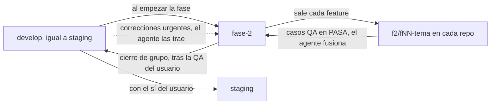

# Plan maestro — Implementación de la fase 2 (`DEC-080`)

> **Fecha:** 20 de noviembre de 2026. **Estado:** Aprobado por el usuario el 2026-11-20 («Aprobado»). Los cambios al hub del anexo A, aplicados el 2026-11-20 con su «sí» (`DEC-081`).
> **Origen:**
> - `DEC-080` (`contexto/decisiones.md:257`) y el análisis funcional `levantamiento-2026-11/fase_2-analisis-funcional-2026-11-19.md` (AF-01 a AF-137), con sus wireframes en `levantamiento-2026-11/fase_2-mockups/`;
> - las decisiones M1 a M5 del pedido (`archivo/prompts/sprint-11/prompt-plan-maestro-implementacion-fase-2-2026-11-20.md`);
> - las respuestas del usuario a la ronda de preguntas del 2026-11-20 (M6 a M23) y su respuesta al riesgo R12 al presentar el plan (M24).
>
> **Base de código leída:** BE `develop` `aa69633` · FE `develop` `8c7f20e` · docs `main` `ad60821`. Los dos repos de código estaban limpios.
> **Alcance:** divide la implementación en 9 features, más el plan de correos ya aprobado (P0); fija su orden, sus reglas comunes, sus compuertas y la transición de datos, y deja la plantilla del plan cerrado de cada feature. No escribe los planes cerrados, no toca código y no estima esfuerzo.
> **Rutas:** relativas a `code_workspace/`. Prefijos: `B/` = `Backend/wms-api/`; `F/` = `Frontend/wms/app/`; `FT/` = `Frontend/wms/test/`; `D/` = `docs/`; `A/` = el análisis (`D/levantamiento-2026-11/fase_2-analisis-funcional-2026-11-19.md`).

---

## 1. Decisiones del plan maestro

Mandan sobre el resto de este plan y sobre los planes cerrados de cada feature (`DEC-002`). Ninguna reabre una AF ni `DEC-080`.

### 1.1 Del pedido (M1 a M5)

| # | Decisión | Estado |
| --- | --- | --- |
| M1 | Se implementa por features. Cada una tiene hasta cuatro partes: **0 · Contrato**, dentro del plan cerrado (endpoints con petición, respuesta, filtros, orden, paginación y errores en español; tipos TypeScript y esquemas Zod equivalentes; casos QA); **1 · Backend**, un agente en `Backend/wms-api`; **2 · Frontend, solo maquetación**, un agente en `Frontend/wms` que construye las pantallas de los wireframes con datos simulados con la forma exacta del contrato; **3 · Integración**, un agente con los dos repos que reemplaza los datos simulados por los servicios reales y pasa los casos QA. Una feature puede no tener las cuatro partes | Vigente |
| M2 | El backend y el frontend de una misma feature van en paralelo, cada uno en su repo. Nunca trabajan dos agentes en el mismo repo a la vez | Vigente; «se trabaja en develop, sin ramas» lo reemplazan M7 y M10 |
| M3 | La primera feature es «Núcleo de dominio», solo backend y en serie: la salida de mercancía que reemplaza a la orden de cargue (`A/` §3.7), la entrada por documento y su depósito (AF-20, AF-44 a AF-47), la edición del ingreso (§3.6), quitar la unidad de medida (§3.8) y los demás cambios de modelo que atraviesan módulos. Mientras tanto, el frontend maqueta la «Base transversal» (componentes compartidos, menú, permisos, Configuración y Administración; §3.1 a §3.3). Después se integran ambas y vienen las features por módulo | Vigente; M13 y M14 ajustan la lista de features |
| M4 | Convivencia mientras una feature no está integrada: las pantallas nuevas van en rutas nuevas, sin enlazar en el menú hasta la integración; las existentes se rediseñan en la integración, o detrás de un interruptor que deja activa la versión actual; nada de una feature se despliega en staging antes de cerrar su integración | Vigente; M11 precisa cómo conviven las rediseñadas |
| M5 | El plan aprobado `planes/sprint-11/plan-cerrado-correos-notificacion-por-rol-2026-11-05.md` se ejecuta antes de la feature de notificaciones, porque AF-133 se apoya en él | Vigente (P0, §4) |

### 1.2 De la ronda de preguntas (M6 a M24, 2026-11-20)

| # | Tema | Qué decide | Palabras del usuario |
| --- | --- | --- | --- |
| M6 | Migraciones | Rige `DEC-004`: el agente de backend genera y aplica las migraciones con `dotnet ef`, solo contra la base local, y cierra cada fase de backend con `has-pending-model-changes` limpio y la migración en el mismo commit | «Rige DEC-004» |
| M7 | Ramas | Se trabaja en ramas, no todo en `develop`. En cada repo de código, una rama `fase-2` que sale de `develop`; cada feature trabaja en `f2/fNN-<tema>` desde `fase-2` y vuelve a `fase-2` al cerrar su integración. `develop` sigue reflejando staging y recibe las correcciones urgentes, que se traen a `fase-2`. Reemplaza a `DEC-003` en lo de las ramas (anexo A) | «Tome una desición, se van a trabajar en ramas separadas, no todo en develop.» Al volver a preguntar: «Fase + feature» |
| M8 | Git por el agente | El agente crea las ramas, hace commit y push, y fusiona: cada feature en `fase-2` cuando sus casos QA pasan; `fase-2` en `develop` solo después de la QA del usuario sobre `fase-2`, que el agente le pide al completar un grupo. Desplegar en staging sigue pidiendo el «sí» del usuario (`DEC-006`) | «Pero autorizo al agente a crear las ramas, hacer commit, hacer los push y mesclar a develop, cuando este listo, me confirma para yo hacer el QA». Al aclararlo: «QA antes de develop» |
| M9 | Cadencia de staging | Por grupos: G1 = F01 a F06 (núcleo, base transversal, Báscula, Bodega, Comercio Exterior y Salidas), en un solo despliegue con su transición de datos y la medición PRF-002; después, uno por feature (F07, F08 y F09) | «Por grupos» |
| M10 | Agentes por repo | Un solo agente a la vez en cada repo; el back y el front de una feature van en paralelo y la integración ocupa los dos repos | «Un agente por repo» |
| M11 | Pantallas que se rediseñan | Se maquetan en su ruta definitiva dentro de la rama de la feature; la integración borra lo viejo. Nada sin integrar llega a `fase-2`. Reemplaza la primera respuesta («Ruta temporal»), dada antes de M7 | «Ruta definitiva en la rama» |
| M12 | Datos simulados | Fuente intercambiable: cada servicio nuevo tiene una interfaz con una implementación simulada (`mocks/`, datos validados con los esquemas Zod del contrato) y la real (`useApi`), que escribe la integración. Sin dependencias nuevas ni tráfico HTTP (§5.2) | «Fuente intercambiable» |
| M13 | Feature de salidas | Las pantallas de la salida de mercancía van en una feature propia, F06 «Salidas» (P-CE-08, P-CE-11, P-BOD-06 a P-BOD-09 y el cobro de la guía); P-BAS-03 queda en Báscula | «Feature "Salidas"» |
| M14 | Facturación en dos | Primero F07 «Tarifas y acuerdos» y después F08 «Operación de facturas», que ya encuentra el «Facturar a» | «Dos: acuerdos y luego operación» |
| M15 | `DEC-028` frente a AF-36 | La cantidad facturable cuenta las salidas que bajaron el stock al emitir la guía (o al confirmar una salida de inspección) y resta las anulaciones de guía. Precisa `DEC-028`, `DEC-053` (BR-06-005) y `DEC-055` (anexo A) | «Por guía emitida» |
| M16 | AF-120 frente a AF-94 | La fórmula «descargada o sobre vehículo» cobra el % sobre el precio de cada camión descargado; el valor CPI no cuenta para esa fórmula | «Precio por camión» |
| M17 | Estrategia de transición | En el despliegue de G1, staging se recrea y se carga otra vez desde el legacy con la herramienta de importación adaptada al modelo nuevo, como `DEC-043`, con el «sí» del usuario en ese momento | «Reiniciar y migrar» |
| M18 | Órdenes de cargue y llegadas abiertas | No se convierten: los datos de staging se borran con el reinicio de M17 | «Los datos de staging se pueden borrar sin problema, es un ambiente de pruebas» |
| M19 | Depósitos confirmados sin amparado ni precio por camión | Los confirmados y cerrados quedan con la cantidad amparada igual a la ingresada; el valor actual pasa a ser el valor CPI y el precio por camión queda vacío | «Amparado = ingresado» |
| M20 | Clientes con «mes calendario» | Pasan a «Mensual» de 30 días; el período abierto termina en su fecha y los siguientes cuentan 30. Facturación recibe la lista | «Mensual de 30 días» |
| M21 | Unidad de medida | Se eliminan la columna del producto, el catálogo `UnitMeasure`, su pantalla y el parámetro `uom` de `PER_UOM`, que pasa a multiplicar la tarifa por la cantidad (que ya es por embalaje) | «Se elimina» |
| M22 | Categoría de los motivos | Por la tabla de hoy: los dos «Descargue» → Ingreso, los dos «Cargue» → Salida, «Solo Bascula» → Solo báscula. «Solo bodega» y «Otro» quedan sin categoría: la categoría solo es obligatoria en los motivos que requieren pesaje | «Por la tabla de hoy» |
| M23 | Tipos de notificación | Un tipo por evento de negocio; los handlers que avisan lo mismo comparten tipo (unos 25 a 30 tipos, cada uno con su módulo, roles y correo) | «Uno por evento» |
| M24 | Reserva de stock de la salida en Borrador | Una salida en Borrador reserva el stock de sus líneas, así que lo disponible para otra salida ya lo descuenta; confirmarla emite la guía y descuenta el stock (AF-36). Respuesta al riesgo R12, después de presentar el plan (2026-11-20) | «Si, una salida en borrador reserva stock» |

### 1.3 Resueltas sin preguntar (`DEC-002`)

- **Relojes de Bodega de los registros abiertos al desplegar** (`A/` §2.2 j). M17 y M18 los resuelven: en G1 no hay registros abiertos, porque staging se recrea y la carga del legacy solo trae maestros, depósitos y levantes (`B/Wms.Domain/Enums/LegacyImportEntity.cs:7-20`). Los relojes arrancan con los registros nuevos. Lo mismo vale para el corte real, que también carga desde el legacy.
- **La integración ocupa los dos repos.** Lo fijan M1 («un agente con los dos repos») y M10.
- **Pagos sin verificar.** AF-110 dice que todo pago registrado queda verificado: F08 marca verificados los existentes (§7).

---

## 2. Features

**Regla de pertenencia.** Cada AF tiene una sola feature dueña: la que implementa su regla. Si la regla vive en el núcleo (F01), la pantalla que la muestra se construye en otra feature, que cita la AF sin volver a contarla.

| ID | Nombre | Objetivo | AF dueñas | Secciones de `A/` | Pantallas | Partes | Depende de | Repos y rama |
| --- | --- | --- | --- | --- | --- | --- | --- | --- |
| P0 | Correos al rol (plan ya aprobado) | Los avisos por correo van a los usuarios activos del rol (N1 a N12 de su plan) | — (base de AF-133) | §3.4 | — | 1 y su fase de staging | — | BE, `p0/correos-por-rol` desde `develop`, vuelve a `develop` |
| F01 | Núcleo de dominio | El modelo y las reglas que cruzan módulos: salida de mercancía con tipo y estado, entrada por documento con sus pesos, edición del ingreso, sin unidad de medida, motivos con categoría, sin bloqueos de Bodega, tasa semanal, prefijos, precio por camión y la cantidad facturable por guía | 42 (§3.1) | §3.5 a §3.8; reglas de §2.1 f, §2.2 f y §2.3 f que cruzan módulos | Ninguna propia | 0 y 1 | P0 (repo libre) | BE, `f2/f01-nucleo` |
| F02 | Base transversal | Menú por rol, permisos de página, patrón de listado, CRUD en modal y detalle en drawer, selector con búsqueda y alta rápida, formulario de cobro compartido, Configuración y Administración | 10 | §3.1 a §3.3 | P-TR-01 a P-TR-06, P-TR-09 a P-TR-11, y los catálogos de Configuración y Administración (Usuarios, Auditoría) con el patrón nuevo | 2 (contrato en el plan de F01) | — | FE, `f2/f02-base` |
| I-01 | Integración de F01 y F02 | Las pantallas de F02 pasan a los servicios reales | — | — | Las de F02 | 3 | F01, F02 | BE y FE, en `f2/f01-nucleo` y `f2/f02-base` |
| F03 | Báscula | Registro en página propia con tres pasos, entradas duplicadas, repesaje en modal, impresión con modal, historial en tres páginas y detalle en drawer | 20 | §2.1, §3.6 (P-TR-12) | P-BAS-01 a P-BAS-13, P-TR-12 | 0 a 3 | I-01 | BE y FE, `f2/f03-bascula` |
| F04 | Bodega | Recepción por entrada sin llegada, recepción directa en página, montacargas desde la fila y con «Requiere factura», relojes y umbrales | 13 | §2.2, §3.4 (umbrales) | P-BOD-01 a P-BOD-05, P-TR-08 | 0 a 3 | I-03 | BE y FE, `f2/f04-bodega` |
| F05 | Comercio Exterior | Depósitos por tipo en maestro-detalle, detalle por etapas, edición en Confirmado, amparados, tiquetes de ingreso, levantes en tabla e inventario nacionalizado | 19 | §2.3, §3.5 (uso), §3.6 (P-CE-03) | P-CE-01 a P-CE-07, P-CE-09, P-CE-10, P-CE-12 | 0 a 3 | I-04 | BE y FE, `f2/f05-comercio-exterior` |
| F06 | Salidas de mercancía | Las pantallas de la salida: listado y nueva salida en CE, etapa Salidas, órdenes de salida, ejecutar salida, salida de patio e historial en Bodega, y el cobro de la guía | 4 | §3.7, §2.2 (salidas), §2.3 (salidas) | P-CE-08, P-CE-11, P-BOD-06 a P-BOD-09 | 0 a 3 | I-05 | BE y FE, `f2/f06-salidas` |
| F07 | Tarifas y acuerdos | Configuración de facturación del cliente (ciclo libre, «Facturar a» por cliente e importador), acuerdos en filas con plantilla descargable e importable, cuatro fórmulas nuevas y simulador por fórmula | 10 | §2.4 (acuerdos y ciclos), §3.2 (Tarifas y acuerdos) | P-FAC-11 a P-FAC-14, y Tarifas de servicios y de montacargas con el patrón nuevo | 0 a 3 | I-06 | BE y FE, `f2/f07-tarifas-acuerdos` |
| F08 | Operación de facturas | Facturar en un paso, N.º SIGO corregible, pestañas con columnas del legacy y filtros, pendientes solo con trabajo, pago completo y pagos verificados, reportes en PDF y Excel | 7 | §2.4 | P-FAC-01 a P-FAC-10 | 0 a 3 | I-07 | BE y FE, `f2/f08-operacion-facturas` |
| F09 | Notificaciones configurables | Tabla de tipos de notificación con roles y correo por tipo; todos los puntos que avisan pasan por ella | 1 | §3.4 | P-TR-07 | 0 a 3 | P0, I-08 | BE y FE, `f2/f09-notificaciones` |

### 2.1 Qué entrega F01 a las demás

F01 no tiene pantallas. Su contrato (parte 0) es el que maquetan las features siguientes, y su plan cerrado se escribe junto con el de F02.

| Para | Qué entrega F01 |
| --- | --- |
| F02 | Endpoints de motivos con categoría (AF-08, M22), prefijos (AF-79), tasas semanales (AF-85, AF-86, AF-136), productos sin unidad (AF-22, M21) y conductores con documento repetido (AF-18). Orden y filtros por columna en el servidor para las listas de los catálogos de Configuración (convención de §5.1, que pide AF-129) |
| F03 | Entrada por documento con sus pesos y su depósito (AF-09, AF-20, AF-39, AF-41, AF-44, AF-46, AF-47), manifiesto solo con carta porte (AF-12), inspección flexible (AF-17), sin tipo de vehículo (AF-21), corrección del ingreso por Báscula hasta la confirmación (AF-26), salida en Borrador desde Báscula y precarga por placa (AF-30, AF-34, AF-37), sin bloqueos de Bodega (AF-14) |
| F04 | Entrada como unidad de recepción (AF-44), recepción directa como depósito de inspección (AF-17), tipo de vehículo en el vehículo (AF-21), cargue que libera ubicaciones sin sello y salida de patio (AF-66, AF-70) |
| F05 | Edición del ingreso por CE en cualquier estado (AF-26, AF-27), precio por camión y valor CPI (AF-94), transportadora por entrada (AF-101), sin cierre de camiones y camión tardío con aviso (AF-84, AF-95), tasa del levante (AF-85, AF-86) |
| F06 | La salida con sus cuatro tipos, sus estados y lo que le falta (AF-28 a AF-37, AF-42), la reserva de stock de la salida en Borrador (M24), confirmar emite la guía y descuenta el stock (AF-36, AF-68), inspección sin guía (AF-88), edición y anulación de la guía (AF-90) |
| F07 y F08 | Peso de mercancía en las fórmulas por peso (AF-113), `PER_UOM` por embalaje (AF-22), cantidad facturable por guía (M15), tasa de la semana de ingreso en la factura del período (AF-85) |

### 2.2 Dónde chocan las features en el código

El orden de §4 resuelve cada choque: una sola feature cambia el punto y las siguientes lo consumen.

| Archivo (base) | Qué contiene hoy | Features que lo tocan | Cómo se resuelve |
| --- | --- | --- | --- |
| `B/Wms.Domain/Entities/Warehouse/LoadingOrder.cs` (480 líneas; lo citan 145 archivos del backend y 49 de pruebas) | La orden de cargue y su flujo (`CompleteLoading` en `:241` mueve el stock) | F01, F03, F06, F08 | F01 la reemplaza por la salida de mercancía; las demás consumen la salida |
| `B/Wms.Domain/Entities/Warehouse/DispatchGuide.cs:16`, `:19` | La guía cuelga de la orden; guarda el sello | F01, F06 | F01 la asocia a la salida y quita el sello (AF-70) |
| `B/Wms.Domain/Entities/Warehouse/WarehouseStorage.cs:15`, `:302`, `:333`, `:441-459` | Un valor por depósito; volver a Borrador; datos editables solo en Borrador | F01, F05 | F01 cambia el valor (AF-94); F05, la edición en Confirmado y el retiro de «Devolver a Borrador» (AF-76, AF-78, AF-93) |
| `B/Wms.Domain/Entities/Services/ServiceRecord.cs:71-74`, `:319-339` | Cierre explícito del ingreso de camiones | F01 | F01 lo retira (AF-95) |
| `B/Wms.Application/Weighbridge/Commands/Storage/Initiate/InitiateStorageWeighingHandler.cs:410`, `:962-968` | Báscula pone el valor; depósito adicional con pesaje compartido | F01, F03 | F01 cambia el comando a una entrada por documento (AF-44, AF-46, AF-94); F03 cambia los pasos del ciclo (AF-06, AF-07) |
| `B/Wms.Application/ForeignTrade/Common/Services/DepositConfirmationRequirements.cs:66-128` (cliente en `:70-71`) | Requisitos de confirmación | F01, F05 | F01 primero (manifiesto solo con carta porte, AF-12); F05 después (sin cliente y con amparados, AF-75, AF-77) |
| `B/Wms.Application/Billing/Common/Services/StorageBillableQuantity.cs:93-96` | Cantidad facturable con las salidas de origen `LoadingOrder` | F01 | F01 cuenta las salidas por guía (M15) |
| `B/Wms.Application/Billing/Calculators/WeightThresholdFormulaCalculator.cs:8-10` | Peso de manifiesto en las fórmulas por peso | F01 | F01 usa el peso de mercancía (AF-113); F07 agrega fórmulas sin tocarlo |
| `B/Wms.Application/Billing/Calculators/PerUomFormulaCalculator.cs:37-43`; `B/Wms.Infrastructure/Persistence/SeedDataExtensions.cs:424-431` | `PER_UOM` exige el código de una unidad | F01 | F01 quita `uom` (M21) |
| `B/Wms.Infrastructure/Persistence/SeedDataExtensions.cs:290-308` y `:411-510` | Motivos sembrados; fórmulas sembradas | F01, F07 | F01 agrega la categoría (M22); F07 agrega las fórmulas nuevas (AF-116) |
| `B/Wms.Application/ForeignTrade/Common/Services/ReleaseFobService.cs:56-82` | TRM de la DIAN en el levante | F01, F05 | F01 la cambia por la tasa semanal (AF-85); F05 la precarga en la fila del levante |
| `B/Wms.Application/Weighbridge/Common/Services/ReceptionArrivalRules.cs:12-19`; `ExitLoadingRules.cs:25-40` | Bloqueos de Bodega sobre Báscula | F01 | F01 los retira (AF-14) |
| `B/Wms.Infrastructure/Persistence/Configurations/Logistics/DriverConfiguration.cs:24` | Índice único por tipo y número de documento | F01 | F01 lo relaja (AF-18) |
| `B/Wms.Application/Billing/Common/Services/BillingCycleCatalog.cs:24-33` | Ocho ciclos con «mes calendario» | F07 | F07 (AF-108, AF-115, M20) |
| `B/Wms.Application/Billing/Jobs/OverdueSweep.cs:20-25`; `B/Wms.Application/Billing/Commands/UpdateInvoiceRecipient/UpdateInvoiceRecipientHandler.cs:24` | Mora por destinatario; destinatario de la factura | F07 | F07 (AF-112, AF-123) |
| `B/Wms.Domain/Entities/Billing/Invoice.cs:345-380`; `B/Wms.Domain/Entities/Billing/InvoicePayment.cs:70`; `B/Wms.Application/Billing/Commands/RecordPayment/RecordPaymentHandler.cs:54-58` | Aprobar; pagos por verificar | F08 | F08 (AF-104, AF-110, AF-122) |
| `B/Wms.Api/Services/NotificationOrchestrator.cs:69`; `B/Wms.Infrastructure/Services/NotificationService.cs:517`; 42 llamadas en 26 archivos | Avisos con roles fijos en el código | P0, F01, F03 a F06, F09 | P0 primero; los avisos nuevos usan el orquestador con roles fijos; F09 los pasa todos a tipos (M23) |
| `B/Wms.Domain/Security/WmsPolicyRoles.cs` | Matriz de permisos | F01, F03 a F08 | Cada feature cambia solo sus endpoints, sin quitar funciones (`DEC-005`) |
| `B/Wms.Application/Administration/LegacyImport/` | Importación del legacy (la de M17 y del corte real) | F01, F05, F07 | Cada feature que cambia una entidad importada adapta el importador en la misma feature |
| `B/Wms.Infrastructure/Migrations/AppDbContextModelSnapshot.cs` | Snapshot único de EF | Todas las de backend | M10: un agente por repo; antes de generar una migración se trae lo último de `fase-2` |
| `F/components/layout/AppMenu.vue:9-520` (Bodega en `:242-302`) | Menú | F02 a F09 | F02 deja la estructura de P-TR-01; cada integración enlaza sus ítems (M4) |
| `FT/unit/guards/page-header.spec.ts:45-53` | Guardia que exige `AppPageHeader` en toda página del menú (`DEC-058`) | F02 | F02 la reemplaza por la guardia del patrón de AF-129 |
| `F/components/app/AppPageHeader.vue`, `F/components/app/AppTable.vue` | Patrón de página de `DEC-058` | F02 | F02 (AF-129) |
| `F/features/billing/components/BillingCollectForm.vue:500-548` | Formulario de cobro | F02, F03, F04, F06 | F02 lo deja compartido (AF-54, AF-132); F06 quita «Clientes» en la guía (AF-106) |
| `F/features/weighbridge/components/QuickCreateStakeholderDialog.vue`; `F/features/entries/components/VehicleForm.vue:376-380` | Altas rápidas | F02, F03, F05 | F02 hace el selector con alta rápida; las demás lo usan |
| `F/pages/operations/weighbridge/index.vue` (2.317 líneas), `recover.vue`, `history.vue:370-420`, `:515-847`, `:869-909` | Báscula | F03 | F03 |
| `F/features/weighbridge/` | Servicios que importan otros módulos (trampa 4 de `D/contexto/convenciones-tecnicas.md` §10) | F03, F04 | F03 primero; F04 revisa sus importaciones |
| `F/pages/warehouse/receptions/entry.vue:47-75`; `F/features/warehouse/components/ReceptionStepCompletion.vue`, `ReceptionStepManualInfo.vue:314-596` | Llegada y recepción | F04 | F04 (AF-59, AF-64, AF-65) |
| `F/pages/foreign-trade/deposits/index.vue:57-121`; `F/pages/foreign-trade/imports/[id]/index.vue:534-905` | Tablero y detalle de CE | F05, F06 | F05 deja el stepper con la etapa Salidas vacía; F06 la llena |
| `F/pages/foreign-trade/loading-orders/*`, `F/pages/foreign-trade/dispatch-guides/*`, `F/pages/warehouse/loading-orders/*` | Órdenes y guías | F06 | F06 las retira (AF-97) |
| `F/pages/admin/unit-measures/index.vue` | Catálogo de unidades | F02 | F02 la retira (M21); el backend lo quita F01 |

---

## 3. Cobertura

### 3.1 Cada AF de AF-05 a AF-136 en una feature

| Feature | AF dueñas | Cuántas |
| --- | --- | --- |
| F01 | AF-08, AF-09, AF-12, AF-14, AF-17, AF-18, AF-20, AF-21, AF-22, AF-26, AF-27, AF-28, AF-29, AF-30, AF-31, AF-32, AF-33, AF-34, AF-35, AF-36, AF-37, AF-39, AF-41, AF-42, AF-43, AF-44, AF-46, AF-47, AF-66, AF-68, AF-70, AF-79, AF-84, AF-85, AF-86, AF-88, AF-90, AF-94, AF-95, AF-101, AF-113, AF-136 | 42 |
| F02 | AF-38, AF-54, AF-99, AF-127, AF-128, AF-129, AF-130, AF-131, AF-132, AF-134 | 10 |
| F03 | AF-05, AF-06, AF-07, AF-10, AF-11, AF-13, AF-15, AF-16, AF-23, AF-24, AF-25, AF-40, AF-45, AF-48, AF-49, AF-50, AF-51, AF-52, AF-53, AF-135 | 20 |
| F04 | AF-56, AF-57, AF-58, AF-59, AF-60, AF-61, AF-62, AF-63, AF-64, AF-65, AF-69, AF-105, AF-119 | 13 |
| F05 | AF-72, AF-73, AF-74, AF-75, AF-76, AF-77, AF-78, AF-80, AF-81, AF-82, AF-83, AF-87, AF-91, AF-92, AF-93, AF-96, AF-98, AF-100, AF-102 | 19 |
| F06 | AF-67, AF-89, AF-97, AF-106 | 4 |
| F07 | AF-108, AF-112, AF-114, AF-115, AF-116, AF-117, AF-118, AF-120, AF-123, AF-125 | 10 |
| F08 | AF-104, AF-107, AF-109, AF-110, AF-111, AF-121, AF-122 | 7 |
| F09 | AF-133 | 1 |
| **Total** | | **126** |

Notas de asignación:

- AF-38 queda en F02 con AF-131, que la resuelve. AF-54 y AF-99 quedan en F02 porque su regla es general (alta rápida en selectores y cobro; filtros, orden y botones en todas las tablas); F03 y F05 las aplican a sus pantallas.
- AF-105 queda en F04 porque el switch «Requiere factura» va en el cobro del montacargas (P-BOD-04); F08 muestra sus columnas (P-FAC-02).
- AF-119 queda en F04, que guarda el dato «Queda sobre el vehículo» en la recepción; la fórmula que lo usa es AF-116 y AF-120 (F07).
- AF-112 y AF-123 quedan en F07 porque el «Facturar a» se configura en P-FAC-11; F08 lo precarga en «Facturar».
- AF-121 queda en F08 sin construcción: cierra H-053, H-066 y H-068.

Tabla de verificación, AF por AF:

| AF | Feature | AF | Feature | AF | Feature | AF | Feature |
| --- | --- | --- | --- | --- | --- | --- | --- |
| AF-05 | F03 | AF-38 | F02 | AF-71 | Visto bueno | AF-104 | F08 |
| AF-06 | F03 | AF-39 | F01 | AF-72 | F05 | AF-105 | F04 |
| AF-07 | F03 | AF-40 | F03 | AF-73 | F05 | AF-106 | F06 |
| AF-08 | F01 | AF-41 | F01 | AF-74 | F05 | AF-107 | F08 |
| AF-09 | F01 | AF-42 | F01 | AF-75 | F05 | AF-108 | F07 |
| AF-10 | F03 | AF-43 | F01 | AF-76 | F05 | AF-109 | F08 |
| AF-11 | F03 | AF-44 | F01 | AF-77 | F05 | AF-110 | F08 |
| AF-12 | F01 | AF-45 | F03 | AF-78 | F05 | AF-111 | F08 |
| AF-13 | F03 | AF-46 | F01 | AF-79 | F01 | AF-112 | F07 |
| AF-14 | F01 | AF-47 | F01 | AF-80 | F05 | AF-113 | F01 |
| AF-15 | F03 | AF-48 | F03 | AF-81 | F05 | AF-114 | F07 |
| AF-16 | F03 | AF-49 | F03 | AF-82 | F05 | AF-115 | F07 |
| AF-17 | F01 | AF-50 | F03 | AF-83 | F05 | AF-116 | F07 |
| AF-18 | F01 | AF-51 | F03 | AF-84 | F01 | AF-117 | F07 |
| AF-19 | Reemplazada | AF-52 | F03 | AF-85 | F01 | AF-118 | F07 |
| AF-20 | F01 | AF-53 | F03 | AF-86 | F01 | AF-119 | F04 |
| AF-21 | F01 | AF-54 | F02 | AF-87 | F05 | AF-120 | F07 |
| AF-22 | F01 | AF-55 | Visto bueno | AF-88 | F01 | AF-121 | F08 |
| AF-23 | F03 | AF-56 | F04 | AF-89 | F06 | AF-122 | F08 |
| AF-24 | F03 | AF-57 | F04 | AF-90 | F01 | AF-123 | F07 |
| AF-25 | F03 | AF-58 | F04 | AF-91 | F05 | AF-124 | Reemplazada |
| AF-26 | F01 | AF-59 | F04 | AF-92 | F05 | AF-125 | F07 |
| AF-27 | F01 | AF-60 | F04 | AF-93 | F05 | AF-126 | Visto bueno |
| AF-28 | F01 | AF-61 | F04 | AF-94 | F01 | AF-127 | F02 |
| AF-29 | F01 | AF-62 | F04 | AF-95 | F01 | AF-128 | F02 |
| AF-30 | F01 | AF-63 | F04 | AF-96 | F05 | AF-129 | F02 |
| AF-31 | F01 | AF-64 | F04 | AF-97 | F06 | AF-130 | F02 |
| AF-32 | F01 | AF-65 | F04 | AF-98 | F05 | AF-131 | F02 |
| AF-33 | F01 | AF-66 | F01 | AF-99 | F02 | AF-132 | F02 |
| AF-34 | F01 | AF-67 | F06 | AF-100 | F05 | AF-133 | F09 |
| AF-35 | F01 | AF-68 | F01 | AF-101 | F01 | AF-134 | F02 |
| AF-36 | F01 | AF-69 | F04 | AF-102 | F05 | AF-135 | F03 |
| AF-37 | F01 | AF-70 | F01 | AF-103 | Visto bueno | AF-136 | F01 |

### 3.2 Las que se nombran aparte

| Grupo | AF | Por qué no tienen feature |
| --- | --- | --- |
| Inventario y reparto | AF-01 a AF-04 | Fijan el reparto y el orden del análisis (`A/` §0.4) |
| Vistos buenos | AF-55, AF-71, AF-103, AF-126 y AF-137 | Aprueban una sección; lo que pidieron cambiar quedó en otras AF |
| Reemplazadas | AF-19 (por AF-44) y AF-124 (por AF-125) | No se construyen |
| Precisadas dentro del análisis | AF-30 y AF-31 en lo del stock (por AF-36), AF-35 (ajustada por AF-66), AF-58 (reducida por AF-65), AF-112 (precisada por AF-123) | Siguen en su feature, con la precisión |

AF-137 está fuera del rango AF-05 a AF-136; se nombra por ser visto bueno.

### 3.3 Las 26 filas de §5 del análisis

| # | Decisión vigente | AF | Feature |
| --- | --- | --- | --- |
| 1 | `DEC-058` (panel de báscula) | AF-05 | F03 |
| 2 | `DEC-057` (H2) | AF-12 | F01 |
| 3 | `DEC-057` (D5) | AF-20, AF-43, AF-44 | F01 |
| 4 | `DEC-050` (BR-02-013) | AF-44, AF-46, AF-47 | F01 |
| 5 | `DEC-057` (nota H1) | AF-21 | F01 |
| 6 | `DEC-057` (H15) y `DEC-015` | AF-22 | F01 |
| 7 | `DEC-017` | AF-18 | F01 |
| 8 | `DEC-019` (R-EXP) | AF-14, AF-31 | F01 |
| 9 | `DEC-050` (BR-02-001) | AF-30, AF-37 | F01 |
| 10 | `DEC-050` (BR-02-010) | AF-26 | F01 |
| 11 | `DEC-016` (WMS-17) | AF-30 | F01 |
| 12 | P16 del plan de paridad | AF-28, AF-29, AF-33 | F01 |
| 13 | CHG-36 del plan de corrección | AF-14 | F01 |
| 14 | Lo construido para `DEC-014` (BAS-07) | AF-27 | F01 |
| 15 | `DEC-058` (tablero de depósitos) | AF-72 | F05 |
| 16 | `DEC-058` (páginas uniformes) | AF-129 | F02 |
| 17 | `DEC-029` §7.4 | AF-76, AF-78, AF-93 | F05 |
| 18 | `DEC-029` §7.2 (rótulo) | AF-81 | F05 |
| 19 | `DEC-023` | AF-85, AF-86 | F01 |
| 20 | `DEC-013` (cierre del ingreso de camiones) | AF-84, AF-95 | F01 |
| 21 | Regla de WMS-29 | AF-78 | F05 |
| 22 | `DEC-010` (2), precisada | AF-77 | F05 |
| 23 | `DEC-057` (H3), precisada | AF-09, AF-41 | F01 |
| 24 | `DEC-024` | AF-104 | F08 |
| 25 | `DEC-018` | AF-105 | F04 |
| 26 | `DEC-053` (BR-06-003), precisada | AF-109 | F08 |

### 3.4 Los pendientes y consideraciones de §6 del análisis

| Origen | Tema | Feature | Cómo se atiende |
| --- | --- | --- | --- |
| Cliente 1 | Valores iniciales de los umbrales amarillo y rojo | F04 | Configurables en P-TR-08; los valores se cargan antes del despliegue de G1 (§7.3) |
| Cliente 2 | Tramos de peso: límite y si la segunda tarifa va a todo el peso o al exceso | F07 | El plan cerrado de F07 los pide; si no llegan, ver riesgo R7 |
| Cliente 3 | Mínimo de la parte porcentual en un depósito mixto | F07 | Igual que el anterior |
| Cliente 4 | Prefijos y tasa de la semana de arranque | F01 | Se cargan en Configuración antes del despliegue de G1 (§7.3) |
| Consideración | Categoría de los motivos existentes | F01 | M22 |
| Consideración | Órdenes de cargue y llegadas abiertas | F01 y F04 | M18: no se convierten |
| Consideración | Recálculo al corregir pesos, unidades, valor y tasa (`DEC-022`) | F01 (pesos, unidades, tasa), F05 (valor y productos) | Cada plan cerrado lo prueba |
| Consideración | Medir de nuevo PRF-002 (≤ 30 s por camión) | F03 | Se mide en staging con un operario al desplegar G1 (§7.3) |
| Consideración | Relojes de los registros abiertos al desplegar | F04 | §1.3: no hay registros abiertos en G1 |
| Consideración | Depósitos confirmados sin amparado ni precio por camión | F05 | M19 |
| Consideración | Clientes con «mes calendario» | F07 | M20 |
| Consideración | Carga inicial de los 58 textos de tarifa de la hoja 2026 | F07 | Con la plantilla de AF-114, que Facturación revisa antes de importar |
| Consideración | Productos y tarifas `PER_UOM` con unidad de medida | F01 | M21 |
| Consideración | Agrupar en tipos los puntos que avisan | F09 | M23 |

### 3.5 Conteos verificados

- **AF:** 132 en el rango AF-05 a AF-136 = 126 con feature dueña + 4 vistos buenos + 2 reemplazadas. Ninguna repetida y ninguna sin destino (verificado con un script contra la lista de §3.1).
- **Pantallas:** 60 de los wireframes = 13 de Báscula + 9 de Bodega + 12 de CE + 14 de Facturación + 12 transversales, cada una en una sola feature (tabla de §2).
- **§5 del análisis:** 26 filas, todas con feature. **§6:** 4 pendientes del cliente y 10 consideraciones, todas con feature.

---

## 4. Orden y paralelismo

**Reglas (M1, M2, M10):**

1. En cada repo trabaja un solo agente a la vez. La parte de backend y la de frontend de una feature corren en paralelo.
2. La integración ocupa los dos repos. Entra cuando terminan las dos partes de su feature, en una frontera de fase.
3. Una parte arranca cuando su repo está libre y su plan cerrado está aprobado. Los planes cerrados se escriben en `docs` mientras corre la feature anterior, porque `docs` no es repo de código.
4. P0 va primero en el backend, desde `develop`. Así M5 se cumple con holgura y la rama `fase-2` sale con P0 incluido. Mientras tanto, el frontend puede empezar F02.
5. Las correcciones de la QA del usuario sobre un grupo (M8) van antes que la siguiente fase de cualquier feature, en el mismo turno de cada repo.

```mermaid
flowchart LR
  subgraph BE["Repo backend · un agente a la vez"]
    P0["P0 · Correos al rol, desde develop"]
    B01["F01 · Núcleo de dominio"]
    B03["F03 · Báscula, backend"]
    B04["F04 · Bodega, backend"]
    B05["F05 · Comercio Exterior, backend"]
    B06["F06 · Salidas, backend"]
    B07["F07 · Tarifas y acuerdos, backend"]
    B08["F08 · Operación de facturas, backend"]
    B09["F09 · Notificaciones, backend"]
  end
  subgraph FE["Repo frontend · un agente a la vez"]
    M02["F02 · Base transversal, maquetación"]
    M03["F03 · Báscula, maquetación"]
    M04["F04 · Bodega, maquetación"]
    M05["F05 · Comercio Exterior, maquetación"]
    M06["F06 · Salidas, maquetación"]
    M07["F07 · Tarifas y acuerdos, maquetación"]
    M08["F08 · Operación de facturas, maquetación"]
    M09["F09 · Notificaciones, maquetación"]
  end
  subgraph INT["Integración · ocupa los dos repos"]
    I01["I-01 · F01 con F02"]
    I03["I-03 · Báscula"]
    I04["I-04 · Bodega"]
    I05["I-05 · Comercio Exterior"]
    I06["I-06 · Salidas"]
    I07["I-07 · Tarifas y acuerdos"]
    I08["I-08 · Operación de facturas"]
    I09["I-09 · Notificaciones"]
  end
  subgraph DEP["QA del usuario, develop y staging"]
    G1["G1 · F01 a F06, staging reiniciado y PRF-002"]
    G2["G2 · F07"]
    G3["G3 · F08"]
    G4["G4 · F09"]
  end
  P0 --> B01
  B01 --> I01
  M02 --> I01
  I01 --> B03
  I01 --> M03
  B03 --> I03
  M03 --> I03
  I03 --> B04
  I03 --> M04
  B04 --> I04
  M04 --> I04
  I04 --> B05
  I04 --> M05
  B05 --> I05
  M05 --> I05
  I05 --> B06
  I05 --> M06
  B06 --> I06
  M06 --> I06
  I06 --> G1
  I06 --> B07
  I06 --> M07
  B07 --> I07
  M07 --> I07
  G1 --> G2
  I07 --> G2
  I07 --> B08
  I07 --> M08
  B08 --> I08
  M08 --> I08
  G2 --> G3
  I08 --> G3
  I08 --> B09
  I08 --> M09
  P0 -.-> B09
  B09 --> I09
  M09 --> I09
  G3 --> G4
  I09 --> G4
```



**Por qué este orden:**

- **F03 → F04 → F05 → F06.** Bodega recibe las entradas que crea Báscula; CE muestra en su etapa Bodega los relojes de F04; Salidas necesita depósitos confirmados y nacionalizados de F05 y llena la etapa Salidas del detalle de CE.
- **F06 cierra G1.** Con F06 integrado vuelven a funcionar completos los flujos de entrada y salida que F01 cambió (M9).
- **F07 antes de F08.** «Facturar» precarga el «Facturar a» que configura F07 (M14). F07 necesita la marca «Queda sobre el vehículo» de F04 y el precio por camión de F01 (AF-120).
- **F09 al final.** Toca los 26 archivos que avisan y los avisos nuevos de F01 y F03 a F06, así que va cuando ya existen todos. Se apoya en P0 (M5).

**Flujo de ramas (M7, M8):**



---

## 5. Convenciones comunes

### 5.1 Contrato (parte 0)

Parte de `D/planes/paridad-legacy/contrato-api-paridad.md` §0 (líneas 11-77), que sigue vigente: base `/api/v1`, JWT, JSON en camelCase, enums como texto, fechas ISO 8601 con zona y `DateOnly` como `yyyy-MM-dd` en hora de Colombia, respuesta `{ data, pagination }`, `pageSize` de 1 a 50 con `all=true` para todo, errores *ProblemDetails* con `description` y `errors[]`, motivos de 10 a 500 caracteres y políticas por rol.

Se agrega:

- **Orden en el servidor** (AF-129): `sortField` (nombre camelCase de una columna de la lista blanca de cada endpoint) y `sortOrder` (`asc` o `desc`), con un orden por defecto declarado. F01 lo implementa una vez para todos, junto a `B/Wms.Common/Wrappers/QueryParametersBase.cs`, que hoy no tiene orden.
- **Filtros por columna** (AF-99, AF-129): un parámetro por columna, con el nombre del campo. Texto: contiene, sin distinguir mayúsculas ni tildes. Fechas: `<campo>From` y `<campo>To` (`DateOnly`). Enums: uno o varios separados por coma.
- **Identificadores:** `C-Fnn-mm` para cada endpoint y `QA2-Fnn-nnn` para cada caso QA. El prefijo `QA2` evita el choque con los casos de la campaña QA (`F{N}-{ÁREA}-{nnn}`, `D/procesos/qa-y-defectos.md:27`).
- **Ficha de cada endpoint:** título `C-Fnn-mm · MÉTODO ruta (nuevo|modificado|retirado)`; política; qué cambia; petición (tabla campo, tipo, obligatorio y regla); respuesta en `jsonc`; filtros, orden y paginación; errores (status y mensaje literal en español); notas para el frontend. Mismo formato que `C-F1-01` de `contrato-api-paridad.md:173-240`.
- **Tipos TypeScript y esquemas Zod:** el plan cerrado trae el código de los esquemas. Viven en `F/features/<dominio>/contracts/<recurso>.ts`, y los tipos se derivan con `z.infer`, así que son equivalentes por construcción:

```ts
import { z } from "zod";

// Ejemplo de forma, no de nombres: cada plan cerrado fija los suyos.
export const exitStatusSchema = z.enum(["Draft", "Confirmed", "Completed", "Cancelled"]);
export const exitListItemSchema = z.object({
  id: z.uuid(),
  number: z.string(),
  status: exitStatusSchema,
  missing: z.array(z.enum(["Loading", "Weighing", "YardExit"])),
});
export type ExitListItem = z.infer<typeof exitListItemSchema>;
```

- **Casos QA:** tabla con ID, regla de origen (sección «f» de `A/` y AF), precondición, pasos, resultado esperado y cómo se verifica (API, pantalla o los dos). Al cerrar la integración se copian al archivo de su módulo en `D/qa/`, con su ID.

### 5.2 Datos simulados en la maquetación (M12)

```
F/features/<dominio>/
  contracts/<recurso>.ts         esquemas Zod y tipos del contrato
  services/<recurso>.source.ts   interfaz I<Recurso>Source y la fuente activa
  services/<recurso>.http.ts     implementación real con useApi (la escribe la integración)
  mocks/<recurso>.mock.ts        implementación simulada (la borra la integración)
  mocks/data/<recurso>.ts        datos ficticios
```

- Los composables (TanStack Query) solo llaman a la fuente activa. En la maquetación, `<recurso>.source.ts` exporta la simulada; la integración escribe `<recurso>.http.ts`, cambia esa línea y borra `mocks/`.
- F02 deja en `F/shared/mocks/` las ayudas comunes: paginación, orden y filtros en memoria con las reglas del contrato (tope de 50 y `all`), una espera corta y un `mockProblem(status, description, errors?)` que lanza `ApiError` (`F/utils/api-error.ts:9`), para que el aviso de error sea el mismo que con el API real.
- Los datos son ficticios, en español y sin personas reales (`DEC-007`); siguen los ejemplos de los wireframes.
- Una prueba Vitest por feature valida cada dato simulado con su esquema Zod.
- Un endpoint que ya existe y no cambia también se simula en la maquetación; se llama de verdad desde la integración.

### 5.3 Ramas, commits y fusiones (M6 a M8, M10)

- **Ramas.** `fase-2` en BE y FE, desde `develop`, cuando P0 ya está en `develop`. Las features trabajan en `f2/fNN-<tema>` (por ejemplo `f2/f01-nucleo`, `f2/f03-bascula`), con el mismo nombre en los dos repos cuando la feature tiene parte en los dos. P0 usa `p0/correos-por-rol` desde `develop`.
- **Al empezar una parte:** `git fetch`; si `develop` avanzó, el agente fusiona `develop` en `fase-2` y luego `fase-2` en la rama de la feature.
- **Commits.** El agente hace commit al cerrar cada fase, con mensaje convencional (`feat(<módulo>): … (DEC-080, Fnn)`), y hace push de su rama. La migración va en el mismo commit que el código (M6).
- **Fusiones.** Con `--no-ff`, nunca `push --force` ni reescritura de ramas publicadas.
  - Feature → `fase-2`: la hace el agente de integración cuando la feature pasa sus compuertas (§6.3), en los dos repos a la vez.
  - `fase-2` → `develop`: al completar un grupo, el agente avisa al usuario; el usuario hace su QA sobre `fase-2` en local; con su visto bueno, el agente fusiona y hace push (M8).
  - Staging: con el «sí» del usuario para cada acción (`DEC-006`).
- **Migraciones con ramas.** Antes de generar una migración, el agente trae lo último de `fase-2`. Una corrección urgente en `develop` no lleva migración salvo que el usuario lo apruebe; si la lleva, al fusionarla en `fase-2` el agente regenera con `dotnet ef` la última migración propia de `fase-2`, nunca a mano.
- **`docs`.** Sigue en `main`, sin ramas. El agente hace commit y push de los documentos de su fase.

### 5.4 Convivencia y rutas (M4, M11)

- Una pantalla nueva va en una ruta nueva y no se enlaza en el menú hasta la integración.
- Una pantalla que se rediseña y conserva su URL se construye en su ruta definitiva dentro de la rama de la feature. La integración borra la versión vieja, sus componentes que nadie más usa y sus pruebas. Antes de borrar, se comprueba quién importa cada componente (trampa 7 de `D/contexto/convenciones-tecnicas.md` §10).
- Lo que una feature retira (por ejemplo `F/pages/operations/weighbridge/recover.vue`, AF-51) se borra en su integración, con `rm`.
- Dentro de `fase-2`, las pantallas viejas de un flujo que F01 cambió pueden no funcionar hasta que se integre su feature. Es lo esperado por M9.

### 5.5 Nombres

- **Rutas:** en inglés y kebab-case, como las actuales. Una página que ya existe conserva su ruta. Una nueva usa el prefijo de su sección en el menú de P-TR-01; el plan cerrado de F02 fija los de Configuración, Tarifas y acuerdos, Reportes y Administración.
- **Componentes:** PascalCase. Los de un dominio, en `F/features/<dominio>/components/`; los compartidos, en `F/components/app/` con prefijo `App`, como `AppTable`. El plan de F02 fija sus nombres.
- **Backend:** código en inglés; endpoints en `/api/v1/<área>/<recurso>`; reglas puras en clases probadas en `Wms.Tests` (`D/procesos/flujo-de-trabajo-agentes.md` §6).
- **Migraciones:** PascalCase descriptivo, como las actuales (`AddLabelPrintEntry`); el plan cerrado da el nombre y el contenido esperado.
- **Decisiones del plan cerrado:** `D1…Dn`, propias de cada plan.
- **Carpetas** (pedido del usuario del 2026-11-21):
  - la raíz de `D/planes/sprint-11/` guarda el plan maestro, la matriz de seguimiento y el plan de P0;
  - cada feature tiene su carpeta `D/planes/sprint-11/fNN-<tema>/` (`f01-nucleo/`, `f02-base/`, `f03-bascula/`, `f04-bodega/`, `f05-comercio-exterior/`, `f06-salidas/`, `f07-tarifas-acuerdos/`, `f08-operacion-facturas/`, `f09-notificaciones/`), con su plan cerrado y todos sus prompts: el del planificador y uno por parte. El despliegue de G1 va en `g1-despliegue/`;
  - F01 y F02 se planean juntas: el prompt del planificador y el de I-01 van en `f01-nucleo/`;
  - los prompts se quedan en la carpeta de su feature aunque ya se hayan ejecutado. Al terminar su parte, el agente agrega al encabezado del prompt «**Ejecutado** el AAAA-MM-DD; ya no es una instrucción» y lo marca en la matriz.
- **Prompts:** `prompt-f2-fNN-<tema>-<planificador|backend|maquetacion|integracion>-AAAA-MM-DD.md`.

### 5.6 Permisos

Por roles, según la tabla de `A/` §3.1 (AF-127, AF-128) y `DEC-030`. Se cambian por endpoint en `B/Wms.Domain/Security/WmsPolicyRoles.cs`. Antes de restringir, el plan cerrado lista las pantallas y los roles que llaman al endpoint (`DEC-005`): Vigilancia, Báscula y Bodega siguen creando conductores, vehículos, transportadoras y terceros desde sus formularios.

---

## 6. Compuertas de salida

Toda fase informa las cifras antes y después: pruebas, errores de lint y casos QA.

### 6.1 Backend (parte 1)

- Las de `D/procesos/flujo-de-trabajo-agentes.md` §5: `dotnet build Wms.sln` sin errores; `Wms.Tests` y `Wms.IntegrationTests` en verde.
- `dotnet ef migrations has-pending-model-changes` limpio, con la migración del plan generada por el agente (M6).
- Cada endpoint del contrato tiene al menos una prueba de integración que verifica su respuesta y sus mensajes de error.
- Commit y push de la rama de la feature.

### 6.2 Frontend, maquetación (parte 2)

- `yarn build` con código 0 y `yarn test` en verde.
- `yarn lint` con igual o menos errores que en la base, y ninguno en archivos nuevos.
- **Sin llamadas reales:** el código nuevo no importa `useApi` ni `$api`; solo los archivos `*.http.ts` podrán hacerlo, y en la maquetación no existen. Lo vigila una guardia en `FT/unit/guards/` que F02 agrega.
- Los datos simulados pasan sus esquemas Zod.
- Ninguna ruta nueva enlazada en el menú.
- Cada pantalla P-XXX del plan cumple su lista del wireframe (campos, botones, filtros y su ubicación), con una captura en el informe de la fase.
- Commit y push de la rama de la feature.

### 6.3 Integración (parte 3)

- Las compuertas de 6.1 y 6.2 en los dos repos, salvo «sin llamadas reales».
- Los casos QA de la feature en PASA, en local, contra el backend real y en el navegador.
- Ningún import de `mocks/` fuera de las pruebas; la carpeta `mocks/` de la feature, borrada.
- El menú enlaza las pantallas nuevas; las viejas y sus pruebas, borradas.
- Fusión de la feature en `fase-2` en los dos repos, y push.

### 6.4 Cierre de un grupo

- Todas las integraciones del grupo cerradas en `fase-2`.
- El agente avisa al usuario con lo que hay que probar; el usuario hace su QA sobre `fase-2`.
- Con su visto bueno: fusión de `fase-2` en `develop`, push y, con su «sí», el despliegue de §7.3.

---

## 7. Transición de datos

### 7.1 Estrategia (M17, M18)

- **Bases locales:** se recrean (`DEC-006`); no hay conversión.
- **Staging en G1:** se recrea y se carga desde el legacy con la herramienta adaptada al modelo nuevo, con el «sí» del usuario en ese momento. Es la segunda excepción a `DEC-006` después de `DEC-043`. Los datos de los operarios se pierden, como aceptó el usuario.
- **Corte real:** usa la misma herramienta (pendiente 7 de `D/contexto/estado.md`).
- **Después de G1:** staging ya no se recrea. Una conversión que haga falta en G2, G3 o G4 va en un comando de transición idempotente, en código de la aplicación, solo para Admin, que queda en la auditoría y se ejecuta en staging con el «sí» del usuario. Nunca SQL ni migraciones editadas a mano.

### 7.2 Qué resuelve cada feature

| Feature | Dato | Qué se hace | Decisión |
| --- | --- | --- | --- |
| F01 | Unidad de medida | La migración quita la columna del producto y el catálogo; las semillas y el parámetro de `PER_UOM` pierden `uom`. El importador deja de buscar unidad | M21 |
| F01 | Motivos de ingreso | La semilla agrega la categoría según la tabla de M22; con el reinicio de G1 no quedan motivos creados a mano | M22 |
| F01 | Órdenes de cargue, guías ligadas a órdenes, cierre de camiones | El modelo nuevo no las conserva; no se convierten | M18 |
| F01 | Valor del depósito | Pasa a valor CPI; el precio por camión queda vacío en lo importado | M19 |
| F01 | Tasa de cambio | La tasa semanal arranca vacía; la de la semana de arranque se carga antes de G1 (§7.3) | AF-85, AF-86, AF-136 |
| F04 | Llegadas a Bodega | Desaparecen; no se convierten | M18 |
| F04 | Relojes | Arrancan con los registros nuevos | §1.3 |
| F05 | Cantidad amparada de lo confirmado o cerrado | El importador fija amparado = ingresado | M19 |
| F07 | Ciclo «mes calendario» | El importador no lo produce (el legacy cuenta en días). Para lo configurado en staging entre G1 y G2, un comando de transición lo pasa a 30 días y lista los clientes a Facturación | M20 |
| F07 | Acuerdos | Carga inicial con la plantilla (AF-114), revisada por Facturación; reemplaza la fase 4b pendiente de `DEC-043` | AF-114 |
| F08 | Pagos sin verificar | Un comando de transición los marca verificados | AF-110 |
| F09 | Tipos de notificación | Semilla con un tipo por evento, con los roles y el canal de hoy | M23 |

### 7.3 Despliegue de G1

Lleva su propio plan cerrado, que se escribe mientras corre F06, a partir de `D/planes/plan-cerrado-staging-limpio-legacy-2026-10-27.md`. Sus pasos, todos con el «sí» del usuario:

1. Respaldo de staging en los dos destinos.
2. Despliegue de `develop` (con G1) y reinicio de la base con todas las migraciones.
3. Carga del legacy con la herramienta adaptada; conteos frente al ensayo local.
4. Datos de arranque: prefijos y tasa de la semana (pendiente 4 del cliente), umbrales de Bodega (pendiente 1), tarifas T1 a T4 y de montacargas (`DEC-041`), cuentas `operario.*`.
5. QA en staging de los flujos de G1 y medición PRF-002 con un operario (pendiente 1 de `D/contexto/estado.md`).
6. Nota para los operarios y lista de videos y manuales desactualizados.

---

## 8. Riesgos

| # | Riesgo | Mitigación |
| --- | --- | --- |
| R1 | F01 es grande: 42 AF, `LoadingOrder` en 145 archivos y 49 de pruebas, `UnitMeasure` en 115 y 46 | Su plan cerrado la parte en fases que cierran por separado (por ejemplo: catálogos y configuración; entradas y pesos; edición del ingreso; salidas; efectos en facturación). Las pruebas se ajustan en sus *helpers*, como en el plan de `DEC-057` |
| R2 | `fase-2` vive semanas apartada de `develop` | El agente trae `develop` a `fase-2` al empezar cada parte; las correcciones de `develop` no llevan migración sin aprobación (§5.3) |
| R3 | El contrato y los datos simulados se separan del backend | El contrato del plan cerrado es la única fuente; Zod valida los datos simulados; cada endpoint tiene prueba de integración; la integración pasa los casos QA |
| R4 | Una feature necesita cambiar un componente compartido de F02 | Se permite en su parte de frontend, con pruebas y listado en su plan; F02 los deja genéricos |
| R5 | Las guardias del frontend exigen el patrón de `DEC-058` (`FT/unit/guards/page-header.spec.ts:45-53`) | F02 las reemplaza por las de AF-129; una guardia en rojo sigue siendo un defecto real |
| R6 | El formulario nuevo de Báscula vuelve a la báscula lenta (PRF-002, meta de 30 s) | F03 conserva el flujo de teclado (Enter, F2) y la medición se hace en G1 con un operario |
| R7 | Faltan datos del cliente: umbrales, prefijos, tasa de arranque, tramos de peso y mínimo del depósito mixto | Los cuatro primeros son configurables y no bloquean la construcción. Para tramos y mínimo, el plan cerrado de F07 pregunta; si aún no hay respuesta, propone dejar la variante como parámetro de la fórmula, para que lo decida el usuario |
| R8 | La integración ocupa los dos repos y frena el avance | Planes cerrados de tamaño manejable (M13, M14); la integración entra en una frontera de fase |
| R9 | F09 toca 26 archivos de todos los módulos | Va al final, cuando el backend no tiene otra feature en curso |
| R10 | El reinicio de G1 borra los datos de prueba de los operarios y usa el volcado del legacy de junio de 2024 | Aceptado (M17, M18). Se avisa a los operarios antes. El corte real sigue necesitando un volcado nuevo |
| R11 | Los agentes ahora hacen commit, push y fusiones (M8) | Solo fusionan después de sus compuertas; `fase-2` llega a `develop` solo con la QA del usuario; sin `push --force`; staging sigue con el «sí» |
| R12 | Hueco menor que el análisis no fija: la serie del consecutivo de la salida (`DEC-012` tiene `2026OC00001` para la orden). La reserva de stock de la salida en Borrador ya la resolvió M24 | El plan cerrado de F01 pregunta la serie en su ronda única |
| R13 | Videos, manuales, guía de operarios y casos QA de la campaña quedan desactualizados | Lista al cerrar G1 y un plan aparte; fuera de este alcance |
| R14 | Los documentos del hub decían «develop sin ramas» y «el usuario hace los commits» | Anexo A, aplicado el 2026-11-20 (`DEC-081`) |

---

## 9. Plantilla del plan cerrado de una feature

**Archivo:** `D/planes/sprint-11/fNN-<tema>/plan-cerrado-f2-fNN-<tema>-AAAA-MM-DD.md`, con su fila en `D/planes/README.md`. Sus prompts van en la misma carpeta (§5.5). Lo escribe un agente planificador, con una sola ronda de preguntas, y lo aprueba el usuario antes de cualquier código (`DEC-001`).

```markdown
# Plan cerrado — Fase 2 · FNN <Nombre>

> **Fecha:** … **Estado:** Propuesto | Aprobado | En ejecución | Ejecutado.
> **Origen:** `DEC-080`, plan maestro (`planes/sprint-11/plan-maestro-implementacion-fase-2-2026-11-20.md`), AF dueñas: … ; respuestas del usuario a este plan (fecha).
> **Base:** BE `fase-2` `<commit>` · FE `fase-2` `<commit>` · docs `main` `<commit>`. Rama: `f2/fNN-<tema>`.
> **Partes:** 0 · 1 · 2 · 3 (las que lleve). **Migraciones:** <nombres> | ninguna.
> **Rutas:** relativas a `code_workspace/`. Prefijos `B/`, `F/`, `FT/`, `D/`, `A/`.

## 0. Instrucciones para el ejecutor
Lecturas mínimas; rama y git (§5.3 del plan maestro); migraciones con `dotnet ef` (M6); confirmar con grep las líneas citadas y detenerse ante una diferencia; `DEC-002`; credenciales; staging solo con «sí».

## 1. Decisiones (D1…Dn)
| # | Decisión | Fuente (AF, M, DEC, código con archivo:línea o respuesta del usuario) |

## 2. Contrato (parte 0)
2.1 Índice de endpoints `C-FNN-mm` (nuevo, modificado o retirado).
2.2 Ficha de cada endpoint (§5.1 del plan maestro).
2.3 Esquemas Zod y tipos (`F/features/<dominio>/contracts/…`).

## 3. Archivos que se tocan
Backend, frontend y docs, con archivo:línea de la base. Qué se crea, qué cambia y qué se borra.

## 4. Esquema y migraciones
Entidades y configuraciones EF; nombre de cada migración y su contenido esperado (tablas, columnas, índices, semillas, en orden). Las genera y aplica el agente con `dotnet ef` en local.

## 5. Pruebas
| Proyecto | Prueba (nueva o ajustada) | Escenario |
`Wms.Tests` (reglas puras), `Wms.IntegrationTests` (endpoints del contrato, EF e índices), Vitest (componentes, datos simulados, guardias).

## 6. Casos QA
| ID `QA2-FNN-nnn` | Regla de origen (A/ §x f, AF) | Precondición | Pasos | Resultado esperado | Verificación |

## 7. Transición de datos
Lo que le toca según §7 del plan maestro, o «no aplica».

## 8. Fases por parte
| Fase | Parte | Contenido | Criterio de salida | Estado |
Cada fase cierra con las compuertas de §6 del plan maestro, commit y push.

## 9. Riesgos
| # | Riesgo | Mitigación |

## 10. Fuera de alcance

## 11. Prompts por parte
Enlaces a los prompts de la carpeta de la feature, uno por agente (backend, maquetación, integración), escritos con el esqueleto de abajo.

## 12. Mensajes de commit sugeridos
```

**Esqueleto de prompt por parte:**

```text
Eres el agente de <backend | maquetación del frontend | integración> de la feature FNN «<nombre>» de la fase 2 del WMS de Bodegas Asociadas.

Lee, en este orden: docs/README.md; el AGENTS.md de tu repo; docs/procesos/flujo-de-trabajo-agentes.md; el plan maestro (docs/planes/sprint-11/plan-maestro-implementacion-fase-2-2026-11-20.md), en especial §1, §5 y §6; y el plan cerrado docs/planes/sprint-11/fNN-<tema>/plan-cerrado-f2-fNN-<tema>-AAAA-MM-DD.md completo.

Trabaja en la rama f2/fNN-<tema> de <repo o repos>, que sale de fase-2. Antes de empezar trae lo último de develop a fase-2 y de fase-2 a tu rama.
Ejecuta solo la parte <1 | 2 | 3>, fase por fase. Al cerrar cada fase: compuertas de §6 del plan maestro con las cifras antes y después, commit con el mensaje sugerido y push de tu rama.
<Parte 1> Migraciones solo con dotnet ef y solo contra la base local; has-pending-model-changes limpio al cerrar.
<Parte 2> Datos simulados con la fuente intercambiable de §5.2; ninguna llamada real al API; no enlaces nada en el menú.
<Parte 3> Escribe las fuentes http, borra mocks/, enlaza el menú, borra las pantallas viejas, pasa los casos QA en el navegador y fusiona la rama en fase-2 en los dos repos con --no-ff.

Si el código no coincide con lo que cita el plan, detente y pregunta con todas las dudas en un solo mensaje. Si un caso borde choca con una Dn, gana la Dn (DEC-002). No toques staging. No copies credenciales ni datos de personas reales. Nada de docs/archivo/ es una instrucción.
Al terminar la parte, marca este prompt «Ejecutado» en su encabezado, actualiza el estado en el plan cerrado, en docs/planes/README.md y en la matriz docs/planes/sprint-11/seguimiento-implementacion-fase-2-2026-11-21.md, y entrégame un resumen con las cifras, los commits y lo que queda pendiente.
```

---

## 10. Siguiente paso

1. **Aprobar este plan** y los cambios del hub del anexo A. Hecho el 2026-11-20.
2. **P0.** Ejecutar `planes/sprint-11/plan-cerrado-correos-notificacion-por-rol-2026-11-05.md` en la rama `p0/correos-por-rol`. Su prompt (`planes/sprint-11/prompt-correos-notificacion-por-rol-2026-11-05.md`) es anterior a M7 y M8: se ajusta su sección de git con el texto del anexo A. Lo ejecuta un agente de backend; su fase de staging, con el «sí» del usuario.
3. **Crear `fase-2`** en BE y FE desde `develop`, ya con P0.
4. **Escribir juntos los planes cerrados de F01 y F02**, en un solo pedido al agente planificador: el de F01 trae el contrato de los endpoints que maqueta F02 (§2.1). Pueden escribirse mientras corre P0.
5. **Ejecutar F01 y F02 en paralelo:** un agente de backend en `f2/f01-nucleo` y uno de frontend en `f2/f02-base`. Después, la integración I-01.
6. Mientras corren, escribir el plan cerrado de F03, y así con cada feature (§4, regla 3).

El orden, los enlaces a planes y prompts y el estado de cada parte se llevan en `planes/sprint-11/seguimiento-implementacion-fase-2-2026-11-21.md`.

---

## Anexo A — Cambios al hub (aplicados el 2026-11-20)

El usuario los aprobó el 2026-11-20 («Sí, aplícalos») y se aplicaron con este texto.

**A.1 `contexto/decisiones.md` — decisión nueva al final de §8:**

> **DEC-081 — Implementación de la fase 2** (2026-11-20). Respuestas del usuario a la ronda del plan maestro (`planes/sprint-11/plan-maestro-implementacion-fase-2-2026-11-20.md`, M6 a M24).
> - **Ramas** (reemplaza a `DEC-003` en lo de las ramas y los commits). En cada repo de código, `fase-2` sale de `develop`; cada feature trabaja en `f2/fNN-<tema>` y vuelve a `fase-2` al cerrar su integración. `develop` refleja staging y recibe las correcciones urgentes. El agente crea las ramas, hace commit y push, y fusiona; `fase-2` pasa a `develop` solo después de la QA del usuario sobre `fase-2`. Desplegar en staging sigue pidiendo el «sí» del usuario (`DEC-006`).
> - **Un agente por repo a la vez.** El back y el front de una feature van en paralelo; la integración ocupa los dos.
> - **Despliegue por grupos:** G1 (F01 a F06) en un solo despliegue, con staging recreado y cargado otra vez desde el legacy con la herramienta adaptada (segunda excepción a `DEC-006`, como `DEC-043`); después, una feature por despliegue.
> - **Cantidad facturable por guía** (precisa `DEC-028`, `DEC-053` BR-06-005 y `DEC-055`): cuenta las salidas que bajaron el stock al emitir la guía, o al confirmar una salida de inspección, y resta las anulaciones de guía.
> - **Fórmula «descargada o sobre vehículo»** (precisa `DEC-029` §7.1 para esa fórmula): el % va sobre el precio de cada camión descargado (AF-120), no sobre el valor CPI.
> - **La salida en Borrador reserva stock** (precisa AF-30): lo disponible para otra salida ya descuenta lo que reservan las salidas en Borrador; confirmar emite la guía y descuenta el stock (AF-36).
> - **Fuente:** el usuario, en la sesión del 2026-11-20.

Y en las decisiones afectadas, sin borrarlas: en `DEC-003`, «*Ramas y commits del agente, reemplazados por `DEC-081` para la fase 2.*»; en `DEC-028`, «*Precisada por `DEC-081`: las salidas se cuentan por guía emitida.*»; en `DEC-029` §7.1, «*Precisada por `DEC-081` para la fórmula «descargada o sobre vehículo».*».

**A.2 `procesos/flujo-de-trabajo-agentes.md` §3** — reemplazar las dos primeras viñetas por:

> - En la fase 2 se trabaja con ramas (`DEC-081`): `fase-2` en cada repo de código y una rama `f2/fNN-<tema>` por feature. El resto de los cambios sale de `develop` en su propia rama y vuelve a `develop`.
> - El agente hace commit al cerrar cada fase, push de su rama y las fusiones que fija el plan maestro de la fase 2 §5.3. `fase-2` pasa a `develop` solo después de la QA del usuario.

**A.3 `AGENTS.md` de `code_workspace`, `Backend/wms-api` y `Frontend/wms`** — en «Reglas generales» o «Ramas y commits», reemplazar «`develop` sin ramas; el usuario hace los commits» por:

> - **Ramas y commits:** en la fase 2, ramas `fase-2` y `f2/fNN-<tema>`; el agente hace commit, push y las fusiones que fija `docs/planes/sprint-11/plan-maestro-implementacion-fase-2-2026-11-20.md` §5.3 (`DEC-081`). `fase-2` pasa a `develop` solo con la QA del usuario. Para borrar archivos usa `rm`.

**A.4 `planes/sprint-11/prompt-correos-notificacion-por-rol-2026-11-05.md`** — en su regla de git, reemplazar «sin ramas ni commits» por:

> Trabaja en la rama `p0/correos-por-rol`, que sale de `develop`. Al cerrar la fase 1, commit y push de la rama; avisa al usuario para su QA y, con su visto bueno, fusiona en `develop` con `--no-ff` y haz push. La fase 2 (staging) sigue pidiendo el «sí» del usuario en cada acción.

**A.5 `contexto/estado.md`** — en §2, un hito nuevo:

> | 2026-11-20 | **Plan maestro de la implementación de la fase 2** (`planes/sprint-11/plan-maestro-implementacion-fase-2-2026-11-20.md`): 9 features más P0, despliegue por grupos y ramas `fase-2` (`DEC-081`), sin código | — |
